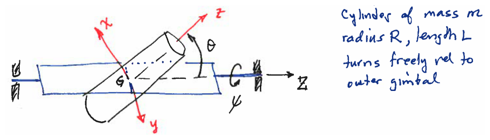
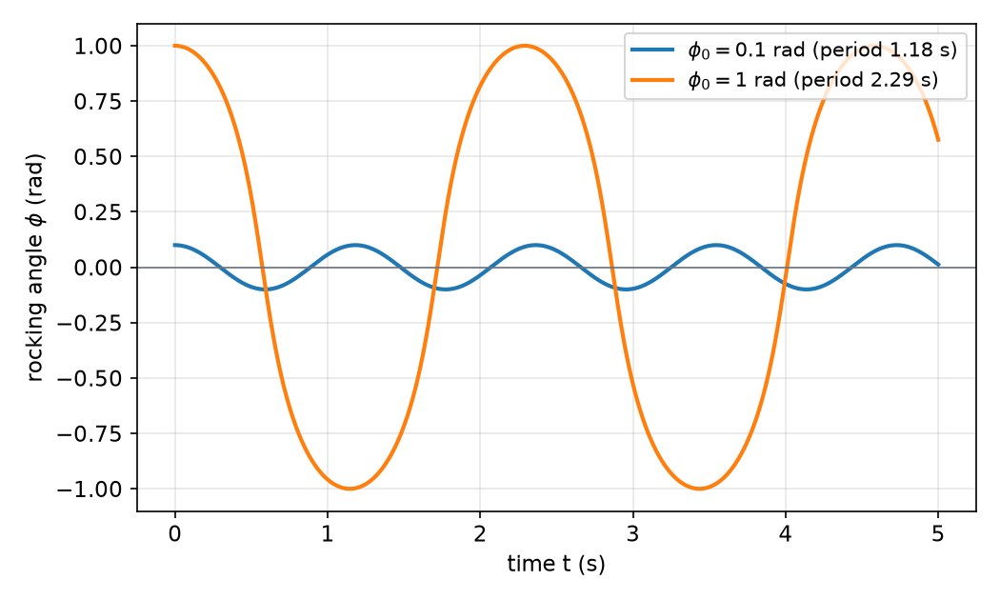

# Lagrange's Equations

Newton–Euler equations treat each body separately and carry every constraint force as an unknown. For a linkage of several bodies the number of unknowns grows quickly, and most of them are reactions that do no work and are not needed for the motion. Lagrange's equations avoid both problems. They are written in terms of two scalars, the kinetic energy \\(T\\) and the potential energy \\(V\\), together with the generalized forces, which come only from the forces that do work, so constraint forces that do no virtual work never appear. This chapter derives the equations from D'Alembert's principle, shows how generalized forces are computed, and works through examples on rods, a gimbal, a linkage, a rocking block and a gyroscope. Constraints that cannot be removed by a choice of coordinates are treated in [Constrained Systems and Their Simulation](constrained-systems.md).

## Generalized Coordinates

Let the configuration of a system be described by coordinates \\(q\_1,\dots,q\_N\\). The position of any point \\(P\\) is then a function \\(\bar r\_P(q\_1,\dots,q\_N,t)\\), and its velocity is

\\[
\bar v\_P = \sum\_{k=1}^{N}\frac{\partial\bar r\_P}{\partial q\_k}\dot q\_k + \frac{\partial\bar r\_P}{\partial t}.
\\]

The coordinates are **independent** when every set of values is admissible, that is, when no constraint relates them. The number of independent coordinates equals the number of degrees of freedom \\(n\\). Most of the examples below choose such coordinates directly, so that the constraints are satisfied by construction. When a natural choice of coordinates is redundant, the multiplier form of Lagrange's equations in [Constrained Systems and Their Simulation](constrained-systems.md) applies instead.

Two identities do most of the work in the derivation. Both follow from the velocity expression above:

\\[
\frac{\partial\bar v\_P}{\partial\dot q\_k} = \frac{\partial\bar r\_P}{\partial q\_k},
\qquad
\frac{d}{dt}\Big(\frac{\partial\bar r\_P}{\partial q\_k}\Big) = \frac{\partial\bar v\_P}{\partial q\_k}.
\\]

The first holds because \\(\dot q\_k\\) appears in the velocity only through the term \\(\frac{\partial\bar r\_P}{\partial q\_k}\dot q\_k\\). The second holds because the order of differentiation with respect to time and with respect to \\(q\_k\\) can be interchanged for a smooth function \\(\bar r\_P\\). Both identities are used repeatedly, and together they explain why the velocity expression alone supplies the coefficients of the equations.

A **virtual displacement** is an imagined infinitesimal change of configuration at a fixed instant of time, consistent with the constraints. For independent coordinates it is

\\[
\delta\bar r\_P = \sum\_{k=1}^{N}\frac{\partial\bar r\_P}{\partial q\_k}\delta q\_k .
\\]

A constraint force \\(\bar f\_P\\) is **ideal** when it does no work in any virtual displacement, \\(\sum\_P\bar f\_P\cdot\delta\bar r\_P = 0\\). Frictionless pins and guides, smooth contacts and rolling without slip are ideal, because for rolling the contact point has no virtual displacement. Friction with slip is not ideal, and its work must be counted as a generalized force. Every constraint in this chapter is taken to be ideal.

## D'Alembert's Principle and Lagrange's Equations

Newton's second law for a point \\(P\\) with applied force \\(\bar F\_P\\) and constraint force \\(\bar f\_P\\) reads \\(\bar F\_P+\bar f\_P=m\_P\bar a\_P\\). Take the dot product with \\(\delta\bar r\_P\\) and sum over all points. Because the constraint forces do no virtual work, the result is D'Alembert's principle:

\\[
\sum\_P\big(\bar F\_P - m\_P\bar a\_P\big)\cdot\delta\bar r\_P = 0 .
\\]

Each term of the inertia part can be written in terms of the kinetic energy. Using the product rule and the second identity above,

\\[
m\_P\bar a\_P\cdot\frac{\partial\bar r\_P}{\partial q\_k}
= \frac{d}{dt}\Big(m\_P\bar v\_P\cdot\frac{\partial\bar r\_P}{\partial q\_k}\Big) - m\_P\bar v\_P\cdot\frac{d}{dt}\Big(\frac{\partial\bar r\_P}{\partial q\_k}\Big)
= \frac{d}{dt}\Big(m\_P\bar v\_P\cdot\frac{\partial\bar v\_P}{\partial\dot q\_k}\Big) - m\_P\bar v\_P\cdot\frac{\partial\bar v\_P}{\partial q\_k}.
\\]

With \\(T\_P=\tfrac12 m\_P\bar v\_P\cdot\bar v\_P\\), the two terms are exactly \\(\partial T\_P/\partial\dot q\_k\\) and \\(\partial T\_P/\partial q\_k\\), so

\\[
m\_P\bar a\_P\cdot\frac{\partial\bar r\_P}{\partial q\_k} = \frac{d}{dt}\Big(\frac{\partial T\_P}{\partial\dot q\_k}\Big) - \frac{\partial T\_P}{\partial q\_k}.
\\]

The applied forces give the **generalized forces**

\\[
Q\_k = \sum\_P\bar F\_P\cdot\frac{\partial\bar r\_P}{\partial q\_k}, \qquad\text{so that}\qquad \sum\_P\bar F\_P\cdot\delta\bar r\_P = \sum\_{k}Q\_k\\,\delta q\_k .
\\]

Substituting both results into D'Alembert's principle and writing \\(T=\sum\_P T\_P\\) gives

\\[
\sum\_{k=1}^{N}\Big[\frac{d}{dt}\Big(\frac{\partial T}{\partial\dot q\_k}\Big) - \frac{\partial T}{\partial q\_k} - Q\_k\Big]\delta q\_k = 0 .
\\]

The virtual displacements \\(\delta q\_k\\) are arbitrary, so each bracket must vanish. This gives **Lagrange's equations**,

\\[
\frac{d}{dt}\Big(\frac{\partial T}{\partial\dot q\_k}\Big) - \frac{\partial T}{\partial q\_k} = Q\_k, \qquad k=1,\dots,n .
\\]

When the applied forces include conservative forces with potential \\(V(q,t)\\), their generalized forces are \\(-\partial V/\partial q\_k\\). Moving them to the left-hand side and writing \\(L=T-V\\) gives the common form

\\[
\frac{d}{dt}\Big(\frac{\partial L}{\partial\dot q\_k}\Big) - \frac{\partial L}{\partial q\_k} = Q^{nc}\_k ,
\\]

where \\(Q^{nc}\_k\\) includes only the nonconservative forces. For a spring, \\(V=\tfrac12k(\ell-\ell\_0)^2\\) with \\(\ell\\) the current length. For gravity, \\(V=mgh\\) with \\(h\\) the height of the mass center.

**Rigid bodies.** For a rigid body the kinetic energy is \\(T=\tfrac12 m\bar v\_G\cdot\bar v\_G+\tfrac12\bar\omega\cdot\bar H\_G\\), which in principal axes is \\(\tfrac12\\{\omega\\}^T[I\_G]\\{\omega\\}\\) (see [Inertia and Momentum of Rigid Bodies](inertia-momentum.md)). The rotational part of the virtual work is \\(\bar M\cdot\delta\bar\theta\\), and the virtual rotation is \\(\delta\bar\theta=\sum\_k(\partial\bar\omega/\partial\dot q\_k)\\,\delta q\_k\\). The vector \\(\partial\bar\omega/\partial\dot q\_k\\) is the **partial angular velocity**, the rotational analogue of \\(\partial\bar v/\partial\dot q\_k\\). Carrying the same steps through for the rotational terms gives Lagrange's equations for systems of rigid bodies, with generalized forces

\\[
Q\_k = \sum\_P\bar F\_P\cdot\frac{\partial\bar v\_P}{\partial\dot q\_k} + \sum\_B\bar M\_B\cdot\frac{\partial\bar\omega\_B}{\partial\dot q\_k}.
\\]

The partial velocities in this formula are the same ones that appear in the velocity expressions, so the work of every force and moment can be read off the kinematics.

## Generalized Forces

The formula for \\(Q\_k\\) is the statement that a force does work through the velocity of its point of application. In practice one writes the velocity of each point, takes the partial derivative with respect to each \\(\dot q\_k\\), and dots it with the force. Three observations simplify most calculations.

- A force perpendicular to the velocity of its point of application makes no contribution to that generalized force. A reaction along a constraint direction therefore drops out.
- A follower force, which always points along a link, contributes only through the displacement of its point of application. The double pendulum of [Constrained Systems and Their Simulation](constrained-systems.md) has such a force.
- A prescribed motion that is not a coordinate, such as a rotation at a fixed rate, enters through the terms it produces in \\(T\\) and \\(V\\). If the torque that maintains it is wanted, the rotation is promoted to a coordinate, as in Example 6.6.

## Procedure

The steps below apply to every example in this chapter.

1. Choose independent coordinates. Their number is the number of degrees of freedom.
2. Find the position and angular velocity of each body in terms of the coordinates, and differentiate to obtain \\(\bar v\\) and \\(\bar\omega\\).
3. Form \\(T\\) from the particle and rigid-body terms, and \\(V\\) from the conservative forces.
4. Compute the generalized forces \\(Q\_k\\) from the nonconservative forces and moments.
5. Form the \\(n\\) equations, collect the terms in \\(\ddot q\\), and write them as \\(M(q)\ddot q = F(q,\dot q,t)\\) for numerical solution.
6. Check the result. A coordinate that appears in \\(T\\) only through its velocity and is absent from \\(V\\) and \\(Q\\) is cyclic, and its momentum \\(\partial T/\partial\dot q\_k\\) is conserved. For conservative systems \\(T+V\\) is constant. A special case can often be compared with a Newton–Euler solution.

## Worked Examples

**Example 6.1 (One coordinate: a rod on a floor and an incline).** A uniform rod of mass \\(m\\) and length \\(L\\) has \\(I\_C=mL^2/12\\). Its end \\(A\\) rests on a frictionless horizontal floor and its end \\(B\\) on a frictionless incline that rises from the corner \\(O\\) at angle \\(\beta\\). Let \\(\theta\\) be the angle of the rod above the floor. The two contacts remove two of the three planar coordinates of the center \\(C\\), so one coordinate suffices.

*Geometry.* Since \\(A\\) is on the floor, the height of \\(C\\) is \\(y\_C=\tfrac L2\sin\theta\\). The point \\(B\\) lies at \\(\bar r\_B=\bar r\_C+\tfrac L2(\cos\theta,\sin\theta)\\) and must lie on the incline line through \\(O\\) with unit normal \\((-\sin\beta,\cos\beta)\\). The condition \\(\bar r\_B\cdot(-\sin\beta,\cos\beta)=0\\) gives, after solving for the horizontal position of \\(C\\),

\\[
x\_C = \frac L2\big(2\cot\beta\\,\sin\theta - \cos\theta\big).
\\]

Differentiating,

\\[
\dot x\_C = \frac L2\dot\theta\big(2\cot\beta\cos\theta + \sin\theta\big), \qquad \dot y\_C = \frac L2\dot\theta\cos\theta .
\\]

*Kinetic energy.* Combining the two components,

\\[
\bar v\_C\cdot\bar v\_C = \frac{L^2\dot\theta^2}{4\sin^2\beta}\\,f(\theta), \qquad f(\theta)=\cos^2(\beta-\theta)+\cos^2\theta+2\cos\theta\cos\beta\cos(\beta-\theta).
\\]

The identity is checked by multiplying the bracket \\((2\cot\beta\cos\theta+\sin\theta)^2+\cos^2\theta\\) by \\(\sin^2\beta\\) and expanding. Writing \\(J(\theta)=mL^2f(\theta)/(4\sin^2\beta)+I\_C\\), the kinetic energy is \\(T=\tfrac12J(\theta)\dot\theta^2\\).

*Potential energy and generalized force.* \\(V=mg\tfrac L2\sin\theta\\). The contacts are frictionless, so \\(Q\_\theta=0\\).

*Equation of motion.* Lagrange's equation needs \\(\partial T/\partial\dot\theta=J\dot\theta\\) and \\(\partial T/\partial\theta=\tfrac12J'\dot\theta^2\\), where \\(J'=dJ/d\theta\\). Since \\(\partial V/\partial\theta=\tfrac12mgL\cos\theta\\),

\\[
\boxed{\\,J(\theta)\ddot\theta + \tfrac12J'(\theta)\dot\theta^2 + \tfrac12 mgL\cos\theta = 0\\,}
\\]

with

\\[
J'(\theta)=\frac{mL^2}{4\sin^2\beta}\\,f'(\theta), \qquad f'(\theta)=2\sin(\beta-\theta)\cos(\beta-\theta)-2\sin\theta\cos\theta-2\sin\theta\cos\beta\cos(\beta-\theta)+2\cos\theta\cos\beta\sin(\beta-\theta).
\\]

The equation conserves \\(\tfrac12J\dot\theta^2+\tfrac12mgL\sin\theta\\), which gives a first check. The two contact forces never appear. A Newton–Euler solution of the same rod has to find both normal forces and then eliminate them, and the result must agree with the equation above after that elimination. The multiplier form of the same problem is treated in Example 7.1.

**Example 6.2 (Two coordinates, one cyclic: a cylinder in a gimbal).** A cylinder of mass \\(m\\), radius \\(R\\) and length \\(L\\) is pivoted at its center \\(G\\) inside a massless gimbal. The gimbal turns about a fixed horizontal axis \\(Z\\) through \\(G\\) by the angle \\(\psi\\), and the cylinder turns relative to the gimbal by the angle \\(\theta\\) about the gimbal's transverse axis. Body axes \\(xyz\\) are principal at \\(G\\), with \\(z\\) along the cylinder axis and \\(y\\) along the transverse axis. The inertias are \\(I\_{xx}=I\_{yy}=m(3R^2+L^2)/12\\) and \\(I\_{zz}=mR^2/2\\).

*Figure: the cylinder of Example 6.2. The gimbal turns by \\(\psi\\) about the fixed axis \\(Z\\). The tilt \\(\theta\\) is measured from \\(Z\\) to the cylinder axis \\(z\\), and the body axes \\(xyz\\) are attached at the pivot \\(G\\).*

The angular velocity is \\(\bar\omega=\dot\theta\bar j+\dot\psi\bar K\\), with \\(\bar K=-\sin\theta\\,\bar i+\cos\theta\\,\bar k\\) the direction of \\(Z\\), so

\\[
\omega\_x=-\dot\psi\sin\theta,\qquad \omega\_y=\dot\theta,\qquad \omega\_z=\dot\psi\cos\theta .
\\]

Since \\(G\\) is fixed, \\(V=0\\) and there are no nonconservative moments, so \\(Q\_\theta=Q\_\psi=0\\). The kinetic energy is

\\[
T=\tfrac12\big[I\_{xx}(\dot\theta^2+\dot\psi^2\sin^2\theta)+I\_{zz}\dot\psi^2\cos^2\theta\big].
\\]

For \\(\theta\\), \\(\partial T/\partial\dot\theta=I\_{xx}\dot\theta\\) and \\(\partial T/\partial\theta=(I\_{xx}-I\_{zz})\dot\psi^2\sin\theta\cos\theta\\), so

\\[
I\_{xx}\ddot\theta - (I\_{xx}-I\_{zz})\dot\psi^2\sin\theta\cos\theta = 0 .
\\]

This is Euler's equation about the \\(y\\) axis, as it must be, because \\(y\\) is a principal axis through the fixed point \\(G\\).

For \\(\psi\\), the coordinate does not appear in \\(T\\) or \\(V\\), so it is cyclic and

\\[
\frac{\partial T}{\partial\dot\psi}=\big(I\_{xx}\sin^2\theta+I\_{zz}\cos^2\theta\big)\dot\psi = h,
\\]

where \\(h\\) is a constant. This quantity is \\(\bar H\_G\cdot\bar K\\), the component of angular momentum along the fixed axis \\(Z\\). It is conserved because the bearings exert no moment about \\(Z\\). The precession rate therefore follows the tilt through \\(\dot\psi=h/(I\_{xx}\sin^2\theta+I\_{zz}\cos^2\theta)\\), and the \\(\theta\\) equation governs how the tilt itself evolves.

**Example 6.3 (The spherical pendulum from energy).** A bob of mass \\(m\\) hangs on a cable of fixed length \\(r\\) from a fixed point \\(O\\), with \\(\phi\\) measured from the upward vertical and \\(\theta\\) the azimuth. The kinetic energy is \\(T=\tfrac12 mr^2(\dot\phi^2+\dot\theta^2\sin^2\phi)\\) and the potential energy is \\(V=mgr\cos\phi\\). Since \\(\theta\\) is cyclic, \\(\partial T/\partial\dot\theta=mr^2\sin^2\phi\\,\dot\theta\\) is constant. The \\(\phi\\) equation is

\\[
r\ddot\phi = r\dot\theta^2\sin\phi\cos\phi + g\sin\phi .
\\]

These are the equations derived from force balance in [Particle Kinematics](particle-kinematics.md). Lagrange's equations give them directly, with no tension to eliminate. The energy \\(\tfrac12mr^2(\dot\phi^2+\dot\theta^2\sin^2\phi)+mgr\cos\phi\\) provides the integral that checks any simulation.

**Example 6.4 (A collar with a pendulum rod: a check against Newton–Euler).** A collar of mass \\(m\_1\\) slides without friction on a horizontal guide between two springs, each of stiffness \\(k\\), so that the total stiffness is \\(2k\\). A uniform rod of mass \\(m\_2\\) and length \\(L\\) hangs from a frictionless pin \\(A\\) on the collar. Let \\(x\\) be the collar position and \\(\theta\\) the angle of the rod from the downward vertical, with the springs unstretched at \\(x=0\\). The center of the rod is at \\(\bar r\_{G/A}=\tfrac L2(\sin\theta,-\cos\theta)\\), and \\(I\_A=m\_2L^2/3\\). The kinetic energy and potential energy are

\\[
T=\tfrac12(m\_1+m\_2)\dot x^2+\tfrac12m\_2L\dot x\dot\theta\cos\theta+\tfrac16m\_2L^2\dot\theta^2,\qquad V=kx^2-\tfrac12m\_2gL\cos\theta .
\\]

Lagrange's equations give

\\[
(m\_1+m\_2)\ddot x+\tfrac12m\_2L\ddot\theta\cos\theta-\tfrac12m\_2L\dot\theta^2\sin\theta+2kx=0,
\\]
\\[
\tfrac12m\_2L\ddot x\cos\theta+\tfrac13m\_2L^2\ddot\theta+\tfrac12m\_2gL\sin\theta=0 .
\\]

The first equation is the force balance on the collar and rod together. The second is the moment balance on the rod about \\(A\\). A Newton–Euler solution writes the same two balances, but for the moment about \\(A\\) it must include the anomaly term \\(\bar r\_{G/A}\times m\_2\bar a\_A\\), because \\(A\\) accelerates. Lagrange's equations include that term automatically.

Linearizing about \\(x=\theta=0\\) with \\(m\_1=1\\) kg, \\(m\_2=2\\) kg, \\(L=1\\) m and \\(k=2\\) N/m gives \\(M=\begin{bmatrix}3&1\\\\1&2/3\end{bmatrix}\\) and \\(K=\mathrm{diag}(4,\\,9.81)\\). The frequencies satisfy \\(\det(K-\omega^2M)=0\\), which with \\(\lambda=\omega^2\\) reads \\(\lambda^2-32.10\lambda+39.24=0\\). The two natural frequencies are \\(\omega\_1\approx5.55\\) rad/s and \\(\omega\_2\approx1.13\\) rad/s.

**Example 6.5 (A scissor linkage braced by a spring).** A link \\(AC\\) of mass \\(m\\) and length \\(L\\) is pinned at a fixed point \\(A\\). A second link \\(BD\\) of mass \\(\tfrac32m\\) and length \\(\tfrac32L\\) is pinned to \\(AC\\) at \\(C\\), a distance \\(L\\) from \\(B\\). The end \\(B\\) rides on a roller on the horizontal line through \\(A\\). A spring \\(k\\) joins \\(A\\) and \\(B\\), unstretched when \\(\theta=45^\circ\\). A vertical load \\(P\\) acts downward at \\(D\\). The triangle \\(ABC\\) is isosceles, so \\(AB=2L\cos\theta\\) and \\(AC\\) makes the angle \\(\theta\\) with the horizontal.

The center of \\(AC\\) is at height \\(\tfrac L2\sin\theta\\). The center of \\(BD\\) is at \\(\bar r\_{G/A}=\tfrac54L\cos\theta\\,\bar i+\tfrac34L\sin\theta\\,\bar j\\), so \\(\bar v\_G=\tfrac L4\dot\theta(-5\sin\theta,\\,3\cos\theta)\\). With \\(I\_A=mL^2/3\\) for \\(AC\\) and \\(I\_G=\tfrac9{32}mL^2\\) for \\(BD\\),

\\[
T=\tfrac12mL^2\dot\theta^2\Big(\tfrac{35}{24}+\tfrac32\sin^2\theta\Big).
\\]

The spring length is \\(2L\cos\theta\\), so \\(V=\tfrac12k\big(2L\cos\theta-\sqrt2L\big)^2+\tfrac{13}8mgL\sin\theta\\). The gravity term adds \\(\tfrac12mgL\sin\theta\\) from \\(AC\\) and \\(\tfrac98mgL\sin\theta\\) from \\(BD\\). The point \\(D\\) has \\(\bar r\_{D/A}=\tfrac L2\cos\theta\\,\bar i+\tfrac32L\sin\theta\\,\bar j\\), so \\(\delta\bar r\_D=(-\tfrac L2\sin\theta\\,\bar i+\tfrac32L\cos\theta\\,\bar j)\delta\theta\\) and \\(Q\_\theta=-\tfrac32PL\cos\theta\\). Lagrange's equation is

\\[
mL^2\Big(\tfrac{35}{24}+\tfrac32\sin^2\theta\Big)\ddot\theta+\tfrac32mL^2\dot\theta^2\sin\theta\cos\theta-2kL^2\big(2\cos\theta-\sqrt2\big)\sin\theta+\tfrac{13}8mgL\cos\theta=-\tfrac32PL\cos\theta .
\\]

The roller and the pin at \\(C\\) are ideal, so their reactions do not appear. The load \\(P\\) enters only through \\(Q\_\theta\\), which is its projection on the motion of \\(D\\).

**Example 6.6 (A rod on a precessing T-bar: prescribed rotation and the torque).** A thin rod \\(BC\\) of mass \\(m\\) and length \\(L\\) is pinned at \\(B\\) to the end of a horizontal arm of a T-bar. The point \\(B\\) is at distance \\(R\\) from the vertical axis of the T-bar, and the rod can swing by the angle \\(\theta\\) below the arm. The T-bar has moment of inertia \\(I\_T\\) about its vertical axis and turns through the angle \\(\psi\\) under a torque \\(\Gamma(t)\\). The rod's angular velocity is \\(\bar\omega=\dot\theta\bar j\_1+\dot\psi\bar k\_1\\), and the velocity of its center combines the arm's rotation with the swing. Working out the sums gives

\\[
T=\tfrac16mL^2\dot\theta^2+\tfrac12mR^2\dot\psi^2+\tfrac12mRL\dot\psi^2\cos\theta+\tfrac16mL^2\dot\psi^2\cos^2\theta+\tfrac12I\_T\dot\psi^2,\qquad V=-\tfrac12mgL\sin\theta .
\\]

The generalized forces are \\(Q\_\theta=0\\) and \\(Q\_\psi=\Gamma\\), since the torque does work only through \\(\psi\\). The equation for \\(\theta\\) is

\\[
\tfrac13mL^2\ddot\theta+\tfrac12mRL\dot\psi^2\sin\theta+\tfrac13mL^2\dot\psi^2\sin\theta\cos\theta-\tfrac12mgL\cos\theta=0 .
\\]

The equation for \\(\psi\\) concerns \\(\partial T/\partial\dot\psi\\), which is the momentum about the vertical axis. Since \\(\psi\\) does not appear in \\(T\\) or \\(V\\),

\\[
\frac{d}{dt}\Big(\frac{\partial T}{\partial\dot\psi}\Big)=\Gamma, \qquad \frac{\partial T}{\partial\dot\psi}=\dot\psi\Big[I\_T+mR^2+mRL\cos\theta+\tfrac13mL^2\cos^2\theta\Big].
\\]

The question is what torque holds the T-bar at a fixed rate \\(\dot\psi=\Omega\\). Promote \\(\psi\\) to a coordinate, which is equivalent to adding the constraint \\(\dot\psi-\Omega=0\\), and evaluate the \\(\psi\\) equation with \\(\ddot\psi=0\\):

\\[
\boxed{\\,\Gamma=-\Omega\\,\dot\theta\Big(mRL\sin\theta+\tfrac23mL^2\sin\theta\cos\theta\Big)\\,}
\\]

The torque is proportional to the rate at which the rod swings. It is the gyroscopic and Coriolis effect of the swing on the arm, and it vanishes when the rod is at rest relative to the arm. A multibody Newton–Euler computation about the pin \\(B\\), including the anomaly term, gives the same moment.

**Example 6.7 (Rocking of a box on a cylinder).** A homogeneous box of mass \\(m\\), height \\(h\\) and length \\(b\\) rolls without slip on top of a fixed cylinder of radius \\(R\\). Let \\(\phi\\) be the counterclockwise rotation of the box, measured from the upright position. Rolling without slip means that the contact point has moved a distance \\(R\phi\\) along the box. Taking the cylinder's center as the datum,

\\[
\bar r\_{G/C}=R\phi\\,\bar i+\tfrac h2\bar j, \qquad \bar v\_G=\dot\phi\bar k\times\bar r\_{G/C}=-\tfrac h2\dot\phi\\,\bar i+R\phi\dot\phi\\,\bar j ,
\\]

so that, with \\(I\_G=\tfrac1{12}m(h^2+b^2)\\),

\\[
T=\tfrac12m\Big[\big(\tfrac h2\dot\phi\big)^2+(R\phi\dot\phi)^2\Big]+\tfrac12I\_G\dot\phi^2, \qquad V=mg\big(R\cos\phi+R\phi\sin\phi+\tfrac h2\cos\phi\big).
\\]

Lagrange's equation is

\\[
\Big(I\_G+\tfrac14mh^2+mR^2\phi^2\Big)\ddot\phi+mR^2\phi\dot\phi^2+mg\big(R\phi\cos\phi-\tfrac h2\sin\phi\big)=0 .
\\]

For small \\(\phi\\) the equation linearizes to \\((I\_G+\tfrac14mh^2)\ddot\phi+mg(R-\tfrac h2)\phi=0\\). The box is stable when \\(R>h/2\\), and its small-amplitude period is \\(2\pi\sqrt{(h^2/3+b^2/12)/[g(R-h/2)]}\\). With \\(R=1\\) m, \\(h=0.04\\) m, \\(b=2\\) m and \\(g=9.81\\) m/s² the period is 1.17 s.

The integrated equation shows that the period depends on amplitude. Starting from rest with \\(m=1\\) kg, the integrated period is 1.18 s from \\(\phi(0)=0.1\\) rad and 2.29 s from \\(\phi(0)=1\\) rad. The inertia grows with \\(\phi\\) through the term \\(mR^2\phi^2\\), and the restoring stiffness falls as the swing grows, so the large swing is slower. For a tall box with \\(h=2.2\\) m, \\(h/2>R\\), and the linear stability condition fails. The integrated angle grows steadily from 0.1 rad to about 2.7 rad at \\(t=5\\) s, which is the toppling motion.

*Figure: integrated rocking of the box in Example 6.7 (\\(m=1\\) kg, \\(R=1\\) m, \\(h=0.04\\) m, \\(b=2\\) m), released from rest. The period is 1.18 s for a 0.1 rad start and 2.29 s for a 1 rad start, against the linear value of 1.17 s, so the period lengthens with amplitude.*

**Example 6.8 (A gyroscopic turn indicator).** A disk spins at a constant rate \\(\Omega\_1\\) relative to a gimbal about its axis \\(x'\\). The gimbal turns by the angle \\(\beta\\) about the axis \\(CD\\) against a torsional spring \\(k\\). The whole device precesses at a prescribed rate \\(\Omega\_2(t)\\) about the vertical \\(Z\\), and the disk center is a distance \\(L\\) from the precession axis. The disk has \\(I\_1\\) about its spin axis and \\(I\_2\\) about the transverse axes, and the gimbal is massless. The angular velocity of the disk is

\\[
\bar\omega=(\Omega\_1-\Omega\_2\sin\beta)\bar i'+\dot\beta\bar j'+\Omega\_2\cos\beta\\,\bar k' ,
\\]

so that \\(T=\tfrac12\big[I\_1(\Omega\_1-\Omega\_2\sin\beta)^2+I\_2\dot\beta^2+I\_2\Omega\_2^2\cos^2\beta\big]+\tfrac12m(L\Omega\_2)^2\\) and \\(V=\tfrac12k\beta^2\\). The last term of \\(T\\) does not depend on \\(\beta\\). The drives do no work through \\(\delta\beta\\), so \\(Q\_\beta=0\\). Lagrange's equation is

\\[
I\_2\ddot\beta+\Omega\_2\cos\beta\big(\Omega\_2(I\_2-I\_1)\sin\beta+I\_1\Omega\_1\big)+k\beta=0 .
\\]

For small \\(\beta\\) and slowly varying \\(\Omega\_2\\), the equation gives a static deflection \\(\beta\approx-I\_1\Omega\_1\Omega\_2/k\\). The deflection is proportional to the turn rate, which is how the instrument measures \\(\Omega\_2\\).

## Summary

- **Lagrange's equations:** \\(\dfrac{d}{dt}\Big(\dfrac{\partial T}{\partial\dot q\_k}\Big)-\dfrac{\partial T}{\partial q\_k}+\dfrac{\partial V}{\partial q\_k}=Q\_k\\) for \\(k=1,\dots,n\\) independent coordinates.
- **Identities:** \\(\partial\bar v/\partial\dot q\_k=\partial\bar r/\partial q\_k\\) and \\(\dfrac{d}{dt}(\partial\bar r/\partial q\_k)=\partial\bar v/\partial q\_k\\).
- **Generalized forces:** \\(Q\_k=\sum\bar F\cdot\partial\bar v/\partial\dot q\_k+\sum\bar M\cdot\partial\bar\omega/\partial\dot q\_k\\). Conservative forces enter through \\(V\\).
- **Rigid-body energy:** \\(T=\tfrac12m\bar v\_G\cdot\bar v\_G+\tfrac12\bar\omega\cdot\bar H\_G\\).
- **Cyclic coordinates:** if \\(q\_k\\) appears in neither \\(T\\) nor \\(V\\) and \\(Q\_k=0\\), then \\(\partial T/\partial\dot q\_k\\) is constant.
- **Single-coordinate form:** a rod on a floor and an incline reduces to \\(J\ddot\theta+\tfrac12J'\dot\theta^2+\tfrac12mgL\cos\theta=0\\).
- **Prescribed rotation:** promote the rotation to a coordinate, and its generalized force is the torque that must be applied.

## See Also

- [Constrained Systems and Their Simulation](constrained-systems.md): Lagrange's equations with multipliers when coordinates are redundant, and numerical integration of the results.
- [Kane's Method](kanes-method.md): the same dynamics written with generalized speeds, which handles nonholonomic constraints.
- [Newton–Euler Equations of Rigid-Body Motion](newton-euler.md): the force and moment balances that Lagrange's equations replace.
- [Particle Kinematics](particle-kinematics.md) and [Rotating Frames and Relative Motion](relative-motion.md): the velocity expressions that Lagrange's equations need.
- [Inertia and Momentum of Rigid Bodies](inertia-momentum.md): the kinetic energy of a rigid body.
- [Lagrangian Mechanics](../../../physics/classical/lagrangian.md): the physics viewpoint on the same equations.
- [Dynamics](../README.md): the overview chapters, including [Energy](../energy.md) and [Vibrations](../vibrations.md).
- [Manipulator Dynamics](../../../app/robotics/manipulators/dynamics.md): Lagrange's equations applied to robot arms.
