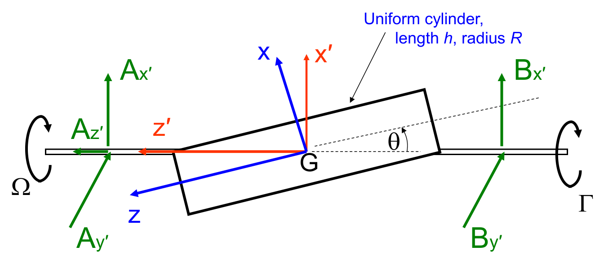
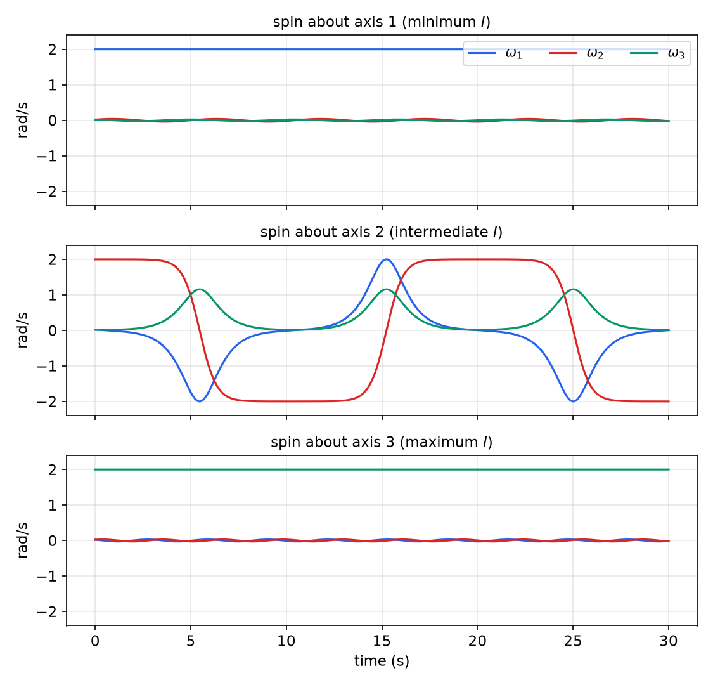
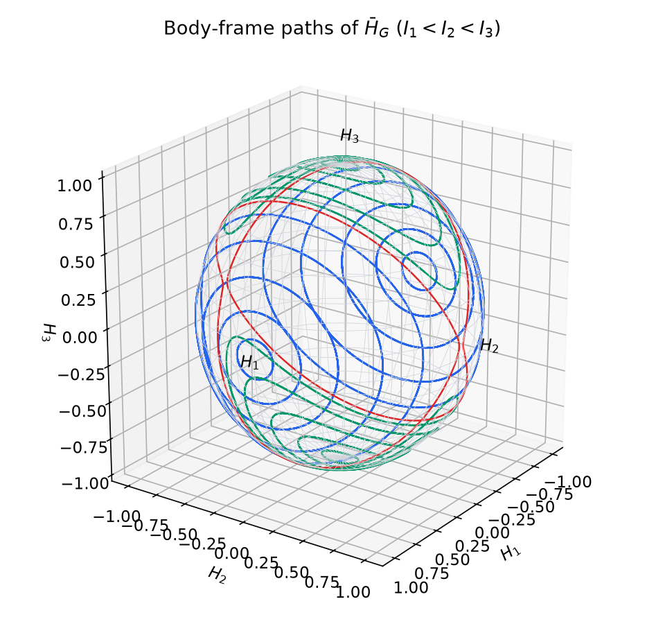
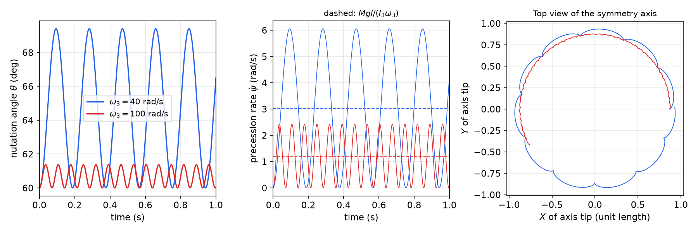
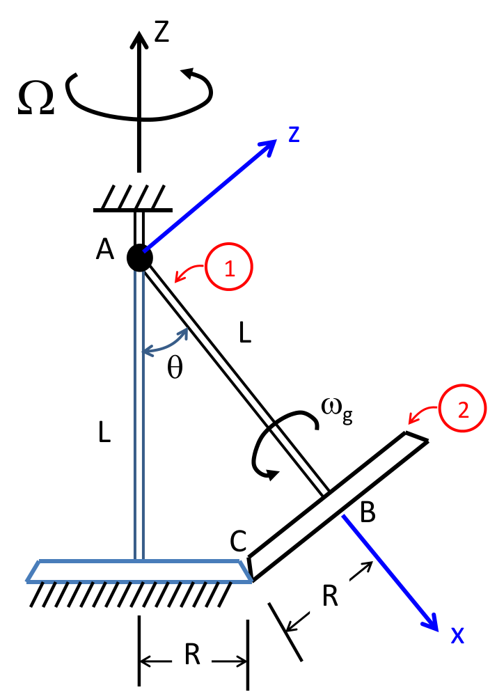
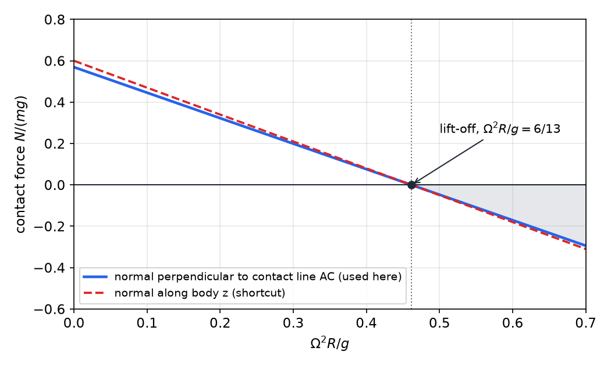
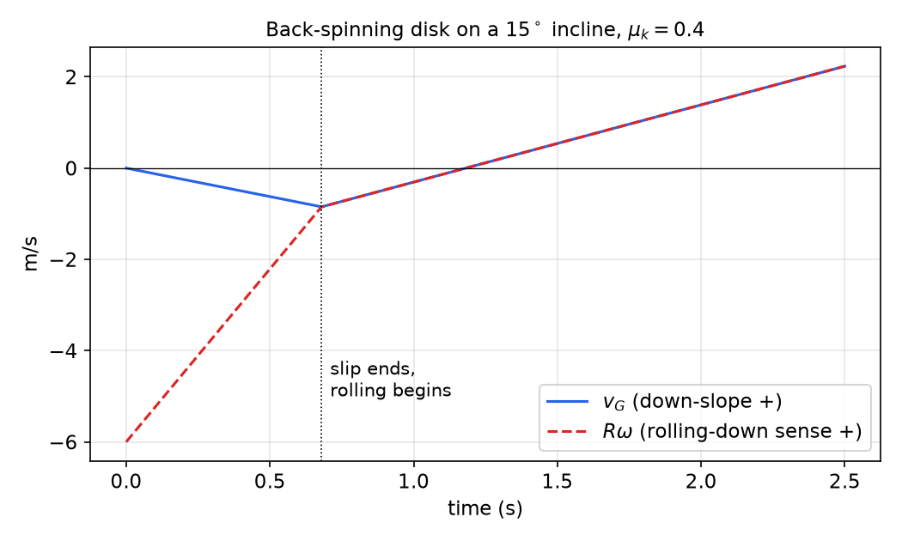

# Newton–Euler Equations of Rigid-Body Motion

The previous chapter, [Inertia and Momentum of Rigid Bodies](inertia-momentum.md), produced the two principles \\(\Sigma\bar F = m\bar a\_G\\) and \\(\Sigma\bar M\_A = \dot{\bar H}\_A\\), together with the inertia matrix that turns angular velocity into angular momentum. This chapter turns them into working equations of motion for a rigid body in three dimensions. The central step is differentiating \\(\bar H\\) in a rotating frame, which yields Euler's equations and with them the characteristically three-dimensional effects: bearing reactions on a body that spins at constant speed, gyroscopic precession and nutation, and the gyroscopic loads in rolling bodies. The chapter closes with planar problems involving friction and slip, and with the work–energy principle, which gives an energy route to the same motion.

## The Newton–Euler Equations

### Six scalar equations per body

For a single rigid body the momentum principles give
\\[
\boxed{\Sigma\bar F = m\bar a\_G,\qquad \Sigma\bar M\_A = \dot{\bar H}\_A\quad(A = G\ \text{or}\ A\ \text{a fixed point})}
\\]
The first is three scalar equations for the motion of the mass center; the second is three for the rotation. If moments are taken about any other point, the anomaly term must be kept: \\(\Sigma\bar M\_A = \dot{\bar H}\_A + \bar r\_{G/A}\times m\bar a\_A\\). The forces and moments include every external load, applied forces, gravity and the reactions of supports and of other bodies, and the reactions are usually among the unknowns.

### Differentiating angular momentum in a moving frame

The angular momentum is most easily written in components along axes in which the inertia matrix is constant, which means axes that move with the body. For a vector expressed in a frame \\(xyz\\) rotating with angular velocity \\(\bar\omega\_{xyz}\\), the transport theorem of [Rotating Frames and Relative Motion](relative-motion.md) gives
\\[
\dot{\bar H} = \Big(\frac{\partial\bar H}{\partial t}\Big)\_{xyz} + \bar\omega\_{xyz}\times\bar H ,
\\]
where the first term differentiates only the components. Three choices of frame are common.

1. **Body-fixed axes** (\\(\bar\omega\_{xyz} = \bar\omega\\)). The inertia matrix is constant, and the derivatives of the components of \\(\bar\omega\\) are the components of \\(\bar\alpha\\). Then
\\[
\boxed{\\{\Sigma M\\} = [I]\\{\alpha\\} + [\tilde\omega][I]\\{\omega\\}},\qquad [\tilde\omega] = \begin{bmatrix} 0 & -\omega\_z & \omega\_y \\\\ \omega\_z & 0 & -\omega\_x \\\\ -\omega\_y & \omega\_x & 0 \end{bmatrix},
\\]
valid for any body-fixed axes, principal or not. The matrix \\([\tilde\omega]\\) is the matrix of the cross product \\(\bar\omega\times\\).
2. **Principal axes that are not body-fixed** (\\(\bar\omega\_{xyz}\neq\bar\omega\\)). For an axisymmetric body such as a disk, wheel, rotor or sphere, a frame that follows the symmetry axis without spinning keeps the inertia matrix constant and diagonal. Then \\((\partial\bar H/\partial t)\_{xyz} = [I]\\,\tfrac{d}{dt}\\{\omega\\}\\), and the cross product uses \\(\bar\omega\_{xyz}\\). Note that \\(\tfrac{d}{dt}\\{\omega\\}\\) is now not the column of components of \\(\bar\alpha\\).
3. **Fixed (inertial) axes.** The derivative of \\(\bar H\\) is just the derivative of its components, but the inertia matrix changes as the body turns, so this is rarely convenient.

### Procedure

For each body, in order:

1. **Kinematics.** Choose the frame for \\(\bar H\\). Find \\(\bar\omega\\), \\(\bar\omega\_{xyz}\\) and \\(\bar a\_G\\) (or the acceleration of the reference point), using constraints such as rolling contact to eliminate dependent rates.
2. **Free-body diagram.** Show every external force and couple, including the unknown reactions, with explicit sign conventions.
3. **Inertia.** Write \\([I]\\) at \\(G\\) or at the fixed point, in the chosen axes, and form \\(\\{H\\} = [I]\\{\omega\\}\\).
4. **Equations.** Write \\(\Sigma\bar F = m\bar a\_G\\) and \\(\Sigma\bar M = \dot{\bar H}\\) in components.
5. **Solve.** Count unknowns, accelerations and reactions, against equations. Components along a free joint axis carry no reaction moment and give the equation of motion. The remaining components determine the reactions.

## Euler's Equations

If the body-fixed axes are principal, \\([I] = \mathrm{diag}(I\_{xx}, I\_{yy}, I\_{zz})\\), and the matrix equation reduces to the form Euler published in 1758.

**Theorem (Euler's equations).** For body-fixed principal axes at \\(G\\) (or at a fixed point of the body),
\\[
\boxed{\begin{aligned}
\Sigma M\_x &= I\_{xx}\alpha\_x - (I\_{yy} - I\_{zz})\\,\omega\_y\omega\_z,\\\\
\Sigma M\_y &= I\_{yy}\alpha\_y - (I\_{zz} - I\_{xx})\\,\omega\_z\omega\_x,\\\\
\Sigma M\_z &= I\_{zz}\alpha\_z - (I\_{xx} - I\_{yy})\\,\omega\_x\omega\_y .
\end{aligned}}
\\]

*Proof.* With \\(\\{H\\} = \\{I\_{xx}\omega\_x, I\_{yy}\omega\_y, I\_{zz}\omega\_z\\}^T\\), the \\(x\\) component of \\(\bar\omega\times\bar H\\) is \\(\omega\_yI\_{zz}\omega\_z - \omega\_zI\_{yy}\omega\_y = -(I\_{yy}-I\_{zz})\omega\_y\omega\_z\\). The other two follow by the cyclic permutation \\(x\to y\to z\to x\\). \\(\square\\)

The products \\(\omega\_y\omega\_z\\) and so on are the **gyroscopic terms**. They make the rotational equations nonlinear and coupled even with no applied moment. They vanish only when the body rotates about a principal axis or when the relevant moments of inertia are equal.

## Example: Cylinder Mounted Obliquely on a Shaft

**Example 5.1 (Cylinder welded to a rotating shaft).** A uniform cylinder of mass \\(m\\), length \\(h\\) and radius \\(R\\) is welded to a shaft so that its axis \\(z\\) makes angle \\(\theta\\) with the shaft axis \\(z'\\). The shaft passes diagonally through the cylinder, so \\(\tan\theta = 2R/h\\). The shaft turns at rate \\(\Omega\\), possibly varying, and is driven by a torque \\(\Gamma\\). Bearing \\(A\\), a thrust bearing with forces \\(A\_{x'}, A\_{y'}, A\_{z'}\\), and bearing \\(B\\), with forces \\(B\_{x'}, B\_{y'}\\), are each \\(L/2\\) from \\(G\\). Neglecting gravity, find \\(\Gamma\\) and the bearing reactions.

*Figure: the cylinder, with principal axes \\(xyz\\) (\\(z\\) along the cylinder) and shaft axes \\(x'y'z'\\) (\\(z'\\) along the shaft), sharing the origin \\(G\\) and the axis \\(y = y'\\). Both frames rotate with the body. Bearing forces are shown in green, with the speed \\(\Omega\\) at one end of the shaft and the torque \\(\Gamma\\) at the other.*

*Solution 1: principal axes.* Both frames are body-fixed. The principal inertias at \\(G\\) are \\(I\_{xx} = I\_{yy} = m(\tfrac{R^2}4 + \tfrac{h^2}{12})\\) and \\(I\_{zz} = \tfrac12mR^2\\). Since \\(\bar k' = \sin\theta\\,\bar i + \cos\theta\\,\bar k\\),
\\[
\bar\omega = \Omega\bar k' = \Omega(\sin\theta\\,\bar i + \cos\theta\\,\bar k),\qquad \bar\alpha = \dot\Omega(\sin\theta\\,\bar i + \cos\theta\\,\bar k).
\\]
With \\(\omega\_y = 0\\), Euler's equations give
\\[
\Sigma M\_{Gx} = I\_{xx}\dot\Omega\sin\theta,\qquad \Sigma M\_{Gy} = (I\_{xx} - I\_{zz})\Omega^2\sin\theta\cos\theta,\qquad \Sigma M\_{Gz} = I\_{zz}\dot\Omega\cos\theta .
\\]
The moment of the bearing forces and torque is easiest in the shaft frame, \\(\Sigma\bar M\_G = (B\_{y'} - A\_{y'})\tfrac L2\\,\bar i' + (A\_{x'} - B\_{x'})\tfrac L2\\,\bar j' + \Gamma\bar k'\\). Transforming with \\(\bar i' = \cos\theta\\,\bar i - \sin\theta\\,\bar k\\), \\(\bar j' = \bar j\\) and \\(\bar k' = \sin\theta\\,\bar i + \cos\theta\\,\bar k\\), and equating the two expressions for each component,
\\[
\begin{aligned}
(1)\quad & I\_{xx}\dot\Omega\sin\theta = \tfrac L2\cos\theta\\,(B\_{y'} - A\_{y'}) + \Gamma\sin\theta,\\\\
(2)\quad & (I\_{xx} - I\_{zz})\Omega^2\sin\theta\cos\theta = \tfrac L2(A\_{x'} - B\_{x'}),\\\\
(3)\quad & I\_{zz}\dot\Omega\cos\theta = -\tfrac L2\sin\theta\\,(B\_{y'} - A\_{y'}) + \Gamma\cos\theta .
\end{aligned}
\\]
Forming \\(\sin\theta\times(1) + \cos\theta\times(3)\\) eliminates the bearing forces:
\\[
\boxed{\Gamma = \big(I\_{xx}\sin^2\theta + I\_{zz}\cos^2\theta\big)\dot\Omega}
\\]
Since \\(G\\) lies on the shaft axis, \\(\bar a\_G = \bar 0\\), so \\(A\_{x'} + B\_{x'} = 0\\), \\(A\_{y'} + B\_{y'} = 0\\) and \\(A\_{z'} = 0\\). Equation (2) and the combination \\(\cos\theta\times(1) - \sin\theta\times(3)\\) then give
\\[
\boxed{A\_{x'} = -B\_{x'} = \frac1L(I\_{xx} - I\_{zz})\\,\Omega^2\sin\theta\cos\theta,\qquad B\_{y'} = -A\_{y'} = \frac1L(I\_{xx} - I\_{zz})\\,\dot\Omega\sin\theta\cos\theta}
\\]

*Solution 2: shaft axes (not principal).* The inertia matrix in \\(x'y'z'\\) is \\([I'] = [R\_y(\theta)][I][R\_y(\theta)]^T\\), with \\(I\_{z'z'} = I\_{xx}\sin^2\theta + I\_{zz}\cos^2\theta\\), \\(I\_{x'y'} = I\_{y'z'} = 0\\) and \\(I\_{x'z'} = -(I\_{xx} - I\_{zz})\sin\theta\cos\theta\\). In these axes \\(\\{\omega'\\} = \\{0,0,\Omega\\}^T\\) and \\(\\{\alpha'\\} = \\{0,0,\dot\Omega\\}^T\\), so \\(\\{\Sigma M\_G\\} = [I']\\{\alpha'\\} + [\tilde\omega'][I']\\{\omega'\\}\\) gives directly
\\[
A\_{y'} = \tfrac1L I\_{x'z'}\dot\Omega,\qquad B\_{x'} = \tfrac1L I\_{x'z'}\Omega^2,\qquad \Gamma = I\_{z'z'}\dot\Omega ,
\\]
which are the same answers.

*Discussion.*

- The drive torque and the angular acceleration are related by the moment of inertia about the shaft, \\(\Gamma = I\_{z'z'}\dot\Omega\\), exactly as in fixed-axis planar rotation.
- The shaking forces are proportional to the product of inertia \\(I\_{x'z'}\\). At constant speed \\(\Gamma = 0\\) and \\(A\_{y'} = B\_{y'} = 0\\), but \\(A\_{x'} = -B\_{x'} \neq 0\\): a couple that turns with the shaft, which the bearings feel as a vibration at the running frequency. This is **dynamic imbalance**.
- If \\(I\_{xx} = I\_{zz}\\), which happens for \\(h = \sqrt3R\\) (a cylinder that is inertially spherical about \\(G\\)), every axis is principal, \\(\bar H\_G\\) is parallel to \\(\bar\omega\\), and the reactions vanish.
- The angular momentum \\(\bar H\_G = I\_{xx}\omega\_x\bar i + I\_{zz}\omega\_z\bar k\\) is tilted away from the shaft. As the body turns, its tip sweeps around the shaft, so \\(\dot{\bar H}\_G\\) and therefore \\(\Sigma\bar M\_G\\) point into the page at the instant shown. The bearings push up at \\(A\\) and down at \\(B\\), so \\(A\_{x'} > 0\\) and \\(B\_{x'} < 0\\) when \\(I\_{xx} > I\_{zz}\\).

## Dynamic Imbalance and Bearing Reactions

A rotor turning at constant speed about a fixed axis needs no bearing forces, beyond those carrying gravity, only if two conditions hold. Its center of mass lies on the axis (**static balance**; otherwise \\(m\bar a\_G = -m\Omega^2\bar r\_{G\perp}\\) demands a rotating force). And the axis is a principal axis at \\(G\\) (**dynamic balance**; otherwise the products of inertia make \\(\bar H\\) swing around and demand a rotating couple).

For a body spinning about a body-fixed axis \\(x\\) at rate \\(\Omega\\) through a fixed point \\(O\\), \\(\\{H\_O\\} = \Omega\\{I\_{xx}, -I\_{xy}, -I\_{xz}\\}^T\\) and
\\[
\\{\Sigma M\_O\\} = [I\_O]\\{\alpha\\} + \\{\omega\\}\times\\{H\_O\\} = \begin{Bmatrix} I\_{xx}\dot\Omega \\\\ -I\_{xy}\dot\Omega + I\_{xz}\Omega^2 \\\\ -I\_{xz}\dot\Omega - I\_{xy}\Omega^2 \end{Bmatrix}.
\\]
The \\(\Omega^2\\) terms are pure product-of-inertia effects.

**Example 5.2 (Bent rod spinning about \\(x\\)).** The bent rod of [Inertia and Momentum of Rigid Bodies](inertia-momentum.md), with \\([I\_O] = [2/3,\ 1,\ 0;\ 1,\ 8/3,\ 0;\ 0,\ 0,\ 10/3]\\) kg·m² in the chapter's stored convention, rotates about \\(x\\) at a constant 2 rad/s. Find the moment at \\(O\\) that balances the dynamic forces.

*Solution.* \\(\\{H\_O\\} = [I\_O]\\{2,0,0\\}^T = \\{4/3,\ 2,\ 0\\}^T\\). With body-fixed axes and constant \\(\bar\omega\\), \\(\Sigma\bar M\_O = \bar\omega\times\bar H\_O = 2\bar i\times(\tfrac43\bar i + 2\bar j) = 4\bar k\\) N·m. The product of inertia tilts \\(\bar H\_O\\) out of line with \\(\bar\omega\\), so a moment is needed even at constant speed. \\(\square\\)

**Example 5.3 (Rectangular plate welded diagonally to a shaft).** A thin rectangular plate of mass 0.2 kg, with sides \\(a = 60\\) mm and \\(b = 90\\) mm, is welded diagonally to a massless shaft \\(AB\\) spinning at constant \\(\Omega = 100\\) rad/s. The bearings at \\(A\\) and \\(B\\) are 100 mm on either side of \\(G\\) and supply forces but no moments. Find the bearing reactions.

*Solution.* Let \\(xyz\\) be the plate's principal axes at \\(G\\), with \\(z\\) normal to the plate, and let \\(x\_1\\) lie along the shaft, at angle \\(\beta\\) to \\(x\\) with \\(\tan\beta = a/b\\), so \\(\beta = 33.69^\circ\\). The principal inertias are
\\[
I\_{xx} = \tfrac1{12}ma^2 = 6\times10^{-5},\qquad I\_{yy} = \tfrac1{12}mb^2 = 1.35\times10^{-4},\qquad I\_{zz} = \tfrac1{12}m(a^2+b^2) = 1.95\times10^{-4}\ \text{kg·m}^2 .
\\]
The angular velocity \\(\bar\omega = \Omega(\cos\beta\\,\bar i - \sin\beta\\,\bar j)\\) is constant, so \\(\bar\alpha = \bar 0\\), and the \\(z\\) component of Euler's equations is the only one that involves no bearing force:
\\[
\Sigma M\_{Gz} = (I\_{xx} - I\_{yy})\Omega^2\cos\beta\sin\beta = -0.3462\ \text{N·m}.
\\]
The bearing forces form this couple about \\(G\\). With bearings a distance \\(\ell = 0.1\\) m from \\(G\\) and \\(\bar a\_G = \bar 0\\), \\(\bar B = -\bar A\\), and the couple gives \\(B\_{y\_1} = -A\_{y\_1} = -1.7308\\) N, with \\(A\_{z\_1} = B\_{z\_1} = 0\\). The reactions form a couple fixed in the rotating plate. \\(\square\\)

**Example 5.4 (Rod-and-hoop body on a shaft: static plus dynamic imbalance).** The rod-and-hoop body of [Inertia and Momentum of Rigid Bodies](inertia-momentum.md) has a hoop of radius \\(r = 0.1\\) m and a rod of length \\(2r\\), with mass per unit length \\(\rho A = 0.1\\) kg/m. It is welded at \\(O\\) to the middle of a shaft \\(AB\\) of length 1 m, which spins at a constant \\(\omega = 20\\) rad/s about \\(y\\). The bearings are thin, and gravity is neglected. Find the bearing forces.

*Solution.* From the inertia chapter, \\(\\{H\_O\\} = \rho Ar^3\omega\\{0,\ 30.9410,\ -12.5664\\}^T\\), so the moment about \\(O\\) is
\\[
\Sigma\bar M\_O = \bar\omega\times\bar H\_O = -12.5664\\,\rho A\omega^2r^3\\,\bar i = -0.5027\\,\bar i\ \text{N·m}.
\\]
The center of mass is off the axis. The rod has mass \\(m\_1 = 0.02\\) kg and the hoop \\(m\_2 = 0.0628\\) kg, so \\(m = 0.0828\\) kg and \\(\bar r\_{G/O} = (0,\ -0.0759,\ -0.1759)\\) m. Then \\(m\bar a\_G = m\\,\bar\omega\times(\bar\omega\times\bar r\_{G/O}) = 5.8265\\,\bar k\\) N. The bearing equations are
\\[
A\_z + B\_z = 5.8265\ \text{N},\qquad (B\_z - A\_z)\tfrac L2 = -0.5027\ \text{N·m}\quad(L = 1\ \text{m}),
\\]
which give \\(A\_z = 3.4159\\) N and \\(B\_z = 2.4106\\) N. All other components vanish. The static imbalance, from the offset of \\(G\\), contributes equal shares to the two bearings, and the dynamic imbalance, from the product \\(I\_{yz}\\), shifts load from one bearing to the other. \\(\square\\)

**Example 5.5 (Wobble plate: disk on a bent shaft).** A thin disk of mass \\(m\\) and radius \\(R\\) spins at constant rate \\(\omega\_2\\) relative to a bent shaft \\(AB\\), which turns at constant \\(\omega\_1\\) about the fixed horizontal axis \\(x\_1\\). The disk's spin axis \\(x\_2\\) is tilted by \\(\theta\\) from \\(x\_1\\), and \\(G\\) is midway between bearings \\(A\\) and \\(B\\), each at distance \\(L\\). Find \\(\bar H\_G\\) and the bearing reactions.

*Solution.* Use axes \\(x\_2y\_2z\_2\\) fixed to the shaft at \\(G\\). They are principal for the disk, which is axisymmetric, but they do not spin with it, so \\(\bar\omega\_{xyz} = \omega\_1\bar i\_1 = \omega\_1(\cos\theta\\,\bar i\_2 + \sin\theta\\,\bar j\_2)\\). The disk's angular velocity is \\(\bar\omega = \omega\_1\bar i\_1 + \omega\_2\bar i\_2 = (\omega\_2 + \omega\_1\cos\theta)\bar i\_2 + \omega\_1\sin\theta\\,\bar j\_2\\), so
\\[
\bar H\_G = \tfrac12mR^2(\omega\_2 + \omega\_1\cos\theta)\\,\bar i\_2 + \tfrac14mR^2\omega\_1\sin\theta\\,\bar j\_2 .
\\]
Its components are constant in \\(xyz\\), so \\(\dot{\bar H}\_G = \bar\omega\_{xyz}\times\bar H\_G\\), and
\\[
\Sigma\bar M\_G = \Big[\tfrac14mR^2\omega\_1^2\cos\theta\sin\theta - \tfrac12mR^2(\omega\_2 + \omega\_1\cos\theta)\\,\omega\_1\sin\theta\Big]\bar k\_2 .
\\]
The bearing reactions form a couple about \\(G\\) in the plane of \\(\bar i\_1\\) and \\(\bar j\_1\\), with \\(\bar B = -\bar A = (\Sigma M\_G\cdot\bar k\_2)\\,\bar j\_1/(2L)\\) and \\(A\_z = B\_z = 0\\). The couple is nonzero even for \\(\omega\_2 = 0\\), so a tilted disk is a dynamic imbalance, and the spin adds a gyroscopic part that grows with the spin rate. \\(\square\\)

## Torque-Free Motion

With no applied moment about \\(G\\), for example a satellite, a thrown object in free fall, or a body supported at \\(G\\) by frictionless gimbals, \\(\dot{\bar H}\_G = \bar 0\\). The angular momentum is then fixed in inertial space, and because no moment does work, the rotational kinetic energy is also constant. In body-fixed principal axes with moments \\(I\_1, I\_2, I\_3\\),
\\[
I\_1\dot\omega\_1 = (I\_2 - I\_3)\omega\_2\omega\_3,\qquad I\_2\dot\omega\_2 = (I\_3 - I\_1)\omega\_3\omega\_1,\qquad I\_3\dot\omega\_3 = (I\_1 - I\_2)\omega\_1\omega\_2 ,
\\]
with the two integrals
\\[
H^2 = I\_1^2\omega\_1^2 + I\_2^2\omega\_2^2 + I\_3^2\omega\_3^2,\qquad 2T = I\_1\omega\_1^2 + I\_2\omega\_2^2 + I\_3\omega\_3^2 .
\\]
Multiplying the \\(k\\)th equation by \\(\omega\_k\\) and adding shows that \\(T\\) is constant. Multiplying it by \\(I\_k\omega\_k\\) and adding shows that \\(H\\) is constant.

### Permanent rotations and their stability

Uniform rotation about any principal axis is an equilibrium of these equations. To test its stability, spin the body about axis 1 at rate \\(\Omega\\) and perturb it, with \\(\omega\_1 = \Omega + \epsilon\_1\\), \\(\omega\_2 = \epsilon\_2\\) and \\(\omega\_3 = \epsilon\_3\\). To first order,
\\[
I\_1\dot\epsilon\_1 = 0,\qquad I\_2\dot\epsilon\_2 = (I\_3 - I\_1)\Omega\\,\epsilon\_3,\qquad I\_3\dot\epsilon\_3 = (I\_1 - I\_2)\Omega\\,\epsilon\_2 .
\\]
Differentiating the second and substituting the third gives
\\[
\ddot\epsilon\_2 + \frac{(I\_1 - I\_2)(I\_1 - I\_3)}{I\_2I\_3}\\,\Omega^2\epsilon\_2 = 0 .
\\]

**Theorem (intermediate-axis theorem).** Rotation of a torque-free rigid body about the principal axis of largest or of smallest moment of inertia is stable in the linearized sense, and the perturbations oscillate. Rotation about the axis of intermediate moment of inertia is unstable. For \\(I\_1 < I\_2 < I\_3\\) and spin about axis 2, the perturbations grow as \\(e^{\lambda t}\\) with
\\[
\lambda = \Omega\sqrt{\frac{(I\_3 - I\_2)(I\_2 - I\_1)}{I\_1I\_3}} .
\\]

*Proof.* For spin about axis 1, the coefficient \\((I\_1 - I\_2)(I\_1 - I\_3)\\) is positive when \\(I\_1\\) is the largest or the smallest of the three, and negative when it lies between them. Relabel for the other axes. \\(\square\\)

Linear stability of the extreme axes is confirmed nonlinearly by the two integrals. The figure shows a simulation for \\(I\_1 = 1\\), \\(I\_2 = 2\\) and \\(I\_3 = 3\\) kg·m², each case started at 2 rad/s about one axis with perturbations of 0.02 rad/s on the other two. For spin about axis 2 the predicted growth rate is \\(\lambda = 2\sqrt{1/3} = 1.15\\) s⁻¹, so a 1 percent perturbation reaches order one after about \\(\ln(100)/1.15 \approx 4\\) s. The first reversal of \\(\omega\_2\\) occurs at about 5.5 s, and reversals recur about every 9.8 s. Over the run, \\(T\\) and \\(H\\) are conserved to about \\(10^{-11}\\) relative error, which is the check on the integration.

*Figure: body-frame angular-velocity components for torque-free rotation with \\(I\_1 < I\_2 < I\_3\\). Spin about the minimum axis (top) or the maximum axis (bottom) stays close to the initial state, with a small bounded wobble. Spin about the intermediate axis (middle) is unstable: after a few seconds \\(\omega\_2\\) reverses sign as the body flips over, then returns, periodically.*

### Geometry: polhodes

In body-frame components of \\(\bar H\\), the two integrals say that \\(\bar H\\) lies on the sphere \\(H\_1^2 + H\_2^2 + H\_3^2 = H^2\\) and on the ellipsoid \\(H\_1^2/I\_1 + H\_2^2/I\_2 + H\_3^2/I\_3 = 2T\\). Their intersections are the paths that \\(\bar H\\) traces relative to the body. Near the axes of maximum and minimum inertia these are small closed loops. Through the intermediate axis passes a separatrix, at which the energy is \\(T = H^2/(2I\_2)\\), which divides the loops around axis 1 from those around axis 3.

*Figure: body-frame paths of \\(\bar H\_G\\) on the sphere of constant \\(\lvert\bar H\_G\rvert\\) for \\(I\_1 < I\_2 < I\_3\\). Blue loops circle the minimum-inertia axis \\(H\_1\\), green loops the maximum-inertia axis \\(H\_3\\), and the red curves start close to the intermediate axis \\(H\_2\\) and run along the separatrix.*

For a body that dissipates energy internally, such as one with flexing antennas or sloshing fuel, \\(H\\) stays fixed while \\(T\\) decreases. At fixed \\(H\\) the energy \\(H^2/(2I)\\) is smallest for the largest \\(I\\), so such a body drifts toward rotation about its major axis. A minimum-inertia spin is therefore stable only for a perfectly rigid body.

### The axisymmetric body

If \\(I\_1 = I\_2 = I\\), with symmetry axis 3, then \\(\omega\_3\\) is constant and the first two equations become \\(\dot\omega\_1 = -\lambda\omega\_2\\), \\(\dot\omega\_2 = \lambda\omega\_1\\), with \\(\lambda = (I\_3 - I)\omega\_3/I\\). Decomposing \\(\bar\omega\\) along and across the symmetry axis \\(\bar e\_3\\) gives \\(\bar\omega = \bar H/I + (1 - I\_3/I)\omega\_3\bar e\_3\\), so \\(\dot{\bar e}\_3 = (\bar H/I)\times\bar e\_3\\). The symmetry axis therefore cones about the fixed vector \\(\bar H\\) at the constant rate \\(H/I\\). This is the torque-free precession, or wobble, of a thrown disk or a spinning satellite.

## Gyroscopic Effects

### The gyroscopic moment

Suppose a rotor with a large spin angular momentum \\(\bar H \approx I\_s\omega\_s\bar e\\) along its axis \\(\bar e\\) has that axis turned at rate \\(\bar\Omega\\). Then \\(\dot{\bar H}\approx\bar\Omega\times\bar H\\), and a moment
\\[
\Sigma\bar M \approx \bar\Omega\times\bar H
\\]
must act on the rotor. The rotor reacts on its supports with the opposite moment. Two qualitative rules follow from \\(\Sigma\bar M = \dot{\bar H}\\). The tip of \\(\bar H\\) moves toward the applied moment, so a moment swings the spin axis sideways, at right angles to itself. And turning the spin axis at rate \\(\Omega\\) requires a moment perpendicular to both the spin axis and the turning axis, of magnitude \\(I\_s\omega\_s\Omega\\).

**Example 5.6 (Cylinder in a gimbal driven at constant rate).** A cylinder of mass \\(m\\), length \\(L\\) and radius \\(R\\) is pinned in a gimbal that rotates about the horizontal axis \\(AB\\) at constant rate \\(\Omega\\), driven by a torque \\(\Gamma\\). The cylinder pivots freely relative to the gimbal about \\(y'\\), and \\(\beta\\) is the angle between the cylinder axis and \\(AB\\). Find the equation of motion for \\(\beta\\) and the torque \\(\Gamma\\).

*Solution.* Take principal axes \\(x'y'z'\\) fixed to the cylinder, with \\(z'\\) along the symmetry axis: \\(I\_{x'x'} = I\_{y'y'} = \tfrac1{12}m(3R^2+L^2)\\) and \\(I\_{z'z'} = \tfrac12mR^2\\). With \\(\bar K = -\sin\beta\\,\bar i' + \cos\beta\\,\bar k'\\) along \\(AB\\), the angular velocity is \\(\bar\omega = \dot\beta\\,\bar j' - \Omega\bar K\\), and \\(\bar\alpha = \ddot\beta\\,\bar j' + \dot\beta(\bar\omega\times\bar j')\\). The free pivot gives \\(\Sigma M\_{y'} = 0\\), so
\\[
\boxed{(L^2 + 3R^2)\ddot\beta + (3R^2 - L^2)\Omega^2\sin\beta\cos\beta = 0}
\\]
The other two Euler components give the moments that the cylinder exerts on the gimbal, \\(\Gamma\_{x'} = \tfrac16mL^2\Omega\dot\beta\cos\beta\\) and \\(\Gamma\_{z'} = \tfrac12mR^2\Omega\dot\beta\sin\beta\\). Moments about \\(AB\\) on the massless gimbal balance, so
\\[
\boxed{\Gamma = \tfrac16m(L^2 - 3R^2)\\,\Omega\dot\beta\sin\beta\cos\beta}
\\]
As a check, the power \\(\Gamma\Omega\\) equals the rate of change of the cylinder's kinetic energy. The torque vanishes if \\(\dot\beta = 0\\) or if \\(L^2 = 3R^2\\). Linearizing about \\(\beta = 0\\) gives \\(\ddot\beta + \frac{3R^2 - L^2}{L^2 + 3R^2}\Omega^2\beta = 0\\). A slender cylinder (\\(L^2 > 3R^2\\)) is unstable aligned with \\(AB\\) and oscillates about \\(\beta = 90^\circ\\), perpendicular to the rotation axis. A rotating body prefers to turn about its axis of maximum moment of inertia. \\(\square\\)

**Example 5.7 (Spinning disk in a gimbal on a rotating frame).** A thin uniform disk of mass \\(m\\) and radius \\(R\\) spins at constant rate \\(\dot\phi\\) about \\(x\\) relative to a massless gimbal. The gimbal is carried in bearings \\(A\\) and \\(B\\), a distance \\(L\\) apart on the \\(y\\) axis, on a Y-shaped frame that turns about the vertical \\(Z\\) at rate \\(\dot\psi\\). The gimbal is held with tilt \\(\theta = 0\\), so \\(z\\) is along \\(Z\\). (a) If the spin is fast and \\(\dot\psi\\) is slow and positive, which way does the gimbal tip when released? (b) Find the moment the gimbal exerts on the disk. (c) Find the bearing reactions, neglecting gravity.

*Solution.* (a) \\(\bar H\_G\\) points essentially along \\(+x\\). Turning about \\(+Z\\) swings it toward \\(+y\\), so the required moment is along \\(+y\\). When the restraint is released, the gimbal turns the opposite way, in the \\(-y\\) sense.

(b) Use the gimbal frame \\(xyz\\), principal for the disk, with \\(\bar\omega\_{xyz} = \dot\psi\bar k\\) and \\(\bar\omega = \dot\phi\bar i + \dot\psi\bar k\\). With \\(I\_{xx} = \tfrac12mR^2\\) and \\(I\_{zz} = \tfrac14mR^2\\),
\\[
\bar H\_G = I\_{xx}\dot\phi\\,\bar i + I\_{zz}\dot\psi\\,\bar k,\qquad \Sigma\bar M\_G = \Big(\frac{\partial\bar H\_G}{\partial t}\Big)\_{xyz} + \dot\psi\bar k\times I\_{xx}\dot\phi\\,\bar i = I\_{zz}\ddot\psi\\,\bar k + \tfrac12mR^2\dot\phi\dot\psi\\,\bar j .
\\]
The \\(\bar j\\) term is the gyroscopic moment \\(\tfrac12mR^2\dot\phi\dot\psi\\). Checking with Euler's equations gives the same value: \\(I\_{yy}\alpha\_y = \tfrac14mR^2\dot\phi\dot\psi\\) and \\(-(I\_{zz} - I\_{xx})\omega\_z\omega\_x = \tfrac14mR^2\dot\phi\dot\psi\\), which sum to \\(\tfrac12mR^2\dot\phi\dot\psi\\). Keeping only the first term is a common slip.

(c) For the gimbal and disk together, with a restraining torque \\(\Gamma\\) about \\(y\\), \\(\bar a\_G = \bar 0\\) gives \\(A\_x + B\_x = 0\\), \\(A\_y = 0\\) and \\(A\_z + B\_z = 0\\). The moments give \\((B\_z - A\_z)\tfrac L2 = 0\\), \\(\Gamma = \tfrac12mR^2\dot\phi\dot\psi\\), and \\((A\_x - B\_x)\tfrac L2 = \tfrac14mR^2\ddot\psi\\). So \\(A\_z = B\_z = 0\\) and \\(A\_x = -B\_x = \tfrac14mR^2\ddot\psi/L\\). At constant \\(\dot\psi\\) no bearing forces are needed at all, only the torque \\(\Gamma\\) about the gimbal axis. \\(\square\\)

### The heavy symmetric top

A symmetric rotor with a fixed point \\(O\\) on its axis, mass center \\(G\\) at distance \\(l\\) along the axis, transverse moment of inertia \\(I\_0\\) about \\(O\\) and axial moment \\(I\_3\\), moves under gravity. Its orientation is given by Euler angles: precession \\(\psi\\) about the vertical, nutation \\(\theta\\) of the axis from the vertical, and spin \\(\phi\\). Use a frame \\(xyz\\) that follows the axis without spinning, with \\(z\\) along the axis, \\(x\\) along the horizontal line of nodes, and \\(y = z\times x\\). Then \\(\bar\omega = \dot\theta\bar i + \dot\psi\sin\theta\\,\bar j + \omega\_3\bar k\\) with the total spin \\(\omega\_3 = \dot\phi + \dot\psi\cos\theta\\), and \\(\bar H\_O = I\_0\dot\theta\\,\bar i + I\_0\dot\psi\sin\theta\\,\bar j + I\_3\omega\_3\bar k\\). Gravity gives \\(\Sigma\bar M\_O = mgl\sin\theta\\,\bar i\\). Evaluating \\(\dot{\bar H}\_O\\) term by term gives
\\[
\begin{aligned}
x:&\quad I\_0\ddot\theta - I\_0\dot\psi^2\sin\theta\cos\theta + I\_3\omega\_3\dot\psi\sin\theta = mgl\sin\theta,\\\\
y:&\quad I\_0(\ddot\psi\sin\theta + 2\dot\psi\dot\theta\cos\theta) - I\_3\omega\_3\dot\theta = 0,\\\\
z:&\quad I\_3\dot\omega\_3 = 0 .
\end{aligned}
\\]
The \\(z\\) equation says the spin is constant. Multiplying the \\(y\\) equation by \\(\sin\theta\\) shows that \\(p\_\psi = I\_0\dot\psi\sin^2\theta + I\_3\omega\_3\cos\theta\\) is conserved, because gravity has no moment about the vertical. The \\(x\\) equation is the equation of nutation.

Steady precession, with \\(\dot\theta = \ddot\theta = 0\\), satisfies \\(I\_0\cos\theta\\,\dot\psi^2 - I\_3\omega\_3\dot\psi + mgl = 0\\). For a fast top the two roots separate into a **slow precession**, \\(\dot\psi \approx mgl/(I\_3\omega\_3)\\), which is the gyroscopic balance that one sees, and a fast precession, \\(\dot\psi \approx I\_3\omega\_3/(I\_0\cos\theta)\\). A gyroscope released with its axis at rest first drops slightly, and its axis tip then bobs while advancing on average at about the slow-precession rate. The nutation frequency for a fast top is close to \\(I\_3\omega\_3/I\_0\\).

The figure integrates these equations for a disk gyroscope with \\(m = 0.5\\) kg, disk radius 0.09 m and \\(l = 0.05\\) m, so \\(I\_3 = 2.025\times10^{-3}\\), \\(I\_0 = 2.263\times10^{-3}\\) kg·m² and \\(mgl = 0.245\\) N·m. It is released at rest with \\(\theta\_0 = 60^\circ\\). At \\(\omega\_3 = 40\\) rad/s the axis nutates between \\(60^\circ\\) and \\(69.4^\circ\\) and precesses on average at about 3.1 rad/s, against a slow-precession estimate of 3.03 rad/s. At \\(\omega\_3 = 100\\) rad/s the nutation shrinks to about \\(1.4^\circ\\), and the mean precession of 1.215 rad/s matches the estimate of 1.211 rad/s.

*Figure: a pivoted disk gyroscope released at rest with its axis \\(60^\circ\\) from the vertical. Left, the nutation angle oscillates between the release angle and a larger angle, by about \\(9.4^\circ\\) for \\(\omega\_3 = 40\\) rad/s and about \\(1.4^\circ\\) for \\(\omega\_3 = 100\\) rad/s. Center, the precession rate oscillates between zero and a maximum, averaging close to the slow-precession value \\(mgl/(I\_3\omega\_3)\\) (dashed). Right, the axis tip seen from above, which loops with cusps for \\(\omega\_3 = 40\\) rad/s and is nearly circular for \\(\omega\_3 = 100\\) rad/s.*

**Example 5.8 (Sphere on a pinned rod around a spinning shaft: lift-off).** A sphere of mass \\(m\\) and radius \\(R\\) is welded to a massless rod \\(AB\\), with \\(AB = L = 3R\\) and \\(B\\) at the sphere's center. The rod is pinned at \\(A\\) to a vertical shaft that spins at \\(\dot\psi\\), and at low speed the sphere rests against the shaft. (a) Find the critical speed at which the contact force vanishes. (b) Find the equation of motion for the rod angle \\(\theta\\) from the vertical above that speed.

*Solution.* Take axes \\(xyz\\) on the rod at \\(A\\), with \\(x\\) along \\(AB\\) (downward) and \\(y\\) the pin axis. Then \\(I\_{xx} = \tfrac25mR^2\\) and \\(I\_{yy} = I\_{zz} = \tfrac25mR^2 + 9mR^2 = \tfrac{47}5mR^2\\). In contact, \\(\sin\theta = R/L = 1/3\\) and \\(\cos\theta = \sqrt8/3\\). With the vertical \\(\bar K = -\cos\theta\\,\bar i + \sin\theta\\,\bar k\\) and \\(\bar\omega = \dot\psi\bar K\\),
\\[
\bar H\_A = -\tfrac{4\sqrt2}{15}mR^2\dot\psi\\,\bar i + \tfrac{47}{15}mR^2\dot\psi\\,\bar k,\qquad \dot{\bar H}\_A = \bar\omega\times\bar H\_A = 2\sqrt2\\,mR^2\dot\psi^2\\,\bar j .
\\]
When the contact force vanishes, the only moment about the pin axis is that of gravity, \\(mgL\sin\theta = mgR\\), so \\(2\sqrt2\\,mR^2\Omega\_c^2 = mgR\\):
\\[
\Omega\_c = \sqrt{\frac{\sqrt2}{4}\\,\frac gR} = 0.5946\sqrt{g/R} .
\\]
(b) With \\(\bar\omega = \dot\psi\bar K - \dot\theta\bar j\\), the \\(y\\) component of Euler's equations, \\(I\_{yy}\alpha\_y + (I\_{xx} - I\_{zz})\omega\_x\omega\_z = mgL\sin\theta\\), gives
\\[
\tfrac{47}5mR^2\ddot\theta - \tfrac92mR^2\dot\psi^2\sin2\theta + 3mgR\sin\theta = 0 .
\\]
Setting \\(\ddot\theta = 0\\) and \\(\sin\theta = 1/3\\) recovers \\(\Omega\_c\\). \\(\square\\)

## Rolling Contact in Three Dimensions

When a body rolls without slipping, the contact point has the same velocity as the surface it touches. This kinematic constraint fixes the spin in terms of the other rates (see [Rigid-Body Kinematics](rigid-body-kinematics.md)). The friction force at the contact then becomes an unknown reaction. A frame that is principal but does not spin is usually the right one for \\(\bar H\\), and the gyroscopic terms change the normal force.

**Example 5.9 (Bevel gear rolling on a fixed bevel gear).** Two thin bevel gears of radius \\(R\\) roll without slipping while meshed. One is fixed, horizontal and centered on the vertical \\(Z\\) axis. The other, body 2 of mass \\(m\\), turns freely on a thin massless rod \\(AB\\) (body 1) of length \\(L = 3R\\). The rod's end \\(A\\) is a frictionless fixed ball-and-socket on the \\(Z\\) axis, a height \\(L\\) above the fixed gear. The rod turns about \\(Z\\) at constant rate \\(\Omega\\), and gear 2 spins relative to it at \\(\omega\_g\\). Find \\(\omega\_g\\), \\(\bar H\_A\\) and the normal force at the contact.

*Figure: the rod \\(AB\\) precesses about \\(Z\\) at rate \\(\Omega\\), carrying gear 2, which spins on it at \\(\omega\_g\\) and rolls on the fixed gear at \\(C\\). Frame \\(xyz\\) is fixed to the rod, with \\(x\\) along \\(AB\\). It precesses but does not spin.*

*Solution.* The geometry gives \\(\tan(\theta/2) = R/L = 1/3\\), so \\(\theta = 36.87^\circ\\) is the angle between \\(AB\\) and the vertical, with \\(\cos\theta = 0.8\\) and \\(\sin\theta = 0.6\\). With \\(\bar K = -\cos\theta\\,\bar i + \sin\theta\\,\bar k\\), the addition theorem gives
\\[
\bar\omega\_2 = \omega\_g\bar i + \Omega\bar K = (\omega\_g - \Omega\cos\theta)\bar i + \Omega\sin\theta\\,\bar k .
\\]
Rolling at \\(C\\) requires \\(\bar v\_C = \bar 0\\), and \\(A\\) is fixed, so \\(\bar\omega\_2\times\bar r\_{C/A} = \bar 0\\) with \\(\bar r\_{C/A} = L\bar i - R\bar k\\). The \\(\bar j\\) component gives \\((\omega\_g - \Omega\cos\theta)R + \Omega L\sin\theta = 0\\). Since \\(L\sin\theta = R(1 + \cos\theta)\\), this gives \\(\omega\_g = -\Omega\\) at all times.

The inertia about \\(A\\) follows from the disk's principal values about \\(B\\) by the parallel-axis theorem, with \\(I\_{xx} = \tfrac12mR^2\\) and \\(I\_{yy} = I\_{zz} = \tfrac14mR^2 + mL^2 = 9.25\\,mR^2\\). Then
\\[
\bar H\_A = I\_{xx}(\omega\_g - \Omega\cos\theta)\\,\bar i + I\_{zz}\Omega\sin\theta\\,\bar k = m\Omega R^2(-0.9\\,\bar i + 5.55\\,\bar k) .
\\]

The normal force \\(N\\) at \\(C\\) must be perpendicular to the line of contact \\(AC\\). The two pitch cones share the apex \\(A\\) and are tangent along that line, and their common tangent plane contains \\(AC\\) and the rim tangent at \\(C\\), which is parallel to \\(\bar j\\). The unit normal is therefore \\(\bar n = (\bar i + 3\bar k)/\sqrt{10}\\), which points upward because its \\(\bar K\\) component is positive. The socket reaction at \\(A\\) and the friction at \\(C\\) have no \\(\bar j\\) component of moment about \\(A\\), so the \\(\bar j\\) component of \\(\Sigma\bar M\_A = \dot{\bar H}\_A\\) involves only \\(N\\), the weight and the gyroscopic term. The weight, acting at \\(B\\), contributes \\(+1.8\\,mgR\\,\bar j\\). The normal force contributes \\(\bar r\_{C/A}\times N\bar n = -\sqrt{10}\\,NR\\,\bar j\\). Since \\(\bar\omega\_{xyz} = \Omega\bar K\\) and the components of \\(\bar H\_A\\) are constant in \\(xyz\\), \\(\dot{\bar H}\_A = \Omega\bar K\times\bar H\_A = 3.9\\,m\Omega^2R^2\\,\bar j\\). Hence
\\[
-\sqrt{10}\\,NR + 1.8\\,mgR = 3.9\\,m\Omega^2R^2,\qquad\text{so}\qquad \boxed{N = \frac{18\\,mg - 39\\,mR\Omega^2}{10\sqrt{10}} \approx 0.569\\,mg - 1.233\\,mR\Omega^2}
\\]
The contact force vanishes at \\(\Omega\_c = \sqrt{6g/(13R)} = 0.679\sqrt{g/R}\\). Faster than that, the gear would lift off and the arm would swing outward toward the horizontal. \\(\square\\)

A shortcut that takes the normal along the body axis \\(\bar k\\) gives \\(N = 0.6\\,mg - 1.3\\,mR\Omega^2\\), a different force, but the same lift-off speed. At lift-off the normal force vanishes whatever its direction, so the critical speed does not depend on the choice. The shortcut direction is not perpendicular to the line of contact and does not satisfy the contact geometry. The figure compares the two expressions.

*Figure: contact force \\(N/(mg)\\) against \\(\Omega^2R/g\\) for the bevel gear. The solid line uses the common normal of the two pitch cones, and the dashed line uses the body axis \\(\bar k\\). Both cross zero at \\(\Omega^2R/g = 6/13\\), where the gear lifts off, and the shaded region is where contact would be lost.*

**Example 5.10 (Sphere rolling on a ceiling: minimum precession rate).** A sphere of mass \\(m\\) and radius \\(R\\) spins freely on a massless shaft \\(AB\\), where \\(A\\) is a frictionless pin on a vertical shaft and \\(G\\), the sphere's center, is at distance \\(L\\) from \\(A\\). The shaft is inclined so that \\(\sin\theta = R/L\\), and the sphere touches a horizontal ceiling directly above \\(G\\). The system precesses about the vertical at constant \\(\Omega\\) and the sphere rolls on the ceiling. Find the range of \\(\Omega\\) for which contact is maintained.

*Solution.* Let \\(x'y'z'\\) be fixed to \\(AB\\), with \\(x'\\) toward \\(G\\). The sphere's angular velocity is \\(\bar\omega = (\dot\phi - \Omega\sin\theta)\bar i' + \Omega\cos\theta\\,\bar k'\\), where \\(\dot\phi\\) is the spin relative to the shaft. The rolling condition at the contact point, with \\(\bar r\_{C/A} = L\bar i' + R\bar k\_1\\) and \\(\bar k\_1 = -\sin\theta\\,\bar i' + \cos\theta\\,\bar k'\\) the vertical, gives \\(\dot\phi = \Omega/\sin\theta = L\Omega/R\\). With \\(I\_{x'x'} = \tfrac25mR^2\\) and \\(I\_{y'y'} = I\_{z'z'} = \tfrac25mR^2 + mL^2\\), the angular momentum about \\(A\\) has constant components in \\(x'y'z'\\), and
\\[
\Sigma\bar M\_A = \Omega\bar k\_1\times\bar H\_A = \Big(mL^2\Omega^2\cos\theta\sin\theta + \tfrac25mR^2\Omega^2\tfrac LR\cos\theta\Big)\bar j' .
\\]
The ceiling's downward force \\(N\\) at the contact contributes \\(NL\cos\theta\\,\bar j'\\), and gravity contributes \\(mgL\cos\theta\\,\bar j'\\). Setting \\(N = 0\\) gives the limiting rate, using \\(L\sin\theta = R\\):
\\[
\Omega\_{min}^2 = \frac{g}{L\sin\theta + \tfrac25R} = \frac{5g}{7R} .
\\]
Contact requires \\(\Omega^2 \ge 5g/(7R)\\). The other components show that no friction and no drive torque are needed. \\(\square\\)

## Planar Motion with Friction and Slip

For a body in plane motion, \\(\bar\omega = \omega\bar k\\) is perpendicular to a plane of symmetry, the gyroscopic terms vanish, and the Newton–Euler equations reduce to
\\[
\Sigma F\_x = ma\_{Gx},\qquad \Sigma F\_y = ma\_{Gy},\qquad \Sigma M\_G = I\_G\alpha .
\\]
Contacts with friction are subtle, because whether a contact rolls or slips is not known in advance. The standard procedure is as follows.

1. **Assume rolling.** Add the rolling constraint, for a wheel of radius \\(R\\) on a fixed flat surface \\(a\_G = R\alpha\\) with consistent signs, and treat the friction force \\(f\\) as an unknown.
2. **Solve** for the accelerations, \\(f\\) and the normal force \\(N\\). Check that \\(N > 0\\), so that contact is maintained.
3. **Check** \\(\lvert f\rvert \le \mu\_sN\\). If this holds, rolling is correct. If not, the contact slips.
4. **Slipping.** Drop the rolling constraint, set \\(\lvert f\rvert = \mu\_kN\\) with the direction opposing the slip velocity of the contact point, and solve again.

**Example 5.11 (Spool with a cord over a pulley to a hanging mass).** A spool of mass \\(m = 2\\) kg has outer radius \\(R\_o = 3\\) m, inner radius \\(R\_i = 2\\) m and centroidal radius of gyration \\(k\_C = 2\\) m. Its inner drum rolls on a horizontal floor at \\(A\\). A cord wrapped on the outer rim leaves the bottom point \\(B\\) horizontally toward a massless pulley on the right, and hangs from the pulley to a weight of 16 N. Find the spool's angular acceleration just after release, the minimum friction coefficient for rolling, and the acceleration of the weight if the friction coefficient is half that minimum.

*Solution.* The cord tension \\(T\\) is not 16 N, because the weight accelerates. Let \\(\alpha\\) be counterclockwise. The spool gives \\(T + f = ma\_{Cx}\\), \\(N = mg\\) and \\(TR\_o + fR\_i = mk\_C^2\alpha\\). The weight \\(D\\), of mass \\(m\_D = 16/g = 1.631\\) kg, gives \\(T - 16 = m\_Da\_D\\). Rolling at \\(A\\) gives \\(a\_{Cx} = -\alpha R\_i\\), and the cord constraint gives \\(a\_D = -\alpha(R\_o - R\_i)\\).

(a) Assuming rolling, \\(\alpha = 0.9075\\) rad/s² counterclockwise, \\(T = 14.52\\) N and \\(f = -18.15\\) N. The friction acts to the left.

(b) The minimum friction coefficient is \\(\mu\_{min} = \lvert f\rvert/N = 18.15/19.62 = 0.925\\).

(c) With \\(\mu = \mu\_{min}/2\\) the contact slips, and the friction of magnitude \\(\mu N = 9.075\\) N still acts to the left. The rolling relation is dropped, but the cord constraint becomes \\(a\_D = -a\_{Cx} - \alpha R\_o\\). The three equations \\(T - 9.075 = ma\_{Cx}\\), \\(3T - 2(9.075) = 8\alpha\\) and \\(T - 16 = m\_Da\_D\\) give \\(a\_{Cx} = 0.188\\) m/s², \\(T = 9.45\\) N, \\(\alpha = 1.28\\) rad/s² and \\(a\_D = -4.01\\) m/s², so the weight accelerates downward. \\(\square\\)

**Example 5.12 (Spinning disk placed on an incline).** A uniform disk of mass \\(m\\), radius \\(R\\) and \\(\kappa^2 = R^2/2\\) is spun with back-spin, so that its contact point moves down the slope, and is set on an incline of angle \\(\phi\\) with its center at rest. The friction coefficients are \\(\mu\_k\\) and \\(\mu\_s\\). (a) When does the center first move uphill? (b) When can pure rolling occur later on?

*Solution.* Take \\(x\\) down the slope. (a) While slipping, kinetic friction \\(\mu\_kN\\) acts uphill: \\(mg\sin\phi - \mu\_kN = ma\_{Gx}\\) with \\(N = mg\cos\phi\\). The center accelerates uphill when \\(\mu\_k > \tan\phi\\), and friction meanwhile reduces the back-spin. (b) Once the contact stops slipping the disk rolls, with \\(f R = m\kappa^2\alpha\\) and \\(a\_{Gx} = R\alpha\\). The uniform disk then has \\(f = \tfrac13mg\sin\phi\\), and rolling requires \\(\lvert f\rvert \le \mu\_sN\\), that is,
\\[
\tan\phi \le 3\mu\_s .
\\]

The figure simulates \\(\phi = 15^\circ\\), \\(\mu\_k = 0.4\\), \\(R = 0.1\\) m and an initial back-spin of 60 rad/s. During slip the center accelerates uphill at \\(g(\sin\phi - \mu\_k\cos\phi) = -1.25\\) m/s², while the spin changes at \\(\mu\_kg\cos\phi\\,R/\kappa^2 = 75.8\\) rad/s². The slip velocity reaches zero at \\(t = 0.679\\) s, with the disk moving uphill at 0.85 m/s. From then on it rolls, with \\(f/N = \tfrac13\tan\phi = 0.089\\), well within \\(\mu\_s\\), and it decelerates at \\(\tfrac23g\sin\phi = 1.69\\) m/s². It stops at \\(t = 1.18\\) s and rolls back down.

*Figure: the velocity of the center (solid) and \\(R\omega\\) (dashed) for a back-spinning disk on a \\(15^\circ\\) incline. While the two differ the contact slips and kinetic friction acts. They meet at the end of the slip phase, after which they coincide, so the disk rolls up, stops and rolls back down.*

**Example 5.13 (Rod sliding between a floor and an incline).** A slender rod of mass \\(m\\) and length \\(L\\) slides without friction, with end \\(A\\) on a horizontal floor and end \\(B\\) on a plane inclined at \\(\beta\\). The rod makes angle \\(\theta\\) with the horizontal. With \\(N\_A\\) vertical at \\(A\\) and \\(N\_B\\) normal to the incline at \\(B\\), the equations are
\\[
-N\_B\sin\beta = ma\_{Cx},\qquad N\_A - mg + N\_B\cos\beta = ma\_{Cy},\qquad -N\_A\tfrac L2\cos\theta + N\_B\tfrac L2\cos(\beta - \theta) = \tfrac1{12}mL^2\ddot\theta .
\\]
The end constraints give the acceleration of the center,
\\[
a\_{Cx} = \frac{\ddot\theta L}2\Big[\frac{2\cos\theta}{\tan\beta} + \sin\theta\Big] + \frac{\dot\theta^2L}2\Big[\cos\theta - \frac{2\sin\theta}{\tan\beta}\Big],\qquad a\_{Cy} = \frac{\ddot\theta L}2\cos\theta - \frac{\dot\theta^2L}2\sin\theta .
\\]
Solving the force equations for \\(N\_B = -ma\_{Cx}/\sin\beta\\) and \\(N\_A\\), and substituting into the moment equation, gives one second-order equation for \\(\theta\\). Even with one degree of freedom, Newton–Euler carries the constraint forces, which must be eliminated by hand. [Lagrange's Equations](lagrange.md) produce the same equation of motion without them. \\(\square\\)

## The Work–Energy Principle

### Power of the forces on a rigid body

By König's theorem, \\(T = \tfrac12m\bar v\_G\cdot\bar v\_G + \tfrac12\\{\omega\\}^T[I\_G]\\{\omega\\}\\). In body-fixed axes \\([I\_G]\\) is constant, so
\\[
\dot T = m\bar a\_G\cdot\bar v\_G + \bar\omega\cdot\big([I\_G]\\{\alpha\\} + \bar\omega\times\bar H\_G\big) = m\bar a\_G\cdot\bar v\_G + \bar\omega\cdot\dot{\bar H}\_G ,
\\]
where the added term \\(\bar\omega\cdot(\bar\omega\times\bar H\_G)\\) is zero. By the Newton–Euler equations,
\\[
\dot T = \Sigma\bar F\cdot\bar v\_G + \Sigma\bar M\_G\cdot\bar\omega = \sum\_i\bar F\_i\cdot\bar v\_i ,
\\]
the last form following from \\(\bar v\_i = \bar v\_G + \bar\omega\times\bar r\_{i/G}\\). The rate of change of kinetic energy equals the power of the external forces, each multiplied by the velocity of the material point where it acts.

**Theorem (work–energy principle).** For a rigid body, or a system of rigid bodies connected by workless joints,
\\[
\boxed{T\_2 - T\_1 = W\_{1\to2} = \int\_{t\_1}^{t\_2}\sum\_i\bar F\_i\cdot\bar v\_i\\,dt}
\\]
If the working forces derive from a potential \\(V\\), as gravity and springs do, then \\(T + V\\) is conserved.

Forces that do no work include the reactions at fixed smooth supports and frictionless pins, the friction and normal forces at a rolling contact on a fixed surface (they act at a point with zero velocity), and equal and opposite pin forces between connected bodies, since the two pin points share a velocity. Kinetic friction at a slipping contact does negative work. The planar version of these ideas is in [Work and Energy](../energy.md). The work–energy principle gives one scalar equation. It suffices for one-degree-of-freedom systems and, combined with a conserved momentum component, for some systems with two.

**Example 5.14 (Grooved bar sliding over a fixed pin).** A bar \\(AB\\) of length \\(L\\) and mass \\(m\\) has its center \\(G\\) at the midpoint and \\(\kappa\_G = 0.4L\\). It is pinned at its lower end \\(A\\) to a collar of mass \\(m/2\\) that slides on a horizontal guide. A groove in the bar slides over a fixed pin \\(C\\) located \\(L/3\\) above the guide. Everything is frictionless. Released from rest at \\(\theta = 60^\circ\\), what is \\(\dot\theta\\) at \\(\theta = 30^\circ\\)? The geometry requires \\(\theta \ge \sin^{-1}(1/3) = 19.47^\circ\\).

*Solution.* The fixed pin lies on the bar, so \\(\bar r\_{C/A} = \tfrac{L}{3\tan\theta}\bar i + \tfrac L3\bar j\\). The bar slides along the pin at rate \\(\dot u\\) along \\(\bar e\_t = \cos\theta\\,\bar i + \sin\theta\\,\bar j\\). Since the pin is fixed, \\(\bar 0 = v\_A\bar i + \dot u\\,\bar e\_t + \dot\theta\bar k\times\bar r\_{C/A}\\), which gives
\\[
\dot u = -\dot\theta\frac{L\cos\theta}{3\sin^2\theta},\qquad v\_A = \dot\theta\frac{L}{3\sin^2\theta},\qquad \bar v\_G = L\dot\theta\Big\\{\Big[\frac{1}{3\sin^2\theta} - \frac{\sin\theta}{2}\Big]\bar i + \frac{\cos\theta}{2}\bar j\Big\\} .
\\]
The kinetic energy is \\(T = \tfrac12(\tfrac m2)v\_A^2 + \tfrac12m\\,\bar v\_G\cdot\bar v\_G + \tfrac12m(0.4L)^2\dot\theta^2\\), and the potential energy is \\(V = mg\tfrac L2\sin\theta\\). The pin and guide forces do no work, since they are normal to the motion. At \\(30^\circ\\), \\(T = 1.205\\,mL^2\dot\theta^2\\), and \\(T\_2 = V\_1 - V\_2 = 0.1830\\,mgL\\). Hence
\\[
\dot\theta = -0.3897\sqrt{g/L}\quad(\theta\ \text{decreasing}).
\\]

\\(\square\\)

**Example 5.15 (Bar on a free spinning shaft raised by a cable).** A 50 kg bar of length \\(L = 1\\) m is pinned at \\(A\\) to a vertical shaft that turns freely about \\(Z\\). A cable attached to the bar at \\(2L/3\\) from \\(A\\) runs over a guide on the shaft \\(2L/3\\) above \\(A\\), and is pulled with constant tension \\(F = 2\\) kN, raising the bar. The angle \\(\theta\\) is measured from the downward vertical. Initially \\(\theta = 20^\circ\\), \\(\dot\theta = 0\\) and \\(\Omega = 5\\) rad/s. Find \\(\Omega\\) and \\(\dot\theta\\) at \\(\theta = 90^\circ\\).

*Solution.* With \\(x\\) along the bar, \\(\bar\omega = -\Omega\cos\theta\\,\bar i - \dot\theta\\,\bar j + \Omega\sin\theta\\,\bar k\\), and for the slender bar about \\(A\\), \\(I\_{xx} = 0\\) and \\(I\_{yy} = I\_{zz} = \tfrac13mL^2\\). So \\(\bar H\_A = \tfrac13mL^2(-\dot\theta\\,\bar j + \Omega\sin\theta\\,\bar k)\\), and its component along the vertical \\(Z\\) axis is \\(\tfrac13mL^2\Omega\sin^2\theta\\). No moment acts about \\(Z\\), since the shaft is free and the cable passes through the guide on the axis. This component is conserved:
\\[
\Omega\_2 = \Omega\_1\frac{\sin^2\theta\_1}{\sin^2\theta\_2} = 0.5849\ \text{rad/s}.
\\]
The energy is \\(T = \tfrac16mL^2(\dot\theta^2 + \Omega^2\sin^2\theta)\\). The cable segment from the guide to the bar has length \\(2(2L/3)\cos(\theta/2)\\), so the cable does work \\(W\_F = F\tfrac{4L}3[\cos(\theta\_1/2) - \cos(\theta\_2/2)] = 740.5\\) N·m. Gravity does \\(W\_g = -mg\tfrac L2(\cos\theta\_1 - \cos\theta\_2) = -230.5\\) N·m. Then \\(T\_2 = T\_1 + W\_F + W\_g\\) gives \\(\dot\theta\_2 = 7.99\\) rad/s at \\(\theta = 90^\circ\\). The momentum integral is what makes this solvable: without it there would be two unknown rates and one energy equation. \\(\square\\)

## Summary

- **Newton–Euler:** \\(\Sigma\bar F = m\bar a\_G\\); \\(\Sigma\bar M\_A = \dot{\bar H}\_A\\) for \\(A = G\\) or a fixed point, otherwise with the anomaly term \\(\bar r\_{G/A}\times m\bar a\_A\\). In moving axes, \\(\dot{\bar H} = (\partial\bar H/\partial t)\_{xyz} + \bar\omega\_{xyz}\times\bar H\\).
- **Body-fixed axes:** \\(\\{\Sigma M\\} = [I]\\{\alpha\\} + [\tilde\omega][I]\\{\omega\\}\\). **Principal axes (Euler):** \\(\Sigma M\_x = I\_{xx}\alpha\_x - (I\_{yy} - I\_{zz})\omega\_y\omega\_z\\), and cyclically.
- **Non-spinning principal frames** for axisymmetric bodies keep \\([I]\\) constant, but the cross product uses \\(\bar\omega\_{xyz}\\).
- **Dynamic imbalance:** a body spinning about \\(z\\) needs a rotating couple proportional to \\(I\_{xz}\\) and \\(I\_{yz}\\) times \\(\Omega^2\\). Balance requires \\(G\\) on the axis and the axis principal. For the oblique cylinder, \\(\Gamma = I\_{z'z'}\dot\Omega\\) and \\(A\_{x'} = (I\_{xx} - I\_{zz})\Omega^2\sin\theta\cos\theta/L\\).
- **Torque-free motion:** \\(\bar H\_G\\) is fixed in space and \\(T\\) is constant. Spin about the maximum or minimum axis is stable, and spin about the intermediate axis is unstable with \\(\lambda = \Omega\sqrt{(I\_3 - I\_2)(I\_2 - I\_1)/(I\_1I\_3)}\\).
- **Gyroscopic moment:** \\(\Sigma\bar M\approx\bar\Omega\times\bar H\\), and the tip of \\(\bar H\\) moves toward the moment. For the heavy top, \\(\omega\_3\\) and \\(p\_\psi\\) are conserved, and slow precession is \\(\dot\psi\approx mgl/(I\_3\omega\_3)\\).
- **Rolling contact:** rolling fixes the spin, and the gyroscopic terms change the normal force. For the bevel gear the normal force is \\(N = (18mg - 39mR\Omega^2)/(10\sqrt{10})\\), and lift-off occurs at \\(\Omega^2 = 6g/(13R)\\). A sphere on a ceiling needs \\(\Omega^2 \ge 5g/(7R)\\).
- **Friction:** assume rolling, solve, and check \\(N > 0\\) and \\(\lvert f\rvert \le \mu\_sN\\). Otherwise the contact slips with \\(\lvert f\rvert = \mu\_kN\\) opposing the slip velocity.
- **Work–energy:** \\(T\_2 - T\_1 = \int\sum\bar F\_i\cdot\bar v\_i\\,dt\\). Rolling-contact forces, smooth supports and internal pin forces do no work, and conserved momentum components can supply the second equation.

## See Also

- [Inertia and Momentum of Rigid Bodies](inertia-momentum.md): the inertia matrix, principal axes and kinetic energy used here.
- [Rigid-Body Kinematics](rigid-body-kinematics.md) and [Rotating Frames and Relative Motion](relative-motion.md): angular velocity, Euler angles, rolling constraints and derivatives in moving frames.
- [Lagrange's Equations](lagrange.md), [Constrained Systems and Their Simulation](constrained-systems.md) and [Kane's Method](kanes-method.md): equations of motion that avoid the constraint forces.
- [Rigid-Body Dynamics](../../../physics/classical/rigid-body.md): Euler's equations and gyroscopes from the physics side.
- [Work and Energy](../energy.md) and [Impulse and Momentum](../momentum.md): the introductory planar and particle treatments.
- [Numerical Methods for ODEs](../../../math/numerical/odes.md): integrating the equations of motion.
