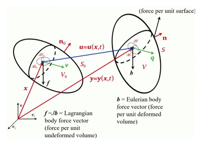
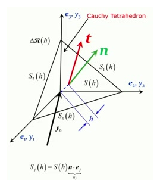
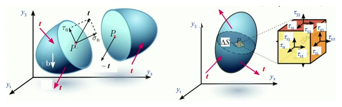
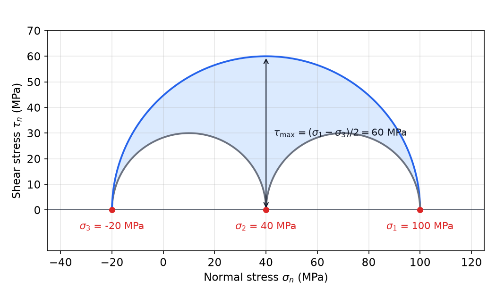
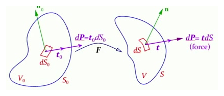

# Balance Laws and Stress

The kinematics chapter describes how a body moves and deforms. This chapter states the laws that every body obeys while it does so, whatever its material: mass is conserved, linear and angular momentum change as the forces dictate, and energy is conserved once heat is included. Each law is first written for an arbitrary part of the body and then **localized** into a field equation that holds at every point. The chapter also introduces the Cauchy stress, the tensor that carries internal forces, and the stresses referred to the reference configuration that solid-mechanics formulations use.

Notation follows the subsection conventions. Reference positions are \\(\mathbf X\\), current positions are \\(\mathbf x = \boldsymbol\chi(\mathbf X,t)\\), and \\(\mathbf F = \partial\mathbf x/\partial\mathbf X\\) with \\(J = \det\mathbf F > 0\\). Densities are \\(\rho\_0(\mathbf X)\\) and \\(\rho(\mathbf x,t)\\). The current (Eulerian) velocity and acceleration are \\(\mathbf v(\mathbf x,t)\\) and \\(\mathbf a(\mathbf x,t)\\). The velocity gradient is \\(\mathbf L = \nabla\mathbf v\\), with \\(L\_{ij} = \partial v\_i/\partial x\_j\\), and its symmetric and skew parts are \\(\mathbf D\\) and \\(\boldsymbol\Omega\\). The body force per unit current volume is \\(\mathbf b\\), and the body force per unit reference volume is \\(\mathbf f = J\mathbf b\\). Repeated indices are summed.

## Conservation of Mass

Take a **material part** \\(\Delta V(t)\\): a fixed set of particles, bounded by the surface \\(\Delta S(t)\\) that moves with them. Its mass cannot change,
\\[
\frac{d}{dt}\int\_{\Delta V(t)}\rho\\,dV = 0 .
\\]
The integral is over the current region, but the reference region \\(\Delta V\_0\\) is fixed. The two are linked by the Jacobian. A small volume \\(dV\_0\\) at \\(\mathbf X\\) maps to \\(dV = J\\,dV\_0\\), so for any field \\(g\\)
\\[
\int\_{\Delta V} g(\mathbf x,t)\\,dV = \int\_{\Delta V\_0} g(\boldsymbol\chi(\mathbf X,t),t)\\,J(\mathbf X,t)\\,dV\_0 .
\\]
Applying this lemma to \\(g = \rho\\) and using the fixed reference volume gives the mass balance in reference form, \\(\int\_{\Delta V\_0}\rho\\,J\\,dV\_0 = \int\_{\Delta V\_0}\rho\_0\\,dV\_0\\) for every \\(\Delta V\_0\\). Localization (below) then yields the **Lagrangian local form**
\\[
\rho(\boldsymbol\chi(\mathbf X,t),t)\\,J(\mathbf X,t) = \rho\_0(\mathbf X).
\\]
Only the reference density and the Jacobian are needed here. The current density follows from \\(\rho = \rho\_0/J\\).

### The Eulerian form

Most fluid problems are posed at fixed points of space, so the Eulerian form is more useful. Differentiate \\(\rho J = \rho\_0\\) with respect to time while following a particle. The reference density is constant, so
\\[
\frac{D\rho}{Dt}\\,J + \rho\\,\dot J = 0 .
\\]
Two facts give \\(\dot J\\). First, \\(\dot{\mathbf F} = \partial\mathbf v/\partial\mathbf X = (\nabla\mathbf v)\mathbf F\\) by the chain rule, so \\(\mathbf L = \dot{\mathbf F}\mathbf F^{-1}\\). Second, Jacobi's formula for the derivative of a determinant gives \\(\dot J = J\\,\mathrm{tr}(\dot{\mathbf F}\mathbf F^{-1}) = J\\,\mathrm{tr}\\,\mathbf L = J\\,\nabla\cdot\mathbf v\\). Substituting, \\(D\rho/Dt + \rho\\,\nabla\cdot\mathbf v = 0\\). Writing \\(D\rho/Dt = \partial\rho/\partial t + \mathbf v\cdot\nabla\rho\\) and combining the terms gives the **Eulerian local form**
\\[
\frac{\partial\rho}{\partial t} + \nabla\cdot(\rho\mathbf v) = 0 .
\\]
The local rate of density change equals the negative of the net outflow of mass. Each term has a physical meaning: \\(\rho\mathbf v\\) is the mass crossing a unit area per unit time, and its divergence is the net outflow per unit volume.

### Incompressibility

If the material is incompressible, \\(\rho\\) is constant along particle paths and \\(\dot\rho = 0\\), so \\(\nabla\cdot(\rho\mathbf v) = \rho\\,\nabla\cdot\mathbf v = 0\\). Equivalently \\(J = 1\\) and \\(\nabla\cdot\mathbf v = \mathrm{tr}\\,\mathbf D = 0\\). This is the constraint that every incompressible flow must satisfy. It is most often used directly on the velocity, because velocity is the unknown in fluid problems.

## Transport Theorem

Many balance laws involve the time derivative of an integral over a material part. The **Reynolds transport theorem** gives that derivative for any scalar, vector or tensor field \\(g(\mathbf x,t)\\):
\\[
\frac{d}{dt}\int\_{\Delta V(t)} g\\,\rho\\,dV = \int\_{\Delta V(t)} \frac{Dg}{Dt}\\,\rho\\,dV,
\qquad
\frac{Dg}{Dt} = \frac{\partial g}{\partial t} + \mathbf v\cdot\nabla g .
\\]
The time derivative passes inside the integral, and it acts only on \\(g\\), not on the density. The region moves with the material, but the density factor takes care of that.

**Proof.** Transform to the reference configuration with the lemma above. Since \\(\rho J = \rho\_0\\) does not depend on time,
\\[
\frac{d}{dt}\int\_{\Delta V\_0} g(\boldsymbol\chi,t)\\,\rho\_0\\,dV\_0 = \int\_{\Delta V\_0}\frac{d}{dt}\big[g(\boldsymbol\chi(\mathbf X,t),t)\big]\\,\rho\_0\\,dV\_0 .
\\]
The reference region is fixed, so the derivative moves inside. The total time derivative of \\(g\\) at a particle is \\(Dg/Dt\\). Transforming back with \\(\rho\_0\\,dV\_0 = \rho\\,dV\\) gives the result. \\(\square\\)

With \\(g = \mathbf v\\), the theorem gives \\(\frac{d}{dt}\int\rho\mathbf v\\,dV = \int\rho\mathbf a\\,dV\\), where \\(\mathbf a = D\mathbf v/Dt\\) is the Eulerian acceleration. This is the step that converts momentum rates into integrals of acceleration.

## Global Balance Laws

For any material part \\(\Delta V\\) with boundary \\(\Delta S\\), there are three global statements. The first two are Newton's second law and the moment-of-momentum law applied to the part. The third is the mechanical energy balance:
\\[
\frac{d}{dt}\int\_{\Delta V}\rho\mathbf v\\,dV = \int\_{\Delta S}\mathbf t\\,dS + \int\_{\Delta V}\mathbf b\\,dV ,
\\]
\\[
\frac{d}{dt}\int\_{\Delta V}\mathbf x\times\rho\mathbf v\\,dV = \int\_{\Delta S}\mathbf x\times\mathbf t\\,dS + \int\_{\Delta V}\mathbf x\times\mathbf b\\,dV .
\\]
Here \\(\mathbf t\\) is the **traction**: the contact force per unit area of the current surface \\(\Delta S\\), exerted on \\(\Delta V\\) by the material outside it. The body force \\(\mathbf b\\) acts at a distance, for example gravity or electromagnetic forces, and it is distributed over the volume. Continuum mechanics has no concentrated forces. A finite force cannot act over zero area, so all surface forces are tractions with a finite limit of force per area.

*Figure: a body in its reference configuration (left) and current configuration (right). A small part \\(\Delta V\_0\\) maps to \\(\Delta V\\). The body force per unit reference volume is \\(\mathbf f = J\mathbf b\\), and the traction \\(\mathbf t\\) acts on the deformed surface \\(\Delta S\\). The figure labels the current position \\(\mathbf y\\), which this book writes as \\(\mathbf x\\).*

The mechanical power identity, which says that the work rate of the external forces equals the stress power plus the rate of kinetic energy, is derived below from the local equations.

## Localization

The global laws must hold for every part of the body. That requirement is strong enough to produce pointwise equations.

**Lemma (localization).** Let \\(f\\) be a continuous scalar, vector or tensor field on a region \\(\mathcal R\\). If \\(\int\_{\Delta V} f\\,dV = 0\\) for every part \\(\Delta V \subset \mathcal R\\), then \\(f = 0\\) everywhere in \\(\mathcal R\\).

**Proof.** In one dimension, let \\(f\\) be continuous on \\([a,b]\\) with \\(\int\_{x\_1}^{x\_2} f\\,dx = 0\\) for all \\(x\_1,x\_2\\). Suppose \\(f(x\_0) > 0\\) at some \\(x\_0\\). By continuity \\(f > 0\\) on an interval \\([\xi\_1,\xi\_2]\\) containing \\(x\_0\\), and then \\(\int\_{\xi\_1}^{\xi\_2} f\\,dx > 0\\), a contradiction. The three-dimensional argument is the same, with a small ball in place of the interval. \\(\square\\)

The essential point is that the domain is arbitrary. One zero integral over a particular domain says nothing about the integrand, but zero integrals over every domain force the integrand to vanish.

## Cauchy's Theorem

The traction \\(\mathbf t(\mathbf x,\mathbf n,t)\\) depends on the point, the time, and the orientation \\(\mathbf n\\) of the cutting surface. Cauchy showed that its dependence on \\(\mathbf n\\) is linear.

**Theorem (Cauchy).** There is a second-order tensor \\(\boldsymbol\tau(\mathbf x,t)\\), the **Cauchy stress**, such that for every unit normal \\(\mathbf n\\)
\\[
\mathbf t(\mathbf x,\mathbf n,t) = \boldsymbol\tau(\mathbf x,t)\\,\mathbf n,
\qquad t\_i = \tau\_{ij}\\,n\_j .
\\]
Here \\(\mathbf n\\) is the outward normal of the part on which the traction acts. The components are \\(\tau\_{ij} = \mathbf e\_i\cdot\boldsymbol\tau\mathbf e\_j\\): the \\(i\\)-th component of the force per unit current area on the face whose outward normal is \\(\mathbf e\_j\\). The stress is defined on the current configuration. Its components are forces per unit deformed area, not per undeformed area.

**Proof (Cauchy's tetrahedron).** Fix a point \\(\mathbf x\_0\\), a time \\(t\\), and a unit normal \\(\mathbf n\\). Consider the tetrahedron \\(\Delta\mathcal R(h)\\) with its vertex at \\(\mathbf x\_0\\). Its slanted face \\(S(h)\\) has outward normal \\(\mathbf n\\), and its three other faces \\(S\_j(h)\\) lie in the coordinate planes with outward normals \\(-\mathbf e\_j\\). The projected area of each coordinate face is \\(S\_j(h) = S(h)\\,n\_j\\). The altitude of the tetrahedron from \\(\mathbf x\_0\\) to \\(S(h)\\) is \\(h\\), and its volume is \\(\tfrac13 S(h)\\,h\\).

*Figure: the Cauchy tetrahedron. The slanted face has normal \\(\mathbf n\\), and the three coordinate faces have outward normals \\(-\mathbf e\_j\\) and projected areas \\(S(h)\\,n\_j\\). The figure labels the current position \\(\mathbf y\\); this book writes it \\(\mathbf x\\).*

Apply the global BLM to this tetrahedron:
\\[
\int\_{\Delta\mathcal R(h)}\mathbf b\\,dV + \int\_{S(h)}\mathbf t(\mathbf x,\mathbf n)\\,dS + \sum\_{j=1}^{3}\int\_{S\_j(h)}\mathbf t(\mathbf x,-\mathbf e\_j)\\,dS = \int\_{\Delta\mathcal R(h)}\rho\mathbf a\\,dV .
\\]
All integrands are continuous, so on a bounded region containing every tetrahedron the volume integrand \\(\mathbf b - \rho\mathbf a\\) is bounded by some \\(M\\). The volume terms are therefore at most \\(M\\,\tfrac13 S(h)\\,h\\), which is small compared with the area \\(S(h)\\) as \\(h \to 0\\). By the mean value theorem, \\(\int\_{S(h)}\mathbf t(\mathbf x,\mathbf n)\\,dS = [\mathbf t(\mathbf x\_0,\mathbf n) - \boldsymbol\delta(h)]\\,S(h)\\) and \\(\int\_{S\_j(h)}\mathbf t(\mathbf x,-\mathbf e\_j)\\,dS = [\mathbf t(\mathbf x\_0,-\mathbf e\_j) - \boldsymbol\eta\_j(h)]\\,S(h)\\,n\_j\\), where \\(\boldsymbol\delta,\boldsymbol\eta\_j \to \mathbf 0\\) as \\(h \to 0\\). Dividing by \\(S(h)\\) and letting \\(h \to 0\\) removes the volume terms and leaves
\\[
\mathbf t(\mathbf x\_0,\mathbf n) + \sum\_{j=1}^{3}\mathbf t(\mathbf x\_0,-\mathbf e\_j)\\,n\_j = \mathbf 0 .
\\]
This looks like an equilibrium condition, but it holds in full dynamics. Accelerations and body forces vanish in the limit, because they are of higher order in \\(h\\).

Setting \\(\mathbf n = \mathbf e\_j\\) in this relation gives \\(\mathbf t(\mathbf x\_0,-\mathbf e\_j) = -\mathbf t(\mathbf x\_0,\mathbf e\_j)\\). Substituting back, \\(\mathbf t(\mathbf x\_0,\mathbf n) = \sum\_j n\_j\\,\mathbf t(\mathbf x\_0,\mathbf e\_j)\\). Define \\(\tau\_{ij}\\) by \\(\mathbf t(\mathbf x\_0,\mathbf e\_j) = \tau\_{ij}\mathbf e\_i\\). Then \\(\mathbf t = \boldsymbol\tau\mathbf n\\), which is the theorem. \\(\square\\)

The stress therefore has nine components. The first index is the direction of the force, and the second index identifies the face. The normal stresses are \\(\tau\_{11}\\), \\(\tau\_{22}\\) and \\(\tau\_{33}\\). The shear stresses are the off-diagonal components.

*Figure: left, tractions acting on the cut surfaces of two bodies. The traction on a cut has a normal part \\(\sigma\_n\\) and a shear part \\(\tau\_n\\). Right, the traction on a small surface \\(\Delta S\\) through a point, and the nine components of the Cauchy stress on the faces of a cube at that point.*

## Symmetry of the Cauchy Stress

The global moment-of-momentum law forces the stress tensor to be symmetric. This is a consequence of the balance of angular momentum, and it holds in full dynamics, not only in equilibrium.

Write the moment-of-momentum law componentwise, with \\((\mathbf x\times\mathbf y)\_i = \varepsilon\_{ijk}x\_jy\_k\\). On the left, the Reynolds theorem applied to \\(\varepsilon\_{ijk}x\_j\rho v\_k\\) gives \\(\varepsilon\_{ijk}(v\_jv\_k + x\_j a\_k)\rho\\). The term \\(\varepsilon\_{ijk}v\_jv\_k\\) is zero because \\(\varepsilon\\) is antisymmetric and \\(v\_jv\_k\\) is symmetric. So the left side is \\(\int\_{\Delta V}\varepsilon\_{ijk}x\_j\rho a\_k\\,dV\\).

On the right, use \\(t\_k = \tau\_{kl}n\_l\\) and the divergence theorem:
\\[
\int\_{\Delta S}\varepsilon\_{ijk}x\_j\tau\_{kl}n\_l\\,dS = \int\_{\Delta V}\frac{\partial}{\partial x\_l}\big(\varepsilon\_{ijk}x\_j\tau\_{kl}\big)dV = \int\_{\Delta V}\varepsilon\_{ijk}\big(\tau\_{kj} + x\_j\\,\partial\_l\tau\_{kl}\big)dV ,
\\]
using \\(\partial x\_j/\partial x\_l = \delta\_{jl}\\). Putting the two sides together,
\\[
\int\_{\Delta V}\varepsilon\_{ijk}\\,x\_j\big(\rho a\_k - \partial\_l\tau\_{kl} - b\_k\big)dV = \int\_{\Delta V}\varepsilon\_{ijk}\tau\_{kj}\\,dV .
\\]
The bracket is the \\(k\\)-th component of the momentum balance, which is zero by the local form derived in the next section. Hence \\(\int\_{\Delta V}\varepsilon\_{ijk}\tau\_{kj}\\,dV = 0\\) for every part, and localization gives \\(\varepsilon\_{ijk}\tau\_{kj} = 0\\). Multiply by \\(\varepsilon\_{imn}\\) and use \\(\varepsilon\_{imn}\varepsilon\_{ijk} = \delta\_{mj}\delta\_{nk} - \delta\_{mk}\delta\_{nj}\\):
\\[
\varepsilon\_{imn}\varepsilon\_{ijk}\tau\_{kj} = \tau\_{nm} - \tau\_{mn} = 0 .
\\]
Therefore
\\[
\boxed{\boldsymbol\tau = \boldsymbol\tau^T}
\\]
Only six of the nine components are independent. This is why Cauchy stress is described by six functions.

## Principal Stresses and Mohr's Circles

Because \\(\boldsymbol\tau\\) is symmetric, the spectral theorem gives three real **principal stresses** \\(\sigma\_1 \ge \sigma\_2 \ge \sigma\_3\\) with mutually orthogonal principal directions (see the tensor chapter). In the principal basis, a plane with unit normal \\(\mathbf n = (n\_1,n\_2,n\_3)\\) carries the traction \\(\mathbf t = (\sigma\_1n\_1,\sigma\_2n\_2,\sigma\_3n\_3)\\). Write \\(p\_i = n\_i^2\\), so that \\(\sum\_i p\_i = 1\\). The normal stress and the shear stress on the plane are then
\\[
\sigma\_n = \mathbf n\cdot\boldsymbol\tau\mathbf n = \sum\_i\sigma\_i p\_i ,
\qquad
\tau\_n^2 = \lvert\mathbf t\rvert^2 - \sigma\_n^2 = \sum\_i\sigma\_i^2p\_i - \Big(\sum\_i\sigma\_ip\_i\Big)^2 .
\\]
Take first a plane containing the \\(\mathbf e\_1\\) axis, so \\(n\_1 = 0\\) and \\(p\_2 + p\_3 = 1\\). Then \\(\sigma\_n - c = \tfrac12(\sigma\_2-\sigma\_3)(p\_2-p\_3)\\) with \\(c = \tfrac12(\sigma\_2+\sigma\_3)\\), and \\(\tau\_n^2 = p\_2p\_3(\sigma\_2-\sigma\_3)^2\\). Adding the squares,
\\[
(\sigma\_n - c)^2 + \tau\_n^2 = \tfrac14(\sigma\_2-\sigma\_3)^2\big[(p\_2-p\_3)^2 + 4p\_2p\_3\big] = \Big[\tfrac12(\sigma\_2-\sigma\_3)\Big]^2 .
\\]
The stress on these planes therefore lies on a circle in the \\((\sigma\_n,\tau\_n)\\) plane, centered at \\(\tfrac12(\sigma\_2+\sigma\_3)\\) with radius \\(\tfrac12(\sigma\_2-\sigma\_3)\\). The same calculation applied to the other two principal planes gives two more circles. For a general normal the point \\((\sigma\_n,\tau\_n)\\) lies between the three circles. This is **Mohr's construction**, and the figure below shows it.

**Example (Mohr's circles).** Take \\(\sigma\_1 = 100\\), \\(\sigma\_2 = 40\\) and \\(\sigma\_3 = -20\\) MPa. The three circles are centered at \\(70\\), \\(40\\) and \\(10\\) MPa with radii \\(30\\), \\(60\\) and \\(30\\) MPa. The largest shear stress is the radius of the outer circle, \\(\tau\_{\max} = \tfrac12(\sigma\_1-\sigma\_3) = 60\\) MPa. It acts on the planes with normals \\((\mathbf e\_1\pm\mathbf e\_3)/\sqrt2\\). For \\(\mathbf n = (\mathbf e\_1+\mathbf e\_3)/\sqrt2\\), \\(\sigma\_n = \tfrac12(100-20) = 40\\) MPa, \\(\lvert\mathbf t\rvert^2 = \tfrac12(100^2+20^2) = 5200\\), and \\(\tau\_n^2 = 5200 - 1600 = 3600\\), so \\(\tau\_n = 60\\) MPa, as the construction predicts. Equal principal stresses would shrink the circles to a point, which is the hydrostatic state with no shear anywhere.

*Figure: Mohr's circles for the example above. The shaded region holds every admissible pair \\((\sigma\_n,\tau\_n)\\). The outer circle sets the largest shear stress, and the points where each circle meets the axis are the principal stresses.*

## Equations of Motion

The local form of the momentum balance follows from the global form, Cauchy's theorem and the divergence theorem. Apply the divergence theorem to \\(\int\_{\Delta S}\boldsymbol\tau\mathbf n\\,dS = \int\_{\Delta V}\nabla\cdot\boldsymbol\tau\\,dV\\), where \\((\nabla\cdot\boldsymbol\tau)\_i = \partial\_j\tau\_{ij}\\). The global law becomes
\\[
\int\_{\Delta V}\big(\nabla\cdot\boldsymbol\tau + \mathbf b - \rho\mathbf a\big)\\,dV = \mathbf 0 \quad\text{for every } \Delta V .
\\]
Localization gives the **Eulerian equation of motion**
\\[
\boxed{\nabla\cdot\boldsymbol\tau + \mathbf b = \rho\mathbf a}
\qquad\text{or}\qquad
\frac{\partial\tau\_{ij}}{\partial x\_j} + b\_i = \rho\\,a\_i .
\\]
With \\(\boldsymbol\tau\\) symmetric, the order of the indices in the divergence does not matter. The equation holds for any material and any motion. For a body at rest, \\(\mathbf a = \mathbf 0\\), and the equation reduces to the equilibrium condition \\(\nabla\cdot\boldsymbol\tau + \mathbf b = \mathbf 0\\). Equilibrium is therefore only a special case. The equation of motion gives three partial differential equations for the six independent stress components. It cannot determine them alone, and the constitutive law closes the system, as the next chapter explains.

### Stress power and the power identity

Multiply the equation of motion by \\(\mathbf v\\) and integrate over \\(\Delta V\\). Use the divergence theorem on the surface term:
\\[
\int\_{\Delta S}\mathbf t\cdot\mathbf v\\,dS = \int\_{\Delta S}\tau\_{ij}n\_jv\_i\\,dS = \int\_{\Delta V}\big(\partial\_j\tau\_{ij}\big)v\_i\\,dV + \int\_{\Delta V}\tau\_{ij}\\,\partial\_jv\_i\\,dV .
\\]
Substitute \\(\partial\_j\tau\_{ij} = \rho a\_i - b\_i\\). Since \\(\partial\_jv\_i = L\_{ij}\\) and \\(\tau\_{ij}L\_{ij} = \boldsymbol\tau:\mathbf L = \boldsymbol\tau:\mathbf D\\) (because \\(\boldsymbol\tau\\) is symmetric, the skew part of \\(\mathbf L\\) contributes nothing), the result is
\\[
\int\_{\Delta S}\mathbf t\cdot\mathbf v\\,dS + \int\_{\Delta V}\mathbf b\cdot\mathbf v\\,dV = \int\_{\Delta V}\boldsymbol\tau:\mathbf D\\,dV + \frac{d}{dt}\int\_{\Delta V}\tfrac12\rho\|\mathbf v\|^2\\,dV ,
\\]
where the last step uses the transport theorem with \\(g = \tfrac12\|\mathbf v\|^2\\). This is the **mechanical power identity**. The work rate of the external forces splits into the stress power \\(\boldsymbol\tau:\mathbf D\\) per unit current volume and the rate of change of kinetic energy. For a quasi-static process the kinetic term vanishes. How large the stress power is depends on the material, which is the subject of the constitutive chapter.

## Stress Measures on the Reference Configuration

The Cauchy stress is measured per unit deformed area, and the deformed area is the unknown. Solid mechanics often prefers stresses measured on the fixed reference configuration. The analogy is the tensile test. The **true stress** is force divided by the current area, and the **engineering stress** is force divided by the original area. The second is simpler to work with because the original area is known in advance.

### The first Piola–Kirchhoff stress

Consider the force \\(d\mathbf P\\) acting on a surface element. In the current configuration it is \\(d\mathbf P = \mathbf t\\,dS = \boldsymbol\tau\mathbf n\\,dS\\), where \\(\mathbf n\\) is the normal and \\(dS\\) the area. Nanson's formula from the kinematics chapter gives \\(\mathbf n\\,dS = J\mathbf F^{-T}\mathbf N\\,dS\_0\\), where \\(\mathbf N\\) and \\(dS\_0\\) describe the reference surface element. Therefore
\\[
d\mathbf P = \boldsymbol\tau\\,J\mathbf F^{-T}\mathbf N\\,dS\_0 = \mathbf P\\,\mathbf N\\,dS\_0 ,
\qquad\text{with}\qquad
\boxed{\mathbf P = J\\,\boldsymbol\tau\\,\mathbf F^{-T}} .
\\]
The tensor \\(\mathbf P\\) is the **first Piola–Kirchhoff stress**. It is the same physical force, referred to the undeformed area: the reference traction is \\(\mathbf t\_0 = \mathbf P\mathbf N\\), with components \\(t\_{0i} = P\_{iK}N\_K\\). Its first index is the spatial direction of the force, and its second index is the reference direction of the face. The stress \\(\mathbf P\\) is not symmetric in general, since \\(\mathbf F^{-T}\\) is not. For \\(\mathbf F = \mathbf I\\) it reduces to \\(\boldsymbol\tau\\).

*Figure: the same force \\(d\mathbf P\\) is written on the reference area \\(dS\_0\\) with normal \\(\mathbf N\\), giving \\(\mathbf t\_0 = \mathbf P\mathbf N\\), and on the current area \\(dS\\) with normal \\(\mathbf n\\), giving \\(\mathbf t\\). The deformation gradient \\(\mathbf F\\) maps one configuration to the other.*

### The Piola identity and the Lagrangian equation of motion

The equation of motion can be written with \\(\mathbf P\\) and reference coordinates. The derivation needs an identity for the cofactor of \\(\mathbf F\\).

**Piola identity.** For every \\(K\\),
\\[
\sum\_j \frac{\partial}{\partial x\_j}\left(\frac{F\_{jK}}{J}\right) = 0 .
\\]

**Proof.** Write \\(\partial/\partial x\_j = F^{-1}\_{Mj}\\,\partial/\partial X\_M\\), since \\(\partial X\_M/\partial x\_j = F^{-1}\_{Mj}\\). Differentiate the quotient, and use Jacobi's formula \\(\partial J/\partial X\_M = J F^{-1}\_{Lk}\\,\partial F\_{kL}/\partial X\_M\\):
\\[
\sum\_j\frac{\partial}{\partial x\_j}\left(\frac{F\_{jK}}{J}\right) = \frac{1}{J}\Big(F^{-1}\_{Mj}\frac{\partial F\_{jK}}{\partial X\_M} - F^{-1}\_{Lk}\frac{\partial F\_{kL}}{\partial X\_K}\Big) .
\\]
The second term arises because \\(F^{-1}\_{Mj}F\_{jK} = \delta\_{MK}\\). The compatibility of the deformation gives \\(\partial F\_{jK}/\partial X\_M = \partial F\_{jM}/\partial X\_K\\), since both equal \\(\partial^2x\_j/\partial X\_K\partial X\_M\\). With that substitution the first term becomes \\(F^{-1}\_{Mj}\\,\partial F\_{jM}/\partial X\_K\\), which after renaming dummy indices is identical to the second term. The difference is zero. \\(\square\\)

With \\(\boldsymbol\tau = \tfrac1J\mathbf P\mathbf F^T\\), that is \\(\tau\_{ij} = \tfrac1J P\_{iK}F\_{jK}\\), the Eulerian equation of motion becomes a reference equation. Differentiate the product \\(\tau\_{ij} = P\_{iK}\\,(F\_{jK}/J)\\) with respect to \\(x\_j\\). By the Piola identity the term in which the derivative falls on \\(F\_{jK}/J\\) vanishes. The remaining term is
\\[
\frac{\partial\tau\_{ij}}{\partial x\_j} = \frac{\partial P\_{iK}}{\partial x\_j}\frac{F\_{jK}}{J} = \frac{1}{J}\frac{\partial P\_{iK}}{\partial X\_K} ,
\\]
where the last step uses \\(\partial P\_{iK}/\partial x\_j \cdot F\_{jK} = F^{-1}\_{Mj}F\_{jK}\\,\partial P\_{iK}/\partial X\_M = \partial P\_{iK}/\partial X\_K\\). Substituting into the Eulerian equation, multiplying by \\(J\\), and using \\(J\rho = \rho\_0\\) gives the **Lagrangian equation of motion**
\\[
\boxed{\frac{\partial P\_{iK}}{\partial X\_K} + f\_i = \rho\_0\\,a\_i}
\qquad\text{or}\qquad
\nabla\_{\mathbf X}\cdot\mathbf P + \mathbf f = \rho\_0\mathbf a .
\\]
Here \\(\mathbf a\\) is the material acceleration \\(\partial^2\mathbf x/\partial t^2\\) at fixed \\(\mathbf X\\), which equals the Eulerian acceleration evaluated at the same particle. The form looks almost identical to the Eulerian one, but the derivatives are with respect to reference coordinates and the forces are per unit reference volume.

### The second Piola–Kirchhoff and Kirchhoff stresses

The first Piola–Kirchhoff stress is not symmetric, so it carries nine components. A symmetric tensor on the reference configuration is obtained from the **second Piola–Kirchhoff stress**,
\\[
\boxed{\mathbf S = \mathbf F^{-1}\mathbf P = J\\,\mathbf F^{-1}\boldsymbol\tau\\,\mathbf F^{-T}} ,
\qquad\text{so that}\qquad \mathbf P = \mathbf F\mathbf S .
\\]
The second Piola–Kirchhoff stress is symmetric exactly when \\(\boldsymbol\tau\\) is, so it is symmetric by the balance of angular momentum. It has no direct physical traction interpretation. It is obtained from \\(\mathbf P\\) by pulling the force back to the reference configuration with \\(\mathbf F^{-1}\\). The symmetry condition for \\(\mathbf P\\) is \\(\mathbf P\mathbf F^T = \mathbf F\mathbf P^T\\), which is the angular momentum law written in reference variables. It is less convenient than the symmetry of \\(\mathbf S\\), and this is the main reason \\(\mathbf S\\) is preferred for hyperelasticity.

The **Kirchhoff stress** \\(\mathbf K = J\boldsymbol\tau\\) is also symmetric. It is the Cauchy stress scaled by the volume ratio, and it is convenient in expressions that already contain \\(J\\). The four stresses are related by
\\[
\boldsymbol\tau = \frac{1}{J}\mathbf P\mathbf F^T = \frac{1}{J}\mathbf F\mathbf S\mathbf F^T .
\\]

The Lagrangian equation of motion can also be written with \\(\mathbf S\\). Substituting \\(P\_{iK} = F\_{iM}S\_{MK}\\) gives
\\[
\frac{\partial}{\partial X\_K}\big(F\_{iM}S\_{MK}\big) + f\_i = \rho\_0\\,a\_i .
\\]
For a given \\(\mathbf F\\) this equation is linear in \\(\mathbf S\\). Because \\(\mathbf F\\) itself depends on the unknown motion, the full problem is nonlinear, which is the usual price of a finite-deformation formulation.

### Work-conjugate pairs

Each stress measure is paired with a rate of deformation so that their product is the stress power. Per unit reference volume, \\(P\_{iK}\dot F\_{iK} = \mathrm{tr}(\mathbf P^T\dot{\mathbf F})\\). Since \\(\mathbf P^T = J\mathbf F^{-1}\boldsymbol\tau\\) and \\(\dot{\mathbf F}\mathbf F^{-1} = \mathbf L\\),
\\[
\mathbf P:\dot{\mathbf F} = J\\,\mathrm{tr}\big(\mathbf F^{-1}\boldsymbol\tau\dot{\mathbf F}\big) = J\\,\mathrm{tr}\big(\boldsymbol\tau\mathbf L\big) = J\\,\boldsymbol\tau:\mathbf D ,
\\]
where the last step uses the symmetry of \\(\boldsymbol\tau\\), which makes the skew part of \\(\mathbf L\\) drop out. The same value appears for the other pairs. With the Green–Lagrange strain \\(\mathbf E = \tfrac12(\mathbf C - \mathbf I)\\) and right Cauchy–Green tensor \\(\mathbf C = \mathbf F^T\mathbf F\\), one has \\(\dot{\mathbf E} = \mathbf F^T\mathbf D\mathbf F\\). Then \\(\mathbf S:\dot{\mathbf E} = \mathrm{tr}(\mathbf F\mathbf S\mathbf F^T\mathbf D) = \mathrm{tr}(J\boldsymbol\tau\mathbf D) = J\boldsymbol\tau:\mathbf D\\). The reference form of the power identity is therefore
\\[
\int\_{\Delta V\_0}\mathbf P:\dot{\mathbf F}\\,dV\_0 = \int\_{\Delta V\_0}\mathbf S:\dot{\mathbf E}\\,dV\_0 = \int\_{\Delta V}\boldsymbol\tau:\mathbf D\\,dV .
\\]
The table summarizes the pairs.

| Stress | Power per unit volume | Work-conjugate rate | Symmetric |
|---|---|---|---|
| Cauchy \\(\boldsymbol\tau\\) | current | \\(\mathbf D\\) | yes |
| Kirchhoff \\(\mathbf K = J\boldsymbol\tau\\) | reference | \\(\mathbf D\\) | yes |
| First Piola–Kirchhoff \\(\mathbf P\\) | reference | \\(\dot{\mathbf F}\\) | no |
| Second Piola–Kirchhoff \\(\mathbf S\\) | reference | \\(\dot{\mathbf E}\\) | yes |

The choice among these is one of convenience. Each gives the same stress power, and each is useful for a different constitutive law. The hyperelastic chapter uses \\(\mathbf S\\) because it is symmetric, and fluid mechanics uses \\(\boldsymbol\tau\\) because the fluid is described on the current configuration.

### Three worked examples

**Example (uniaxial tension of an incompressible material).** Let a bar be stretched to \\(\lambda\\) along \\(\mathbf e\_1\\) with no volume change. Then \\(\mathbf F = \mathrm{diag}(\lambda,\lambda^{-1/2},\lambda^{-1/2})\\), \\(J = 1\\), and the lateral sides are free, so \\(\tau\_{22} = \tau\_{33} = 0\\). Let the measured Cauchy stress be \\(\tau\_{11} = 6\\) MPa at \\(\lambda = 2\\). From \\(\mathbf P = J\boldsymbol\tau\mathbf F^{-T}\\),
\\[
P\_{11} = \frac{\tau\_{11}}{\lambda} = \frac{6\ \text{MPa}}{2} = 3\ \text{MPa} .
\\]
This is the engineering stress, the force divided by the original area. The area ratio is \\(A/A\_0 = \lambda^{-1}\\) for an incompressible bar, which is consistent with the formula. In general \\(P\_{11} = \lambda\_t^2\tau\_{11}\\) with lateral stretch \\(\lambda\_t\\), and \\(\lambda\_t^2 = A/A\_0\\).

**Example (rigid motion does no stress work).** For a rigid motion \\(\mathbf x = \mathbf Q(t)\mathbf X + \mathbf c(t)\\) with \\(\mathbf Q\\) orthogonal, \\(\mathbf F = \mathbf Q\\) and \\(\mathbf L = \dot{\mathbf Q}\mathbf Q^T\\). Since \\(\mathbf Q\mathbf Q^T = \mathbf I\\), the matrix \\(\dot{\mathbf Q}\mathbf Q^T\\) is skew, so \\(\mathbf D = \tfrac12(\mathbf L + \mathbf L^T) = \mathbf 0\\). The stress power is zero for any stress state, and rigid rotations do not change stored energy.

**Example (volume change and the deviatoric stress).** Split the Cauchy stress into a mean part and a deviatoric part, \\(\boldsymbol\tau = \pi\mathbf I + \boldsymbol\tau'\\), with \\(\pi = \tfrac13\mathrm{tr}\\,\boldsymbol\tau\\) and \\(\mathrm{tr}\\,\boldsymbol\tau' = 0\\). The stress power is then
\\[
\boldsymbol\tau:\mathbf D = \pi\\,\mathrm{tr}\\,\mathbf D + \boldsymbol\tau':\mathbf D ,
\qquad \mathrm{tr}\\,\mathbf D = \nabla\cdot\mathbf v = \frac{\dot J}{J} .
\\]
For an isochoric motion, \\(J = 1\\) and the mean stress does no work. Only the deviatoric stress produces plastic work in metals, which are nearly incompressible during plastic flow.

## Energy: The First Law and the Heat Equation

The mechanical power identity omits heat. The first law adds thermal energy. Let \\(u\\) be the internal energy per unit mass, \\(\mathbf q\\) the heat flux vector (heat crossing a unit area per unit time), and \\(h\\) a volumetric heat source, such as induction heating, a chemical reaction or a phase change. The total energy balance is
\\[
\frac{d}{dt}\int\_{\Delta V}\Big(\tfrac12\rho\|\mathbf v\|^2 + \rho u\Big)dV = \int\_{\Delta S}\mathbf t\cdot\mathbf v\\,dS + \int\_{\Delta V}\mathbf b\cdot\mathbf v\\,dV - \int\_{\Delta S}\mathbf q\cdot\mathbf n\\,dS + \int\_{\Delta V}h\\,dV .
\\]
Subtract the mechanical power identity. The kinetic terms cancel. The Reynolds transport theorem turns the rate of the internal energy into \\(\int\rho\dot u\\,dV\\), and the divergence theorem converts the heat-flux integral into \\(-\int\nabla\cdot\mathbf q\\,dV\\). Localization gives the **local energy equation**
\\[
\boxed{\rho\\,\dot u = \boldsymbol\tau:\mathbf D - \nabla\cdot\mathbf q + h} .
\\]
Expressing the internal energy per unit mass makes the transport step simple. The term \\(\boldsymbol\tau:\mathbf D\\) is the stress power that enters the body.

### The heat equation for a deforming body

Fourier's law \\(\mathbf q = -k\nabla T\\) with constant isotropic conductivity \\(k\\) gives \\(-\nabla\cdot\mathbf q = k\nabla^2T\\). The stress power is not all stored or converted to heat, however. Split the rate of deformation into elastic and plastic parts, \\(\mathbf D = \mathbf D^e + \mathbf D^p\\). The elastic work is stored reversibly, and the plastic work is shared between heat and stored structural energy, such as the dislocation energy in a metal. Let \\(\beta\\), the **Taylor–Quinney fraction**, be the fraction of plastic work that becomes heat, with \\(0 < \beta < 1\\) and typically about \\(0.9\\). The internal energy splits as \\(\rho\dot u = \rho\dot u^E + \rho\dot u^T + \rho\dot u^S\\), with
\\[
\rho\dot u^E = \boldsymbol\tau:\mathbf D^e,\qquad \rho\dot u^T = \rho c\\,\dot T,\qquad \rho\dot u^S = (1-\beta)\\,\boldsymbol\tau:\mathbf D^p ,
\\]
where \\(c\\) is the specific heat. Substituting into the local energy equation and cancelling the elastic and structural parts gives
\\[
\boxed{\rho c\\,\dot T = \beta\\,\boldsymbol\tau:\mathbf D^p + k\nabla^2T + h}
\\]
This is the heat equation for a deforming body. The temperature rises through plastic heating and internal sources and falls by conduction. Plastic heating is what makes a wire warm up when it is bent back and forth. The rate of plastic deformation \\(\mathbf D^p\\) depends on the material, and it belongs to plasticity theory, which this book does not cover.

## The Second Law

The second law states that entropy can be produced but never destroyed. In global form, with \\(s\\) the entropy per unit mass and \\(T\\) the absolute temperature, the rate of entropy increase in a part is at least the entropy input:
\\[
\frac{d}{dt}\int\_{\Delta V}\rho s\\,dV \ge \int\_{\Delta V}\frac{h}{T}\\,dV - \int\_{\Delta S}\frac{\mathbf q\cdot\mathbf n}{T}\\,dS .
\\]
Applying the divergence theorem and localization gives the **Clausius–Duhem inequality** in local form,
\\[
\rho\\,\dot s \ge \frac{h}{T} - \nabla\cdot\Big(\frac{\mathbf q}{T}\Big) .
\\]
This is an inequality, not an equation to solve. It is a requirement that every constitutive law must satisfy.

To make the requirement usable, eliminate \\(h\\) with the energy equation. Multiply by \\(T\\) and use \\(T\nabla\cdot(\mathbf q/T) = \nabla\cdot\mathbf q - \mathbf q\cdot\nabla T/T\\). The inequality becomes \\(\rho T\dot s \ge h - \nabla\cdot\mathbf q + \mathbf q\cdot\nabla T/T\\), and the energy equation replaces \\(h - \nabla\cdot\mathbf q\\) by \\(\rho\dot u - \boldsymbol\tau:\mathbf D\\). With the Helmholtz free energy \\(\psi = u - Ts\\), so that \\(\dot u - T\dot s = \dot\psi + s\dot T\\), the result is
\\[
\boldsymbol\tau:\mathbf D - \rho\\,(\dot\psi + s\dot T) - \frac{\mathbf q\cdot\nabla T}{T} \ge 0 .
\\]
The first term is the stress power. The second is the rate of stored free energy and entropy. The third is the heat conduction, which is dissipative whenever heat flows down the temperature gradient. Constitutive laws must make this dissipation non-negative for all admissible processes. The next chapter uses this condition to restrict the form of the stress.

## Summary

- **Mass:** \\(\rho J = \rho\_0\\) in reference form, and \\(\partial\rho/\partial t + \nabla\cdot(\rho\mathbf v) = 0\\) in Eulerian form. Incompressibility means \\(\nabla\cdot\mathbf v = 0\\).
- **Reynolds transport:** \\(\frac{d}{dt}\int g\rho\\,dV = \int (Dg/Dt)\rho\\,dV\\) for any material part.
- **Cauchy:** \\(\mathbf t = \boldsymbol\tau\mathbf n\\) with \\(\boldsymbol\tau\\) defined on the current configuration.
- **Angular momentum:** \\(\boldsymbol\tau = \boldsymbol\tau^T\\), so the Cauchy stress has six independent components.
- **Equation of motion:** \\(\nabla\cdot\boldsymbol\tau + \mathbf b = \rho\mathbf a\\) (Eulerian), and \\(\nabla\_{\mathbf X}\cdot\mathbf P + \mathbf f = \rho\_0\mathbf a\\) (Lagrangian, with \\(\mathbf f = J\mathbf b\\)).
- **Stress measures:** \\(\mathbf P = J\boldsymbol\tau\mathbf F^{-T}\\), \\(\mathbf S = \mathbf F^{-1}\mathbf P = J\mathbf F^{-1}\boldsymbol\tau\mathbf F^{-T}\\) (symmetric), and \\(\mathbf K = J\boldsymbol\tau\\).
- **Power:** \\(\mathbf P:\dot{\mathbf F} = \mathbf S:\dot{\mathbf E} = J\boldsymbol\tau:\mathbf D\\), the stress power per unit reference volume.
- **Energy:** \\(\rho\dot u = \boldsymbol\tau:\mathbf D - \nabla\cdot\mathbf q + h\\), and with plastic heating \\(\rho c\\,\dot T = \beta\boldsymbol\tau:\mathbf D^p + k\nabla^2T + h\\).
- **Second law:** \\(\rho\dot s \ge h/T - \nabla\cdot(\mathbf q/T)\\), which gives the dissipation inequality \\(\boldsymbol\tau:\mathbf D - \rho(\dot\psi + s\dot T) - \mathbf q\cdot\nabla T/T \ge 0\\).

## See Also

- [Tensor Algebra and Calculus](tensors.md): the spectral theorem for the Cauchy stress and the index identities used above.
- [Kinematics of Deformation](kinematics.md): the deformation gradient, the Jacobian and Nanson's formula.
- [Constitutive Theory and Material Symmetry](constitutive.md): the relations that close the balance laws.
- [Viscous Fluids](fluids.md): the Navier–Stokes equations obtained from the equation of motion and a Newtonian law.
- [Hyperelastic Solids](hyperelasticity.md): the second Piola–Kirchhoff stress of an elastic potential.
- [Stress and Strain](../stress-strain.md): Mohr's circle at the level of beams and bars.
- [Eigenvalues and Eigenvectors](../../../math/linear-algebra/eigen.md): the principal stresses as eigenvalues of a symmetric tensor.
- [Conservation Laws (fluid mechanics)](../../fluid/conservation.md): the engineering form of mass and momentum conservation.
- [Entropy and Irreversibility](../../thermo/entropy.md): the second law in thermodynamics.
