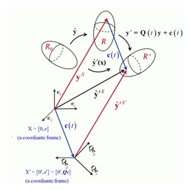
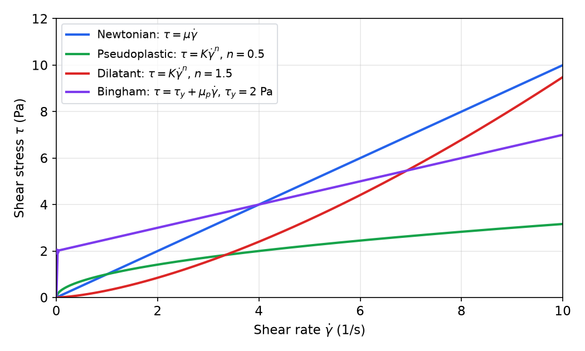
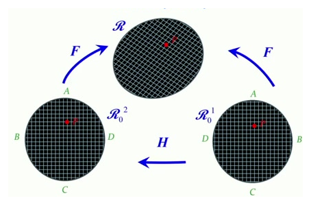
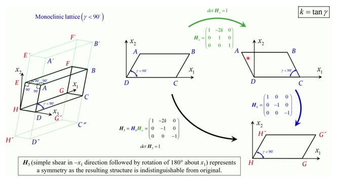
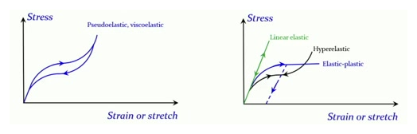

# Constitutive Theory and Material Symmetry

The balance laws hold for every material, so on their own they cannot tell steel from rubber or water from honey. Something must relate the stress to the motion, and that relation is the **constitutive law**. This chapter asks which restrictions physics places on such laws: they must be invariant under a change of observer, they must be consistent with the second law, and they must respect the symmetries of the material. These restrictions reduce the general response to forms that the later chapters on fluids, hyperelastic solids and linear elastic solids can use.

Notation follows the previous chapter. Reference and current positions are \\(\mathbf X\\) and \\(\mathbf x\\), \\(\mathbf F = \partial\mathbf x/\partial\mathbf X\\), \\(J = \det\mathbf F\\). The stresses are the Cauchy stress \\(\boldsymbol\tau\\), the first Piola–Kirchhoff stress \\(\mathbf P = J\boldsymbol\tau\mathbf F^{-T}\\) and the second Piola–Kirchhoff stress \\(\mathbf S = \mathbf F^{-1}\mathbf P\\). The rate of deformation and spin are \\(\mathbf D\\) and \\(\boldsymbol\Omega\\). Two deformation measures are used throughout: the right and left Cauchy–Green tensors \\(\mathbf C = \mathbf F^T\mathbf F\\) and \\(\mathbf B = \mathbf F\mathbf F^T\\).

## What a Constitutive Law Must Satisfy

Per point, the balance laws give one mass equation, three momentum equations and one energy equation. The unknowns are the motion (three components), the stress (six independent components), the heat flux, the temperature, the internal energy and the entropy. The balance laws cannot determine the stress, so every continuum theory needs constitutive laws to close the system. A constitutive law is a model of one material. It gives the stress, and the heat flux, as functions of the deformation and temperature history at a point.

Every constitutive law must satisfy three requirements.

1. It must be consistent with the second law, in the dissipation form derived in the previous chapter.
2. It must be invariant under the material's symmetry transformations.
3. It must be invariant under a change of observer. This is the **principle of material frame-indifference**.

The first is a check on each proposed law. The second and third restrict the functional form of the law itself. Familiar examples are Hooke's law \\(\boldsymbol\sigma = \mathbb C\boldsymbol\varepsilon\\) for linear elastic solids, the stress–stretch relation of rubber, the viscous stress of a Newtonian fluid, and the rate form used for elastic–viscoplastic metals.

## Material Frame-Indifference

### Change of observer

Two observers watching the same motion use different coordinate frames. The second observer's frame may be translated and rotated, so the current position of a material point is seen as
\\[
\mathbf x' = \mathbf Q(t)\\,\mathbf x + \mathbf c(t) ,
\\]
where \\(\mathbf Q(t)\\) is a proper orthogonal tensor (\\(\mathbf Q^T\mathbf Q = \mathbf I\\), \\(\det\mathbf Q = 1\\)) and \\(\mathbf c(t)\\) is a vector. The material is the same, so the reference position \\(\mathbf X\\) is unchanged. Differentiating the change of observer gives how each kinematic quantity transforms.

- The deformation gradient transforms as \\(\mathbf F' = \mathbf Q\mathbf F\\), because \\(\mathbf c\\) does not depend on \\(\mathbf X\\).
- The Jacobian and the density are unchanged, \\(J' = J\\) and \\(\rho' = \rho\\).
- The velocity picks up the motion of the frame: \\(\mathbf v' = \mathbf Q\mathbf v + \dot{\mathbf Q}\mathbf Q^T(\mathbf x' - \mathbf c) + \dot{\mathbf c}\\).

A quantity is **objective** (frame-indifferent) if it is seen the same way by both observers. A scalar \\(a\\) is objective if \\(a' = a\\). A vector \\(\mathbf w\\) is objective if \\(\mathbf w' = \mathbf Q\mathbf w\\). A second-order tensor \\(\mathbf A\\) is objective if \\(\mathbf A' = \mathbf Q\mathbf A\mathbf Q^T\\). The table lists the quantities used in this book.

| Quantity | Change of observer | Objective? |
|---|---|---|
| \\(\rho\\), \\(J\\) | unchanged | yes |
| \\(\mathbf v\\), \\(\mathbf a\\) | includes \\(\dot{\mathbf Q}\mathbf Q^T(\mathbf x'-\mathbf c)+\dot{\mathbf c}\\) | no |
| \\(\mathbf L = \nabla\mathbf v\\) | \\(\dot{\mathbf Q}\mathbf Q^T + \mathbf Q\mathbf L\mathbf Q^T\\) | no |
| \\(\mathbf D\\) | \\(\mathbf Q\mathbf D\mathbf Q^T\\) | yes |
| \\(\boldsymbol\Omega\\) | \\(\dot{\mathbf Q}\mathbf Q^T + \mathbf Q\boldsymbol\Omega\mathbf Q^T\\) | no |
| \\(\mathbf B\\), \\(\mathbf V\\) | \\(\mathbf Q\mathbf B\mathbf Q^T\\), \\(\mathbf Q\mathbf V\mathbf Q^T\\) | yes |
| \\(\mathbf C\\), \\(\mathbf E\\), \\(\mathbf U\\) | unchanged | yes, as reference quantities |
| \\(\boldsymbol\tau\\) | \\(\mathbf Q\boldsymbol\tau\mathbf Q^T\\) | yes |
| \\(\dot{\boldsymbol\tau}\\) | extra terms from \\(\dot{\mathbf Q}\\) | no |

The Cauchy stress is objective for a simple reason. The traction is a physical force per area, and both observers see the same surface, but its direction and the normal to the surface are rotated. If \\(\mathbf n' = \mathbf Q\mathbf n\\) and \\(\mathbf t' = \mathbf Q\mathbf t\\), then Cauchy's theorem gives \\(\boldsymbol\tau'\mathbf Q\mathbf n = \mathbf Q\boldsymbol\tau\mathbf n\\) for every \\(\mathbf n\\), so \\(\boldsymbol\tau' = \mathbf Q\boldsymbol\tau\mathbf Q^T\\). The rate of deformation is objective because \\(\dot{\mathbf Q}\mathbf Q^T\\) is skew: \\(\mathbf D' = \mathrm{sym}(\mathbf L') = \mathbf Q\mathbf D\mathbf Q^T\\). The spin is not objective, since its skew part picks up \\(\dot{\mathbf Q}\mathbf Q^T\\).

*Figure: change of observer. The same material point is seen from the frame \\(X\\) and from a frame that is translated by \\(\mathbf c(t)\\) and rotated by \\(\mathbf Q(t)\\). The figure writes the current position as \\(\mathbf y\\) and \\(\mathbf y'\\), which this book writes as \\(\mathbf x\\) and \\(\mathbf x'\\).*

### Objective stress rates

A nonlinear material responds to the rate of deformation, so its constitutive law is often written as a relation between a stress rate and \\(\mathbf D\\). The material time derivative \\(\dot{\boldsymbol\tau}\\) is not objective, so it cannot be used directly. The **Jaumann rate**
\\[
\overset{\nabla}{\boldsymbol\tau} = \dot{\boldsymbol\tau} + \boldsymbol\tau\boldsymbol\Omega - \boldsymbol\Omega\boldsymbol\tau
\\]
is objective. To see this, let \\(\mathbf A = \dot{\mathbf Q}\mathbf Q^T\\), which is skew, so that \\(\dot{\mathbf Q} = \mathbf A\mathbf Q\\). With \\(\boldsymbol\tau' = \mathbf Q\boldsymbol\tau\mathbf Q^T\\), the derivative is
\\[
\dot{\boldsymbol\tau}' = \mathbf A\boldsymbol\tau' + \mathbf Q\dot{\boldsymbol\tau}\mathbf Q^T - \boldsymbol\tau'\mathbf A ,
\\]
using \\(\mathbf Q\dot{\mathbf Q}^T = \mathbf A^T = -\mathbf A\\). The new spin is \\(\boldsymbol\Omega' = \mathbf A + \mathbf Q\boldsymbol\Omega\mathbf Q^T\\). Substituting, the terms \\(\pm\mathbf A\boldsymbol\tau'\\) and \\(\pm\boldsymbol\tau'\mathbf A\\) cancel, and
\\[
\overset{\nabla}{\boldsymbol\tau}{}' = \mathbf Q\dot{\boldsymbol\tau}\mathbf Q^T + \mathbf Q\boldsymbol\tau\boldsymbol\Omega\mathbf Q^T - \mathbf Q\boldsymbol\Omega\boldsymbol\tau\mathbf Q^T = \mathbf Q\\,\overset{\nabla}{\boldsymbol\tau}\\,\mathbf Q^T .
\\]
The Jaumann rate is the rate seen by an observer that turns with the material, at the material's own spin. The **convected rate** \\(\overset{\circ}{\boldsymbol\tau} = \overset{\nabla}{\boldsymbol\tau} + \mathbf D\boldsymbol\tau + \boldsymbol\tau\mathbf D\\) is objective too, because each of its terms transforms as \\(\mathbf Q(\cdot)\mathbf Q^T\\). Many objective rates are possible, and they are called stress fluxes. The choice among them is made by fitting experimental data. The Jaumann rate is the most common.

## Simple Materials Without Memory

A **simple material without memory** (also called a Cauchy-elastic material) is one whose Cauchy stress at a point depends only on the current deformation gradient at that point:
\\[
\boldsymbol\tau(\mathbf x,t) = \hat{\boldsymbol\tau}\big(\mathbf F(\mathbf X,t),\mathbf X\big) .
\\]
The dependence on \\(\mathbf X\\) allows inhomogeneous materials such as composites. There is no dependence on the path, the history or the rate. When the deformation is removed, \\(\mathbf F = \mathbf I\\), and the stress returns to its value at the reference state. For a stress-free reference, \\(\hat{\boldsymbol\tau}(\mathbf I) = \mathbf 0\\).

### Restrictions from objectivity

Frame-indifference applied to the definition gives
\\[
\hat{\boldsymbol\tau}(\mathbf Q\mathbf F,\mathbf X) = \mathbf Q\\,\hat{\boldsymbol\tau}(\mathbf F,\mathbf X)\\,\mathbf Q^T
\\]
for every proper orthogonal \\(\mathbf Q\\). Use the polar decomposition \\(\mathbf F = \mathbf R\mathbf U\\), where \\(\mathbf R\\) is a rotation and \\(\mathbf U\\) is symmetric positive definite. Choosing \\(\mathbf Q = \mathbf R^T\\) gives \\(\hat{\boldsymbol\tau}(\mathbf U) = \mathbf R^T\hat{\boldsymbol\tau}(\mathbf F)\mathbf R\\), that is,
\\[
\hat{\boldsymbol\tau}(\mathbf F,\mathbf X) = \mathbf R\\,\hat{\boldsymbol\tau}(\mathbf U,\mathbf X)\\,\mathbf R^T .
\\]
The stress is therefore determined by the stretch \\(\mathbf U\\), and the rotation enters only through the rotation of the result. This is the reduction that makes simple materials tractable.

### Conservative and dissipative materials

In one dimension a simple material has a single-valued stress–strain relation \\(\sigma = f(\varepsilon)\\). The work done over any closed loop of strain is then zero, since the loop returns to the same stress at each strain. In three dimensions this is not automatic. The stress power per reference volume, \\(\mathbf P:\dot{\mathbf F}\\), integrated around a closed loop in deformation space, can be nonzero even though the stress at each point is a function of \\(\mathbf F\\) alone. The stress depends only on where the loop is, but the work depends on how the loop is traversed.

A simple material is **conservative** when there is a scalar potential \\(W\\) with \\(\mathbf P = \partial W/\partial\mathbf F\\). The condition is the equality of mixed second derivatives,
\\[
\frac{\partial P\_{iK}}{\partial F\_{jL}} = \frac{\partial P\_{jL}}{\partial F\_{iK}} .
\\]
There are nine stress functions and nine independent deformation gradient components. The integrability condition above is a set of many equations on these nine functions. Arbitrary functions do not satisfy it, so most simple materials are **dissipative**: energy is lost over some cycles. Viscoelastic polymers under quasistatic loading and anisotropic elastic materials whose stress is not derived from a potential are examples. Conservative simple materials are the hyperelastic materials discussed below.

### Isotropic simple materials

A simple material is **isotropic** if its response does not change when the reference configuration is rotated, \\(\hat{\boldsymbol\tau}(\mathbf F\mathbf Q,\mathbf X) = \hat{\boldsymbol\tau}(\mathbf F,\mathbf X)\\) for every proper orthogonal \\(\mathbf Q\\). (Material symmetry is discussed in full below.) Two deformation gradients that differ by a rotation on the right, \\(\mathbf F\\) and \\(\mathbf F\mathbf Q\\), have the same left Cauchy–Green tensor, because \\((\mathbf F\mathbf Q)(\mathbf F\mathbf Q)^T = \mathbf F\mathbf F^T\\). The response of an isotropic material therefore depends only on \\(\mathbf B\\). Combining this with objectivity, the stress is an isotropic function of \\(\mathbf B\\). A standard representation theorem for isotropic tensor functions of one symmetric tensor then gives
\\[
\boldsymbol\tau = \beta\_0\\,\mathbf I + \beta\_1\\,\mathbf B + \beta\_2\\,\mathbf B^2 ,
\\]
where the coefficients \\(\beta\_k\\) are scalar functions of the three invariants of \\(\mathbf B\\). This is the general form for an isotropic simple material. The hyperelastic stress below is a special case.

## Hyperelastic Materials

A **hyperelastic** (Green-elastic) material is a conservative simple material. There is a strain-energy density \\(W(\mathbf F,\mathbf X)\\), defined per unit reference volume, such that
\\[
\mathbf P = \frac{\partial W}{\partial\mathbf F}, \qquad P\_{iK} = \frac{\partial W}{\partial F\_{iK}} ,
\qquad\text{so that}\qquad
\boldsymbol\tau = \frac{1}{J}\\,\frac{\partial W}{\partial\mathbf F}\\,\mathbf F^T .
\\]
Because \\(\mathbf P:\dot{\mathbf F} = \dot W\\), the stress work over any closed cycle is \\(\oint\dot W\\,dt = 0\\). Hyperelastic materials return all the energy they absorb, which is the defining property of rubber-like behavior.

### Restrictions on the energy

Objectivity requires \\(W(\mathbf Q\mathbf F) = W(\mathbf F)\\). Differentiating this identity with respect to \\(\mathbf F\\) gives \\(\mathbf P(\mathbf Q\mathbf F) = \mathbf Q\\,\mathbf P(\mathbf F)\\), and then \\(\boldsymbol\tau(\mathbf Q\mathbf F) = \mathbf Q\boldsymbol\tau(\mathbf F)\mathbf Q^T\\) follows directly. In particular \\(W(\mathbf Q) = W(\mathbf I)\\): a pure rotation stores no energy.

For an isotropic material, the energy also does not change when the reference is rotated, \\(W(\mathbf F\mathbf Q) = W(\mathbf F)\\). Writing \\(\mathbf F = \mathbf R\mathbf U\\) and using both invariances, \\(W\\) depends only on the eigenvalues of \\(\mathbf U\\), which are the **principal stretches** \\(\lambda\_1,\lambda\_2,\lambda\_3\\). The rotation of the principal axes is free for an isotropic material, so
\\[
W(\mathbf F) = \hat W(\lambda\_1,\lambda\_2,\lambda\_3) .
\\]
The same energy can be written in terms of the invariants of \\(\mathbf B\\),
\\[
I\_1 = \mathrm{tr}\\,\mathbf B = \sum\_i\lambda\_i^2,\qquad
I\_2 = \tfrac12\big[(\mathrm{tr}\\,\mathbf B)^2 - \mathrm{tr}(\mathbf B^2)\big],\qquad
I\_3 = \det\mathbf B = J^2 ,
\\]
as \\(W = \bar W(I\_1,I\_2,I\_3)\\). The invariants are convenient when the principal axes are not known in advance or rotate during the motion.

### The stress in invariant form

Differentiate \\(\bar W\\) with respect to \\(\mathbf F\\) through the invariants, using \\(\partial I\_1/\partial\mathbf F = 2\mathbf F\\), \\(\partial I\_2/\partial\mathbf F = 2(I\_1\mathbf F - \mathbf B\mathbf F)\\) and \\(\partial I\_3/\partial\mathbf F = 2I\_3\mathbf F^{-T}\\). Writing \\(\bar W\_k = \partial\bar W/\partial I\_k\\) and multiplying by \\(\mathbf F^T/J\\),
\\[
\boxed{\boldsymbol\tau = \frac{2}{J}\Big[\big(\bar W\_1 + I\_1\bar W\_2\big)\mathbf B - \bar W\_2\\,\mathbf B^2\Big] + 2J\\,\bar W\_3\\,\mathbf I}
\\]
This is the form predicted by the representation theorem for isotropic simple materials, with the coefficients \\(\beta\_k\\) given by the derivatives of \\(\bar W\\). In the principal basis, where \\(\mathbf F = \mathrm{diag}(\lambda\_i)\\), the same result is simpler. With \\(\partial\hat W/\partial\lambda\_i\\) the derivative in the \\(i\\)-th stretch,
\\[
\tau\_i = \frac{\lambda\_i}{J}\\,\frac{\partial\hat W}{\partial\lambda\_i}\quad\text{(no sum)},\qquad J = \lambda\_1\lambda\_2\lambda\_3 .
\\]
This is the most convenient formula for uniaxial, equibiaxial and balloon problems, and fitting a model to test data is usually done in this form.

### Elastic fluids

If the energy depends only on \\(I\_3 = J^2\\), that is \\(\bar W\_1 = \bar W\_2 = 0\\), the stress is isotropic: \\(\boldsymbol\tau = 2J\bar W\_3\mathbf I\\). It has no shear stress and depends only on the volume ratio. Writing the energy as \\(W(J)\\), the stress is \\(\boldsymbol\tau = -p(J)\mathbf I\\) with \\(p(J) = -dW/dJ\\). This is an **elastic fluid**: compressed and released, it recovers its volume and its energy, but it cannot support shear. An ideal gas at fixed temperature is a standard example.

### Common models

The following models are used for rubber-like and soft materials. Their constants are identified from experiments, and their applications are treated in the hyperelasticity chapter.

| Model | Strain-energy density \\(W\\) |
|---|---|
| Neo-Hookean | \\(C\_1\\,(I\_1 - 3 - 2\ln J) + D\_1\\,(J-1)^2\\) |
| Mooney–Rivlin | \\(C\_{10}\\,(J^{-2/3}I\_1 - 3) + C\_{01}\\,(J^{-4/3}I\_2 - 3) + \tfrac{1}{D\_1}(J-1)^2\\) |
| Blatz–Ko | \\(\tfrac{\mu}{2}\\,(J^{-2}I\_2 + 2J - 5)\\) |

The Blatz–Ko model (Blatz and Ko, 1962) depends on \\(I\_2\\) and \\(J\\) but not on \\(I\_1\\), so it is compressible. Its constant \\(\mu > 0\\) is the shear modulus of the reference state. The constant \\(-5\\) makes \\(W\\) vanish at \\(\mathbf F = \mathbf I\\), where \\(I\_1 = I\_2 = 3\\) and \\(J = 1\\). This is the same reference choice as in the other two models.

**Example (principal stresses of a Blatz–Ko material).** With \\(I\_2J^{-2} = \sum\_i\lambda\_i^{-2}\\) and \\(2J = 2\lambda\_1\lambda\_2\lambda\_3\\), the energy in principal stretches is \\(\hat W = \tfrac{\mu}{2}\big(\sum\_i\lambda\_i^{-2} + 2\lambda\_1\lambda\_2\lambda\_3 - 5\big)\\). Its derivative is \\(\partial\hat W/\partial\lambda\_i = \mu\\,(J/\lambda\_i - \lambda\_i^{-3})\\). The principal Cauchy stress is then
\\[
\tau\_i = \frac{\lambda\_i}{J}\\,\mu\Big(\frac{J}{\lambda\_i} - \frac{1}{\lambda\_i^{3}}\Big) = \mu\Big(1 - \frac{1}{J\\,\lambda\_i^{2}}\Big)\quad\text{(no sum)} .
\\]
At \\(\lambda\_i = 1\\) every stress vanishes, as it should. For a uniform stretch \\(\lambda\\) in all three directions, \\(J = \lambda^3\\) and the stress is \\(\mu(1 - \lambda^{-5})\\), which is negative (compressive) for \\(\lambda < 1\\).

## Fourth-Order Tensors and Linear Response

A linear constitutive law maps a second-order tensor to another, \\(T\_{ij} = C\_{ijkl}\\,D\_{kl}\\), with a fourth-order tensor \\(\mathbb C\\) of 81 components. The components depend on the basis, and under a change of basis \\(C'\_{ijkl} = A\_{ip}A\_{jq}A\_{kr}A\_{ls}C\_{pqrs}\\) with \\(A\_{ij} = \mathbf f\_i\cdot\mathbf e\_j\\). The symmetries follow from the physics of the response.

- **First minor symmetry** \\(C\_{ijkl} = C\_{jikl}\\): if the output is always symmetric, \\(\mathbb C\mathbf L\\) must be symmetric for every \\(\mathbf L\\).
- **Second minor symmetry** \\(C\_{ijkl} = C\_{ijlk}\\): if the response depends only on the symmetric part of its argument, a skew input produces nothing.
- **Major symmetry** \\(C\_{ijkl} = C\_{klij}\\): this holds when the response derives from an energy, \\(\mathbf M:\mathbb C\mathbf L = \mathbf L:\mathbb C\mathbf M\\) for all \\(\mathbf M\\) and \\(\mathbf L\\).

A tensor is **isotropic** if its components are the same in every orthonormal basis. Then
\\[
C\_{ijkl} = \alpha\\,\delta\_{ij}\delta\_{kl} + \beta\\,\delta\_{ik}\delta\_{jl} + \gamma\\,\delta\_{il}\delta\_{jk} .
\\]
Imposing the first minor symmetry swaps the last two terms, so only \\(\beta + \gamma\\) matters, and one can take \\(\beta = \gamma\\). The result has two constants,
\\[
C\_{ijkl} = \alpha\\,\delta\_{ij}\delta\_{kl} + \beta\\,(\delta\_{ik}\delta\_{jl} + \delta\_{il}\delta\_{jk}) .
\\]
Two constants out of 81 components is a large reduction, and it is entirely a consequence of isotropy and symmetry. In the linear elasticity chapter, a tensile test identifies \\(\alpha\\) and \\(\beta\\) with the Lamé constants \\(\lambda\\) and \\(\mu\\).

### The viscous response and Newtonian fluids

A fluid is described on the current configuration, and its stress depends on the rate of deformation rather than the displacement. The classification of fluids follows the same logic.

- An **ideal fluid** carries no shear stress, \\(\boldsymbol\tau = -p\mathbf I\\), and its pressure \\(p\\) is determined by the boundary conditions, not by the deformation.
- An **elastic fluid** is compressible without shear, \\(\boldsymbol\tau = -p(\rho)\mathbf I\\).
- A **viscous fluid** has \\(\boldsymbol\tau = -p\mathbf I + \mathbf c(\mathbf D)\\), where \\(\mathbf c\\) is a tensor-valued response function. Isotropy and objectivity require \\(\mathbf c(\mathbf Q\mathbf D\mathbf Q^T) = \mathbf Q\mathbf c(\mathbf D)\mathbf Q^T\\).
- A **Newtonian fluid** is a viscous fluid whose \\(\mathbf c\\) is linear, \\(\mathbf c(\mathbf D) = \mathbb c\\,\mathbf D\\), with \\(\mathbb c\\) a linear isotropic fourth-order tensor.

Take \\(\mathbb c\\) in the isotropic form above and use the symmetry of \\(\mathbf D\\). Then \\(c\_{ijkl}D\_{kl} = \alpha\\,\delta\_{ij}\\,\mathrm{tr}\\,\mathbf D + 2\beta\\,D\_{ij}\\). Writing \\(\mu = \beta\\) for the viscosity, this is the **Navier–Poisson relation**
\\[
\boldsymbol\tau = -p\mathbf I + \alpha\\,(\mathrm{tr}\\,\mathbf D)\\,\mathbf I + 2\mu\mathbf D .
\\]
Here \\(\mu\\) is the dynamic viscosity, with units of stress per unit rate of strain. Writing the bulk viscosity \\(\kappa = \alpha + \tfrac23\mu\\) and the deviatoric rate \\(\mathbf D' = \mathbf D - \tfrac13(\mathrm{tr}\\,\mathbf D)\mathbf I\\),
\\[
\boldsymbol\tau = -p\mathbf I + \kappa\\,(\mathrm{tr}\\,\mathbf D)\\,\mathbf I + 2\mu\\,\mathbf D' .
\\]
The bulk viscosity \\(\kappa\\) measures the resistance to volume change. The pressure \\(p\\) is thermodynamic in general, so it is not simply \\(-\tfrac13\mathrm{tr}\\,\boldsymbol\tau\\). When the fluid is incompressible, \\(\mathrm{tr}\\,\mathbf D = 0\\), the viscous stress is \\(2\mu\mathbf D\\), and \\(-p = \tfrac13\mathrm{tr}\\,\boldsymbol\tau\\). This is the constitutive law used for the Navier–Stokes equations in the viscous fluids chapter, where the momentum balance is combined with it.

*Figure: shear stress against shear rate. The Newtonian fluid is a straight line through the origin. A pseudoplastic fluid thins with shear, a dilatant fluid thickens, and a Bingham plastic does not flow until its yield stress \\(\tau\_y\\) is exceeded. The constants are illustrative.*

Common liquids such as water, air, alcohol and thin oils are close to Newtonian. Many other materials are not. Salt solutions, molten polymers, blood, toothpaste and paint show the nonlinear behavior in the figure. Each non-Newtonian law is a different choice of the nonlinear function \\(\mathbf c\\). Power-law fluids, \\(\tau = K\dot\gamma^n\\) in simple shear, are shear-thinning for \\(n < 1\\) and shear-thickening for \\(n > 1\\). A Bingham plastic has \\(\tau = \tau\_y + \mu\_p\dot\gamma\\) above its yield stress.

## Material Symmetry

### Symmetry transformations

Two reference configurations of a material can be indistinguishable. Let \\(\mathbf H\\) be a tensor that maps one reference configuration onto another. If the response to a deformation does not change when the reference is changed by \\(\mathbf H\\), then \\(\mathbf H\\) is a **symmetry transformation**. Formally, \\(\mathbf H\\) is a symmetry at the point \\(\mathbf X\\) if \\(\det\mathbf H = \pm1\\) and
\\[
\hat{\boldsymbol\tau}(\mathbf F\mathbf H,\mathbf X) = \hat{\boldsymbol\tau}(\mathbf F,\mathbf X)\quad\text{for all }\mathbf F .
\\]
The condition \\(\det\mathbf H = \pm1\\) is required because a symmetry cannot change the density. A tensor with unit determinant preserves volume.

*Figure: two reference configurations, related by a tensor \\(\mathbf H\\), that reach the same current configuration. The material cannot distinguish them, so \\(\mathbf H\\) is a symmetry.*

The set of all symmetry transformations at a point is the **symmetry group** \\(\mathcal G\\). A set of tensors is a group if the product of any two members is a member, and the inverse of any member is a member. The set of all nonsingular tensors, the set of all orthogonal tensors, and the set of all unimodular tensors (\\(\det = \pm1\\)) are groups. The set of tensors with negative determinant is not a group, because the product of two of them has positive determinant. Symmetric positive definite tensors are not a group either, because a product of two symmetric tensors need not be symmetric.

In practice, the symmetry discussions use proper and improper orthogonal tensors, which are rotations and reflections. Non-orthogonal unimodular symmetries also occur, as the next example shows.

**Isotropy.** A material is **isotropic** at a point if its symmetry group contains every proper orthogonal tensor. Then \\(\hat{\boldsymbol\tau}(\mathbf F\mathbf Q,\mathbf X) = \hat{\boldsymbol\tau}(\mathbf F,\mathbf X)\\) for all rotations \\(\mathbf Q\\). This is a property of the material. It is not the same as an isotropic tensor, which is a tensor proportional to \\(\mathbf I\\). A material can be isotropic while its stress tensor is anything but isotropic.

### Crystal systems and a monoclinic example

Crystals have symmetry groups that are determined by their lattices. The seven crystal systems are triclinic, monoclinic, orthorhombic, tetragonal, rhombohedral, hexagonal and cubic, and the fourteen Bravais lattices refine them. The triclinic system has the least symmetry, and each higher system contains more transformations. Polycrystalline metals are made of randomly oriented grains, so their properties average out to an isotropic material on large scales.

**Example (a non-orthogonal symmetry of a monoclinic lattice).** Take a monoclinic lattice with one oblique angle \\(\gamma < 90^\circ\\), and let \\(k = \tan\gamma\\). The simple shear
\\[
\mathbf H\_a = \begin{pmatrix}1 & -2k & 0\\\\ 0 & 1 & 0\\\\ 0 & 0 & 1\end{pmatrix}
\\]
has \\(\det\mathbf H\_a = 1\\). The half-turn about \\(x\_1\\), \\(\mathbf H\_b = \mathrm{diag}(1,-1,-1)\\), has \\(\det\mathbf H\_b = 1\\). Their product is
\\[
\mathbf H\_3 = \mathbf H\_b\mathbf H\_a = \begin{pmatrix}1 & -2k & 0\\\\ 0 & -1 & 0\\\\ 0 & 0 & -1\end{pmatrix},
\\]
which is unimodular but not orthogonal, since its second column has length \\(\sqrt{4k^2+1} \ne 1\\). Applying \\(\mathbf H\_3\\) to the lattice gives a structure indistinguishable from the original, so \\(\mathbf H\_3\\) belongs to the symmetry group. Symmetries of this kind come from the lattice geometry, and they are not limited to rotations and reflections.

*Figure: a monoclinic lattice. The shear \\(\mathbf H\_a\\) followed by the half-turn \\(\mathbf H\_b\\) gives \\(\mathbf H\_3\\), which maps the lattice onto itself. The caption in the figure reads: the resulting structure is indistinguishable from the original.*

### Consequences for the elastic constants

Symmetry constrains the linear elastic tensor. Using Voigt notation, the stiffness becomes a symmetric \\(6\times6\\) matrix with 21 entries for an unrestricted material. The symmetry group then fixes some entries to zero or equal to each other. The number of independent constants for the common classes is:

| Symmetry | Independent elastic constants |
|---|---|
| Triclinic | 21 |
| Monoclinic | 13 |
| Orthotropic | 9 |
| Transversely isotropic | 5 |
| Isotropic | 2 |

The isotropic case has the two constants found above, and it is the basis of the linear elasticity chapter. The monoclinic counts follow directly from the symmetry of the lattice.

## Types of Solid Behavior

Solids are classified by the shape of their stress–strain curves. The classes differ in whether the stress is conservative, dissipative, or rate-dependent.

*Figure: stress against strain or stretch. Left, pseudoelastic and viscoelastic loops that dissipate energy around each cycle. Right, linear elastic, hyperelastic and elastic–plastic responses. The elastic–plastic curve keeps a permanent strain after unloading.*

- A **simple material without memory** has stress that depends only on the current deformation gradient. It may or may not be conservative.
- A **hyperelastic** material is conservative: loading and unloading follow the same path, and no energy is lost. Rubber is the standard example.
- A **linear elastic** material is a special case of a hyperelastic material with a linear stress–strain relation for small strains.
- A **pseudoelastic** material, such as the shape-memory alloys nickel–titanium and copper–aluminum–nickel, shows a hysteresis loop. It dissipates energy in each cycle but recovers its shape. It is not a simple material without memory, because its response depends on history.
- An **elastic–plastic** material retains a permanent strain on unloading. Its law is history-dependent.
- **Viscoelastic** and **viscoplastic** materials depend on the rate of loading as well as the history.

This book covers the hyperelastic and linear elastic classes in detail. The other classes need plasticity or viscoelasticity theory, which lies beyond it.

### Rate-form laws

Elastic–plastic and elastic–viscoplastic materials are most naturally written in rate form, with an objective stress rate on the left. As an example, take the elastic–viscoplastic metal. The rate of deformation splits into elastic and plastic parts, \\(\mathbf D = \mathbf D^e + \mathbf D^p\\), and the elastic part is related to the stress rate by the modulus \\(\mathbb C\\),
\\[
\overset{\nabla}{\boldsymbol\tau} = \mathbb C\\,\mathbf D^e = \mathbb C\\,(\mathbf D - \mathbf D^p) .
\\]
The plastic flow direction is proportional to the deviatoric stress, \\(\boldsymbol\tau' = \boldsymbol\tau - \tfrac13(\mathrm{tr}\\,\boldsymbol\tau)\mathbf I\\). With the equivalent stress \\(\bar\sigma = \sqrt{\tfrac32\\,\boldsymbol\tau':\boldsymbol\tau'}\\) and the equivalent plastic strain rate \\(\dot{\bar\varepsilon}^p = \sqrt{\tfrac23\\,\mathbf D^p:\mathbf D^p}\\),
\\[
\mathbf D^p = \frac{3\\,\dot{\bar\varepsilon}^p}{2\\,\bar\sigma}\\,\boldsymbol\tau' .
\\]
The equivalent stress is related to the equivalent plastic strain and its rate by a hardening law \\(\bar\sigma = f(\bar\varepsilon^p,\dot{\bar\varepsilon}^p,T)\\). This law is measured in a uniaxial tensile test, and it is then applied to any three-dimensional stress state. The derivation and the choice of hardening law belong to plasticity theory.

## Summary

The main constitutive restrictions are summarized below.

- **Objectivity:** a constitutive law must satisfy \\(\boldsymbol\tau(\mathbf Q\mathbf F) = \mathbf Q\boldsymbol\tau(\mathbf F)\mathbf Q^T\\). The Cauchy stress and \\(\mathbf D\\) are objective, \\(\mathbf L\\) and \\(\boldsymbol\Omega\\) are not, and the Jaumann rate \\(\overset{\nabla}{\boldsymbol\tau} = \dot{\boldsymbol\tau} + \boldsymbol\tau\boldsymbol\Omega - \boldsymbol\Omega\boldsymbol\tau\\) is objective.
- **Simple materials:** \\(\boldsymbol\tau = \hat{\boldsymbol\tau}(\mathbf F,\mathbf X)\\), with \\(\boldsymbol\tau = \mathbf R\\,\hat{\boldsymbol\tau}(\mathbf U)\\,\mathbf R^T\\) by objectivity. Isotropic simple materials satisfy \\(\boldsymbol\tau = \beta\_0\mathbf I + \beta\_1\mathbf B + \beta\_2\mathbf B^2\\).
- **Hyperelastic materials:** \\(\mathbf P = \partial W/\partial\mathbf F\\), \\(\boldsymbol\tau = \tfrac1J\\,\partial W/\partial\mathbf F\\,\mathbf F^T\\), and for isotropic materials \\(W = \hat W(\lambda\_1,\lambda\_2,\lambda\_3) = \bar W(I\_1,I\_2,I\_3)\\), with \\(\tau\_i = (\lambda\_i/J)\\,\partial\hat W/\partial\lambda\_i\\) in the principal basis.
- **Fourth-order tensors:** a linear isotropic response has two constants, \\(C\_{ijkl} = \alpha\\,\delta\_{ij}\delta\_{kl} + \beta(\delta\_{ik}\delta\_{jl} + \delta\_{il}\delta\_{jk})\\).
- **Newtonian fluids:** \\(\boldsymbol\tau = -p\mathbf I + \kappa(\mathrm{tr}\\,\mathbf D)\mathbf I + 2\mu\mathbf D'\\), reducing to \\(\boldsymbol\tau = -p\mathbf I + 2\mu\mathbf D\\) for incompressible flow.
- **Material symmetry:** the symmetry group consists of unimodular tensors \\(\mathbf H\\) with \\(\hat{\boldsymbol\tau}(\mathbf F\mathbf H) = \hat{\boldsymbol\tau}(\mathbf F)\\). Isotropy means the group contains all rotations. Symmetry reduces the number of linear elastic constants from 21 to 2 in the isotropic case.

## See Also

- [Balance Laws and Stress](balance-laws.md): the balance laws and stress measures that these constitutive laws close.
- [Kinematics of Deformation](kinematics.md): the deformation gradient, the polar decomposition and the Cauchy–Green tensors.
- [Viscous Fluids](fluids.md): the Navier–Stokes equations with the Newtonian law derived here.
- [Hyperelastic Solids](hyperelasticity.md): applications of the energy function, including uniaxial stretch and balloon inflation.
- [Linear Elasticity](linear-elasticity.md): the Lamé constants and the linear stress–strain law.
- [Elastic Waves and Impact](waves.md): wave propagation with the linear elastic law.
- [Stress and Strain](../stress-strain.md): the one-dimensional version of the constitutive relation.
- [Elasticity](../elasticity.md): elastic constants for beam and bar problems.
- [Eigenvalues and Eigenvectors](../../../math/linear-algebra/eigen.md): the principal stretches and principal stresses.
