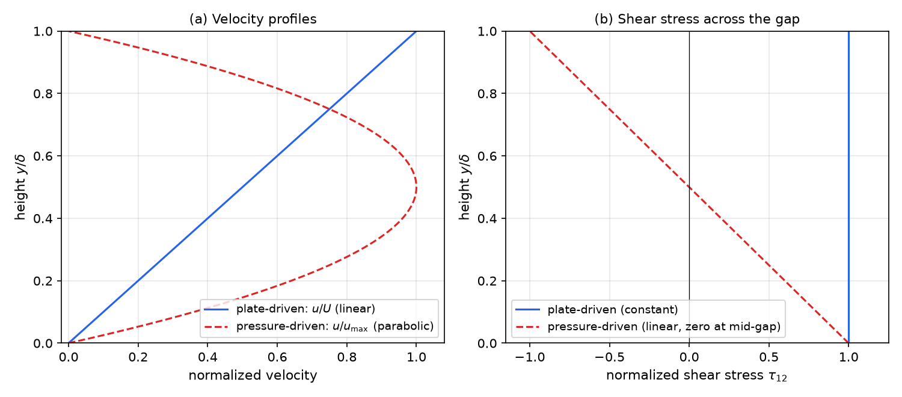
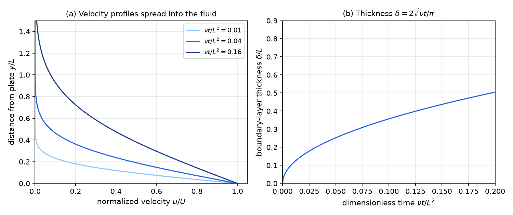
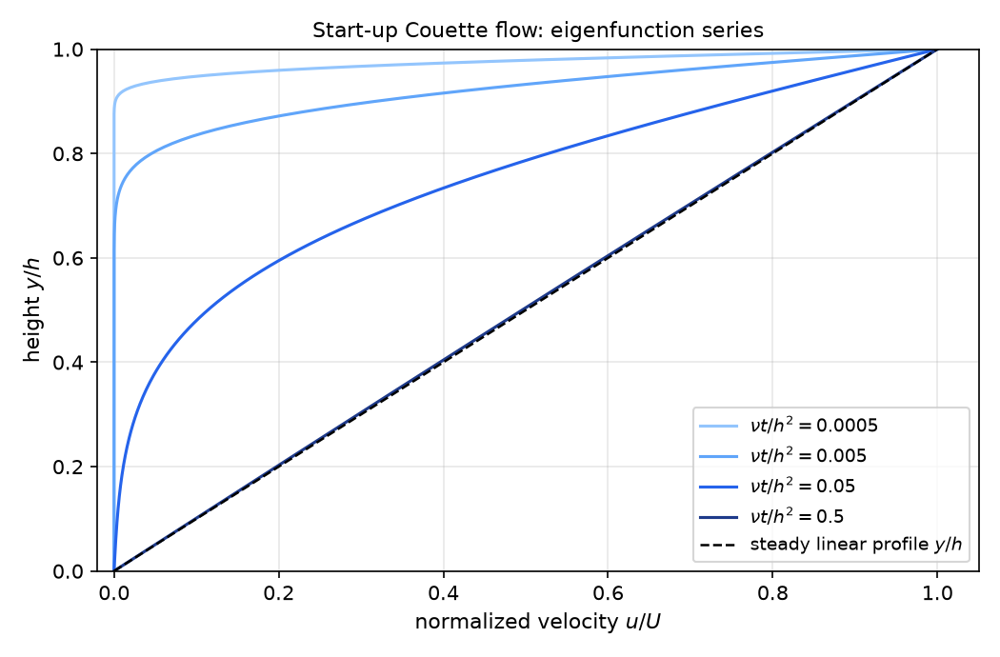

# Viscous Fluids

A fluid has no preferred shape to return to. Under a steady shear it keeps flowing, and the stress it carries depends on how fast it deforms rather than how far. This chapter applies the general constitutive framework to viscous fluids: isotropy reduces the most general viscous response to the Navier–Poisson law, the balance laws then give the Navier–Stokes equations, and those equations are solved for four classical flows.

## Constitutive Classes for Fluids

Throughout, the current position is \\(\mathbf x=(x\_1,x\_2,x\_3)\\), the velocity field is \\(\mathbf v(\mathbf x,t)\\), and \\(\rho\\), \\(p\\) and \\(\mu\\) denote density, pressure and dynamic viscosity. The velocity gradient \\(\mathbf L=\nabla\mathbf v\\) has entries \\(L\_{ij}=\partial v\_i/\partial x\_j\\), and only its symmetric part enters the viscous laws:
\\[
\mathbf D=\tfrac12\left(\mathbf L+\mathbf L^T\right),\qquad D\_{ij}=\tfrac12\left(\frac{\partial v\_i}{\partial x\_j}+\frac{\partial v\_j}{\partial x\_i}\right).
\\]
The rate-of-deformation tensor \\(\mathbf D\\) is objective. Under a change of observer by a rotation \\(\mathbf Q(t)\\), the Cauchy stress \\(\boldsymbol\tau\\) and \\(\mathbf D\\) transform as \\(\boldsymbol\tau\mapsto\mathbf Q\boldsymbol\tau\mathbf Q^T\\) and \\(\mathbf D\mapsto\mathbf Q\mathbf D\mathbf Q^T\\). The velocity gradient is not objective, which is why viscous laws are written in \\(\mathbf D\\) and not in \\(\mathbf L\\).

Three idealized classes of fluid follow from the simplest possible responses.

**Definition (Ideal fluid).** An ideal fluid carries no shear stress: \\(\boldsymbol\tau=-p\mathbf I\\). Its pressure cannot be read off from the deformation; boundary conditions or confinement determine it.

**Definition (Elastic fluid).** An elastic fluid has \\(\boldsymbol\tau=-p(\rho)\mathbf I\\), so its pressure depends only on density, or equivalently on the volume ratio \\(J\\). It is compressible, carries no shear, and recovers its volume when the pressure is released.

**Definition (Viscous fluid).** A viscous fluid has \\(\boldsymbol\tau=-p\mathbf I+\mathbf c(\mathbf D)\\), where \\(\mathbf c\\) is a tensor-valued function of \\(\mathbf D\\). Frame indifference requires
\\[
\mathbf c(\mathbf Q\mathbf D\mathbf Q^T)=\mathbf Q\\,\mathbf c(\mathbf D)\\,\mathbf Q^T\qquad\text{for every rotation }\mathbf Q,
\\]
which says that rotating the deformation rotates the stress in the same way. For a fluid with no preferred direction this identity is the whole content of isotropy.

**Definition (Newtonian fluid).** A Newtonian fluid has \\(\mathbf c(\mathbf D)=\mathbb c\\,\mathbf D\\), where the fourth-order tensor \\(\mathbb c\\) does not depend on \\(\mathbf D\\). The response is linear: doubling the rate of deformation doubles the viscous stress.

Water, air and thin oils are close to Newtonian at ordinary rates. Many other materials are not. In a **shear-thinning** (pseudoplastic) fluid the apparent viscosity falls as the shear rate rises, as in molten polymers, blood and many paints. A **shear-thickening** (dilatant) fluid behaves the other way, as a concentrated cornstarch suspension does. A **Bingham plastic** does not flow until the shear stress exceeds a yield stress, and then flows with a constant viscosity. On a plot of shear stress against shear rate, a Newtonian fluid gives a straight line through the origin, a shear-thinning fluid a curve that bends downward, a shear-thickening fluid a curve that bends upward, and a Bingham plastic a line that misses the origin. The Navier–Stokes equations derived below assume the Newtonian law.

## The Navier–Poisson Law

For a Newtonian fluid, the isotropic fourth-order tensor takes the form (the derivation of isotropic tensors is in [Constitutive Theory and Material Symmetry](constitutive.md))
\\[
c\_{ijkl}=\alpha\\,\delta\_{ij}\delta\_{kl}+\beta\\,\delta\_{ik}\delta\_{jl}+\gamma\\,\delta\_{il}\delta\_{jk},
\\]
with three scalars \\(\alpha\\), \\(\beta\\) and \\(\gamma\\). Contracting with \\(D\_{kl}\\) gives
\\[
(\mathbb c\\,\mathbf D)\_{ij}=c\_{ijkl}D\_{kl}=\alpha\\,\delta\_{ij}D\_{kk}+\beta D\_{ij}+\gamma D\_{ji}=\alpha\\,\delta\_{ij}\operatorname{tr}\mathbf D+(\beta+\gamma)D\_{ij}.
\\]
Because \\(\mathbf D\\) is symmetric, \\(\beta\\) and \\(\gamma\\) appear only through their sum, so only two material constants survive. Writing \\(2\mu=\beta+\gamma\\), the constitutive law becomes
\\[
\boxed{\boldsymbol\tau=-p\\,\mathbf I+\alpha\\,(\operatorname{tr}\mathbf D)\\,\mathbf I+2\mu\\,\mathbf D}.
\\]
This is the **Navier–Poisson relation**. The coefficient \\(\mu\\) is the dynamic viscosity, with units of stress divided by rate of strain, Pa·s. The isotropic term \\(\alpha(\operatorname{tr}\mathbf D)\mathbf I\\) responds to the rate of volume change and is discussed next.

### Compressible fluids and bulk viscosity

The trace \\(\operatorname{tr}\mathbf D=\nabla\cdot\mathbf v\\) is the fractional rate of volume change, \\(\dot J/J\\). Split \\(\mathbf D\\) into its isotropic and deviatoric parts, \\(\mathbf D'=\mathbf D-\tfrac13(\operatorname{tr}\mathbf D)\mathbf I\\). Then
\\[
\boldsymbol\tau=-p\\,\mathbf I+k\\,(\operatorname{tr}\mathbf D)\\,\mathbf I+2\mu\\,\mathbf D',\qquad k=\alpha+\tfrac23\mu .
\\]
The constant \\(k\\) is the **bulk viscosity**. It measures resistance to volume change: a fluid compressed faster needs a larger normal stress. The thermodynamic pressure \\(p\\) is in general not equal to minus one third of the trace of \\(\boldsymbol\tau\\). Taking the trace of the law above gives
\\[
-\tfrac13\operatorname{tr}\boldsymbol\tau=p-k\operatorname{tr}\mathbf D ,
\\]
so the mean normal stress is the thermodynamic pressure reduced by a viscous contribution. Many gas calculations take \\(k=0\\), which is Stokes's hypothesis, but \\(k\\) is an independent material property in general.

### Incompressible fluids

When the flow is incompressible, \\(\operatorname{tr}\mathbf D=0\\) and \\(\mathbf D'=\mathbf D\\). The law reduces to
\\[
\boxed{\boldsymbol\tau=-p\\,\mathbf I+2\mu\\,\mathbf D},\qquad -p=\tfrac13\operatorname{tr}\boldsymbol\tau .
\\]
The pressure is no longer a function of the deformation. It acts as a multiplier that enforces \\(\nabla\cdot\mathbf v=0\\), and boundary conditions determine it as the solution is found.

## Field Equations

### Mass conservation and incompressibility

Mass balance is \\(\partial\rho/\partial t+\nabla\cdot(\rho\mathbf v)=0\\). With constant density the equation reduces to
\\[
\nabla\cdot\mathbf v=\frac{\partial v\_i}{\partial x\_i}=\operatorname{tr}\mathbf L=\operatorname{tr}\mathbf D=0 .
\\]
In Lagrangian form the same condition is \\(J=1\\): a material volume does not change.

### Momentum and the Navier–Stokes equations

The Eulerian balance of linear momentum, for a fluid with body force \\(\mathbf b\\) per unit mass, is
\\[
\rho\left(\frac{\partial\mathbf v}{\partial t}+(\mathbf v\cdot\nabla)\mathbf v\right)=\nabla\cdot\boldsymbol\tau+\rho\mathbf b .
\\]
Insert the Newtonian law \\(\boldsymbol\tau=-p\mathbf I+2\mu\mathbf D\\). The pressure contributes \\(-\partial p/\partial x\_i\\) to the divergence. For the viscous part, the definition of \\(\mathbf D\\) and incompressibility give
\\[
\frac{\partial}{\partial x\_j}\left(2\mu D\_{ij}\right)=\mu\frac{\partial}{\partial x\_j}\left(\frac{\partial v\_i}{\partial x\_j}+\frac{\partial v\_j}{\partial x\_i}\right)=\mu\nabla^2 v\_i+\mu\frac{\partial}{\partial x\_i}\left(\frac{\partial v\_j}{\partial x\_j}\right)=\mu\nabla^2 v\_i ,
\\]
and the last term vanishes because \\(\nabla\cdot\mathbf v=0\\). The result is the **Navier–Stokes equations** for an incompressible Newtonian fluid:
\\[
\boxed{\rho\left(\frac{\partial\mathbf v}{\partial t}+(\mathbf v\cdot\nabla)\mathbf v\right)=-\nabla p+\mu\nabla^2\mathbf v+\rho\mathbf b}.
\\]
Dividing by \\(\rho\\) gives the normalized form, with \\(\nu=\mu/\rho\\) the **kinematic viscosity** (units m²/s; this is not Poisson's ratio) and \\(\tilde p=p/\rho\\):
\\[
\frac{\partial\mathbf v}{\partial t}+(\mathbf v\cdot\nabla)\mathbf v=\nu\nabla^2\mathbf v-\nabla\tilde p+\mathbf b .
\\]
The left side is the acceleration, made of a local and a convective part. The pressure gradient and the body force drive the motion, and \\(\nu\nabla^2\mathbf v\\) is the viscous resistance. The convective term \\((\mathbf v\cdot\nabla)\mathbf v\\) is the only nonlinear term. Together with \\(\nabla\cdot\mathbf v=0\\), the equations supply four scalar relations for the four unknowns \\(\mathbf v\\) and \\(p\\). The stress then follows from the constitutive law.

### Lagrangian form

The same problem can be written in reference coordinates. With \\(\mathbf F=\partial\mathbf x/\partial\mathbf X\\), the first Piola–Kirchhoff stress is \\(\mathbf P=J\boldsymbol\tau\mathbf F^{-T}\\). For an incompressible Newtonian fluid \\(J=1\\), so \\(\mathbf P=\boldsymbol\tau\mathbf F^{-T}\\) with \\(\boldsymbol\tau=-p\mathbf I+2\mu\mathbf D\\), and using \\(2\mathbf D=\mathbf L+\mathbf L^T\\) with \\(\mathbf L=\dot{\mathbf F}\mathbf F^{-1}\\) one finds
\\[
\mathbf P=-p\\,\mathbf F^{-T}+\mu\left(\dot{\mathbf F}\mathbf C^{-1}+\mathbf F^{-T}\dot{\mathbf F}^T\mathbf F^{-T}\right),\qquad \mathbf C=\mathbf F^T\mathbf F .
\\]
This law is nonlinear in \\(\mathbf F\\) and involves the velocity gradient in a complicated way, so fluid mechanics uses the Eulerian form, in which the only nonlinearity is the convective term.

### Boundary and initial conditions

A specific problem needs data on every part of the boundary and at the initial time. The usual choices are:

- a velocity on a solid wall, \\(\mathbf v=\mathbf V\_w\\) (the no-slip condition, with \\(\mathbf V\_w\\) the wall velocity);
- a pressure at an opening, \\(p=\hat p(t)\\), set by a pump or a reservoir;
- a traction on a free surface, \\(\boldsymbol\tau\mathbf n=\hat{\mathbf t}\\), with \\(\hat{\mathbf t}=\mathbf 0\\) for an unloaded surface;
- an initial velocity, usually \\(\mathbf v=\mathbf 0\\) for a fluid at rest before the motion starts.

A **steady** flow has \\(\partial/\partial t=0\\) at every fixed point. Particles still accelerate as they move into regions of different speed, as a river does where it narrows. A steady problem therefore drops the time derivative and becomes a boundary-value problem.

### The Reynolds number

Scale the Navier–Stokes equations by a length \\(l\\) and a velocity \\(V\\). The ratio of convective to viscous terms is the **Reynolds number**,
\\[
\mathrm{Re}=\frac{lV}{\nu}=\frac{\rho lV}{\mu} .
\\]
When \\(\mathrm{Re}\\) is small, viscous forces dominate, the flow is laminar and often solvable in closed form. When \\(\mathrm{Re}\\) is large, inertia dominates, the flow tends to be unsteady and turbulent, and the equations are far harder to solve. For pipe flow the transition begins near \\(\mathrm{Re}\approx 2300\\), depending on the disturbance level. Typical values run from about \\(10^{-4}\\) for a swimming bacterium to about \\(10^{12}\\) for a tropical cyclone.

## Plane Couette Flow

The simplest viscous flows are those between two infinite parallel plates. Let the lower plate lie at \\(y=0\\) and the upper plate at \\(y=\delta\\), with \\(x=x\_1\\) along the flow and \\(y=x\_2\\) across it. Infinite plates avoid side-wall effects. The lower plate is fixed and the upper plate moves at speed \\(U\\). A streamwise pressure gradient \\(G=dp/dx\\) may also drive the fluid.

We look for a steady, laminar, unidirectional flow with no body force,
\\[
\mathbf v=u(y)\\,\mathbf e\_1 .
\\]
Incompressibility holds automatically because \\(\partial u/\partial x=0\\). The convective term vanishes, since \\((\mathbf v\cdot\nabla)\mathbf v=u\\,(\partial u/\partial x)\\,\mathbf e\_1=\mathbf 0\\). The three components of the Navier–Stokes equations reduce to
\\[
0=-\frac{\partial p}{\partial x}+\mu\frac{d^2u}{dy^2},\qquad 0=-\frac{\partial p}{\partial y},\qquad 0=-\frac{\partial p}{\partial z}.
\\]
The last two show that \\(p\\) depends on \\(x\\) alone. In the first equation the left side depends only on \\(y\\) and the right side only on \\(x\\), so both equal a constant, \\(G=dp/dx\\). Integrating twice and imposing \\(u(0)=0\\) and \\(u(\delta)=U\\) gives
\\[
\boxed{u(y)=\frac{U\\,y}{\delta}+\frac{G}{2\mu}\\,y\\,(y-\delta)}.
\\]
The shear stress and normal stresses follow from the constitutive law:
\\[
\tau\_{xy}=\mu\frac{du}{dy}=\frac{\mu U}{\delta}+G\left(y-\frac{\delta}{2}\right),\qquad \tau\_{xx}=\tau\_{yy}=\tau\_{zz}=-p=-(Gx+p\_0),
\\]
with all other components zero. The velocity is a plate-driven part, linear in \\(y\\), plus a pressure-driven part, parabolic in \\(y\\). Because the equations are linear for this flow, the two parts superpose.

**Example 5.1 (Plate-driven Couette flow).** Set \\(G=0\\). The velocity is linear, \\(u=Uy/\delta\\), and the shear stress is uniform, \\(\tau\_{xy}=\mu U/\delta\\). The force per unit area needed to drag the upper plate is therefore \\(\mu U/\delta\\): it grows with speed and viscosity and falls with the gap.

Check this with the power identity, which for a steady flow says that the work rate of the surface tractions equals the viscous dissipation. The moving plate does work at the rate \\(\tau\_{xy}U=\mu U^2/\delta\\) per unit area. The dissipation per unit volume is
\\[
\boldsymbol\tau:\mathbf D=2\tau\_{xy}D\_{xy}=2\left(\frac{\mu U}{\delta}\right)\left(\frac{U}{2\delta}\right)=\frac{\mu U^2}{\delta^2},
\\]
and multiplying by the gap \\(\delta\\) gives \\(\mu U^2/\delta\\) per unit area. The two agree.

**Example 5.2 (Pressure-driven flow between fixed plates).** Set \\(U=0\\) and take \\(G<0\\), so the fluid moves in the \\(+x\\) direction. The velocity is
\\[
u(y)=\frac{\|G\|}{2\mu}\\,y\\,(\delta-y)\ge 0 .
\\]
The maximum lies at mid-gap, \\(u\_{\max}=\|G\|\delta^2/(8\mu)\\). The flow rate per unit width is
\\[
Q=\int\_0^\delta u\\,dy=\frac{\|G\|\\,\delta^3}{12\mu}.
\\]
The shear stress \\(\tau\_{xy}=G(y-\delta/2)\\) is linear. It vanishes at mid-gap, has magnitude \\(\|G\|\delta/2\\) at the walls, and changes sign between the two halves of the channel.

Now check the power identity. The pressure drops by \\(\|G\|L\\) over a length \\(L\\), so the pressure does work at the rate \\(\|G\|LQ=\|G\|^2L\delta^3/(12\mu)\\) per unit width. For the dissipation, \\(D\_{xy}=\tfrac12 du/dy=\tfrac{G}{2\mu}(y-\delta/2)\\), so \\(\boldsymbol\tau:\mathbf D=2\tau\_{xy}D\_{xy}=(G^2/\mu)(y-\delta/2)^2\\). Integrating over the gap with \\(\int\_0^\delta(y-\delta/2)^2\\,dy=\delta^3/12\\) and multiplying by \\(L\\) gives the same value.

*Figure: left, the streamwise velocity across the gap for plate-driven flow (linear) and pressure-driven flow (parabolic), each divided by its maximum. Right, the shear stress across the gap divided by its value at the lower wall. The plate-driven stress is uniform; the pressure-driven stress is linear and changes sign at mid-gap.*

## Hagen–Poiseuille Flow

The axisymmetric counterpart is a fluid driven along a circular pipe of radius \\(a\\). Use cylindrical coordinates \\((r,\theta,x)\\) with \\(x\\) along the axis, and look for a steady, fully developed flow with velocity \\(u(r)\\,\mathbf e\_x\\). The convective term vanishes, and for an axisymmetric function \\(\nabla^2u=\tfrac1r\\,\tfrac{d}{dr}\left(r\\,\tfrac{du}{dr}\right)\\). The axial momentum balance is
\\[
0=-\frac{dp}{dx}+\frac{\mu}{r}\frac{d}{dr}\left(r\frac{du}{dr}\right),
\\]
in which \\(dp/dx=G\\) is uniform along the pipe. Integrating once gives \\(r\\,du/dr=Gr^2/(2\mu)+C\\). Regularity on the axis requires \\(C=0\\), since otherwise \\(du/dr\\) behaves like \\(C/r\\) and \\(u\\) like \\(C\ln r\\). A second integration with the no-slip condition \\(u(a)=0\\) gives
\\[
u(r)=\frac{G}{4\mu}\left(r^2-a^2\right)=\frac{\|G\|}{4\mu}\left(a^2-r^2\right).
\\]
The profile is parabolic with its maximum \\(\|G\|a^2/(4\mu)\\) on the axis. The volumetric flow rate is
\\[
Q=\int\_0^a u\\,2\pi r\\,dr=\frac{\pi\|G\|\\,a^4}{8\mu}.
\\]
Over a pipe of length \\(L\\) with pressure drop \\(\Delta p=\|G\|L\\), this is the **Hagen–Poiseuille equation**:
\\[
\boxed{Q=\frac{\pi a^4\\,\Delta p}{8\mu L}}.
\\]
The mean velocity is \\(Q/(\pi a^2)=u\_{\max}/2\\). The flow rate is proportional to the pressure drop and to the fourth power of the radius, and inversely proportional to viscosity and length. Halving the radius cuts the flow by a factor of sixteen. Because the flow is steady and the kinetic energy does not change, the power identity gives \\(Q\\,\Delta p\\) for the work rate of the pressure, which equals the viscous dissipation in the pipe.

**Example 5.3 (Drinking through a straw).** Take water, with \\(\rho=1000\\) kg/m³ and \\(\mu=1\\) mPa·s, in a straw of diameter \\(D=5\\) mm (radius \\(a=2.5\\) mm) and length \\(L=20\\) cm. Atmospheric pressure is about 101 kPa, and a mouth can at best create a near-vacuum, so \\(\Delta p\le 101\\) kPa. Here \\(\pi a^4/(8\mu L)\approx 7.7\times10^{-8}\\) m³/(s·Pa). For \\(\Delta p=60\\) kPa the steady formula gives \\(Q\approx 4.6\\) L/s, and a full vacuum of 101 kPa gives \\(Q\approx 7.8\\) L/s. The power supplied at 60 kPa is \\(Q\\,\Delta p\approx 0.28\\) kW.

These are steady upper bounds, and a real sip cannot reach them. The mouth cannot hold a vacuum, and the liquid must be accelerated from rest. A more realistic sip raises the liquid 20 cm in 0.1 s. The volume \\(\pi a^2L\approx 3.9\\) mL then gives \\(Q\approx 39\\) mL/s, which needs only \\(\Delta p=8\mu LQ/(\pi a^4)\approx 0.5\\) kPa. The lesson is that the steady model, though exact in its own regime, is a guide to scale and not a prediction for transient drinking.

The straw also shows that one geometry can sit in different regimes. Comparing the Navier–Stokes terms with a mean velocity \\(U\\), the inertial terms scale as \\(\rho U^2/L\\) or \\(\rho U^2/D\\), the pressure term as \\(\Delta p/L\\), and the viscous term as \\(\mu U/D^2\\). Writing the pressure drop with the Darcy friction factor, \\(\Delta p=f\\,(L/D)\\,\rho U^2/2\\), three regimes appear as \\(\mathrm{Re}=\rho UD/\mu\\) and the aspect ratio \\(L/D\\) change:

- **Laminar suction** (small \\(\mathrm{Re}\\)). Viscous and pressure terms balance, \\(\Delta p/L\sim\mu U/D^2\\), and the Hagen–Poiseuille law holds with \\(f=64/\mathrm{Re}\\). A long, thin straw sipped gently behaves this way.
- **Inertial slurping** (wide, short straw). The pressure drop is set by the kinetic-energy scale, \\(\Delta p\sim\rho U^2\\), so \\(\Delta p/L\sim\rho U^2/L\\) and the friction factor scales as \\(D/L\\).
- **Turbulent suction** (long, narrow straw at high \\(\mathrm{Re}\\)). The friction factor is roughly constant, \\(\Delta p\sim(L/D)\rho U^2\\), so \\(\Delta p/L\sim\rho U^2/D\\).

Only the first regime is covered by the exact solution above. The other two require either turbulence modelling or numerical solution of the full equations.

## Transient Flows

### Rayleigh's problem

Suppose the fluid occupies \\(y\ge 0\\) and is at rest. At \\(t=0\\) the plate at \\(y=0\\) is set suddenly into motion at speed \\(U\\) along \\(x\\), and it stays at that speed. The impulsive start has no length scale, so the solution should be self-similar.

Take \\(\mathbf v=u(y,t)\\,\mathbf e\_x\\). The convective term vanishes, and the \\(y\\) and \\(z\\) momentum equations show that \\(p\\) does not depend on \\(y\\) or \\(z\\). If \\(\partial p/\partial x\\) were a nonzero constant, the fluid far from the plate would accelerate without limit, which contradicts its rest state. So \\(\partial p/\partial x=0\\), and the pressure can be taken as zero everywhere. The problem reduces to the diffusion equation
\\[
\frac{\partial u}{\partial t}=\nu\frac{\partial^2u}{\partial y^2},\qquad u(y,0)=0\quad (y>0),\qquad u(0,t)=U\quad (t>0),\qquad u\to 0\quad\text{as }y\to\infty .
\\]
Seek a solution \\(u=U\\,F(\eta)\\) with \\(\eta=y/(2\sqrt{\nu t})\\). Since \\(\partial\eta/\partial t=-\eta/(2t)\\) and \\((\partial\eta/\partial y)^2=1/(4\nu t)\\),
\\[
-\frac{\eta}{2t}F'(\eta)=\frac{F''(\eta)}{4t}\quad\Longrightarrow\quad F''+2\eta F'=0 .
\\]
Integrating gives \\(F'=Ke^{-\eta^2}\\). The condition \\(F(0)=1\\) fixes the constant of integration, and \\(F(\infty)=0\\) gives \\(K\sqrt\pi/2=-1\\). Hence \\(F=1-\operatorname{erf}\eta=\operatorname{erfc}\eta\\), and
\\[
\boxed{u(y,t)=U\operatorname{erfc}\\!\left(\frac{y}{2\sqrt{\nu t}}\right)},\qquad \operatorname{erfc}\eta=\frac{2}{\sqrt\pi}\int\_\eta^\infty e^{-s^2}\\,ds .
\\]
The profile at each time is a rescaled copy of the same curve. Its thickness grows like \\(\sqrt{\nu t}\\), so the momentum diffuses into the fluid as heat does.

The thickness can be defined as the height of a rectangle of speed \\(U\\) with the same area as the profile:
\\[
\delta(t)=\int\_0^\infty\frac{u}{U}\\,dy=2\sqrt{\nu t}\int\_0^\infty\operatorname{erfc}\eta\\,d\eta=2\sqrt{\frac{\nu t}{\pi}},
\\]
using \\(\int\_0^\infty\operatorname{erfc}\eta\\,d\eta=1/\sqrt\pi\\). The spreading speed \\(d\delta/dt=\sqrt{\nu/(\pi t)}\\) decreases with time, and the Reynolds number based on \\(\delta\\) and \\(U\\), \\(U\delta/\nu=2U\sqrt{t/(\pi\nu)}\\), grows with time.

The same mathematics governs conduction. A semi-infinite solid whose surface temperature is suddenly raised to \\(T\_w\\) has \\(T=T\_w\operatorname{erfc}(x/(2\sqrt{\alpha t}))\\), where \\(\alpha\\) is the thermal diffusivity. One equation with \\(\nu\\) replaced by \\(\alpha\\) describes both problems.

*Figure: left, the similarity profiles \\(u/U=\operatorname{erfc}(y/(2\sqrt{\nu t}))\\) at three dimensionless times \\(\nu t/L^2\\), with distance measured in units of \\(L\\). Right, the equal-area boundary-layer thickness \\(\delta=2\sqrt{\nu t/\pi}\\) grows like the square root of time.*

### Start-up Couette flow

Now let the fluid lie between a fixed lower plate at \\(y=0\\) and an upper plate at \\(y=h\\). Both are at rest until \\(t=0\\), when the upper plate starts moving at speed \\(U\\). For \\(u(y,t)\\) along the flow,
\\[
\frac{\partial u}{\partial t}=\nu\frac{\partial^2u}{\partial y^2}\quad(0<y<h,\quad t>0),\qquad u(0,t)=0,\quad u(h,t)=U\quad(t>0),\qquad u(y,0)=0\quad(0<y<h).
\\]
The boundary and initial data disagree at the corner \\(y=h\\), \\(t=0\\). This does not matter, because the solution is continuous for \\(t>0\\).

The problem is solved by splitting, separation of variables and superposition.

1. **Split off the steady part.** The linear profile \\(u^s=Uy/h\\) satisfies the equation and both wall conditions, but not the initial condition. Write \\(u=u^s+w\\). Then \\(w\\) satisfies the same equation with \\(w(0,t)=w(h,t)=0\\) and \\(w(y,0)=-Uy/h\\).

2. **Separate variables.** Seek \\(w=Y(y)T(t)\\). Then \\(T'/(\nu T)=Y''/Y=-\kappa\\). Take the separation constant as \\(-\kappa\\) with \\(\kappa>0\\), so that the time factor decays: \\(T=e^{-\nu\kappa t}\\). The spatial problem \\(Y''+\kappa Y=0\\), \\(Y(0)=0\\), \\(Y(h)=0\\) has solutions \\(Y=\sin(n\pi y/h)\\) with \\(\kappa=(n\pi/h)^2\\) for \\(n=1,2,\dots\\). Each eigenmode decays at its own rate.

3. **Superpose.** The sum of all modes is
\\[
w=\sum\_{n=1}^\infty B\_n\\,e^{-\nu n^2\pi^2 t/h^2}\sin\frac{n\pi y}{h},
\\]
and the initial condition requires \\(\sum\_n B\_n\sin(n\pi y/h)=-Uy/h\\).

4. **Use orthogonality.** The sine functions are orthogonal on \\((0,h)\\), with \\(\int\_0^h\sin(m\pi y/h)\sin(n\pi y/h)\\,dy=(h/2)\delta\_{mn}\\). Multiplying the initial condition by \\(\sin(n\pi y/h)\\) and integrating isolates each coefficient:
\\[
B\_n=\frac{2}{h}\int\_0^h\left(-\frac{Uy}{h}\right)\sin\frac{n\pi y}{h}\\,dy=\frac{2U(-1)^n}{n\pi},
\\]
where the integral uses \\(\int\_0^h y\sin(n\pi y/h)\\,dy=-h^2(-1)^n/(n\pi)\\).

5. **Return to the original variable.** The identity \\(\sin(n\pi(1-s))=-(-1)^n\sin(n\pi s)\\) turns the series into a form that is easy to read. The solution is
\\[
\boxed{u(y,t)=\frac{Uy}{h}-\frac{2U}{\pi}\sum\_{n=1}^\infty\frac{1}{n}\\,e^{-n^2\pi^2\nu t/h^2}\sin\\!\left[n\pi\left(1-\frac{y}{h}\right)\right]}.
\\]

The transient is a sum of decaying sine modes. The slowest one, \\(n=1\\), sets the relaxation time \\(h^2/(\pi^2\nu)\\). This time depends only on the gap and the kinematic viscosity, not on the speed \\(U\\). At \\(\nu t/h^2=0.05\\) the mid-gap velocity is about \\(0.114\\,U\\). The semi-infinite result \\(U\operatorname{erfc}((h-y)/(2\sqrt{\nu t}))\\), which ignores the lower wall, gives the same value to three significant figures. At this time the lower wall has almost no effect on the midplane.

*Figure: start-up Couette profiles \\(u/U\\) against \\(y/h\\) at four dimensionless times \\(\nu t/h^2\\), evaluated from the eigenfunction series. Early on, the motion is confined to a thin layer near the moving wall. The dashed line is the steady linear profile that the flow approaches.*

**Exercise 5.4 (Heat conduction analogue).** A bar of length \\(L\\), initially at \\(T=0\\), has its end \\(x=0\\) held at \\(T\_w\\) and its end \\(x=L\\) held at zero. The same steps, with \\(\nu\\) replaced by the thermal diffusivity \\(\alpha\\), give
\\[
T(x,t)=T\_w\left(1-\frac{x}{L}\right)-\frac{2T\_w}{\pi}\sum\_{n=1}^\infty\frac{1}{n}\\,e^{-n^2\pi^2\alpha t/L^2}\sin\frac{n\pi x}{L}.
\\]
Verify the steps for yourself: the steady part is \\(T\_w(1-x/L)\\), and the sine coefficients are \\(-2T\_w/(n\pi)\\).

## Summary

- Isotropy and frame indifference give the Navier–Poisson law \\(\boldsymbol\tau=-p\mathbf I+\alpha(\operatorname{tr}\mathbf D)\mathbf I+2\mu\mathbf D\\). For incompressible flow, \\(\boldsymbol\tau=-p\mathbf I+2\mu\mathbf D\\) with \\(\nabla\cdot\mathbf v=0\\). The bulk viscosity \\(k=\alpha+2\mu/3\\) governs compressible flow.
- The Navier–Stokes equations are \\(\rho(\partial\mathbf v/\partial t+(\mathbf v\cdot\nabla)\mathbf v)=-\nabla p+\mu\nabla^2\mathbf v+\rho\mathbf b\\). The Reynolds number \\(\mathrm{Re}=lV/\nu\\) measures the balance between inertia and viscosity.
- Plane Couette flow is \\(u=Uy/\delta+(G/2\mu)y(y-\delta)\\). Plate-driven shear is \\(\mu U/\delta\\). Pressure-driven flow is parabolic with flow rate \\(\|G\|\delta^3/(12\mu)\\).
- Pipe flow is \\(u=(\|G\|/4\mu)(a^2-r^2)\\), with Hagen–Poiseuille law \\(Q=\pi a^4\Delta p/(8\mu L)\\).
- The power identity holds in each steady case: the work rate of the boundary tractions and pressures equals the viscous dissipation \\(\int\boldsymbol\tau:\mathbf D\\,dV\\).
- Rayleigh's problem: \\(u=U\operatorname{erfc}(y/(2\sqrt{\nu t}))\\) and \\(\delta=2\sqrt{\nu t/\pi}\\).
- Start-up Couette flow: \\(u=Uy/h-(2U/\pi)\sum(1/n)e^{-n^2\pi^2\nu t/h^2}\sin[n\pi(1-y/h)]\\), with relaxation time \\(h^2/(\pi^2\nu)\\).

## See Also

- [Tensor Algebra and Calculus](tensors.md) and [Kinematics of Deformation](kinematics.md): the tensor tools and the velocity gradient used here.
- [Balance Laws and Stress](balance-laws.md): the mass and momentum balances and the power identity.
- [Constitutive Theory and Material Symmetry](constitutive.md): objectivity and isotropic response functions.
- [Hyperelastic Solids](hyperelasticity.md): the solid counterpart, where stress derives from a stored energy.
- [Fluid Mechanics](../../fluid/README.md): the engineering treatment of fluid flow, including [internal flow](../../fluid/internal.md) and [turbulence](../../fluid/turbulence.md).
- [Partial Differential Equations](../../../math/diffeq/pdes.md): the diffusion equation and similarity solutions.
- [Numerical PDEs](../../../math/numerical/pdes.md): numerical solution of the Navier–Stokes equations when no closed form exists.
