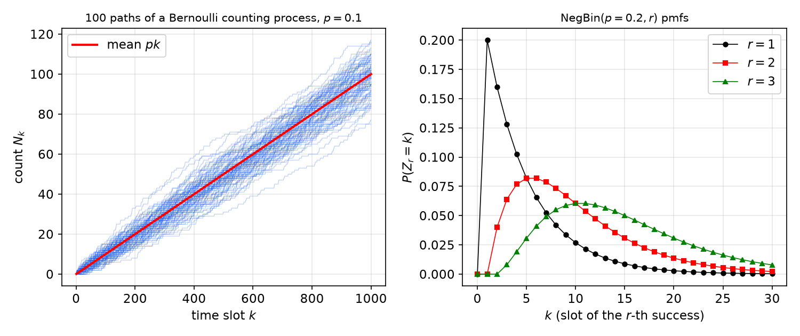
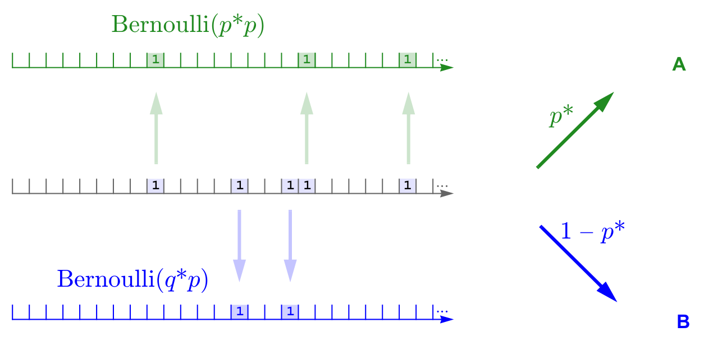
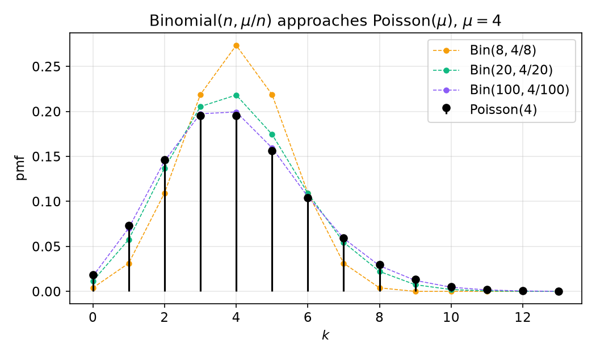
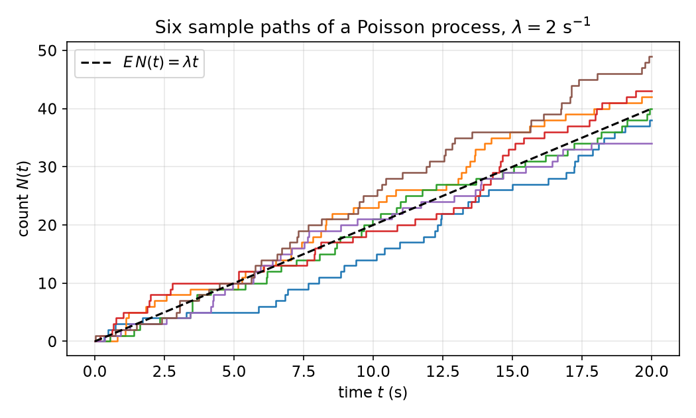
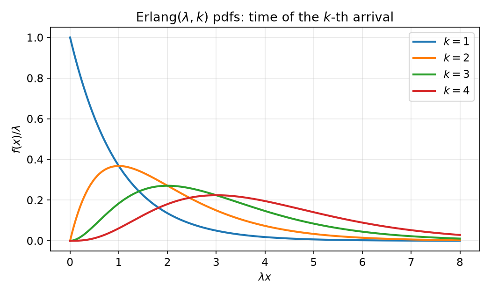
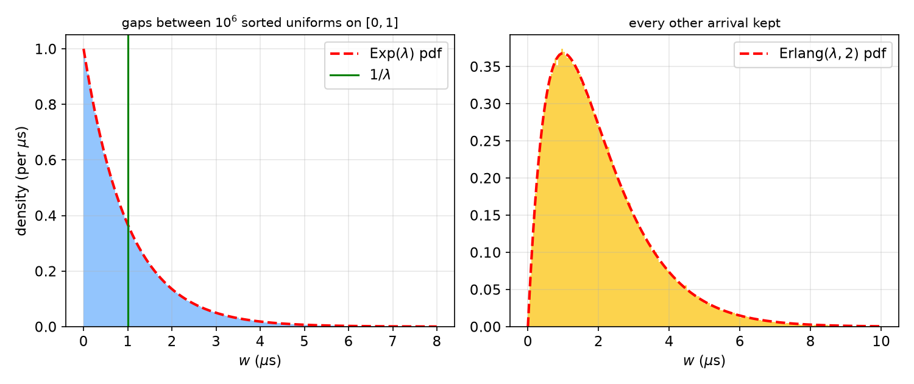

# Bernoulli and Poisson Processes

The simplest random processes are arrival processes: a sequence of moments at which something happens, such as a coke cap with a star, a raindrop on a sensor, a photon on a detector or a car on a bridge. This chapter builds the two canonical models. The **Bernoulli process** lives in discrete time and is a sequence of independent coin flips. The **Poisson process** lives in continuous time and is the limit of a Bernoulli process with ever finer slots. The two theories run in parallel: counts in a window are binomial or Poisson, waiting times are geometric or exponential, the time of the \\(k\\)-th arrival is negative binomial or Erlang, and both processes can be split and merged. Merging also gives an easy way to analyse *races* between independent waiting times.

## The Bernoulli Process

**Definition (Bernoulli process).** A Bernoulli process with parameter \\(p\\) is an infinite sequence \\(\\{X\_i\\}\_{i\ge 1}\\) of mutually independent Bernoulli\\((p)\\) random variables:
\\[
P(X\_i = 1) = p, \qquad P(X\_i = 0) = 1 - p \triangleq q .
\\]
A 1 in slot \\(i\\) is called a *success* or an *arrival*.

There are two ways to view it. In the first, the process is an infinite collection of random variables, each from its own experiment with sample space \\(\\{0,1\\}\\), and it is characterized by the joint pmfs of every finite subset. Independence makes these products: \\(P(X\_1=x\_1,\dots,X\_n=x\_n) = p^{\sum x\_i}q^{n-\sum x\_i}\\). In the second view there is a single experiment whose sample space is the set of all infinite binary sequences. Every individual outcome then has probability zero. For example, the all-ones sequence has probability \\(\lim\_{n\to\infty}p^n = 0\\) whenever \\(p<1\\), so probabilities must be assigned to events (sets of sequences) rather than to outcomes.

The Bernoulli process is the discrete-time analogue of the Poisson process. Three random variables built from it recur throughout. They can be introduced through a running example.

**Example (Coke caps).** Five percent of coke caps carry a star, independently, so the caps of successive cokes form a Bernoulli\\((0.05)\\) process. Define

- \\(Y\\) = number of stars in a six-pack;
- \\(W\\) = number of cokes up to and including the first star;
- \\(Z\\) = number of cokes up to and including the fifth star.

Then \\(Y\\) is binomial, \\(W\\) is geometric and \\(Z\\) is negative binomial, as derived next.

### Counting arrivals: the binomial distribution

The number of arrivals in a window of \\(n\\) slots is \\(Y = X\_1+\dots+X\_n\\). There are \\(\binom{n}{k}\\) placements of \\(k\\) ones among \\(n\\) slots, and each has probability \\(p^kq^{n-k}\\), so
\\[
P(Y = k) = \binom{n}{k}p^kq^{n-k}, \qquad k = 0,1,\dots,n .
\\]
The moment generating function follows because the mgf of a sum of independent random variables is the product of their mgfs:
\\[
\phi\_Y(s) = E\big(e^{sY}\big) = \prod\_{i=1}^n E\big(e^{sX\_i}\big) = (q + pe^s)^n .
\\]
Expanding with the binomial theorem, \\((q+pe^s)^n = \sum\_k \binom nk q^{n-k}p^k e^{sk}\\), and the coefficient of \\(e^{sk}\\) is exactly \\(P(Y=k)\\). This confirms the pmf. Linearity gives \\(E(Y) = np\\). Independence makes the variances add, so \\(\mathrm{var}(Y) = npq\\).

The **Bernoulli counting process** is the running count \\(N\_k = \sum\_{i=1}^k X\_i\\), a nondecreasing staircase that rises by one at each arrival. For fixed \\(k\\), \\(N\_k\sim\mathrm{Bin}(k,p)\\). For example, \\(N\_{800}\sim\mathrm{Bin}(800,p)\\). A hundred simulated paths with \\(p = 0.1\\) fan out around the line \\(pk\\). Their spread grows like \\(\sqrt{kpq}\\), much more slowly than the mean.

```matlab
plot(cumsum(rand(1000,100) < 0.1))   % 100 sample paths, p = 0.1
```



*Figure: left, 100 sample paths of the Bernoulli counting process \\(N\_k\\) with \\(p=0.1\\), scattered around the mean \\(pk\\) (red). Right, negative binomial pmfs of the slot of the \\(r\\)-th success for \\(p=0.2\\). The case \\(r=1\\) is the geometric pmf. Larger \\(r\\) moves the peak to the right (near \\((r-1)/p\\)) and spreads it out.*

### Waiting for a success: the geometric distribution

Let \\(W\\) be the slot of the first arrival. \\(W>k\\) exactly when the first \\(k\\) trials all fail, so the complementary cdf (ccdf) is
\\[
P(W > k) = q^k, \qquad k = 0,1,2,\dots
\\]
Differencing gives the pmf, and summing a geometric series gives the mgf:
\\[
P\_W(k) = pq^{k-1}\\ (k\ge 1), \qquad F\_W(k) = 1-q^k, \qquad \phi\_W(s) = \sum\_{k\ge1} e^{sk}pq^{k-1} = \frac{pe^s}{1-qe^s}\quad (s<\ln(1/q)).
\\]
Differentiating the mgf gives
\\[
E(W) = \frac1p, \qquad \mathrm{var}(W) = \frac{q}{p^2}.
\\]
We write \\(W\sim\mathrm{Geo}(p)\\). In the coke example the expected number of cokes up to the first star is \\(1/0.05 = 20\\).

### Memorylessness

**Theorem (memoryless property of the geometric).** If \\(W\sim\mathrm{Geo}(p)\\), then for all integers \\(k,m\ge 0\\),
\\[
P(W > k+m \mid W > k) = P(W > m).
\\]
*Proof.* The event \\(\\{W>k+m\\}\\) is contained in \\(\\{W>k\\}\\), so
\\[
P(W>k+m\mid W>k) = \frac{P(W>k+m)}{P(W>k)} = \frac{q^{k+m}}{q^k} = q^m = P(W>m). \qquad\blacksquare
\\]
Having already waited \\(k\\) slots tells us nothing about the remaining wait. This is clear from the process itself: the trials after slot \\(k\\) form a fresh Bernoulli process, independent of the past.

**Example (No stars after 60 cokes).** If no star has appeared in 60 cokes, the probability of still having no star after 75 is \\(P(W>75\mid W>60) = q^{15} = 0.95^{15}\approx 0.46\\). This is the same as the probability that a fresh sequence of 15 cokes has no star.

The continuous counterpart is the exponential distribution. If \\(X\sim\mathrm{Exp}(\lambda)\\), then \\(1-F(x) = e^{-\lambda x}\\) and
\\[
P(X>t+x\mid X>t) = \frac{1-F(t+x)}{1-F(t)} = \frac{e^{-\lambda(t+x)}}{e^{-\lambda t}} = e^{-\lambda x} = P(X>x).
\\]
Two facts are worth remembering. Among distributions on the positive integers, the geometric is the only memoryless one. Among continuous distributions on \\([0,\infty)\\), the exponential is the only one. The geometric is the discrete version of the exponential.

**Example (Light bulb).** A bulb has an exponential lifetime with mean 1000 h. If it has survived 1000 h, the probability that it survives another 1000 h is \\(P(X>2000\mid X>1000) = P(X>1000) = e^{-1}\approx 0.37\\). If it has survived 99 years, the probability of another 1000 h is again 0.37. However old it is, a working bulb has the same remaining-lifetime distribution as a new one. Real bulbs age, so memorylessness is a modelling assumption that fits failures caused by random external shocks better than failures caused by wear.

### Waiting for the r-th success: the negative binomial

Let \\(Z\_r\\) be the slot of the \\(r\\)-th arrival. If \\(W\_1,W\_2,\dots\\) are the gaps between successive arrivals (with \\(W\_1\\) the slot of the first arrival), then
\\[
Z\_r = W\_1 + W\_2 + \dots + W\_r ,
\\]
and the \\(W\_i\\) are i.i.d. Geo\\((p)\\). After each arrival the process starts afresh. For example, with \\(r=5\\), gaps \\(9,5,3,1,6\\) give \\(Z\_5 = 24\\). Because the gaps are i.i.d.,
\\[
\phi\_{Z\_r}(s) = \left(\frac{pe^s}{1-qe^s}\right)^r, \qquad E(Z\_r) = \frac rp, \qquad \mathrm{var}(Z\_r) = \frac{rq}{p^2}.
\\]
The pmf can also be found directly. \\(Z\_r = k\\) means exactly \\(r-1\\) successes in the first \\(k-1\\) slots, followed by a success in slot \\(k\\). These two events are independent, so
\\[
P(Z\_r = k) = \binom{k-1}{r-1}p^{r-1}q^{k-r}\cdot p = \binom{k-1}{r-1}p^rq^{k-r}, \qquad k = r, r+1, \dots
\\]
This is the **negative binomial** distribution, NegBin\\((p,r)\\), and \\(r=1\\) recovers the geometric.

**Example (More than 420 tosses to get 200 heads).** For a fair coin, find the probability that more than 420 tosses are needed to obtain 200 heads.

*Exact.* With \\(p=q=0.5\\) and \\(r = 200\\), \\(P(Z>420) = \sum\_{k=421}^{\infty}\binom{k-1}{199}0.5^{k} \approx 0.153\\).

*Central limit approximation.* \\(Z\\) is a sum of 200 i.i.d. geometric random variables, so it is approximately Gaussian with mean \\(200/p = 400\\) and variance \\(200q/p^2 = 400\\). Applying a continuity correction,
\\[
P(Z>420) \approx Q\left(\frac{420.5-400}{20}\right) = Q(1.025) \approx 0.153 .
\\]
The approximation is excellent here because \\(r=200\\) is large. (The Gaussian approximation is discussed in [Iterated Expectation and Limit Theorems](limit-theorems.md).)

### Two routes to the Bernoulli process

We started from i.i.d. Bernoulli trials and derived i.i.d. geometric gaps. The reverse also works. If the gaps \\(W\_1,W\_2,\dots\\) are i.i.d. Geo\\((p)\\) and arrivals are placed at \\(W\_1, W\_1+W\_2, \dots\\), then the slot indicators are i.i.d. Bernoulli\\((p)\\). Each slot after an arrival is a success with probability \\(p\\) regardless of what came before, because the geometric is memoryless. So either description can serve as the definition.

### Nested windows: binomial and hypergeometric

**Example (Counts over nested windows).** In a Bernoulli\\((p)\\) process, let \\(X\\) be the number of arrivals in the first \\(K\\) slots and \\(Y\\) the number in the first \\(N>K\\) slots. Find (a) the correlation coefficient \\(\rho\\), (b) \\(E(Y\mid X=n)\\), (c) \\(P(Y=k\mid X=n)\\) and (d) \\(P(X=k\mid Y=n)\\).

*Solution.* The key step is to split the larger window into non-overlapping pieces: \\(Y = X + U\\), where \\(U\\) counts arrivals in slots \\(K+1,\dots,N\\). Then \\(X\sim\mathrm{Bin}(K,p)\\) and \\(U\sim\mathrm{Bin}(N-K,p)\\) are independent.

(a) \\(E(XY) = E(X^2) + E(X)E(U)\\) and \\(E(X)E(Y) = E(X)^2 + E(X)E(U)\\), so \\(\mathrm{cov}(X,Y) = \mathrm{var}(X)\\) and
\\[
\rho = \frac{\mathrm{var}(X)}{\sqrt{\mathrm{var}(X)\mathrm{var}(Y)}} = \frac{Kpq}{\sqrt{Kpq\cdot Npq}} = \sqrt{\frac{K}{N}} .
\\]
The correlation depends only on how much the windows overlap.

(b) \\(E(Y\mid X=n) = n + E(U\mid X=n) = n + E(U) = n + (N-K)p\\).

(c) Given \\(X=n\\), \\(Y = n+U\\), which is the binomial pmf of \\(U\\) shifted right by \\(n\\): \\(P(Y=k\mid X=n) = P\_U(k-n) = \binom{N-K}{k-n}p^{k-n}q^{N-K-k+n}\\).

(d) By the definition of conditional probability, using \\(\\{X=k,Y=n\\} = \\{X=k, U=n-k\\}\\),
\\[
P(X=k\mid Y=n) = \frac{\binom Kk p^kq^{K-k}\binom{N-K}{n-k}p^{n-k}q^{N-K-n+k}}{\binom Nn p^nq^{N-n}} = \frac{\binom Kk\binom{N-K}{n-k}}{\binom Nn}.
\\]
The parameter \\(p\\) cancels. Given \\(n\\) arrivals among \\(N\\) slots, every set of \\(n\\) arrival slots is equally likely. So \\(X\\) has the distribution of the number of "first-window" slots in a uniformly random \\(n\\)-subset of the \\(N\\) slots. This is the **hypergeometric** distribution, HyperGeo\\((n,K,N)\\).

The hypergeometric is the "sampling without replacement" counterpart of the binomial.

**Example (Vending machine).** A vending machine holds 1000 cokes and we buy six. Let \\(X\\) be the number of stars.

- If each cap independently has a star with probability 0.05, the chance is the same for every purchase (as if each coke were replaced). Then \\(X\sim\mathrm{Bin}(6,0.05)\\).
- If exactly 50 of the 1000 cokes have stars, each purchase changes the odds for the next one (no replacement). Then \\(X\sim\mathrm{HyperGeo}(6,50,1000)\\).

| | with replacement | without replacement |
|---|---|---|
| model | \\(n\\) draws, defect fraction \\(p = K/N\\) | \\(n\\) draws from \\(N\\) items, \\(K\\) defective |
| distribution | \\(\mathrm{Bin}(n,p)\\) | \\(\mathrm{HyperGeo}(n,K,N)\\) |
| pmf | \\(\binom nk p^k(1-p)^{n-k}\\) | \\(\binom Kk\binom{N-K}{n-k}\big/\binom Nn\\) |
| mean | \\(np\\) | \\(np\\) |
| variance | \\(np(1-p)\\) | \\(\dfrac{N-n}{N-1}\\,np(1-p)\\) |

The factor \\((N-n)/(N-1)\\) is the *finite-population correction*. Drawing without replacement reduces the variance, because each draw slightly balances the next. As \\(N\to\infty\\) with \\(K/N=p\\) fixed, the correction tends to 1 and the hypergeometric tends to the binomial.

**Example (Defective golf balls).** Golf balls are defective independently with probability 0.02, and a factory packs 500 boxes of 12 per day. Name the distributions of the following:

- defectives per box: \\(X\sim\mathrm{Bin}(12,0.02)\\), with mean \\(0.24\\);
- defectives per day: \\(Y\sim\mathrm{Bin}(6000,0.02)\\), with mean 120;
- perfect boxes per day: \\(\mathrm{Bin}(500,0.98^{12})\\), where \\(0.98^{12}\approx 0.785\\);
- boxes inspected until the first perfect one: \\(\mathrm{Geo}(0.98^{12})\\);
- boxes inspected until the third perfect one: \\(\mathrm{NegBin}(0.98^{12},3)\\);
- perfect boxes among three drawn from a day's output with 400 perfect and 100 imperfect boxes: \\(\mathrm{HyperGeo}(3,400,500)\\).

Since \\(np = 120\\) lies well inside \\((10, n-10)\\), \\(Y\approx\mathcal N(120,117.6)\\), and with a continuity correction \\(P(Y\ge130)\approx Q(9.5/\sqrt{117.6}) = Q(0.876)\approx 0.19\\). The exact value is 0.1895. Is 119 or 120 defectives more likely? The ratio of consecutive binomial probabilities is
\\[
\frac{P(120)}{P(119)} = \frac{n-119}{120}\cdot\frac pq = \frac{5881}{120}\cdot\frac{1}{49} = \frac{5881}{5880} > 1,
\\]
so 120 is very slightly more likely. Finally, suppose two boxes contain exactly two defectives in total. All \\(\binom{24}{2}\\) pairs of the 24 ball positions are equally likely, so the probability that the defectives are in different boxes is \\(12^2/\binom{24}{2} = 144/276 = 12/23\approx 0.565\\).

### Splitting and merging Bernoulli processes

**Splitting.** Start with a Bernoulli\\((p)\\) process and send each arrival to stream A with probability \\(p^{\star}\\) or to stream B with probability \\(1-p^{\star}\\), independently. In each slot, A has an arrival with probability \\(pp^{\star}\\), independently across slots. So A is a Bernoulli\\((pp^{\star})\\) process and B is a Bernoulli\\((p(1-p^{\star}))\\) process. **The two streams are not independent**, however. They can never both have an arrival in the same slot: \\(P(A\_k=1,B\_k=1) = 0 \ne P(A\_k=1)P(B\_k=1)\\).



*Figure: random splitting. Each arrival of the middle Bernoulli\\((p)\\) stream goes up to A with probability \\(p^{\star}\\) or down to B with probability \\(q^{\star} = 1-p^{\star}\\). Each output is Bernoulli, but the outputs are dependent because no slot can feed both.*

A *deterministic* split is different. If arrivals are assigned alternately A, B, A, B, …, stream A can never have two arrivals in a row unless the original process had an arrival in between, so it is not a Bernoulli process at all.

**Merging.** Let \\(X\_k\\) be i.i.d. Bern\\((p\_1)\\) and \\(Y\_k\\) i.i.d. Bern\\((p\_2)\\), with the two sequences independent. The merged process has an arrival when either does:
\\[
Z\_k = 1-(1-X\_k)(1-Y\_k).
\\]
(a) The \\(Z\_k\\) are i.i.d., because each is a function of the independent pair \\((X\_k,Y\_k)\\), so the merged process is Bernoulli. (b) Its parameter is
\\[
p^{\star} = P(Z\_k = 1) = 1-q\_1q\_2 = p\_1+p\_2-p\_1p\_2 .
\\]
(c) Given a merged arrival, the probability that it came from \\(X\\) is \\(P(X\_k=1\mid Z\_k=1) = p\_1/p^{\star}\\). Reading the per-slot table helps here. The four outcomes \\((X\_k,Y\_k)\\) have probabilities \\(q\_1q\_2, p\_1q\_2, q\_1p\_2, p\_1p\_2\\). The merged arrival is everything except \\((0,0)\\), and the event \\(X\_k = 1\\) is the cells \\(p\_1q\_2 + p\_1p\_2 = p\_1\\).

### Geometric races

**Example (A race between two coke machines).** A machine in Atlanta gives stars as a Bernoulli\\((p\_1)\\) process and one in Shenzhen as an independent Bernoulli\\((p\_2)\\) process. Let \\(W\_1\sim\mathrm{Geo}(p\_1)\\) and \\(W\_2\sim\mathrm{Geo}(p\_2)\\) be their first-star times.

(a) *The winning time \\(W = \min\\{W\_1,W\_2\\}\\).* The ccdf method gives \\(P(W>k) = P(W\_1>k)P(W\_2>k) = (q\_1q\_2)^k\\), which is the ccdf of a geometric. So
\\[
W\sim\mathrm{Geo}(p^{\star}), \qquad p^{\star} = 1-q\_1q\_2 = p\_1+p\_2-p\_1p\_2 .
\\]
Another way to see it: \\(W\\) is the first arrival of the merged Bernoulli\\((p^{\star})\\) process.

(b) *The probability that Atlanta wins outright*, \\(P(W\_1<W\_2)\\). Condition on \\(W\_1\\), which is the law of total probability written as an expectation. Then use the mgf of \\(W\_1\\) evaluated at \\(s = \ln q\_2\\):
\\[
P(W\_1<W\_2) = E\big(P(W\_2>W\_1\mid W\_1)\big) = E\big(q\_2^{W\_1}\big) = \phi\_{W\_1}(\ln q\_2) = \frac{p\_1q\_2}{1-q\_1q\_2} = \frac{p\_1q\_2}{p\_1+p\_2-p\_1p\_2}.
\\]
The same result follows by summing over the pmf of \\(W\_1\\):
\\[
P(W\_1<W\_2) = \sum\_{k\ge1} q\_2^k\\,p\_1q\_1^{k-1} = \frac{p\_1}{q\_1}\sum\_{k\ge1}(q\_1q\_2)^k = \frac{p\_1}{q\_1}\left(\frac{1}{1-q\_1q\_2}-1\right) = \frac{p\_1q\_2}{1-q\_1q\_2}.
\\]
The per-slot table explains the answer. The race ends in the first slot that is not \\((0,0)\\), and Atlanta wins outright if that slot is \\((1,0)\\), which has probability \\(p\_1q\_2\\). Ties, in cell \\((1,1)\\), are possible in discrete time.

**Three-way race.** For independent \\(W\_i\sim\mathrm{Geo}(p\_i)\\), \\(i=1,2,3\\), \\(P(\min > k) = (q\_1q\_2q\_3)^k\\), so the winning time is Geo\\((p^{\star})\\) with
\\[
p^{\star} = 1-q\_1q\_2q\_3 = p\_1+p\_2+p\_3-p\_1p\_2-p\_1p\_3-p\_2p\_3+p\_1p\_2p\_3 .
\\]
The second form is inclusion–exclusion for the union of three independent arrival events. Equivalently, it is the first arrival of three merged fictitious Bernoulli processes.

**Example (Water-bottle race).** \\(n\\) players flip water bottles simultaneously and repeatedly until at least one bottle lands upright. If exactly one lands upright, that player wins. If two or more do, nobody wins. Either way the game ends. Player \\(i\\) succeeds with probability \\(p\_i\\) on each round. Player \\(k\\) is in a geometric race against the merged process of all other players, whose first arrival is \\(W'\sim\mathrm{Geo}(p')\\) with \\(p' = 1-\prod\_{i\ne k}q\_i\\). Player \\(k\\) wins if and only if \\(W\_k < W'\\), so applying (b),
\\[
P(\text{player } k \text{ wins}) = \frac{p\_k\prod\_{i\ne k}q\_i}{1-q\_k\prod\_{i\ne k}q\_i} = \frac{p\_k\prod\_{i\ne k}q\_i}{1-\prod\_i q\_i}.
\\]

**Example (Race of Geo(0.1) and Geo(0.2)).** Let \\(W\_1\sim\mathrm{Geo}(0.1)\\) and \\(W\_2\sim\mathrm{Geo}(0.2)\\) be independent.

- \\(W = \min\\{W\_1,W\_2\\}\sim\mathrm{Geo}(1-0.9\cdot0.8) = \mathrm{Geo}(0.28)\\). The direct sum \\(P(W=k) = p\_1q\_1^{k-1}q\_2^k + q\_1^kp\_2q\_2^{k-1} + p\_1q\_1^{k-1}p\_2q\_2^{k-1}\\) simplifies to \\((1-q\_1q\_2)(q\_1q\_2)^{k-1}\\), as it must.
- \\(E(W\_2\mid W\_1>10) = E(W\_2) = 5\\) by independence.
- \\(E(W\_1\mid W\_1>10) = 10 + 1/p\_1 = 20\\) by memorylessness.
- \\(P(W\_2>10) = 0.8^{10}\approx 0.107\\).
- \\(P(W\_2>W\_1) = p\_1q\_2/(1-q\_1q\_2) = 0.08/0.28 = 2/7\\).
- \\(E(W\_1\mid W\_2>W\_1) = 1/p^{\star} = 25/7\approx 3.57\\).

The last answer reflects a general fact. Let \\(I\\) record the outcome: a tie, player 1 winning or player 2 winning. Then \\(I\\) is independent of the winning time \\(W\\). The race ends at the first slot that is not \\((0,0)\\), and *which* nonzero cell occurs in that slot is independent of *when* it occurs, with \\(P\_I = [p\_1p\_2,\\ p\_1q\_2,\\ q\_1p\_2]/p^{\star}\\). Directly:
\\[
E(W\_1\mid W\_2>W\_1) = \frac{1}{P(W\_2>W\_1)}\sum\_k k\\,p\_1q\_1^{k-1}q\_2^k = \frac{p^{\star}}{p\_1q\_2}\cdot\frac{p\_1q\_2}{(p^{\star})^2} = \frac{1}{p^{\star}}.
\\]

**Example (A coke machine with golden-ratio probabilities).** A machine's button fails on press \\(k\ge 1\\) with probability \\(1/a^{k+1}\\), after dispensing \\(k-1\\) cokes. Each cap independently has a star with probability \\(1/a\\). Let \\(X\\) be the number of stars collected before the machine dies. Find the pmf of \\(Y = X+1\\).

*Solution.* Normalization requires \\(1 = \sum\_{k\ge1}a^{-(k+1)} = \frac{1}{a^2}\cdot\frac{1}{1-1/a} = \frac{1}{a(a-1)}\\), so \\(a^2-a-1=0\\) and \\(a = \varphi = (1+\sqrt5)/2\\). The failure press is Geo\\((p\_1)\\) with \\(p\_1 = 1/\varphi^2 = 2-\varphi\approx 0.382\\). Stars are Bernoulli with \\(p\_2 = 1/\varphi = \varphi-1\approx 0.618\\). Note that \\(p\_1 = q\_2\\) and \\(p\_2 = q\_1\\).

Treat the two as merged processes, a "failure" stream and a "star" stream. A merged arrival in which the button fails ends the game, and
\\[
P(\text{failure}\mid\text{merged arrival}) = \frac{p\_1}{p\_1+p\_2-p\_1p\_2} = \frac{p\_1}{1-q\_1q\_2} = \frac{p\_1}{1-p\_1p\_2} .
\\]
Since \\(p\_1p\_2 = \varphi^{-3}\\) and \\(1-\varphi^{-3} = 2\varphi^{-2}\\) (because \\(\varphi^3 = 2\varphi+1\\) and \\(\varphi^2 = \varphi+1\\)), this probability equals \\(\tfrac12\\). Every merged arrival is therefore a fair coin flip between "star, keep going" and "machine dies". So \\(X\\) is the number of tails before the first head, and
\\[
Y = X+1\sim\mathrm{Geo}(0.5), \qquad P\_Y(r) = 0.5^r .
\\]
A brute-force sum \\(\sum\_{k\ge r}\binom{k-1}{r-1}p\_2^{r-1}q\_2^{k-r}p\_1q\_1^{k-1}\\) gives the same result.

## The Poisson Process

Many arrival phenomena have a *deterministic* rate combined with *completely random* timing. Raindrops hitting a sensor arrive at so many drops per second on average, but they do not fall at regular intervals or coordinate with each other. Other examples are photons on a photodetector, clicks of a Geiger counter, hits on a website, packets at a router, cars crossing a bridge, customers entering a store and meteors in a shower ("10–15 meteors per hour").

**Definition (Poisson process).** A counting process \\(N(t)\\), \\(t\ge0\\), with \\(N(0)=0\\), is a Poisson process with rate \\(\lambda>0\\) if

1. it has **independent increments**: counts in disjoint intervals are independent;
2. it has **stationary increments**: the distribution of the count in an interval depends only on the interval's length;
3. the count in any interval of length \\(T\\) is Poisson\\((\lambda T)\\):
\\[
P\big(N(t+T)-N(t) = k\big) = e^{-\lambda T}\frac{(\lambda T)^k}{k!}, \qquad k=0,1,2,\dots
\\]

An equivalent definition is that the interarrival times are i.i.d. Exp\\((\lambda)\\). Both directions are proved below.

### The Poisson pmf as a limit of the binomial

Why should the count be Poisson? Take a window of length \\(T\\) and divide it into \\(n\\) slots of width \\(T/n\\). For large \\(n\\), the slots are so short that at most one arrival falls in any of them. The chance of an arrival in a slot is proportional to its width, \\(\lambda T/n\\), and different slots are independent. The slot indicators therefore form a Bernoulli process and the count is \\(\mathrm{Bin}(n,\lambda T/n)\\):
\\[
P(Y=k) = \binom nk\left(\frac{\lambda T}{n}\right)^k\left(1-\frac{\lambda T}{n}\right)^{n-k} = \underbrace{\frac{n(n-1)\cdots(n-k+1)}{n\cdot n\cdots n}}\_{\to 1}\\;\frac{(\lambda T)^k}{k!}\\;\underbrace{\left(1-\frac{\lambda T}{n}\right)^{n-k}}\_{\to e^{-\lambda T}} .
\\]
As \\(n\to\infty\\) with \\(k\\) fixed, the first factor is a product of \\(k\\) ratios each tending to 1. The last factor tends to \\(e^{-\lambda T}\\), since \\((1-x/n)^n\to e^{-x}\\) and the extra \\((1-\lambda T/n)^{-k}\to1\\). Hence
\\[
\boxed{P(Y=k) = e^{-\lambda T}\frac{(\lambda T)^k}{k!}}, \qquad Y\sim\mathrm{Poisson}(\lambda T).
\\]
More generally, \\(\mathrm{Bin}(n,\mu/n)\to\mathrm{Poisson}(\mu)\\). The three distributions fit into one picture. When \\(n\\) is small, use the binomial. When \\(n\\) is large but \\(np\\) is moderate, use the Poisson (the law of rare events). When \\(n\\) and \\(np\\) are both large, use the Gaussian. The Gaussian approximation \\(\mathrm{Poisson}(\mu)\approx\mathcal N(\mu,\mu)\\) is good for \\(\mu>10\\).



*Figure: binomial pmfs with mean \\(\mu=4\\) and \\(n = 8, 20, 100\\) (dashed), compared with the Poisson(4) pmf (black stems). By \\(n=100\\) the binomial is visually indistinguishable from the Poisson.*

**Moments.** The mgf is
\\[
\phi(s) = \sum\_{k\ge0}e^{sk}e^{-\mu}\frac{\mu^k}{k!} = e^{-\mu}\sum\_k\frac{(\mu e^s)^k}{k!} = e^{-\mu}e^{\mu e^s} = e^{\mu(e^s-1)} .
\\]
Then \\(\phi'(s) = \mu e^s\phi(s)\\), so \\(E(X) = \mu\\). Next, \\(\phi''(s) = \mu e^s\phi(s)(\mu e^s+1)\\), so \\(E(X^2) = \mu(\mu+1)\\) and
\\[
E(X) = \mathrm{var}(X) = \mu .
\\]
The mean equals the variance. The limit confirms this: \\(\mathrm{Bin}(n,\lambda T/n)\\) has mean \\(\lambda T\\) and variance \\(\lambda T(1-\lambda T/n)\to\lambda T\\).

**Theorem (sums of independent Poissons).** If \\(X\sim\mathrm{Poisson}(\mu\_1)\\) and \\(Y\sim\mathrm{Poisson}(\mu\_2)\\) are independent, then \\(X+Y\sim\mathrm{Poisson}(\mu\_1+\mu\_2)\\).

*Proof.* \\(\phi\_{X+Y}(s) = e^{\mu\_1(e^s-1)}e^{\mu\_2(e^s-1)} = e^{(\mu\_1+\mu\_2)(e^s-1)}\\). \\(\blacksquare\\)

This is consistent with the process picture: the count over \\([0,T\_1+T\_2)\\) is the sum of the independent counts over \\([0,T\_1)\\) and \\([T\_1,T\_1+T\_2)\\).

**Example (Meteor strikes).** A large meteor hits the earth on average four times every 1000 years. Model the strikes as a Poisson process with \\(\lambda = 0.004\\) per year. The probability of no strike during a lifetime of \\(L\\) years is \\(e^{-0.004L}\\). For \\(L=80\\) this is \\(e^{-0.32}\approx 0.73\\).



*Figure: six sample paths of the Poisson counting process \\(N(t)\\) with \\(\lambda = 2\\) arrivals per second, simulated by summing i.i.d. Exp(2) gaps. Each path is a staircase with unit jumps at random times, and the paths spread about the mean line \\(\lambda t\\) with standard deviation \\(\sqrt{\lambda t}\\).*

### Interarrival times are exponential

Let \\(W\\) be the time from one arrival to the next (or from time 0 to the first arrival). The wait exceeds \\(w\\) exactly when a window of length \\(w\\) is empty:
\\[
P(W>w) = P\big(\mathrm{Poisson}(\lambda w) = 0\big) = e^{-\lambda w}, \qquad w>0 .
\\]
So \\(W\sim\mathrm{Exp}(\lambda)\\), with mean \\(1/\lambda\\). By independent increments, the gaps after successive arrivals do not depend on the past, so **the interarrival times of a Poisson process are i.i.d. Exp\\((\lambda)\\)**. This is the continuous version of the geometric gaps of the Bernoulli process.

**Example (Tech Trolley).** A campus trolley arrives as a Poisson process of rate \\(\lambda\\) per minute. You have already waited 30 minutes. By memorylessness, the probability of waiting at least 5 more minutes is \\(e^{-5\lambda}\\), exactly the same as for someone who has just arrived. The 30 minutes already spent waiting carry no information.

### The k-th arrival time: the Erlang distribution

Let \\(X\\) be the time of the \\(k\\)-th arrival. \\(X>x\\) exactly when there are at most \\(k-1\\) arrivals in \\([0,x]\\), so for \\(x>0\\)
\\[
F\_X(x) = 1 - P\big(\mathrm{Poisson}(\lambda x)\le k-1\big) = 1-e^{-\lambda x}\sum\_{i=0}^{k-1}\frac{(\lambda x)^i}{i!} .
\\]
Differentiating, the sum telescopes. The derivative of \\(-e^{-\lambda x}\sum\_{i=0}^{k-1}(\lambda x)^i/i!\\) is \\(\lambda e^{-\lambda x}\left[\sum\_{i=0}^{k-1}\frac{(\lambda x)^i}{i!} - \sum\_{i=1}^{k-1}\frac{(\lambda x)^{i-1}}{(i-1)!}\right] = \lambda e^{-\lambda x}\frac{(\lambda x)^{k-1}}{(k-1)!}\\). Therefore
\\[
\boxed{f\_X(x) = \frac{\lambda^k}{(k-1)!}x^{k-1}e^{-\lambda x}\\,u(x)}, \qquad X\sim\mathrm{Erlang}(\lambda,k).
\\]
The Erlang also has a second interpretation as the sum of \\(k\\) i.i.d. Exp\\((\lambda)\\) gaps. That immediately gives
\\[
E(X) = \frac{k}{\lambda}, \qquad \mathrm{var}(X) = \frac{k}{\lambda^2}, \qquad \phi\_X(s) = \left(\frac{\lambda}{\lambda-s}\right)^k \\ (s<\lambda).
\\]
Allowing a non-integer shape \\(k>0\\), with \\((k-1)!\\) replaced by \\(\Gamma(k)\\), gives the Gamma\\((\lambda,k)\\) family. The chi-square distribution with \\(n\\) degrees of freedom is the special case \\(\lambda = 1/2\\), \\(k = n/2\\). In particular, if \\(X\sim\mathrm{Erlang}(\lambda,k)\\) then \\(2\lambda X\sim\chi^2(2k)\\). These distributions are treated in [Random Variables and Their Distributions](random-variables.md).



*Figure: Erlang\\((\lambda,k)\\) pdfs for \\(k=1,\dots,4\\), in units where \\(\lambda = 1\\). The case \\(k=1\\) is the exponential. As \\(k\\) grows, the peak moves to \\((k-1)/\lambda\\) and the pdf spreads like \\(\sqrt k/\lambda\\). By the central limit theorem it approaches a Gaussian for \\(k>10\\).*

### From exponential gaps back to Poisson counts

Now go in the other direction. Suppose the gaps \\(W\_1,W\_2,\dots\\) are i.i.d. Exp\\((\lambda)\\) and arrivals occur at their partial sums. Let \\(N\\) be the number of arrivals in \\((0,T)\\). Write \\(X = W\_1+\dots+W\_k\sim\mathrm{Erlang}(\lambda,k)\\) for the \\(k\\)-th arrival time and \\(Y = W\_{k+1}\sim\mathrm{Exp}(\lambda)\\) for the next gap. These are independent. Exactly \\(k\\) arrivals occur in \\((0,T)\\) when the \\(k\\)-th arrival comes before \\(T\\) and the \\((k+1)\\)-st after it. In the \\((x,y)\\) plane this region is \\(0<x<T\\), \\(y>T-x\\):
\\[
\begin{aligned}
P(N=k) &= P\big(X<T,\\ X+Y>T\big) = \int\_0^T f\_X(x)\int\_{T-x}^{\infty}\lambda e^{-\lambda y}\\,dy\\,dx = \int\_0^T f\_X(x)\\,e^{-\lambda(T-x)}\\,dx \\\\
&= \int\_0^T\frac{\lambda^kx^{k-1}}{(k-1)!}e^{-\lambda x}e^{-\lambda(T-x)}\\,dx = e^{-\lambda T}\frac{\lambda^k}{(k-1)!}\int\_0^Tx^{k-1}\\,dx = e^{-\lambda T}\frac{(\lambda T)^k}{k!} .
\end{aligned}
\\]
So the count is Poisson\\((\lambda T)\\). Combined with the memorylessness of the gaps, which makes counts in disjoint intervals independent, the two definitions are equivalent.

### Bernoulli and Poisson side by side

| | discrete time (Bernoulli) | continuous time (Poisson) |
|---|---|---|
| example | 5% of cokes have a star | 500 raindrops per second |
| arrival rate | \\(p = 0.05\\) per slot | \\(\lambda = 500\\) per second |
| window | \\(n\\) slots | duration \\(T\\) |
| arrivals in a window | \\(\mathrm{Bin}(n,p)\\) | \\(\mathrm{Poisson}(\lambda T)\\) |
| wait for one arrival | \\(\mathrm{Geo}(p)\\) | \\(\mathrm{Exp}(\lambda)\\) |
| wait for the \\(k\\)-th arrival | \\(\mathrm{NegBin}(p,k)\\) | \\(\mathrm{Erlang}(\lambda,k)\\) |
| merge of independent processes | Bernoulli\\((1-q\_1q\_2)\\) | Poisson\\((\lambda\_1+\lambda\_2)\\) |
| random split | Bernoulli streams, dependent | Poisson streams, independent |

### Arrival times are conditionally uniform

**Discrete time.** Given exactly one arrival in slots \\(\\{1,\dots,n\\}\\), where is it? For \\(1\le k\le n\\), using independence across slots,
\\[
P(W=k\mid N\_n=1) = \frac{P(\text{none in } 1..k-1)\\,P(\text{arrival at } k)\\,P(\text{none in } k+1..n)}{P(N\_n=1)} = \frac{q^{k-1}\\,p\\,q^{n-k}}{npq^{n-1}} = \frac1n .
\\]
The location is uniform on \\(\\{1,\dots,n\\}\\), whatever the value of \\(p\\).

**Continuous time.** Given exactly one arrival in \\((0,T)\\), the cdf of its time \\(t\_1\\) is, for \\(0<t<T\\),
\\[
P(t\_1<t\mid N(T)=1) = \frac{P(\text{one in } [0,t))\\,P(\text{none in } [t,T))}{P(\text{one in } [0,T))} = \frac{\lambda te^{-\lambda t}\cdot e^{-\lambda(T-t)}}{\lambda Te^{-\lambda T}} = \frac{t}{T}.
\\]
So \\(t\_1\mid N(T)=1\sim\mathcal U(0,T)\\).

**Theorem (order statistics property).** Given \\(N(T) = n\\), the arrival times \\(t\_1<\dots<t\_n\\) of a Poisson process have the same joint distribution as \\(\mathrm{sort}\\{U\_1,\dots,U\_n\\}\\), where \\(U\_i\\) are i.i.d. \\(\mathcal U(0,T)\\). Equivalently, the *unordered* set of arrival times is i.i.d. uniform.

*Proof sketch.* For \\(0<s\_1<\dots<s\_n<T\\) and small \\(h\\), the probability of one arrival in each \\([s\_i,s\_i+h)\\) and none elsewhere in \\((0,T)\\) is \\((\lambda h)^ne^{-\lambda T}\\) to first order. Dividing by \\(P(N(T)=n) = e^{-\lambda T}(\lambda T)^n/n!\\) gives the conditional density \\(n!/T^n\\) on the ordered simplex. This is exactly the density of the order statistics of \\(n\\) i.i.d. uniforms. \\(\blacksquare\\)

This gives a practical simulation recipe. To simulate a rate-\\(\lambda\\) Poisson process on \\([0,1]\\), first draw the count and then place that many uniform points:

```matlab
N = poissrnd(100);      % count ~ Poisson(lambda*T), lambda = 100, T = 1
S = sort(rand(1,N));    % arrival times: sorted i.i.d. uniforms
```

Using `N = 100` instead of a random count produces a process *conditioned* on exactly 100 arrivals. This is close to Poisson but not exactly Poisson, because the count no longer fluctuates. The gaps of a million sorted uniforms on \\([0,1]\\) are, to excellent accuracy, Exp\\((10^6)\\), as the histogram below shows.

```matlab
tk = sort(rand(1,1e6));  w  = diff(tk);   histogram(w,400)     % ~ Exp(lambda)
tk2 = tk(1:2:end);       w2 = diff(tk2);  histogram(w2,400)    % ~ Erlang(lambda,2)
```



*Figure: left, histogram of the gaps between \\(10^6\\) sorted uniform points on \\([0,1]\\), matching the Exp\\((\lambda)\\) pdf with \\(\lambda = 10^6\\) and mean \\(1/\lambda = 1\\,\mu\\)s (green line). Right, keeping every other arrival gives gaps that are sums of two exponentials, with pdf \\(\lambda^2we^{-\lambda w}\\) (Erlang\\((\lambda,2)\\)). These gaps are not exponential, so a deterministic "every other" thinning does not produce a Poisson process.*

**Example (Nested windows for a Poisson process).** Let \\(X\\) be the count in \\([0,T\_1)\\) and \\(Y\\) the count in \\([0,T\_2)\\), with \\(T\_1<T\_2\\). As in the Bernoulli case, write \\(Y = X+U\\), where \\(U\sim\mathrm{Poisson}(\lambda(T\_2-T\_1))\\) counts \\([T\_1,T\_2)\\) and is independent of \\(X\\).

(a) \\(\rho = \sqrt{\mathrm{var}(X)/\mathrm{var}(Y)} = \sqrt{\lambda T\_1/(\lambda T\_2)} = \sqrt{T\_1/T\_2}\\).

(b) \\(E(Y\mid X=n) = n+\lambda(T\_2-T\_1)\\).

(c) \\(P(Y=k\mid X=n) = P\_U(k-n)\\), a Poisson pmf shifted by \\(n\\).

(d) By Bayes' rule,
\\[
P(X=k\mid Y=n) = \frac{P(U=n-k)P(X=k)}{P(Y=n)} = \frac{\frac{(\lambda(T\_2-T\_1))^{n-k}}{(n-k)!}e^{-\lambda(T\_2-T\_1)}\cdot\frac{(\lambda T\_1)^k}{k!}e^{-\lambda T\_1}}{\frac{(\lambda T\_2)^n}{n!}e^{-\lambda T\_2}} = \binom nk\left(\frac{T\_1}{T\_2}\right)^k\left(1-\frac{T\_1}{T\_2}\right)^{n-k}.
\\]
So \\(X\mid Y=n\sim\mathrm{Bin}(n,T\_1/T\_2)\\). The order statistics property explains this immediately. The \\(n\\) unordered arrival times are i.i.d. uniform on \\((0,T\_2)\\), and each falls before \\(T\_1\\) independently with probability \\(T\_1/T\_2\\). In discrete time the answer was hypergeometric. The Poisson process is the limit of ever finer slots, and in that limit the hypergeometric becomes the binomial because there are infinitely many slots and "replacement" no longer matters.

**Example (Defects in a fiber-optic cable).** Defects occur along a cable as a Poisson process with \\(\lambda = 4\\) per meter.

(a) The probability that the gap between successive defects exceeds 50 cm is \\(P(\mathrm{Exp}(4)>0.5) = e^{-2}\approx 0.135\\).

(b) The probability that the distance from the first to the third defect exceeds 50 cm: in the 50 cm after the first defect there must be at most one more defect, so the probability is \\(e^{-2}(1+2) = 3e^{-2}\approx 0.406\\). The Erlang\\((4,2)\\) ccdf gives the same.

(c) The probability that a 25 cm section has no defects is \\(e^{-1}\approx 0.368\\).

(d) The probability of two or more defects in 50 cm, with \\(\mu = 2\\), is \\(1-e^{-2}(1+2) = 1-3e^{-2}\approx 0.594\\).

(e) Given exactly two defects in 10 m, their unordered positions are i.i.d. \\(\mathcal U(0,10)\\). They are at least 1 m apart when the point lies in one of two corner triangles of the \\(10\times10\\) square, each of area \\(\tfrac12\cdot 9^2\\). So
\\[
P(\lvert U\_1-U\_2\rvert<1) = 1-\frac{2\cdot\frac12\cdot 9\cdot 9}{100} = 0.19 .
\\]
(f) A piece of random length \\(L\sim\mathrm{Exp}(1)\\) m is cut. Let \\(D\\) be its number of defects and \\(X = D+1\\). Conditioning on the length,
\\[
P\_X(k) = \int\_0^\infty e^{-\lambda x}\frac{(\lambda x)^{k-1}}{(k-1)!}e^{-x}\\,dx = \frac{\lambda^{k-1}}{(\lambda+1)^k} = \frac{1}{\lambda+1}\left(\frac{\lambda}{\lambda+1}\right)^{k-1}.
\\]
So \\(X\sim\mathrm{Geo}(1/(\lambda+1)) = \mathrm{Geo}(0.2)\\). The bridge problem below explains this with a race.

**Example (Chocolate chips).** The daily mean number of chips per cookie is \\(M\sim\mathrm{Exp}(\lambda)\\), and given \\(M=m\\) a cookie has \\(X\sim\mathrm{Poisson}(m)\\) chips. \\(X\\) and \\(M\\) are not independent, since the conditional pmf depends on \\(m\\). By total probability,
\\[
P(X=0) = \int\_0^\infty e^{-m}\lambda e^{-\lambda m}\\,dm = \frac{\lambda}{\lambda+1},
\\]
\\[
P(X=k) = \frac{\lambda}{k!}\int\_0^\infty m^ke^{-(\lambda+1)m}\\,dm = \frac{\lambda}{(\lambda+1)k!}E(Z^k) = \frac{\lambda}{\lambda+1}\left(\frac{1}{\lambda+1}\right)^k ,
\\]
where \\(Z\sim\mathrm{Exp}(\lambda+1)\\) has \\(E(Z^k) = k!/(\lambda+1)^k\\). Hence \\(V = X+1\sim\mathrm{Geo}(\lambda/(\lambda+1))\\). A Poisson count with an exponentially distributed mean is geometric.

### Splitting a Poisson process

Start with a Poisson process of rate \\(\lambda\\) and colour each arrival red with probability \\(p\\) or blue with probability \\(q=1-p\\), independently of everything else.

**Theorem (Poisson splitting).** The red arrivals form a Poisson\\((p\lambda)\\) process, the blue arrivals form a Poisson\\((q\lambda)\\) process, and **the two processes are independent**.

*Proof (counts in one window).* Let \\(N\_1\\) and \\(N\_2\\) be the red and blue counts in a window of length \\(T\\), and let \\(\mu = \lambda T\\). Given \\(N\_1+N\_2 = k+m\\), the red count is \\(\mathrm{Bin}(k+m,p)\\), so
\\[
P(N\_1=k,N\_2=m) = \binom{k+m}{k}p^kq^m\cdot e^{-\mu}\frac{\mu^{k+m}}{(k+m)!} = e^{-p\mu}\frac{(p\mu)^k}{k!}\cdot e^{-q\mu}\frac{(q\mu)^m}{m!}.
\\]
The joint pmf factors into a Poisson\\((p\mu)\\) pmf times a Poisson\\((q\mu)\\) pmf. Independent increments of each coloured process follow from those of the original process together with the independent colouring. \\(\blacksquare\\)

The contrast with Bernoulli splitting is striking. In discrete time, the two streams compete for the same slots. In continuous time, two arrivals never occur at the same instant, so that conflict disappears.

**Example (Electric and gas vehicles).** Vehicles pass at Poisson rate 2 per second, and each is electric with probability \\(p\\). In the next second, the electric count is \\(N\_1\sim\mathrm{Poisson}(2p)\\) and the gas count is \\(N\_2\sim\mathrm{Poisson}(2(1-p))\\), independently. Then:

- \\(P(N=0) = e^{-2}\approx 0.135\\);
- \\(P(N\_2=0) = e^{-2(1-p)}\\), and also \\(P(N\_2=0\mid N\_1=0) = e^{-2(1-p)}\\) by independence;
- for \\(p=0.5\\), \\(P(N\_1=2,N\_2=1) = \frac{e^{-1}}{2!}\cdot\frac{e^{-1}}{1!} = \tfrac12e^{-2}\approx 0.068\\).

A deterministic split behaves differently. If arrivals are assigned alternately red, blue, red, …, neither stream is Poisson, because their gaps are Erlang\\((\lambda,2)\\). The streams are not independent either. For instance, given no red arrivals in a window, there cannot be two blue arrivals in it, since a red arrival would have to lie between them.

### Merging Poisson processes and exponential races

**Theorem (Poisson merging).** If independent Poisson processes of rates \\(\lambda\_1\\) and \\(\lambda\_2\\) are superimposed, the result is a Poisson process of rate \\(\lambda\_1+\lambda\_2\\).

*Proof.* The merged count in any window of length \\(T\\) is the sum of independent Poisson\\((\lambda\_1T)\\) and Poisson\\((\lambda\_2T)\\) counts, so it is Poisson\\(((\lambda\_1+\lambda\_2)T)\\). Counts in disjoint windows remain independent. \\(\blacksquare\\)

**Example (Website hits).** Domestic hits arrive at rate \\(\lambda\_1\\) and international hits at rate \\(\lambda\_2\\), as independent Poisson processes. What is the probability that the next hit is international? Since both processes are memoryless, this is a race between \\(W\_1\sim\mathrm{Exp}(\lambda\_1)\\) and \\(W\_2\sim\mathrm{Exp}(\lambda\_2)\\). Conditioning on \\(W\_2\\),
\\[
P(W\_2<W\_1) = E\big(P(W\_1>W\_2\mid W\_2)\big) = E\big(e^{-\lambda\_1W\_2}\big) = \phi\_{W\_2}(-\lambda\_1) = \frac{\lambda\_2}{\lambda\_2+\lambda\_1}.
\\]
Two sanity checks: as \\(\lambda\_1\to0\\) the answer tends to 1, and equal rates give \\(\tfrac12\\).

**Theorem (exponential race).** Let \\(W\_i\sim\mathrm{Exp}(\lambda\_i)\\), \\(i=1,\dots,n\\), be independent. Let \\(W = \min\_iW\_i\\) be the winning time and \\(I = \arg\min\_iW\_i\\) the winner, and write \\(\Lambda = \lambda\_1+\dots+\lambda\_n\\). Then

(a) \\(W\sim\mathrm{Exp}(\Lambda)\\);

(b) \\(P(I=i) = \lambda\_i/\Lambda\\);

(c) \\(I\\) and \\(W\\) are independent.

*Proof.* (a) \\(P(W>w) = \prod\_ie^{-\lambda\_iw} = e^{-\Lambda w}\\). Equivalently, \\(W\\) is the first arrival of the merged Poisson\\((\Lambda)\\) process: the winning time of the race and the first arrival of the merged process are the same thing.

(b) This is a two-way race between \\(W\_i\\) and the merge of all the others, which has rate \\(\Lambda-\lambda\_i\\), so the website formula applies. Directly:
\\[
P(I=i) = E\Big(\prod\_{j\ne i}P(W\_j>W\_i\mid W\_i)\Big) = E\big(e^{-(\Lambda-\lambda\_i)W\_i}\big) = \phi\_{W\_i}\big(-(\Lambda-\lambda\_i)\big) = \frac{\lambda\_i}{\Lambda}.
\\]
(c) For \\(t\ge0\\),
\\[
P(I=i,\\ W>t) = \int\_t^\infty e^{-(\Lambda-\lambda\_i)x}\lambda\_ie^{-\lambda\_ix}\\,dx = \underbrace{\frac{\lambda\_i}{\Lambda}}\_{P(I=i)}\\;\underbrace{e^{-\Lambda t}}\_{P(W>t)} .
\\]
The joint distribution factors. \\(\blacksquare\\)

Part (c) has two readings. Knowing when the race ended says nothing about who won, and knowing who won does not change the distribution of the winning time. The geometric race has the same structure, with \\(\mathrm{Exp}(\Lambda)\\) replaced by \\(\mathrm{Geo}(1-\prod q\_i)\\).

**Example (Race of Exp(1) and Exp(2)).** Let \\(W\_1\sim\mathrm{Exp}(1)\\) and \\(W\_2\sim\mathrm{Exp}(2)\\) be independent. Then:

- \\(\min\sim\mathrm{Exp}(3)\\);
- \\(E(W\_2\mid W\_1>1) = 0.5\\) by independence;
- \\(E(W\_1\mid W\_1>1) = 1+1 = 2\\) by memorylessness;
- \\(P(W\_2>1) = e^{-2}\approx 0.135\\);
- \\(P(W\_2>W\_1) = \lambda\_1/(\lambda\_1+\lambda\_2) = 1/3\\);
- \\(E(W\_1\mid W\_2>W\_1) = E(W) = 1/3\\), because the winning time is independent of the winner.

### The bridge problem

**Example (How many cars cross before the bridge collapses?).** A bridge collapses at an exponential time \\(W\sim\mathrm{Exp}(\mu)\\). Cars arrive as an independent Poisson process of rate \\(\lambda\\). Find the pmf of the number \\(X\\) of cars that cross before the collapse.

*Approach 1 (condition on the lifetime).* Given \\(W=w\\), the count is Poisson\\((\lambda w)\\), so
\\[
P\_X(k) = E\left(e^{-\lambda W}\frac{(\lambda W)^k}{k!}\right) = \int\_0^\infty e^{-\lambda w}\frac{(\lambda w)^k}{k!}\mu e^{-\mu w}\\,dw = \frac{\mu\lambda^k}{k!}\int\_0^\infty w^ke^{-(\lambda+\mu)w}\\,dw .
\\]
The last integral is \\(\frac{1}{\lambda+\mu}E(V^k)\\) with \\(V\sim\mathrm{Exp}(\lambda+\mu)\\), that is \\(\frac{k!}{(\lambda+\mu)^{k+1}}\\). So
\\[
P\_X(k) = \left(\frac{\mu}{\lambda+\mu}\right)\left(\frac{\lambda}{\lambda+\mu}\right)^k, \qquad k = 0,1,2,\dots
\\]
*Approach 2 (merge).* Think of the collapse as the first arrival of a fictitious Poisson\\((\mu)\\) "bridge" process and merge it with the cars. Each arrival of the merged Poisson\\((\lambda+\mu)\\) process is, independently, a car with probability \\(\lambda/(\lambda+\mu)\\) or the bridge with probability \\(\mu/(\lambda+\mu)\\). So \\(X = k\\) means the first \\(k\\) merged arrivals are cars and the \\((k+1)\\)-st is the bridge, which gives the same answer with no integral. Thus \\(X+1\sim\mathrm{Geo}\big(\mu/(\lambda+\mu)\big)\\). The fiber-optic example (f) is the same problem with \\(\mu = 1\\): the "knife" is a rate-1 process racing the defects.

## Summary

- **Bernoulli process**: i.i.d. Bern\\((p)\\) slots. The count in \\(n\\) slots is \\(\mathrm{Bin}(n,p)\\) with mean \\(np\\) and variance \\(npq\\). The first-arrival time is \\(\mathrm{Geo}(p)\\) with \\(P(W>k) = q^k\\), mean \\(1/p\\) and variance \\(q/p^2\\). The \\(r\\)-th arrival time is \\(\mathrm{NegBin}(p,r)\\) with \\(P(Z=k) = \binom{k-1}{r-1}p^rq^{k-r}\\), mean \\(r/p\\) and variance \\(rq/p^2\\).
- **Memorylessness**: \\(P(W>k+m\mid W>k) = P(W>m)\\). The geometric (discrete) and exponential (continuous) are the only memoryless distributions.
- **Nested windows**: \\(\rho = \sqrt{K/N}\\). Conditioning a sub-window count on the total gives a hypergeometric (Bernoulli) or a binomial (Poisson).
- **Bernoulli split and merge**: random splitting gives dependent Bernoulli streams. Merging gives Bern\\((1-q\_1q\_2)\\). The geometric race has \\(\min\sim\mathrm{Geo}(1-\prod q\_i)\\) and \\(P(W\_1<W\_2) = p\_1q\_2/(1-q\_1q\_2)\\).
- **Poisson process**: independent, stationary increments, with counts \\(\mathrm{Poisson}(\lambda T)\\) and \\(P(k) = e^{-\lambda T}(\lambda T)^k/k!\\). It is the limit of \\(\mathrm{Bin}(n,\lambda T/n)\\). Mean = variance = \\(\lambda T\\), and \\(\phi(s) = e^{\mu(e^s-1)}\\).
- **Interarrival times** are i.i.d. Exp\\((\lambda)\\). The \\(k\\)-th arrival time is \\(\mathrm{Erlang}(\lambda,k)\\) with \\(f(x) = \lambda^kx^{k-1}e^{-\lambda x}/(k-1)!\\), mean \\(k/\lambda\\) and variance \\(k/\lambda^2\\). Exponential gaps imply Poisson counts.
- **Conditional uniformity**: given \\(n\\) arrivals in \\((0,T)\\), the arrival times are sorted i.i.d. \\(\mathcal U(0,T)\\) points.
- **Poisson split and merge**: random splitting gives *independent* Poisson\\((p\lambda)\\) and Poisson\\((q\lambda)\\) processes. Merging adds rates.
- **Exponential race**: \\(\min\sim\mathrm{Exp}(\sum\lambda\_i)\\), \\(P(i \text{ wins}) = \lambda\_i/\sum\lambda\_j\\), and the winner is independent of the winning time.
- **Bridge problem**: the number of Poisson\\((\lambda)\\) arrivals before an independent Exp\\((\mu)\\) time, plus one, is \\(\mathrm{Geo}(\mu/(\lambda+\mu))\\).

## See Also

- [Random Variables and Their Distributions](random-variables.md): pmfs, pdfs, mgfs and the Gamma and chi-square families.
- [Iterated Expectation and Limit Theorems](limit-theorems.md): the CLT and the Gaussian approximations used above.
- [Markov Chains](markov-chains.md): the next step beyond i.i.d. trials. Its birth–death queues are built from Poisson arrivals and exponential service times.
- [Continuous-Time Random Processes](continuous-time.md): shot noise and the random telegraph, both driven by Poisson processes.
- [Common Distributions](../probability/distributions.md): an introductory catalogue of the discrete and continuous families.
