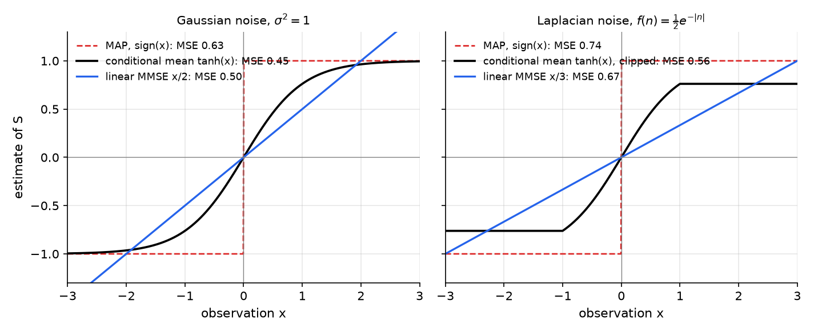
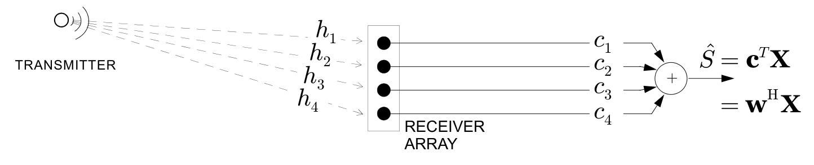
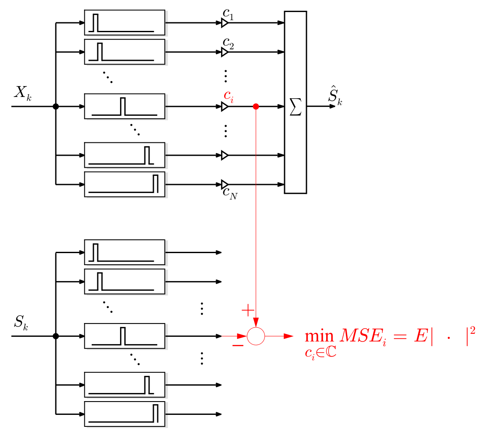
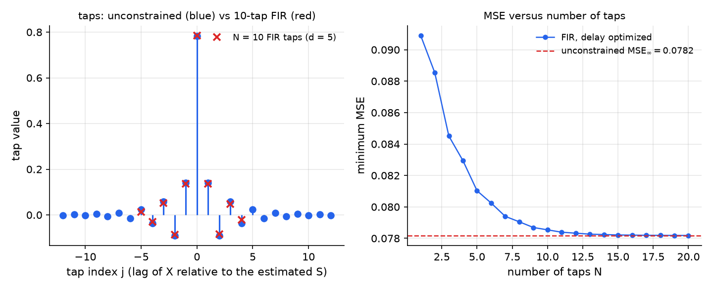
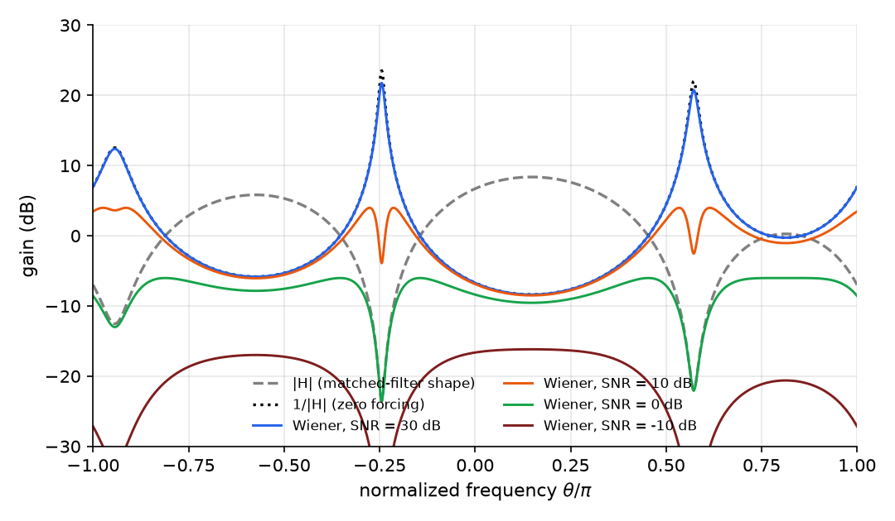
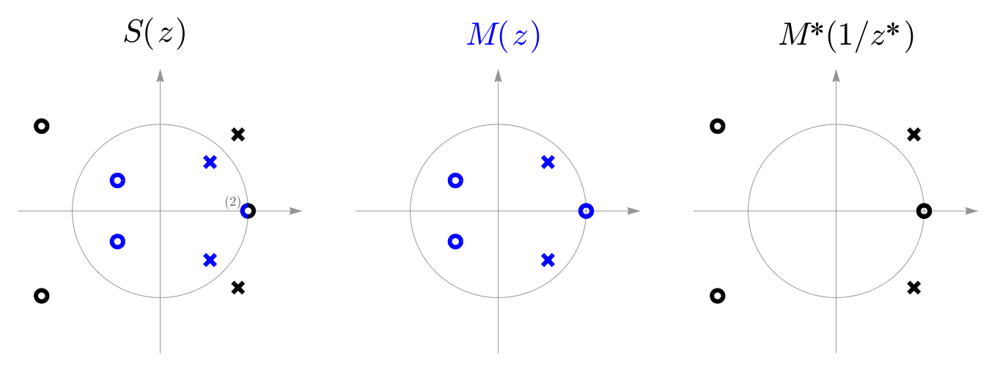

# Optimal Linear Estimation: MMSE, Wiener Filtering and Prediction

Estimation asks for the best guess of a quantity \\(S\\) that cannot be seen directly, given an observation \\(X\\) that depends on \\(S\\) through noise or distortion. This chapter fixes the criterion, mean squared error, and solves the problem in two classes. Unconstrained estimators are conditional means, and linear estimators are solutions of normal equations. For stationary sequences the normal equations become convolution equations, which the Wiener filter solves in frequency, and the spectral factorization of a power spectral density gives the optimal linear predictor. The chapter builds on the conditional Gaussian formulas of [Pairs and Vectors of Random Variables](random-vectors.md) and on the autocorrelation and spectra of [Random Sequences](random-sequences.md).

## The Estimation Problem

### Criteria

Estimation is a basic problem in signal processing, communications, machine learning and statistics. The table lists some familiar instances.

| Application | \\(S\\), the quantity of interest | \\(X\\), the observation |
|---|---|---|
| Satellite positioning | receiver location | satellite signals |
| Speech recognition | transcript | audio recording |
| Image denoising | clean image | grainy image |
| Classification | dog or cat | photograph |
| Finance | tomorrow's price | price history |
| Demodulation | transmitted message | noisy received signal |
| Hidden Markov model | weather | whether an umbrella is carried |

Two criteria for "best" are standard. The **minimum mean squared error** (MMSE) estimator minimizes
\\[
\mathrm{MSE} = E\left[(\hat S - S)^2\right].
\\]
The **maximum a posteriori** (MAP) estimator chooses the most probable value, \\(\hat S = \arg\max\_s P(S = s \mid X)\\) in the discrete case. MAP reports the most likely state given the data, while MMSE minimizes the average squared error. The two can give very different answers, as Example 8.1 shows.

### Unconstrained and linear estimators

An **unconstrained** estimator is any function \\(\hat S = g(X)\\). A **linear** estimator is restricted to the form \\(\hat S = aX + b\\), or \\(\hat S = \mathbf c^T\mathbf X + b\\) when several observations are available. The unconstrained class contains the linear one, so its MMSE is never larger. The questions are when the two coincide and how to compute each.

## Predicting Without Data

Before any observation, the best constant predictor of \\(S\\) is its mean. For any constant \\(b\\), expanding around the mean gives
\\[
E\left[(b - S)^2\right] = \left(b - E(S)\right)^2 + \mathrm{var}(S),
\\]
because the cross term has zero mean. The first term vanishes at \\(b = E(S)\\), so the minimum MSE is \\(\mathrm{var}(S)\\). The rest of the chapter asks how much an observation can reduce this number.

## The Conditional Mean Is the Best Estimator

**Theorem 8.1 (Conditional mean).** Among all functions \\(g\\), the MSE of \\(g(X)\\) is minimized by \\(g(X) = E(S \mid X)\\). The minimum is \\(E\left(\mathrm{var}(S \mid X)\right)\\).

*Proof.* By iterated expectation, \\(\mathrm{MSE} = E\left(E\left[(g(X) - S)^2 \mid X\right]\right)\\). For each fixed value \\(x\\), the number \\(g(x)\\) is a constant inside the conditional expectation, so
\\[
E\left[(g(x) - S)^2 \mid X = x\right] = \left(g(x) - E(S \mid X = x)\right)^2 + \mathrm{var}(S \mid X = x).
\\]
The second term does not depend on \\(g\\). The first is zero when \\(g(x) = E(S \mid X = x)\\) and positive otherwise. Averaging over \\(X\\) gives the result. \\(\blacksquare\\)

The conditional mean is the optimal estimator of any kind, but in general it is nonlinear. The next section finds the best linear estimator, and Theorem 8.3 shows when the two agree.

## The Linear MMSE Estimator

### The scalar case

**Theorem 8.2 (Linear MMSE, scalar).** The MSE of \\(\hat S = aX + b\\) is minimized by
\\[
\hat S = \mu\_S + \rho\\,\frac{\sigma\_S}{\sigma\_X}\\,(X - \mu\_X), \qquad \rho = \frac{\mathrm{cov}(X, S)}{\sigma\_X\sigma\_S},
\\]
and the minimum MSE is \\(\sigma\_S^2(1 - \rho^2)\\).

*Proof.* Write \\(S' = S - \mu\_S\\) and \\(X' = X - \mu\_X\\). Any affine estimator has the form \\(\hat S = \mu\_S + aX' + c\\) for constants \\(a\\) and \\(c\\), where \\(c = b - \mu\_S + a\mu\_X\\). Since \\(E(S') = E(X') = 0\\),
\\[
E\left[(S - \hat S)^2\right] = E\left[(S' - aX' - c)^2\right] = \sigma\_S^2 + a^2\sigma\_X^2 - 2a\rho\sigma\_S\sigma\_X + c^2 = \sigma\_X^2\left(a - \rho\frac{\sigma\_S}{\sigma\_X}\right)^2 + \sigma\_S^2(1 - \rho^2) + c^2.
\\]
The first and third terms are minimized by \\(a = \rho\sigma\_S/\sigma\_X\\) and \\(c = 0\\). The remaining term is \\(\sigma\_S^2(1 - \rho^2)\\). \\(\blacksquare\\)

The estimator regresses toward the mean. If \\(\rho = 0.9\\) and \\(X\\) lies three standard deviations above its mean, the estimate of \\(S\\) lies \\(2.7\\) of its own standard deviations above \\(\mu\_S\\). The MSE is the fraction \\(1 - \rho^2\\) of the unconditional variance that remains.

For zero-mean variables the estimator is \\(\hat S = cX\\), with
\\[
c = \frac{E(XS)}{E(X^2)}, \qquad \mathrm{MSE} = E(S^2)(1 - \rho^2), \qquad \rho^2 = \frac{E^2(XS)}{E(X^2)E(S^2)}.
\\]
The coefficient is the cross-moment divided by the observation's second moment. This is the first row of the summary table at the end of the chapter, and it is the building block for the rest.

### The orthogonality principle

For zero-mean variables, the error of the optimal estimator is orthogonal to the observation: \\(E\left[(S - cX)X\right] = E(SX) - cE(X^2) = 0\\) exactly when \\(c = E(XS)/E(X^2)\\). This **orthogonality principle** also gives a direct proof of optimality. For any other linear estimator \\(\hat S + \Delta\\), with \\(\Delta = dX\\) linear in the observation,
\\[
E\left[(S - \hat S - \Delta)^2\right] = E\left[(S - \hat S)^2\right] - 2E\left[(S - \hat S)\Delta\right] + E(\Delta^2) = \mathrm{MSE}\_{\min} + E(\Delta^2),
\\]
since the middle term vanishes. Any departure from the optimum costs at least \\(E(\Delta^2)\\). In the geometry of random variables with inner product \\(E(UV)\\), the linear MMSE estimator is the projection of \\(S\\) onto the span of \\(X\\). This is the same picture that gives the correlation coefficient in [Pairs and Vectors of Random Variables](random-vectors.md).

### When the linear estimator is optimal

**Theorem 8.3 (Gaussian case).** If \\(S\\) and \\(X\\) are jointly Gaussian, the unconstrained MMSE estimator is linear, and it equals the linear MMSE estimator of Theorem 8.2.

*Proof.* By the conditional Gaussian theorem of [Pairs and Vectors of Random Variables](random-vectors.md), \\(f(s \mid x)\\) is Gaussian with mean \\(\mu\_S + \rho\sigma\_S(x - \mu\_X)/\sigma\_X\\) and variance \\(\sigma\_S^2(1 - \rho^2)\\). The conditional mean is therefore affine in \\(x\\). By Theorem 8.1 it is the unconstrained minimizer, and its MSE \\(E\left(\mathrm{var}(S \mid X)\right) = \sigma\_S^2(1 - \rho^2)\\) equals the linear MMSE. \\(\blacksquare\\)

Outside the Gaussian case the two differ.

### Examples

**Example 8.1 (BPSK in Gaussian noise).** Let \\(S\\) be uniform on \\(\\{\pm 1\\}\\) and observe \\(X = S + N\\), with \\(N \sim \mathcal{N}(0, \sigma^2)\\) independent of \\(S\\). The conditional mean is
\\[
E(S \mid x) = \frac{e^{-(x-1)^2/2\sigma^2} - e^{-(x+1)^2/2\sigma^2}}{e^{-(x-1)^2/2\sigma^2} + e^{-(x+1)^2/2\sigma^2}} = \tanh\left(\frac{x}{\sigma^2}\right).
\\]
The linear MMSE estimator uses \\(E(XS) = 1\\) and \\(E(X^2) = 1 + \sigma^2\\), so \\(\hat S\_{\text{LIN}} = x/(1+\sigma^2)\\). The MAP estimate is \\(\mathrm{sign}(x)\\). For \\(\sigma^2 = 1\\) the three rules have MSEs of about 0.45 (conditional mean \\(\tanh x\\)), 0.50 (linear \\(x/2\\)) and 0.63 (MAP). The MAP error is \\(4P(\text{error}) = 4\Phi(-1)\\). The conditional mean is a smooth squashing of the observation, the linear rule is a line through the origin, and the MAP rule is a hard decision at zero.

*Figure: estimators of a ±1 symbol from \\(X = S + N\\). Left, Gaussian noise with \\(\sigma^2 = 1\\): the conditional mean \\(\tanh x\\) (black), the linear MMSE \\(x/2\\) (blue) and the MAP sign rule (red dashed). Right, Laplacian noise with density \\(\tfrac12 e^{-\lvert n\rvert}\\): the conditional mean is \\(\tanh x\\) for \\(\lvert x\rvert \le 1\\) and flat beyond, while the linear MMSE is \\(x/3\\). The legend gives each MSE.*

**Example 8.2 (Laplacian noise).** Let the noise instead have density \\(\tfrac12 e^{-\lvert n\rvert}\\), which has variance 2. The same reasoning gives
\\[
E(S \mid x) = \frac{e^{-\lvert x-1\rvert} - e^{-\lvert x+1\rvert}}{e^{-\lvert x-1\rvert} + e^{-\lvert x+1\rvert}} = \begin{cases} -\tanh 1, & x < -1, \\\\ \tanh x, & -1 < x \le 1, \\\\ \tanh 1, & x > 1. \end{cases}
\\]
The conditional mean equals \\(\tanh x\\) on \\([-1, 1]\\) and saturates outside. Here \\(E(XS) = 1\\) and \\(E(X^2) = 3\\), so the best linear rule is \\(x/3\\), with MSE \\(2/3\\). The conditional mean reaches an MSE of about 0.56. Its advantage over the linear rule is larger than in the Gaussian case, because the flat outer part is a nonlinear feature that no straight line can reproduce.

**Example 8.3 (A three-point signal).** Let \\(S\\) take the values \\(-2, 0, 2\\) with probabilities \\(0.25, 0.5, 0.25\\), and let \\(X = S + N\\) with \\(N \sim \mathcal{N}(0, 1)\\). Then \\(E(S) = 0\\), \\(E(S^2) = 2\\), \\(E(XS) = 2\\) and \\(E(X^2) = 3\\). So \\(c = 2/3\\), \\(\rho^2 = 2/3\\), and \\(\mathrm{MSE} = 2/3\\). The linear estimator uses only \\(E(S^2)\\) and the cross-moment, so the shape of the pmf of \\(S\\) does not affect it, although it does affect the conditional mean.

## Vector Observations and the Normal Equations

With several observations, the estimator is \\(\hat S = \mathbf c^T\mathbf X\\), where \\(\mathbf X = [X\_1, \dots, X\_N]^T\\). Assume zero means for simplicity.

**Theorem 8.4 (Linear MMSE, vector).** Let \\(\mathbf R = E(\mathbf X\mathbf X^T)\\) and \\(\mathbf r = E(S\mathbf X)\\). The MSE of \\(\mathbf c^T\mathbf X\\) is
\\[
\mathrm{MSE}(\mathbf c) = \mathbf c^T\mathbf R\mathbf c - 2\mathbf c^T\mathbf r + E(S^2).
\\]
If \\(\mathbf R\\) is invertible, the minimum is attained at \\(\mathbf c = \mathbf R^{-1}\mathbf r\\), and
\\[
\mathrm{MSE}\_{\min} = E(S^2) - \mathbf r^T\mathbf R^{-1}\mathbf r = E(S^2)(1 - \rho^2), \qquad \rho^2 = \frac{\mathbf r^T\mathbf R^{-1}\mathbf r}{E(S^2)} \in [0, 1].
\\]

*Proof.* Since \\(\mathbf R\\) is symmetric, completing the square gives
\\[
\mathrm{MSE}(\mathbf c) = (\mathbf c - \mathbf R^{-1}\mathbf r)^T\mathbf R(\mathbf c - \mathbf R^{-1}\mathbf r) + E(S^2) - \mathbf r^T\mathbf R^{-1}\mathbf r.
\\]
The first term is nonnegative and vanishes exactly at \\(\mathbf c = \mathbf R^{-1}\mathbf r\\). \\(\blacksquare\\)

The **normal equations** \\(\mathbf R\mathbf c = \mathbf r\\) say that \\(E\left[(S - \mathbf c^T\mathbf X)X\_i\right] = 0\\) for every \\(i\\), which is the orthogonality principle in vector form. The matrix \\(\mathbf R\\) is symmetric and positive semidefinite, because \\(\mathbf v^T\mathbf R\mathbf v = E\left((\mathbf v^T\mathbf X)^2\right) \ge 0\\). Its inverse is positive definite when the observations are not linearly dependent, which gives \\(\rho^2 \ge 0\\). The bound \\(\rho^2 \le 1\\) holds because an MSE is nonnegative. When \\(\mathbf R\\) is singular, any solution of the normal equations gives the same estimator.

**Example 8.4 (Averaging is not optimal).** Let \\(U\_1, U\_2, U\_3\\) be i.i.d. \\(\mathcal{N}(0,1)\\), and let \\(S = U\_1 + U\_2\\), \\(X\_1 = U\_2 + U\_3\\) and \\(X\_2 = U\_1 + U\_2 + U\_3\\). The single-observation estimators are \\(aX\_1\\) with \\(a = E(X\_1S)/E(X\_1^2) = 1/2\\), and \\(bX\_2\\) with \\(b = E(X\_2S)/E(X\_2^2) = 2/3\\). Using both observations, \\(E(X\_1^2) = 2\\), \\(E(X\_2^2) = 3\\) and \\(E(X\_1X\_2) = 2\\), so
\\[
\mathbf R = \begin{bmatrix} 2 & 2 \\\\ 2 & 3 \end{bmatrix}, \qquad \mathbf r = \begin{bmatrix} 1 \\\\ 2 \end{bmatrix}, \qquad \mathbf c = \mathbf R^{-1}\mathbf r = \begin{bmatrix} -\tfrac12 \\\\ 1 \end{bmatrix}.
\\]
The minimum MSE is \\(E(S^2) - \mathbf r^T\mathbf c = 2 - \tfrac32 = \tfrac12\\). The ad hoc average of the two single-observation weights, \\(\mathbf c' = (a/2, b/2) = (\tfrac14, \tfrac13)\\), is far from optimal. Its extra cost is \\((\mathbf c' - \mathbf c)^T\mathbf R(\mathbf c' - \mathbf c) = \tfrac{11}{24}\\), so its MSE is \\(\tfrac{23}{24}\\), almost double. Because \\((S, X\_1, X\_2)\\) is jointly Gaussian, the unconstrained estimator is also linear, and its MSE is the same \\(\tfrac12\\).

**Example 8.5 (Three antennas with a real channel).** Let \\(S\\) be uniform on \\(\\{\pm 1\\}\\) and observe \\(X\_i = g\_iS + N\_i\\) for \\(i = 1, 2, 3\\), with i.i.d. zero-mean noises of variance \\(\sigma^2\\) independent of \\(S\\). Then \\(\mathbf R = \mathbf g\mathbf g^T + \sigma^2\mathbf I\\) and \\(\mathbf r = \mathbf g\\). Put \\(\mathbf h = \mathbf g/\sigma\\). Since \\((\mathbf h\mathbf h^T + \mathbf I)\mathbf h = (1 + \lVert\mathbf h\rVert^2)\mathbf h\\), the vector \\(\mathbf h\\) is an eigenvector of \\((\mathbf h\mathbf h^T + \mathbf I)^{-1}\\) with eigenvalue \\(1/(1 + \lVert\mathbf h\rVert^2)\\). Therefore
\\[
\mathbf c = \mathbf R^{-1}\mathbf r = \frac{1}{\sigma}(\mathbf h\mathbf h^T + \mathbf I)^{-1}\mathbf h = \frac{\mathbf g}{\sigma^2 + \lVert\mathbf g\rVert^2}, \qquad\text{so}\qquad c\_i = \frac{g\_i}{\sigma^2 + \lVert\mathbf g\rVert^2}.
\\]
Each weight is proportional to its channel gain, so a channel with zero gain gets zero weight. The combiner is a matched filter scaled by a positive constant.

With unequal noise variances \\(\sigma\_i^2\\), whitening the observations by \\(\operatorname{diag}(\sigma\_i)^{-1}\\) and applying the same result gives \\(c\_i = (g\_i/\sigma\_i^2)/(1 + \sum\_j g\_j^2/\sigma\_j^2)\\). Because \\(S\\) is discrete, the unconstrained estimator is not linear here, so this is the best linear rule.

## Complex Observations: Array Combining

Complex observations, common in communications, use the Hermitian transpose. For \\(\hat S = \mathbf w^H\mathbf X\\), with \\(\mathbf R = E(\mathbf X\mathbf X^H)\\) and \\(\mathbf r = E(\mathbf X S^\*)\\), the MSE is
\\[
\mathrm{MSE}(\mathbf w) = \mathbf w^H\mathbf R\mathbf w - 2\\,\mathrm{Re}\\{\mathbf w^H\mathbf r\\} + E(\lvert S\rvert^2).
\\]
Completing the square as before gives \\(\mathbf w = \mathbf R^{-1}\mathbf r\\) and \\(\mathrm{MSE}\_{\min} = E(\lvert S\rvert^2)(1 - \rho^2)\\), with \\(\rho^2 = \mathbf r^H\mathbf R^{-1}\mathbf r/E(\lvert S\rvert^2)\\).

The **channel model** \\(\mathbf X = S\mathbf h + \mathbf N\\) has \\(E\lvert S\rvert^2 = 1\\), and complex noise whose real and imaginary parts are i.i.d. \\(\mathcal{N}(0, \sigma^2)\\), so \\(E(\mathbf N\mathbf N^H) = 2\sigma^2\mathbf I\\). Then \\(\mathbf R = \mathbf h\mathbf h^H + 2\sigma^2\mathbf I\\) and \\(\mathbf r = \mathbf h\\). The eigenvector argument above gives
\\[
\mathbf w = \lambda\mathbf h, \qquad \lambda = \frac{1}{2\sigma^2 + \lVert\mathbf h\rVert^2}.
\\]
The optimal combiner is a scaled **maximal-ratio combiner**, the matched filter for the channel. Two limits are instructive. As \\(\sigma^2 \to 0\\), \\(\mathbf w \to \mathbf h/\lVert\mathbf h\rVert^2\\), which inverts the channel so that \\(\mathbf w^H\mathbf X = S\\) exactly. As \\(\sigma^2 \to \infty\\), \\(\mathbf w \to \mathbf 0\\): with noise alone, the best estimate is the mean, zero.

*Figure: a transmitter reaches a four-element receiver array through complex gains \\(h\_1, \dots, h\_4\\). The array outputs are weighted and summed, so the estimate is \\(\hat S = \mathbf c^T\mathbf X = \mathbf w^H\mathbf X\\), with the weights from the normal equations.*

## FIR Wiener Filtering

Now let \\(\\{X\_k\\}\\) and \\(\\{S\_k\\}\\) be jointly WSS, real and zero mean. The task is to estimate the delayed signal \\(S\_{k-d}\\) from the \\(N\\) most recent observations \\(\mathbf X\_k = [X\_k, X\_{k-1}, \dots, X\_{k-N+1}]^T\\). Define the cross-correlation
\\[
R\_{XS}(m) = E(X\_kS\_{k+m}),
\\]
which does not depend on \\(k\\). Then \\(E(X\_{k-i}S\_{k-d}) = R\_{XS}(i - d)\\), and the normal equations of Theorem 8.4 read
\\[
\begin{bmatrix} R\_X(0) & R\_X(1) & \cdots & R\_X(N-1) \\\\ R\_X(1) & R\_X(0) & \cdots & R\_X(N-2) \\\\ \vdots & & \ddots & \vdots \\\\ R\_X(N-1) & R\_X(N-2) & \cdots & R\_X(0) \end{bmatrix}\mathbf c = \begin{bmatrix} R\_{XS}(-d) \\\\ R\_{XS}(1-d) \\\\ \vdots \\\\ R\_{XS}(N-1-d) \end{bmatrix}.
\\]
The matrix is symmetric Toeplitz, because stationarity makes \\(E(X\_{k-i}X\_{k-j}) = R\_X(i-j)\\) depend only on the difference of the indices. The minimum MSE is \\(R\_{SS}(0)(1-\rho^2)\\), with \\(\rho^2 = \mathbf r^T\mathbf R^{-1}\mathbf r/R\_{SS}(0)\\).

The delay \\(d\\) is a design choice and should minimize the MSE. The choice \\(d = 0\\) can be poor. If \\(X\_k = S\_{k-1}\\) and \\(S\\) is white, then \\(R\_{XS}(i) = E(S\_{k-1}S\_{k+i}) = 0\\) for all \\(i \ge 0\\), so the present observation says nothing about \\(S\_k\\). With \\(d = 1\\), the estimate is exact.

**Example 8.6 (A telegraph signal in white noise).** Let \\(S\_k\\) be a telegraph sequence with \\(R\_{SS}(m) = a^{\lvert m\rvert}\\), \\(a = 0.756\\), and observe \\(X\_k = S\_k + W\_k\\), where \\(W\\) is white with \\(\sigma^2 = 1\\) and independent of \\(S\\). Take \\(d = 0\\) and \\(N = 3\\). Then \\(R\_X(m) = a^{\lvert m\rvert} + \sigma^2\delta\_m\\) and \\(R\_{XS}(i) = a^i\\) for \\(i \ge 0\\), so
\\[
\begin{bmatrix} 1 + \sigma^2 & a & a^2 \\\\ a & 1 + \sigma^2 & a \\\\ a^2 & a & 1 + \sigma^2 \end{bmatrix}\mathbf c = \begin{bmatrix} 1 \\\\ a \\\\ a^2 \end{bmatrix}, \qquad \mathbf c = \begin{bmatrix} 0.400 \\\\ 0.189 \\\\ 0.100 \end{bmatrix}.
\\]
The MSE is \\(1 - \mathbf r^T\mathbf c = 0.40\\). Two checks: as \\(\sigma^2 \to 0\\), \\(\mathbf c \to [1, 0, 0]^T\\), since the observation is the signal itself; as \\(\sigma^2 \to \infty\\), \\(\mathbf c \to \mathbf 0\\).

**Example 8.7 (Weak bits in colored noise).** Let \\(S\_k\\) be i.i.d. uniform on \\(\\{\pm 1\\}\\), and let \\(X\_k = 0.2S\_k + N\_k\\), where the Gaussian noise has spectrum \\(S\_{NN}(e^{j\theta}) = 1.6 - 1.6\cos\theta\\), so \\(R\_N(0) = 1.6\\) and \\(R\_N(\pm 1) = -0.8\\). The noise is colored, and it has no power at zero frequency.

- *One tap.* \\(E(XS) = 0.2\\) and \\(E(X^2) = 0.04 + 1.6 = 1.64\\), so \\(c\_0 = 0.2/1.64 = 5/41\\). The MSE is \\(1 - 0.2c\_0 = 40/41 \approx 0.976\\).
- *Unconstrained.* The Wiener filter of the next section is \\(C(e^{j\theta}) = 0.2/(1.64 - 1.6\cos\theta) = 5/(41 - 40\cos\theta)\\). Its impulse response is \\(c\_k = \tfrac59(0.8)^{\lvert k\rvert}\\), because \\(\sum\_k 0.8^{\lvert k\rvert}e^{-jk\theta} = 0.36/(1.64 - 1.6\cos\theta)\\). Its MSE is \\(1 - 0.2c\_0 = 1 - \tfrac19 = \tfrac89 \approx 0.889\\).
- *FIR with delay.* The best 5-tap filter has its smallest MSE, about 0.935, at delay \\(d = 2\\), the middle tap. The best-delay MSE falls as \\(N\\) grows: 0.976 at \\(N = 1\\), 0.935 at \\(N = 5\\), 0.901 at \\(N = 12\\), and 0.897 at \\(N = 14\\). The value \\(N = 14\\) is the first at which the MSE lies within one per cent of the unconstrained \\(8/9\\).

## The Unconstrained Wiener Filter

If the filter may have infinitely many taps and need not be causal, the matrix equations give way to equations in frequency, which require cross-spectra.

### Cross-correlation and cross-spectrum

Two processes \\(X\\) and \\(Y\\) are **jointly WSS** if each is WSS and \\(R\_{XY}(m) = E(X\_k^\*Y\_{k+m})\\) does not depend on \\(k\\). The **cross-spectral density** is
\\[
S\_{XY}(e^{j\theta}) = \sum\_m R\_{XY}(m)e^{-jm\theta}.
\\]
It is generally complex, and \\(S\_{YX} = S\_{XY}^\*\\). For real processes the conjugations disappear. If \\(Y\_k = \sum\_i h\_iU\_{k-i}\\), then \\(R\_{UY}(m) = \sum\_i h\_iR\_{UU}(m-i)\\), so \\(S\_{UY} = H\\,S\_{UU}\\).

The cross-spectrum has a direct meaning. Pass \\(X\\) and \\(Y\\) through identical unit-energy bandpass filters centred at \\(\theta\_0\\), with vanishing bandwidth. The outputs are \\(V\_k \approx Ae^{jk\theta\_0}\\) and \\(W\_k \approx Be^{jk\theta\_0}\\), and \\(E(V\_k^\*W\_k)\\) approaches \\(S\_{XY}(e^{j\theta\_0})\\). The cross-spectrum is therefore the correlation between \\(X\\) and \\(Y\\) at each frequency, just as the PSD is the power at each frequency.

### The Wiener filter

**Theorem 8.5 (Unconstrained Wiener filter).** Let \\(X\\) and \\(S\\) be jointly WSS with \\(S\_{XX} > 0\\), and let \\(\hat S\_k = \sum\_j c\_jX\_{k-j}\\), with \\(C(e^{j\theta}) = \sum\_j c\_je^{-jj\theta}\\). The MSE is minimized by
\\[
\boxed{C(e^{j\theta}) = \frac{S\_{XS}(e^{j\theta})}{S\_{XX}(e^{j\theta})}}, \qquad \mathrm{MSE}\_{\min} = \frac{1}{2\pi}\int\_{-\pi}^{\pi}S\_{SS}(e^{j\theta})\left(1 - \rho^2(e^{j\theta})\right)d\theta,
\\]
where \\(\rho^2(e^{j\theta}) = \lvert S\_{XS}\rvert^2/(S\_{XX}S\_{SS})\\) is the coherence.

*Proof.* Let \\(E\_k = \hat S\_k - S\_k\\). The filter gives \\(S\_{\hat S\hat S} = \lvert C\rvert^2S\_{XX}\\) and \\(S\_{\hat SS} = C^\*S\_{XS}\\), where \\(S\_{\hat SS}\\) is the cross-spectrum of \\(\hat S\\) with \\(S\\). The error spectrum is therefore
\\[
S\_{EE} = \lvert C\rvert^2S\_{XX} - C^\*S\_{XS} - CS\_{XS}^\* + S\_{SS} = S\_{XX}\left\lvert C - \frac{S\_{XS}}{S\_{XX}}\right\rvert^2 + S\_{SS} - \frac{\lvert S\_{XS}\rvert^2}{S\_{XX}}.
\\]
The only term depending on \\(C\\) is nonnegative and vanishes at \\(C = S\_{XS}/S\_{XX}\\). Since \\(\mathrm{MSE} = R\_{EE}(0) = \frac{1}{2\pi}\int S\_{EE}\\,d\theta\\), the result follows. \\(\blacksquare\\)

The minimization is pointwise in frequency, so each frequency is a scalar problem. The filter-bank picture makes this explicit.

*Figure: the Wiener filter as a bank of narrow bandpass filters. Each band of \\(X\\) is scaled by its own gain \\(c\_i\\), and the results are summed to form \\(\hat S\\). Within a narrow band the problem reduces to the scalar problem of the first row of the summary table, so each gain is a ratio of cross- and auto-spectra at that frequency.*

The MSE depends on the coherence. Where the cross-spectrum vanishes, \\(\rho^2 = 0\\) and the frequency contributes its full signal power to the error.

**Example 8.8 (Signal plus independent noise).** Let \\(X = S + N\\) with \\(S\\) and \\(N\\) independent. Then \\(S\_{XS} = S\_{SS}\\) and \\(S\_{XX} = S\_{SS} + S\_{NN}\\), so
\\[
C(e^{j\theta}) = \frac{S\_{SS}(e^{j\theta})}{S\_{SS}(e^{j\theta}) + S\_{NN}(e^{j\theta})}.
\\]
The filter passes frequencies where the signal dominates and suppresses the rest. Take \\(S\_{SS} = 1 + 0.9\cos\theta\\), a lowpass signal, and \\(S\_{NN} = 1 + 0.8\cos 2\theta\\), which peaks at \\(\theta = 0\\) and \\(\pm\pi\\). Then \\(C(e^{j\theta}) = (1 + 0.9\cos\theta)/(2 + 0.9\cos\theta + 0.8\cos 2\theta)\\). The response is about 0.5 at \\(\theta = 0\\), where both spectra are large, about 0.83 near \\(\pm\pi/2\\), where the noise is weak, and nearly zero at \\(\pm\pi\\), where the signal has power 0.1 against noise power 1.8.

**Example 8.9 (A correlated signal in white noise).** Let \\(R\_{SS}(0) = 1\\) and \\(R\_{SS}(\pm 1) = 0.5\\), so \\(S\_{SS} = 1 + \cos\theta\\), observed in white noise of variance \\(\sigma^2 = 0.1\\). Then
\\[
C(e^{j\theta}) = \frac{1 + \cos\theta}{1.1 + \cos\theta},
\\]
which stays between about 0.9 and 0.95 over most of the band and vanishes at \\(\pm\pi\\), where the signal has no power. The MSE is \\(\sigma^2 c\_0\\), where \\(c\_0 = \frac{1}{2\pi}\int C\\,d\theta = 1 - 0.1/\sqrt{0.21} \approx 0.782\\), so \\(\mathrm{MSE}\_\infty \approx 0.0782\\). The impulse response is symmetric, with \\(c\_{\pm 1} \approx 0.140\\), \\(c\_{\pm 2} \approx -0.090\\), \\(c\_{\pm 3} \approx 0.058\\) and \\(c\_{\pm 4} \approx -0.037\\), decaying with alternating sign. The best-delay FIR filter estimating \\(S\_{k-5}\\) from ten samples has almost the same taps. Its best MSE falls toward \\(\mathrm{MSE}\_\infty\\) as the number of taps grows: 0.0909 for one tap, 0.0885 for two, 0.0845 for three, 0.0810 for five, 0.0785 for ten, and 0.0783 for twelve.

*Figure: left, the taps of the unconstrained filter for \\(S\_{SS} = 1 + \cos\theta\\) and \\(\sigma^2 = 0.1\\) (blue, lags \\(-12\\) to \\(12\\)), with the taps of the 10-tap FIR filter estimating \\(S\_{k-5}\\) (red), placed at the lags they multiply. Right, the minimum MSE of the FIR filter with its best delay, which approaches the unconstrained value \\(0.0782\\) (dashed).*

**Example 8.10 (Ideal bands).** Let \\(X\\) and \\(N\\) be independent, with \\(S\_{XX} = 1\\) for \\(\lvert\theta\rvert < 0.6\pi\\) and zero elsewhere, and \\(S\_{NN} = 1\\) for \\(0.2\pi < \lvert\theta\rvert \le \pi\\) and zero elsewhere. Then \\(R\_{XX}(0) = 0.6\\) and \\(R\_{NN}(0) = 0.8\\). A one-tap filter \\(h\_0Y\\) for \\(Y = X + N\\) has \\(h\_0 = 0.6/1.4 = 3/7\\) and MSE \\(0.6\cdot\tfrac47 = \tfrac{12}{35} \approx 0.34\\). The unconstrained filter is \\(C = 1\\) for \\(\lvert\theta\rvert < 0.2\pi\\), \\(C = \tfrac12\\) for \\(0.2\pi < \lvert\theta\rvert < 0.6\pi\\), and zero beyond. Its MSE is \\(\frac{1}{2\pi}\int S\_{XX}(1 - C)\\,d\theta = 0.2\\). A frequency-dependent gain beats any single gain.

**Example 8.11 (A symmetric channel equalizer).** Let \\(S\_k\\) be i.i.d. uniform on \\(\\{\pm 1\\}\\), and let \\(X\_k = S\_k - 0.5S\_{k-1} - 0.5S\_{k+1} + N\_k\\), where \\(N\\) is i.i.d. \\(\mathcal{N}(0,1)\\). The channel response is \\(H(e^{j\theta}) = 1 - \cos\theta\\), which is real, and \\(S\_{SS} = S\_{NN} = 1\\). The equalizer of Example 8.13 gives
\\[
C(e^{j\theta}) = \frac{H^\*(e^{j\theta})}{\lvert H(e^{j\theta})\rvert^2 + 1} = \frac{1 - \cos\theta}{(1 - \cos\theta)^2 + 1}.
\\]
It vanishes at \\(\theta = 0\\), where the channel has a null, reaches 0.5 at \\(\lvert\theta\rvert = \pi/2\\), and equals 0.4 at \\(\pm\pi\\).

**Example 8.12 (Wiener smoothing of a noisy telegraph).** Let \\(X\\) be a telegraph sequence with \\(p = 0.1\\), so \\(S\_{XX}(e^{j\theta}) = (1 - a^2)/\lvert 1 - ae^{-j\theta}\rvert^2\\) with \\(a = 0.8\\). Let \\(Y = X + W\\), where \\(W\\) is white with unit variance and independent of \\(X\\). Estimating \\(X\\) from \\(Y\\) uses \\(S\_{YX} = S\_{XX}\\) and \\(S\_{YY} = S\_{XX} + 1\\), so
\\[
C(e^{j\theta}) = \frac{S\_{XX}}{S\_{XX} + 1} = \frac{1 - a^2}{2 - 2a\cos\theta} = \frac{0.18}{1 - 0.8\cos\theta}.
\\]
Its impulse response is \\(c\_k = 0.3\\,(\tfrac12)^{\lvert k\rvert}\\), because \\(0.18/(1 - 0.8\cos\theta) = 0.3\sum\_k(\tfrac12)^{\lvert k\rvert}e^{-jk\theta}\\). The coherence is \\(\rho^2 = S\_{XX}/(S\_{XX} + 1)\\), so the MSE is \\(\frac{1}{2\pi}\int S\_{XX}(1 - \rho^2)\\,d\theta = \frac{1}{2\pi}\int C\\,d\theta = c\_0 = 0.3\\), against \\(\mathrm{var}(X) = 1\\).

**Example 8.13 (Equalizing a noisy channel).** Let \\(X\_k = (h \* S)\_k + N\_k\\), where \\(S\\) and \\(N\\) are white and independent of each other, and \\(h\\) is a complex filter with response \\(H\\). Then
\\[
C(e^{j\theta}) = \frac{S\_S\\,H^\*(e^{j\theta})}{S\_S\lvert H(e^{j\theta})\rvert^2 + S\_N}.
\\]
The optimal equalizer depends on the SNR \\(S\_S/S\_N\\). In the noiseless limit \\(S\_N \to 0\\) it becomes the zero-forcing inverse \\(1/H\\), which removes the channel exactly but amplifies noise near the channel's nulls. When noise dominates, \\(S\_N \to \infty\\), it becomes the matched filter \\((S\_S/S\_N)H^\*\\), which maximizes the signal-to-noise ratio without trying to invert the channel. Without noise the coherence is one at every frequency, because \\(X\\) is then an LTI function of \\(S\\).

*Figure: gain of the Wiener equalizer in dB for the complex four-tap channel \\(h = [1, 0.4 - 0.1j, 0.1 + 0.5j, 0.3 + 0.8j]\\) at four SNRs, with \\(\lvert H\rvert\\) (dashed, the matched-filter shape) and \\(1/\lvert H\rvert\\) (dotted, zero forcing). At 30 dB the equalizer follows \\(1/\lvert H\rvert\\) and inverts the channel nulls. As the SNR falls the peaks are suppressed, and at \\(-10\\) dB the response takes the shape of \\(\lvert H\rvert\\).*

The channel gain in the figure ranges from about −24 dB to +8 dB. At 10 dB the peaks are flattened and dips appear at the nulls, and at 0 dB the response is much flatter, with deep dips at the channel nulls.

## Causal Wiener Filtering

The unconstrained filter may be noncausal, which makes it unusable for real-time prediction. For a causal estimator, first factor the input spectrum as \\(S\_{XX} = \gamma^2MM^\*\\), with \\(M\\) monic and minimum phase (the factorization is treated below). The causal Wiener filter is
\\[
C\_{\text{causal}}(z) = \frac{1}{\gamma^2M(z)}\left\\{\frac{S\_{XS}(z)}{M^\*(1/z^\*)}\right\\}\_{\text{causal}},
\\]
where \\(\\{\cdot\\}\_{\text{causal}}\\) keeps the terms with nonnegative powers of \\(z^{-1}\\). The causal part is not a truncation of the noncausal filter, as the next example shows.

**Example 8.14 (A causal filter for a first-order model).** Let \\(M(z) = 1/(1 + az^{-1})\\) with \\(\lvert a\rvert < 1\\), so \\(\gamma^2 = 1\\). Take \\(S\_{XX} = \lvert M\rvert^2\\) and \\(S\_{XS} = 1/M\\). The noncausal filter is \\(C = S\_{XS}/S\_{XX} = (1 + az^{-1})^2(1 + az)\\), which expands to
\\[
C(z) = (1 + 2a^2) + a(2 + a^2)z^{-1} + a^2z^{-2} + az,
\\]
with taps \\(a\\) at lag \\(-1\\), \\(1 + 2a^2\\) at lag 0, \\(a(2 + a^2)\\) at lag 1 and \\(a^2\\) at lag 2. For the causal formula, \\(S\_{XS}/M^\* = (1 + az^{-1})(1 + az)\\) has causal part \\((1 + a^2) + az^{-1}\\), so
\\[
C\_{\text{causal}}(z) = (1 + az^{-1})\left((1 + a^2) + az^{-1}\right) = (1 + a^2) + a(2 + a^2)z^{-1} + a^2z^{-2}.
\\]
The lag \\(-1\\) tap disappears, and the lag-zero tap falls from \\(1 + 2a^2\\) to \\(1 + a^2\\). The later taps are unchanged. Simply dropping the lag \\(-1\\) tap would leave the lag-zero tap at \\(1 + 2a^2\\), so the causal filter is not the truncation of the noncausal one.

## Nonzero Means

Estimation with nonzero means reduces to the zero-mean case. Subtract \\(\mu\_X\\) from the observations, apply the filter \\(C\\) designed from the centered spectra, and add \\(\mu\_S\\) at the end: \\(\hat S\_k = \mu\_S + \sum\_j c\_j(X\_{k-j} - \mu\_X)\\). The means do not affect the filter, which depends only on the covariance structure.

## Linear Prediction

Prediction estimates \\(X\_k\\) from its own past. The same tools apply, and the spectral factorization makes the answer especially clean.

### Spatial prediction and innovations

Let \\(\mathbf X = [X\_1, \dots, X\_N]^T\\) be zero mean. Predict each \\(X\_i\\) linearly from \\(X\_1, \dots, X\_{i-1}\\). Collecting the predictors in a strictly lower-triangular matrix \\(\mathbf P\\) gives \\(\hat{\mathbf X} = \mathbf P\mathbf X\\), and the error is \\(\mathbf e = (\mathbf I - \mathbf P)\mathbf X\\).

**Theorem 8.6 (Spatial prediction).** Factor the correlation matrix as \\(\mathbf R = \mathbf M\boldsymbol\Gamma^2\mathbf M^T\\), where \\(\mathbf M\\) is monic (unit diagonal) lower triangular and \\(\boldsymbol\Gamma\\) is diagonal with positive entries. The MMSE predictor is \\(\mathbf P = \mathbf I - \mathbf M^{-1}\\), and
\\[
\mathrm{MSE}\_{\min} = \operatorname{tr}\left(\boldsymbol\Gamma^2\right) = \sum\_i \Gamma\_{ii}^2.
\\]

*Proof.* The matrix \\(\mathbf B = (\mathbf I - \mathbf P)\mathbf M\\) is monic lower triangular, so write \\(\mathbf B = \mathbf I + \mathbf D\\) with \\(\mathbf D\\) strictly lower triangular. Then
\\[
\mathrm{MSE} = \operatorname{tr}\left((\mathbf I - \mathbf P)\mathbf R(\mathbf I - \mathbf P)^T\right) = \operatorname{tr}\left(\mathbf B\boldsymbol\Gamma^2\mathbf B^T\right) = \operatorname{tr}\left(\boldsymbol\Gamma^2\right) + \operatorname{tr}\left(\mathbf D\boldsymbol\Gamma^2\mathbf D^T\right),
\\]
because the cross terms \\(\mathbf D\boldsymbol\Gamma^2\\) and \\(\boldsymbol\Gamma^2\mathbf D^T\\) have zero diagonals. The last term is nonnegative and vanishes only when \\(\mathbf D = \mathbf 0\\), that is, when \\(\mathbf B = \mathbf I\\), which means \\(\mathbf P = \mathbf I - \mathbf M^{-1}\\). \\(\blacksquare\\)

The prediction error is \\(\mathbf e = \mathbf M^{-1}\mathbf X = \mathbf U\\), the **innovations** of \\(\mathbf X\\). They are uncorrelated, because \\(E(\mathbf U\mathbf U^T) = \mathbf M^{-1}\mathbf R\mathbf M^{-T} = \boldsymbol\Gamma^2\\), and \\(\Gamma\_{ii}^2\\) is the prediction-error variance of the \\(i\\)-th component. The factor \\(\mathbf M^{-1}\\) decorrelates the vector but does not equalize variances. Full whitening, by \\(\mathbf G^{-1}\\) with \\(\mathbf G = \mathbf M\boldsymbol\Gamma\\), does both.

The factorization exists and is unique. Every positive-definite \\(\mathbf R\\) has a unique Cholesky factorization \\(\mathbf R = \mathbf G\mathbf G^T\\) with \\(\mathbf G\\) lower triangular and positive diagonal. It is computed row by row from
\\[
G\_{jj} = \sqrt{R\_{jj} - \sum\_{k<j}G\_{jk}^2}, \qquad G\_{ij} = \frac{1}{G\_{jj}}\left(R\_{ij} - \sum\_{k<j}G\_{ik}G\_{jk}\right), \quad i > j.
\\]
The monic factor is \\(\mathbf M = \mathbf G\boldsymbol\Gamma^{-1}\\), where \\(\boldsymbol\Gamma = \operatorname{diag}(G\_{11}, \dots, G\_{NN})\\).

**Example 8.15 (Spatial prediction).** Let \\(\mathbf R = \begin{bmatrix} 16 & 8 & -8 \\\\ 8 & 20 & 4 \\\\ -8 & 4 & 9 \end{bmatrix}\\). The Cholesky factor is \\(\mathbf G = \begin{bmatrix} 4 & 0 & 0 \\\\ 2 & 4 & 0 \\\\ -2 & 2 & 1 \end{bmatrix}\\), and multiplying it by its transpose returns \\(\mathbf R\\). Then \\(\boldsymbol\Gamma = \operatorname{diag}(4, 4, 1)\\) and
\\[
\mathbf M = \begin{bmatrix} 1 & 0 & 0 \\\\ 0.5 & 1 & 0 \\\\ -0.5 & 0.5 & 1 \end{bmatrix}, \qquad \mathbf P = \mathbf I - \mathbf M^{-1} = \begin{bmatrix} 0 & 0 & 0 \\\\ 0.5 & 0 & 0 \\\\ -0.75 & 0.5 & 0 \end{bmatrix}.
\\]
So \\(\hat X\_2 = 0.5X\_1\\) and \\(\hat X\_3 = -0.75X\_1 + 0.5X\_2\\). The total minimum MSE is \\(16 + 16 + 1 = 33\\), against the original total variance \\(16 + 20 + 9 = 45\\). Prediction reduces the variance of the last two components from 20 and 9 to 16 and 1.

### Arithmetic and geometric means

The monic factor of a PSD is the spectral analogue of \\(\mathbf M\\). To describe it, summarize a positive PSD \\(S\\) by two means. The **arithmetic mean** \\(\mathcal A\\{S\\} = \frac{1}{2\pi}\int\_{-\pi}^{\pi}S\\,d\theta\\) is the average power. The **geometric mean** \\(\mathcal G\\{S\\} = \exp\left(\frac{1}{2\pi}\int\_{-\pi}^{\pi}\log S\\,d\theta\right)\\) measures predictability.

Jensen's inequality gives \\(\mathcal G\\{S\\} \le \mathcal A\\{S\\}\\), with equality if and only if \\(S\\) is constant. For a nonnegative random variable \\(X\\), \\(E(\log X) \le \log E(X)\\), because the tangent line of \\(\log\\) at \\(E(X)\\) lies above the curve. Apply this to \\(X = S(e^{j\theta})\\) with \\(\theta\\) uniform on \\([-\pi, \pi)\\).

The geometric mean is multiplicative, \\(\mathcal G\\{aSP/Q\\} = a\\,\mathcal G\\{S\\}\\,\mathcal G\\{P\\}/\mathcal G\\{Q\\}\\), and for \\(\lvert c\rvert \le 1\\),
\\[
\mathcal G\left\\{\lvert 1 - ce^{-j\theta}\rvert^2\right\\} = 1.
\\]
*Proof.* For \\(\lvert c\rvert < 1\\), \\(\log\lvert 1 - ce^{-j\theta}\rvert^2 = -\sum\_{k \ge 1}\frac{c^ke^{-jk\theta} + c^{\*k}e^{jk\theta}}{k}\\). This is a Fourier series with no constant term, so its average over \\(\theta\\) vanishes. The case \\(\lvert c\rvert = 1\\) follows by continuity. \\(\blacksquare\\)

**Example 8.16 (Means of two spectra).** The spectrum \\(S = 5 - 4\cos\theta = \lvert 1 - 2e^{-j\theta}\rvert^2 = 4\lvert 1 - 0.5e^{-j\theta}\rvert^2\\) has \\(\mathcal A\\{S\\} = 5\\) and \\(\mathcal G\\{S\\} = 4\\). The spectrum \\(S = 3/\lvert 1 - 0.5e^{-j\theta}\rvert^2\\) has \\(\mathcal A\\{S\\} = 3/(1 - 0.25) = 4\\) and \\(\mathcal G\\{S\\} = 3\\). In each case the geometric mean is smaller than the arithmetic mean, and it will turn out to be the prediction-error power.

### Spectral factorization

**Theorem 8.7 (Spectral factorization).** A rational PSD \\(S(e^{j\theta}) > 0\\) factors uniquely as
\\[
S(e^{j\theta}) = \gamma^2M(e^{j\theta})M^\*(e^{j\theta}),
\\]
where \\(M\\) is monic and minimum phase, and \\(\gamma^2 = \mathcal G\\{S\\}\\). Here **minimum phase** means that \\(M\\) and \\(1/M\\) are both causal and stable, so all zeros and poles of \\(M\\) lie strictly inside the unit circle.

*Proof.* Write \\(\log S(z) = \sum\_{k=-\infty}^{\infty}c\_kz^{-k}\\), the cepstrum. Since \\(S\\) is real and positive on the circle, \\(c\_{-k} = c\_k^\*\\). Define the causal series \\(M(z) = \exp\left(\sum\_{k \ge 1}c\_kz^{-k}\right)\\), which is monic because its exponent has no constant term, and \\(\gamma^2 = e^{c\_0}\\). Then
\\[
\gamma^2M(z)M^\*(1/z^\*) = \exp\left(c\_0 + \sum\_{k \ge 1}c\_kz^{-k} + \sum\_{k \ge 1}c\_k^\*z^{k}\right) = \exp\left(\sum\_{k}c\_kz^{-k}\right) = S(z).
\\]
Finally, \\(c\_0 = \frac{1}{2\pi}\int\log S\\,d\theta\\), so \\(\gamma^2 = \mathcal G\\{S\\}\\). The exponential of a causal series is causal, and so is its inverse, so \\(M\\) and \\(1/M\\) are causal and stable. \\(\blacksquare\\)

Three remarks complete the picture. A zero of \\(S\\) on the unit circle must have even order, since a zero of odd order would make \\(S\\) change sign there. Allowing such zeros in \\(M\\) gives the "loosely" minimum-phase version of the theorem. For nonrational spectra, the factorization holds whenever \\(\int\lvert\log S\rvert\\,d\theta < \infty\\), a condition that fails when \\(S\\) vanishes on a set of positive measure. The figure shows the factorization of a rational spectrum with a double zero on the circle.

*Figure: pole–zero plots of \\(S(z)\\) (left), its minimum-phase factor \\(M(z)\\) (middle, blue), and the reflected factor \\(M^\*(1/z^\*)\\) (right). Poles and zeros come in conjugate-reciprocal pairs, so the ones inside the unit circle belong to \\(M\\) and their reflections to the other factor. The double zero on the circle is split between the two factors.*

The factor \\(\gamma M\\) is a square root of \\(S\\), analogous to \\(\mathbf G\\) being a square root of \\(\mathbf R\\). A white sequence with unit variance passed through \\(\gamma M\\) produces a sequence with spectrum \\(S\\). Conversely, the innovations \\(I\_k = X\_k\\) filtered by \\(1/M\\) are white with variance \\(\gamma^2\\), and
\\[
X\_k = I\_k + \sum\_{i \ge 1}m\_iI\_{k-i}.
\\]
The first term is new and unpredictable, and the sum is the part of \\(X\_k\\) that the past determines. For a white sequence the sum is empty and the past says nothing. For the spectrum \\(1.64 + 1.6\cos\theta = \lvert 1 + 0.8e^{-j\theta}\rvert^2\\), with \\(M = 1 + 0.8z^{-1}\\) and \\(\gamma^2 = 1\\), the sum is nonzero and the sequence is smooth and predictable.

### Temporal prediction

**Theorem 8.8 (Optimal temporal prediction).** Let \\(\\{X\_k\\}\\) be WSS with PSD \\(S\_X = \gamma^2MM^\*\\) as in Theorem 8.7. The MMSE strictly causal linear predictor \\(\hat X\_k = \sum\_{i \ge 1}p\_iX\_{k-i}\\) has transfer function
\\[
P(z) = 1 - \frac{1}{M(z)},
\\]
and its MSE is \\(\gamma^2 = \mathcal G\\{S\_X\\}\\).

*Proof.* The error \\(E\_k = X\_k - \hat X\_k\\) has spectrum \\(S\_E = S\_X\lvert 1 - P\rvert^2 = \gamma^2\lvert B\rvert^2\\), where \\(B = M(1 - P)\\). The sequence \\(B\\) is causal with leading coefficient 1, because \\(M\\) is causal and monic and \\(1 - P\\) is causal with leading coefficient 1. By Parseval,
\\[
\mathrm{MSE} = \frac{1}{2\pi}\int S\_E\\,d\theta = \gamma^2\sum\_k\lvert b\_k\rvert^2 = \gamma^2\left(1 + \sum\_{k \ge 1}\lvert b\_k\rvert^2\right) \ge \gamma^2,
\\]
with equality if and only if \\(B = 1\\), that is, \\(1 - P = 1/M\\). \\(\blacksquare\\)

With this predictor the error \\(E = X/M\\) is the innovations sequence, which is white with variance \\(\gamma^2\\). The predictability of a sequence is the ratio \\(\mathcal G\\{S\_X\\}/\mathcal A\\{S\_X\\}\\) of prediction-error power to original power.

A white error does not, however, imply optimal prediction. Multiplying the optimal error filter by \\(G(z) = 2(0.5 - z^{-1})/(1 - 0.5z^{-1})\\), which has constant magnitude 2 on the unit circle, keeps the error white but multiplies its power by 4.

**Example 8.17 (Random telegraph).** For the telegraph signal with \\(R(m) = a^{\lvert m\rvert}\\), \\(a = 1 - 2p\\), the spectrum is \\(4pq\\) times \\(\lvert 1 - ae^{-j\theta}\rvert^{-2}\\). So \\(M(z) = 1/(1 - az^{-1})\\) and \\(\gamma^2 = 4pq\\), and \\(P(z) = az^{-1}\\). The best predictor is \\(\hat X\_k = (1 - 2p)X\_{k-1}\\), with MSE \\(4pq\\). For \\(p = 0.2\\), \\(\hat X\_k = 0.6X\_{k-1}\\) and the MSE is 0.64. This predictor is optimal among all predictors, linear or not, because the telegraph signal is Markov and \\(E(X\_k \mid X\_{k-1}, X\_{k-2}, \dots) = (1 - 2p)X\_{k-1}\\) is already linear.

**Example 8.18 (An AR(4) process).** Let \\(M(z) = 1/D(z)\\) with
\\[
D(z) = 1 - 2.2z^{-1} + 1.79z^{-2} - 0.638z^{-3} + 0.084z^{-4} = (1 - 0.7z^{-1})(1 - 0.6z^{-1})(1 - 0.5z^{-1})(1 - 0.4z^{-1}),
\\]
and \\(\gamma^2 = 1\\). The poles of \\(M\\) lie at \\(0.7, 0.6, 0.5, 0.4\\), inside the unit circle, so \\(M\\) is minimum phase. The spectrum \\(\lvert M\rvert^2\\) peaks at \\(\theta = 0\\) with value \\(1/D(1)^2 = 1/0.036^2 \approx 772\\). The arithmetic mean is the power, \\(\mathcal A\\{S\\} = \sum\_k h\_k^2 \approx 66\\), where \\(h\\) is the impulse response of \\(M\\), and \\(\mathcal G\\{S\\} = 1\\). The optimal predictor is
\\[
\hat X\_k = 2.2X\_{k-1} - 1.79X\_{k-2} + 0.638X\_{k-3} - 0.084X\_{k-4},
\\]
and its error has power 1 instead of 66. The reduction is \\(10\log\_{10}66 \approx 18.2\\) dB, which equals the ratio \\(\mathcal G\\{S\\}/\mathcal A\\{S\\} = 1/66\\).

**Example 8.19 (Finite-tap prediction).** A predictor that uses the \\(N\\) most recent samples, \\(\hat X\_k = \mathbf p^T[X\_{k-1}, \dots, X\_{k-N}]^T\\), has normal equations \\(\mathbf R\mathbf p = \mathbf r\\) with \\(R\_{ij} = R(\lvert i - j\rvert)\\) and \\(\mathbf r = [R(1), \dots, R(N)]^T\\). For the telegraph signal, \\(R(m) = a^{\lvert m\rvert}\\), and \\(\mathbf p = [a, 0, 0, 0, 0]^T\\) solves the five-tap system, because \\(a\\) times each column of \\(\mathbf R\\) gives the corresponding entry of \\(\mathbf r\\). Only the most recent sample matters, and the MSE is \\(1 - a^2 = 4pq\\), the same as the infinite-past predictor.

## Summary

The four estimators of this chapter share one principle: choose the estimator so that the error is orthogonal to everything the estimator may use.

| Estimator | Solution | Minimum MSE | Coherence or \\(\rho^2\\) |
|---|---|---|---|
| \\(\hat S = cX\\), zero mean | \\(c = E(XS)/E(X^2)\\) | \\(E(S^2)(1-\rho^2)\\) | \\(\rho^2 = E^2(XS)/(E(X^2)E(S^2))\\) |
| \\(\hat S = \mathbf c^T\mathbf X\\) | \\(\mathbf R\mathbf c = \mathbf r\\) | \\(E(S^2)(1-\rho^2)\\) | \\(\rho^2 = \mathbf r^T\mathbf R^{-1}\mathbf r/E(S^2)\\) |
| FIR Wiener, \\(\hat S\_{k-d} = \mathbf c^T\mathbf X\_k\\) | Toeplitz \\(\mathbf R\mathbf c = \mathbf r\\), \\(r\_i = R\_{XS}(i-d)\\) | \\(R\_{SS}(0)(1-\rho^2)\\) | \\(\rho^2 = \mathbf r^T\mathbf R^{-1}\mathbf r/R\_{SS}(0)\\) |
| Unconstrained, \\(\hat S\_k = \sum\_j c\_jX\_{k-j}\\) | \\(C = S\_{XS}/S\_{XX}\\) | \\(\mathcal A\\{S\_{SS}(1-\rho^2)\\}\\) | \\(\rho^2(\theta) = \lvert S\_{XS}\rvert^2/(S\_{XX}S\_{SS})\\) |

| Form | Predictor | Solution | Minimum MSE |
|---|---|---|---|
| Spatial | \\(\hat{\mathbf X} = \mathbf P\mathbf X\\) | \\(\mathbf P = \mathbf I - \mathbf M^{-1}\\), \\(\mathbf R = \mathbf M\boldsymbol\Gamma^2\mathbf M^T\\) | \\(\operatorname{tr}(\boldsymbol\Gamma^2)\\) |
| Temporal, infinite past | \\(\hat X\_k = \sum\_{i \ge 1}p\_iX\_{k-i}\\) | \\(P(z) = 1 - 1/M(z)\\), \\(S\_X = \gamma^2MM^\*\\) | \\(\gamma^2 = \mathcal G\\{S\_X\\}\\) |
| Temporal, \\(N\\) taps | \\(\hat X\_k = \mathbf p^T\mathbf X\_k\\) | Toeplitz \\(\mathbf R\mathbf p = \mathbf r\\) | \\(R(0)(1-\rho^2)\\) |

- **Optimal estimators.** The conditional mean \\(E(S \mid X)\\) is the best estimator of any kind. The best linear estimator solves the normal equations \\(\mathbf R\mathbf c = \mathbf r\\), with MSE \\(E(S^2)(1-\rho^2)\\). The two coincide for jointly Gaussian variables.
- **Wiener filtering.** For stationary sequences the unconstrained optimum is \\(C = S\_{XS}/S\_{XX}\\), frequency by frequency. The MSE is \\(\mathcal A\\{S\_{SS}(1-\rho^2)\\}\\). Causal filters are obtained from the causal part of the whitened solution.
- **Equalization.** The MMSE equalizer interpolates between zero forcing at high SNR and the matched filter at low SNR.
- **Prediction.** Spectral factorization \\(S\_X = \gamma^2MM^\*\\) with \\(M\\) monic and minimum phase gives the optimal predictor \\(P = 1 - 1/M\\), whose error is the innovations process with power \\(\gamma^2 = \mathcal G\\{S\_X\\}\\). Predictability is the ratio of geometric to arithmetic mean.

## See Also

- [Pairs and Vectors of Random Variables](random-vectors.md): the conditional Gaussian theorem, the Schur complement and the Cholesky factorization used here.
- [Random Sequences](random-sequences.md): the autocorrelation, PSD and filtering theorem on which the Wiener filter is built.
- [Statistical Estimation](../probability/estimation.md): estimation of unknown parameters from data, with point estimates, efficiency and confidence intervals.
- [Kalman Filter](../../eng/control/linear/kalman-filter.md): the state-space, recursive generalization of Wiener filtering.
- [Z-Transform](../../signals/z-transform.md) and [Z-Plane](../../eng/control/digital/z-plane.md): transfer functions, poles and zeros, and the minimum-phase condition used in spectral factorization.
- [Matrices](../linear-algebra/matrices.md): symmetric positive-definite matrices and the Cholesky factorization.
