# Markov Chains

An i.i.d. sequence has no memory. Each trial ignores all the others. Most real processes remember something, such as a basketball player's recent shots, the length of a queue, the last letter typed or yesterday's weather. A **Markov chain** is the smallest step beyond i.i.d.: the next value depends on the past only through the present value. This one restriction makes the theory tractable. A chain is specified by a single matrix, its distribution evolves by repeated matrix multiplication, and its long-run behaviour is governed by an eigenvector. The same machinery drives queueing models, Google's PageRank, text generation, absorption ("gambler's ruin") problems and the decoding of hidden Markov models with the Viterbi algorithm. This chapter treats finite-state, time-homogeneous chains in discrete time.

## From i.i.d. to Markov

Consider two basketball shooters, and let \\(X\_k\in\\{0,1\\}\\) record a miss or a make on shot \\(k\\).

- The **memoryless shooter** makes each shot with probability 0.8, independently. The shots form a Bernoulli(0.8) process (see [Bernoulli and Poisson Processes](bernoulli-poisson.md)). Each trial is Bern(0.8), the trials are independent, their order is irrelevant, and we could even flip all the "coins" at once.
- The **streaky shooter** makes a shot with probability 0.9 after a make and 0.4 after a miss. In the long run each shot is still made 80% of the time (shown below), but the shots are *not* independent and their order matters. The dependence graph is a chain \\(\cdots\to X\_{-1}\to X\_0\to X\_1\to X\_2\to\cdots\\). Each shot depends directly only on the one before it.

The streaky shooter is a Markov chain. It has memory, but the memory reaches back only one step.

## Definition and Specification

**Definition (Markov chain).** A sequence of discrete random variables \\(X\_0,X\_1,X\_2,\dots\\) taking values in a state space \\(\mathcal S = \\{1,\dots,M\\}\\) is a (time-homogeneous) **Markov chain** if it has the **Markov property**
\\[
P(X\_{k+1}=j\mid X\_k=i,\\ X\_{k-1}=a,\\ X\_{k-2}=b,\dots) = P(X\_{k+1}=j\mid X\_k=i) \triangleq P\_{ij}
\\]
for all \\(k\\) and all states. In words, given the present, the future is independent of the past. The numbers \\(P\_{ij}\\) are the **transition probabilities**, and here they do not depend on \\(k\\). (Non-homogeneous chains, whose transition probabilities depend on \\(k\\), are not treated.)

The state \\(X\_k\\) plays the role of the state of a dynamical system: it summarizes everything about the past that matters for the future. A picture that helps is a frog hopping among lily pads. From pad \\(i\\) it jumps to pad \\(j\\) with probability \\(P\_{ij}\\), whatever route brought it to pad \\(i\\).

A chain is completely specified by two things:

1. an **initial pmf** for \\(X\_0\\), written as a row vector \\(\mathbf p(0)\\);
2. the **transition probability matrix**
\\[
P = \begin{bmatrix} P\_{11} & P\_{12} & \cdots & P\_{1M} \\\\ P\_{21} & P\_{22} & \cdots & P\_{2M} \\\\ \vdots & & \ddots & \vdots \\\\ P\_{M1} & \cdots & & P\_{MM}\end{bmatrix},
\\]
whose row \\(i\\) is the conditional pmf of the next state given the current state \\(i\\). The equivalent picture is a **state-transition diagram**, a directed graph with an arc \\(i\to j\\) labelled \\(P\_{ij}\\) wherever \\(P\_{ij}>0\\).

For the streaky shooter, with states 0 (miss) and 1 (make),
\\[
P = \begin{bmatrix}0.6 & 0.4\\\\ 0.1 & 0.9\end{bmatrix}.
\\]

**Joint pmfs factor.** The chain rule of probability holds for any sequence. The Markov property then shortens every conditioning set to the most recent state:
\\[
P(x\_0,x\_1,\dots,x\_n) = P(x\_0)P(x\_1\mid x\_0)P(x\_2\mid x\_1,x\_0)\cdots P(x\_n\mid x\_{n-1},\dots,x\_0) = P(x\_0)\prod\_{k=0}^{n-1}P\_{x\_kx\_{k+1}} .
\\]
So the initial pmf and \\(P\\) determine every joint pmf. This is why they suffice to specify the chain.

**Example 1 (Streaky shooter paths).** Suppose \\(X\_0 = 1\\).

(a) The probability that the first four shots are \\(1101\\) is \\(P\_{11}P\_{10}P\_{01} = 0.9\cdot0.1\cdot0.4 = 0.036\\).

(b) The probability of making exactly two of the next three shots sums over the three patterns: 110 gives \\(0.9\cdot0.9\cdot0.1 = 0.081\\), 101 gives \\(0.9\cdot0.1\cdot0.4 = 0.036\\), and 011 gives \\(0.1\cdot0.4\cdot0.9 = 0.036\\). The total is \\(0.153\\).

### Longer memory: vectorize the state

Suppose tomorrow's weather depends on the last *two* days:
\\[
P(S\mid RR) = 0.2,\quad P(S\mid SR) = 0.5,\quad P(S\mid RS) = 0.4,\quad P(S\mid SS) = 0.7,
\\]
where \\(SR\\) means "yesterday sun, the day before rain". As it stands, \\(X\_k\\) is not a Markov chain. But the *pair* \\(\mathbf X\_k = (X\_{k-1},X\_{k-2})\\) is one, on four states \\(1 = RR\\), \\(2 = SR\\), \\(3 = RS\\), \\(4 = SS\\). From state \\(RS\\), for example, the next pair is \\(SR\\) with probability 0.4 or \\(RR\\) with probability 0.6:
\\[
P = \begin{bmatrix} 0.8 & 0.2 & 0 & 0 \\\\ 0 & 0 & 0.5 & 0.5 \\\\ 0.6 & 0.4 & 0 & 0 \\\\ 0 & 0 & 0.3 & 0.7\end{bmatrix}.
\\]
The same trick turns any finite-memory process into a Markov chain on an enlarged state space. A \\(\mu\\)-th-order chain on \\(M\\) symbols becomes a first-order chain on up to \\(M^{\mu}\\) states.

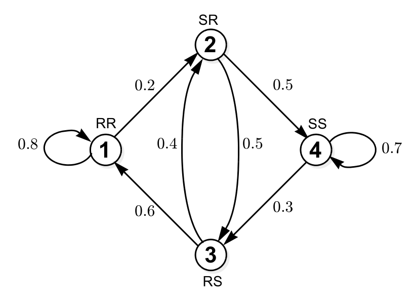

*Figure: the second-order weather model written as a first-order chain on pairs (yesterday, day before). Each state has only two possible successors, because the new pair must begin with tomorrow's weather and end with today's.*

## Evolution of the pmf

Let \\(\mathbf p(k)\\) be the pmf of \\(X\_k\\), written as a row vector. By the law of total probability,
\\[
\underbrace{P(X\_{k+1}=j)}\_{\text{new pmf}} = \sum\_i \underbrace{P(X\_k=i)}\_{\text{old pmf}}\\,P(X\_{k+1}=j\mid X\_k=i) = \sum\_i p\_i(k)P\_{ij},
\\]
or in vector form
\\[
\boxed{\mathbf p(k+1) = \mathbf p(k)\\,P}, \qquad\text{hence}\qquad \mathbf p(k) = \mathbf p(0)\\,P^k .
\\]
Setting \\(\mathbf p(0) = \mathbf e\_i\\) (start in state \\(i\\)) shows that the **\\(k\\)-step transition probabilities** are the entries of the matrix power:
\\[
P\_{ij}(k) \triangleq P(X\_k = j\mid X\_0 = i) = (P^k)\_{ij} .
\\]
Row \\(i\\) of \\(P^k\\) is the conditional pmf of \\(X\_k\\) given \\(X\_0 = i\\).

**Example 2 (Streaky shooter pmf).** Starting from a make, \\(\mathbf p(0) = [0,\\,1]\\), the probability of a make on later shots is \\(1, 0.9, 0.85, 0.825, 0.8125,\dots\\). Starting from a miss it is \\(0, 0.4, 0.6, 0.7, 0.75,\dots\\). From any start the probability approaches 0.8. Its distance from 0.8 halves every step, because the second eigenvalue of \\(P\\) is \\(0.5\\).

**Example 3 (A three-state chain).** Let
\\[
P = \begin{bmatrix}0 & 0.2 & 0.8\\\\ 0.2 & 0 & 0.8\\\\ 0.2 & 0.2 & 0.6\end{bmatrix}, \qquad P^2 = \begin{bmatrix}0.2 & 0.16 & 0.64\\\\ 0.16 & 0.2 & 0.64\\\\ 0.16 & 0.16 & 0.68\end{bmatrix}.
\\]
- \\(P(X\_2 = 3\mid X\_0 = 1) = (P^2)\_{13} = 0.64\\), and the whole pmf of \\(X\_2\\) given \\(X\_0=1\\) is the first row \\([0.2,\\,0.16,\\,0.64]\\).
- If \\(X\_0\\) is uniform, \\(\mathbf p(1) = \tfrac13[1,1,1]P = [0.1\bar3,\\,0.1\bar3,\\,0.7\bar3]\\).
- If \\(X\_0\\) is uniform, the path \\(3\to3\to1\to2\to3\\) has probability \\(\tfrac13\cdot0.6\cdot0.2\cdot0.2\cdot0.8 = 0.0064\\).
- The stationary pmf (defined below) is \\(\boldsymbol\pi = [\tfrac16,\tfrac16,\tfrac23]\\). By symmetry \\(\pi\_1=\pi\_2\\), and the balance equation for state 3, \\(\pi\_3 = 0.8\pi\_1+0.8\pi\_2+0.6\pi\_3\\), gives \\(\pi\_3 = 4\pi\_1\\). This chain is irreducible and aperiodic, so the limit \\(\lim\_k\mathbf p(k)\\) equals \\(\boldsymbol\pi\\) from any start.

### Stochastic matrices and their eigenvalues

A transition matrix has nonnegative entries and **rows that sum to one**. It is called a (right) **stochastic matrix**. Its columns need not sum to one. Row \\(i\\) is "from \\(i\\)" and column \\(j\\) is "to \\(j\\)". The row-sum property says \\(P\mathbf 1 = \mathbf 1\\), so the all-ones column vector is a right eigenvector with eigenvalue 1.

**Theorem (spectrum of a stochastic matrix).** Every stochastic matrix has eigenvalue 1, and every eigenvalue satisfies \\(\lvert\lambda\rvert\le1\\).

*Proof.* Eigenvalue 1 follows from \\(P\mathbf 1 = \mathbf 1\\). For the bound, let \\(Pu = \lambda u\\) with \\(u\ne0\\), and choose \\(i\\) with \\(\lvert u\_i\rvert = \max\_j\lvert u\_j\rvert\\). Then by the triangle inequality and the unit row sums,
\\[
\lvert\lambda\rvert\\,\lvert u\_i\rvert = \Big\lvert\sum\_jP\_{ij}u\_j\Big\rvert \le \sum\_jP\_{ij}\lvert u\_j\rvert \le \lvert u\_i\rvert\sum\_jP\_{ij} = \lvert u\_i\rvert ,
\\]
so \\(\lvert\lambda\rvert\le1\\). Left and right eigenvalues of a matrix coincide, so the same bound holds for the left eigenvalues that govern \\(\mathbf p(k+1) = \mathbf p(k)P\\). \\(\blacksquare\\)

### The stationary pmf

Since 1 is an eigenvalue of \\(P\\), it is also a *left* eigenvalue. So there is a nonzero row vector with \\(\mathbf v = \mathbf vP\\).

**Definition (stationary pmf).** A pmf \\(\boldsymbol\pi\\) is **stationary** if it satisfies the **balance equations**
\\[
\boldsymbol\pi = \boldsymbol\pi P, \qquad \sum\_j\pi\_j = 1 .
\\]
If \\(\mathbf p(k) = \boldsymbol\pi\\), then \\(\mathbf p(k+1) = \boldsymbol\pi\\) as well, so the pmf never changes. Such a \\(\boldsymbol\pi\\) is also called an equilibrium, a fixed point or a balanced pmf.

**Theorem.** Every finite chain has at least one stationary pmf.

*Proof.* Take a left eigenvector \\(\mathbf v = \mathbf vP\\), \\(\mathbf v\ne0\\). We must show it can be chosen nonnegative. For each \\(j\\),
\\[
\lvert v\_j\rvert = \Big\lvert\sum\_iv\_iP\_{ij}\Big\rvert \le \sum\_i\lvert v\_i\rvert P\_{ij}.
\\]
Summing over \\(j\\) and using the unit row sums gives \\(\sum\_j\lvert v\_j\rvert \le \sum\_i\lvert v\_i\rvert\\), which must be an equality. So every one of the inequalities above is an equality, and the vector \\((\lvert v\_1\rvert,\dots,\lvert v\_M\rvert)\\) also satisfies the balance equations. Dividing it by its sum gives a stationary pmf. \\(\blacksquare\\)

A stationary pmf always exists, but it need not be unique, and \\(\mathbf p(k)\\) need not converge to it. Before turning to those questions, here are three ways to compute \\(\boldsymbol\pi\\) for the streaky shooter.

1. *Solve the balance equations.* \\(\pi\_0 = 0.6\pi\_0+0.1\pi\_1\\) gives \\(0.4\pi\_0 = 0.1\pi\_1\\), and with \\(\pi\_0+\pi\_1 = 1\\), \\(\boldsymbol\pi = [0.2,\\,0.8]\\).
2. *Raise \\(P\\) to a high power.* Every row of \\(P^{100}\\) equals \\([0.2,\\,0.8]\\).
3. *Normalize the left eigenvector for \\(\lambda = 1\\).*

```matlab
P = [0.6 0.4; 0.1 0.9];
P^100                                   % rows converge to pi
[V, D] = eig(P');                       % left eigenvectors of P
i1 = find(abs(diag(D)-1) < 1e-9);
v1 = V(:,i1)';  pmf = v1/sum(v1)        % [0.2 0.8]
```

```python
import numpy as np
P = np.array([[0.6, 0.4], [0.1, 0.9]])
w, V = np.linalg.eig(P.T)
v = np.real(V[:, np.argmin(abs(w - 1))]); print(v / v.sum())   # [0.2 0.8]
```

**Example 4 (Two shots of memory).** A shooter makes the next shot with probability 0.4 after missing both previous shots, 0.6 after making exactly one, and 0.8 after making both. What is the long-run shooting percentage? Use the state \\(X\_k = (S\_k,S\_{k-1})\\) with \\(1 = (0,0)\\), \\(2 = (1,0)\\), \\(3 = (0,1)\\), \\(4 = (1,1)\\):
\\[
P = \begin{bmatrix}0.6 & 0.4 & 0 & 0\\\\ 0 & 0 & 0.4 & 0.6\\\\ 0.4 & 0.6 & 0 & 0\\\\ 0 & 0 & 0.2 & 0.8\end{bmatrix}.
\\]
The balance equations, or the eigenvector computation above, give \\(\boldsymbol\pi = [\tfrac16,\tfrac16,\tfrac16,\tfrac12]\\). The shooter makes shot \\(k\\) in states 2 and 4, so
\\[
P(S\_k = 1) = \pi\_2+\pi\_4 = \tfrac16+\tfrac12 = \tfrac23 .
\\]

**Example 5 (Frog on a right-isosceles triangle).** Lily pads 1, 2 and 3 sit at the corners of a 45-45-90 triangle with the right angle at pad 1, legs of length 1 and hypotenuse \\(\sqrt2\\). Each day the frog jumps to one of the other two pads with probability inversely proportional to the distance. From pad 1 both distances are 1, so it jumps to pad 2 or 3 with probability \\(\tfrac12\\) each. From pad 2 the distances are 1 (to pad 1) and \\(\sqrt2\\) (to pad 3). Probabilities inversely proportional to distance are then \\(\frac{\sqrt2}{1+\sqrt2}\\) to pad 1 and \\(\frac{1}{1+\sqrt2}\\) to pad 3, and pad 3 is symmetric:
\\[
P = \begin{bmatrix}0 & \tfrac12 & \tfrac12\\\\ \frac{\sqrt2}{1+\sqrt2} & 0 & \frac{1}{1+\sqrt2}\\\\ \frac{\sqrt2}{1+\sqrt2} & \frac{1}{1+\sqrt2} & 0\end{bmatrix}.
\\]
The chain is irreducible and aperiodic, since returns are possible in 2, 3, 4, … steps. By symmetry \\(\pi\_2 = \pi\_3\\). Balance at pad 1 gives \\(\pi\_1 = 2\pi\_2\frac{\sqrt2}{1+\sqrt2}\\), and normalizing,
\\[
\boldsymbol\pi = \tfrac1{14}\big[\\,8-2\sqrt2,\\ \ 3+\sqrt2,\\ \ 3+\sqrt2\\,\big] \approx [0.369,\\ 0.315,\\ 0.315].
\\]
The frog spends about 31.5% of its time on pad 3. As a sanity check, an equilateral triangle would give \\(\tfrac13\\) each. Here both pads 2 and 3 prefer pad 1, so pad 1 gets more than \\(\tfrac13\\).

**Example 6 (Coach's speeches).** A team wins its next game with probability 0.8 after a win and 0.3 after a loss. With states L and W, \\(P = \begin{bmatrix}0.7 & 0.3\\\\ 0.2 & 0.8\end{bmatrix}\\). Then \\(\pi\_L = 0.7\pi\_L + 0.2(1-\pi\_L)\\), so \\(\pi\_L = 0.4\\) and \\(\pi\_W = 0.6\\). The coach gives a speech after a loss with probability 0.7 and after a win with probability 0.2. The long-run fraction of games followed by a speech is \\(0.7(0.4)+0.2(0.6) = 0.4\\).

**Example 7 (Tourist on bridges).** An island is joined to the North shore by 3 bridges, and the North shore to the South shore by 2 bridges. Each hour a tourist picks one of the bridges available at her location uniformly at random and crosses it. With states North, Island and South, \\(P = \begin{bmatrix}0 & 0.6 & 0.4\\\\ 1 & 0 & 0\\\\ 1 & 0 & 0\end{bmatrix}\\) and \\(\boldsymbol\pi = [0.5,\\,0.3,\\,0.2]\\), so she spends 30% of the time on the island. This is a random walk on a multigraph, and for such walks \\(\pi\_i\\) is proportional to the number of bridges at \\(i\\) (the degree): \\(5:3:2\\).

**Example 8 (A symmetric chain started in equilibrium).** Let \\(X\_k\in\\{-1,0,1\\}\\). From \\(\pm1\\) the chain moves to 0 with probability \\(\tfrac13\\) and otherwise stays. From 0 it moves to \\(-1\\), 0 or \\(+1\\) with probability \\(\tfrac13\\) each:
\\[
P = \tfrac13\begin{bmatrix}2 & 1 & 0\\\\ 1 & 1 & 1\\\\ 0 & 1 & 2\end{bmatrix}.
\\]
The columns also sum to one (\\(P\\) is *doubly stochastic*), so the uniform pmf is stationary, and since the chain is irreducible it is the unique one. Started from \\(\boldsymbol\pi\\), the process is strictly stationary. Its autocorrelation follows by conditioning on the most recent state. Let \\(g(x) = E(X\_1\mid X\_0 = x)\\), so that \\(g(\pm1) = \pm\tfrac23\\) and \\(g(0) = 0\\), i.e. \\(g(x) = \tfrac23x\\). Then
\\[
R(m+1) = E(X\_0X\_{m+1}) = E\big(X\_0\\,E(X\_{m+1}\mid X\_m,\dots,X\_0)\big) = E\big(X\_0\\,g(X\_m)\big) = \tfrac23R(m),
\\]
and since \\(R(0) = E(X^2) = \tfrac23\\), \\(R(m) = \tfrac23\left(\tfrac23\right)^{\lvert m\rvert}\\). Correlations in a Markov chain decay geometrically, at a rate set by the second eigenvalue of \\(P\\), which here is \\(\tfrac23\\). Stationarity and autocorrelation are developed in [Random Sequences, Stationarity and Power Spectra](random-sequences.md).

## Convergence and Classification

Two examples show that the pmf need not settle down.

- *The pmf may oscillate forever.* Take the chain \\(1\to2\\) (probability 1), \\(2\to1\\) and \\(2\to3\\) (\\(\tfrac12\\) each), \\(3\to2\\) (probability 1), started at \\(X\_0 = 2\\). Then \\(P(X\_k=2) = 1\\) for even \\(k\\) and 0 for odd \\(k\\).
- *The limit may depend on the start.* Let state 1 have a self-loop of 0.97 and leak to state 2 with probability 0.02 and to state 3 with probability 0.01. State 2 is absorbing (\\(P\_{22}=1\\)), and states 3 and 4 form a closed pair. Starting in 2, \\(P(X\_k=2) = 1\\) forever. Starting in 3, it is always 0. Starting in 1, it tends to \\(0.02/0.03 = \tfrac23\\).

So we need conditions under which the stationary pmf is unique, the limiting pmf \\(\mathbf p(\infty) = \lim\_k\mathbf p(k)\\) exists, and the two agree. These conditions come from the graph structure of the chain.

### Communicating classes

State \\(j\\) is **reachable** from \\(i\\) (written \\(i\to j\\)) if there is a walk from \\(i\\) to \\(j\\) in the diagram, that is, if \\((P^k)\_{ij}>0\\) for some \\(k\ge0\\). Reachability is transitive. States \\(i\\) and \\(j\\) **communicate** (\\(i\leftrightarrow j\\)) if \\(i\to j\\) and \\(j\to i\\). Communication is an equivalence relation (reflexive, symmetric and transitive). So it partitions the state space into disjoint **communicating classes**, and every state lies in exactly one class.

A chain is **irreducible** if it has a single class, meaning every state is reachable from every other. In graph-theoretic terms the diagram is *strongly connected*.

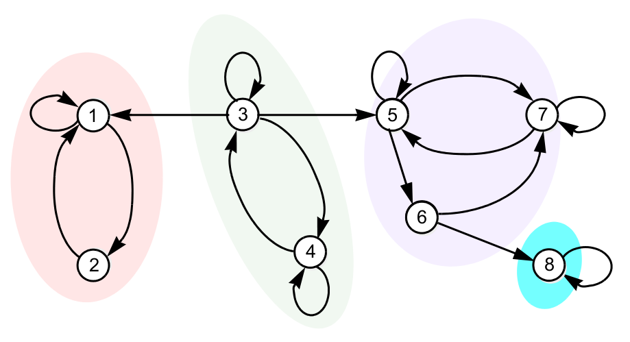

*Figure: an eight-state chain with its communicating classes shaded: \\(\\{1,2\\}\\), \\(\\{3,4\\}\\), \\(\\{5,6,7\\}\\) and \\(\\{8\\}\\). Arcs between classes go only one way. 3 leaks into classes \\(\\{1,2\\}\\) and \\(\\{5,6,7\\}\\), and 6 leaks into \\(\\{8\\}\\).*

### Recurrent and transient states

A state \\(i\\) is **recurrent** if, starting from \\(i\\), the chain returns to \\(i\\) with probability 1. It then returns infinitely often. Otherwise \\(i\\) is **transient**: the return probability is less than 1, there are only finitely many returns, and \\(P(X\_k = i)\to0\\). Transient states can be ignored in the long run.

For finite chains there is a simple graph test. A state \\(i\\) is recurrent if and only if every state reachable from \\(i\\) can reach \\(i\\) back, that is, there is no exit from which return is impossible. A class is recurrent if it is **closed** (no arcs leave it) and transient otherwise. In the eight-state chain, \\(\\{1,2\\}\\) and \\(\\{8\\}\\) are recurrent, while \\(\\{3,4\\}\\) (which leaks to 1 and 5) and \\(\\{5,6,7\\}\\) (which leaks to 8) are transient.

Two consequences, for finite chains:

- *An irreducible chain has all states recurrent.* A finite chain must spend infinite time in some state. In an irreducible chain every state can reach that state and be reached from it, which forces every state to be recurrent.
- *The converse is false.* If \\(P\\) is block diagonal with three \\(2\times2\\) stochastic blocks, every state is recurrent, but there are three closed classes and the chain is not irreducible.

### Periodicity

The **period** of state \\(i\\) is \\(d = \gcd\\{k\ge1: (P^k)\_{ii}>0\\}\\), the greatest common divisor of all possible return times. If \\(d>1\\), returns can occur only at multiples of \\(d\\) and the state is **periodic**. If \\(d=1\\), it is **aperiodic**. A self-loop makes a state aperiodic immediately.

Examples:

- The path graph \\(1\leftrightarrow2\leftrightarrow3\\) has period 2.
- The arc pair \\(1\leftrightarrow2\\) together with the cycle \\(2\to3\to4\to5\to2\\) has cycles of lengths 2 and 4, so the period is \\(\gcd(2,4) = 2\\).
- The chain with \\(1\to3\\), \\(1\to4\\) (\\(\tfrac12\\) each) and \\(3\to2\\), \\(4\to2\\), \\(2\to1\\) (probability 1 each) is irreducible with period 3, since every cycle has length 3.

**Class properties.** Recurrence, transience, periodicity and the value of the period are all *class properties*. If one state in a class has the property, every state in the class has it. A chain is called aperiodic when all its states are aperiodic.

**Definition (ergodic chain).** A finite chain is **ergodic** if it is irreducible and aperiodic. Equivalently, some power \\(P^k\\) has *all* entries strictly positive. Such a matrix is called *primitive*.

**Example 9 (Classifying a ten-state chain).** Consider a chain whose diagram has four groups. The triangle \\(\\{1,2,3\\}\\) is fully connected. State 4 has arcs to 3 and to 5. The triangle \\(\\{5,6,7\\}\\) is fully connected. The triangle \\(\\{8,9,10\\}\\) is fully connected with exits \\(9\to6\\) and \\(10\to5\\).

- The chain is not irreducible (state 4 cannot be reached from 3).
- The communicating classes are \\(\\{1,2,3\\}\\), \\(\\{4\\}\\), \\(\\{5,6,7\\}\\) and \\(\\{8,9,10\\}\\).
- The transient states are \\(\\{4,8,9,10\\}\\), and the recurrent states are \\(\\{1,2,3,5,6,7\\}\\).
- No recurrent state is periodic, because within a fully connected triangle a return is possible in both 2 and 3 steps.
- If all nonzero entries in each row are equal, then \\((P^{17})\_{8,2} = 0\\), since state 2 cannot be reached from state 8 in any number of steps.

**Example 10 (A ring with a chord).** The cycle \\(1\to2\to3\to4\to5\to6\to1\\) plus a chord \\(6\to2\\) is irreducible and has cycles of lengths 6 and 5. Since \\(\gcd(5,6)=1\\), it is aperiodic and hence ergodic. How large must \\(k\\) be for \\(P^k\\) to have all entries positive? Track the set of states reachable from state 1 at each time. It grows at times 6, 11–12, 16–18 and 21–24, and it first contains every state at \\(k = 26\\). The other starting states need fewer steps (state \\(i\\) needs \\(27-i\\)), so the smallest such \\(k\\) is 26.

### The convergence theorem

**Theorem (fundamental convergence theorem).** Let a finite Markov chain be irreducible and aperiodic. Then the balance equations \\(\boldsymbol\pi = \boldsymbol\pi P\\) have a unique pmf solution, every entry \\(\pi\_j\\) is positive, and for every initial pmf,
\\[
\lim\_{k\to\infty}\mathbf p(k) = \boldsymbol\pi, \qquad\text{equivalently}\qquad \lim\_{k\to\infty}P^k = \begin{bmatrix}\boldsymbol\pi\\\\ \vdots\\\\ \boldsymbol\pi\end{bmatrix} = \mathbf 1\boldsymbol\pi .
\\]
*Proof sketch.* For a primitive nonnegative matrix, the Perron–Frobenius theorem says that the eigenvalue 1 is simple, with positive left and right eigenvectors \\(\boldsymbol\pi\\) and \\(\mathbf 1\\), and that every other eigenvalue satisfies \\(\lvert\lambda\rvert<1\\). Expanding \\(P^k\\) in its Jordan form, every component except \\(\mathbf 1\boldsymbol\pi\\) decays like \\(k^m\lvert\lambda\_2\rvert^k\\), where \\(\lambda\_2\\) is the second-largest eigenvalue in modulus. Then \\(\mathbf p(0)P^k\to\mathbf p(0)\mathbf 1\boldsymbol\pi = \boldsymbol\pi\\), because \\(\mathbf p(0)\mathbf 1 = 1\\). \\(\blacksquare\\)

The second eigenvalue sets the *rate* of convergence. For the streaky shooter, \\(\lambda\_2 = 0.5\\), so each step halves the distance to equilibrium.

**Interpretations of \\(\boldsymbol\pi\\).** For an ergodic chain:

- \\(\pi\_j\\) is the long-run probability of being in state \\(j\\);
- \\(\pi\_j\\) is the long-run fraction of time spent in \\(j\\), almost surely along a single sample path (the ergodic theorem for Markov chains);
- the mean recurrence time is \\(T\_j^{\star} = 1/\pi\_j\\). If the chain visits \\(j\\) a fraction \\(\pi\_j\\) of the time, the average spacing between visits is \\(1/\pi\_j\\).

**Example 11.** The two-state chain with \\(P\_{11} = 0.4\\), \\(P\_{12} = 0.6\\), \\(P\_{21} = 0.3\\), \\(P\_{22} = 0.7\\) is ergodic (it has self-loops). Balance gives \\(0.6\pi\_1 = 0.3\pi\_2\\), so \\(\mathbf p(\infty) = [\tfrac13,\tfrac23]\\), and the mean time between visits to state 1 is 3 steps.

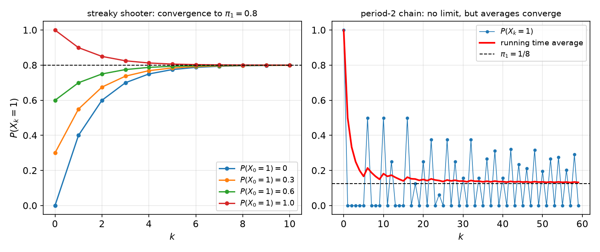

*Figure: left, the streaky shooter's \\(P(X\_k=1)\\) from four initial pmfs. All converge geometrically, with ratio \\(\lambda\_2 = 0.5\\), to \\(\pi\_1 = 0.8\\). Right, a period-2 chain (the double-hexagon chain discussed below) started in state 1. \\(P(X\_k=1)\\) is zero at every odd time and never converges, but its running time average converges to \\(\pi\_1 = 1/8\\).*

### Periodic chains: how to read \\(\boldsymbol\pi\\)

If an irreducible chain is periodic, \\(\boldsymbol\pi\\) is still the unique solution of the balance equations, but \\(\mathbf p(\infty)\\) does not exist and \\(P^k\\) has no limit. The pmf keeps oscillating about \\(\boldsymbol\pi\\), and \\(\boldsymbol\pi\\) still gives the long-run fraction of time spent in each state.

**Example 12 (A deterministic 6-cycle).** For the chain \\(1\to2\to\dots\to6\to1\\), the unique stationary pmf is \\(\boldsymbol\pi = \tfrac16\mathbf 1\\). From any deterministic start, the pmf rotates around the cycle forever with period 6.

**Example 13 (Two hexagons sharing an edge).** The right cycle is \\(1\to2\to3\to4\to5\to6\to1\\). At state 3 the chain branches with probability \\(\tfrac12\\) each, either to 4 or to a left detour \\(3\to7\to8\to9\to10\to4\\). The cycles through 3 have lengths 6 and 10, so the period is \\(\gcd(6,10) = 2\\). Starting from \\(X\_0 = 1\\),
\\[
\mathbf p(\text{even }k)\to\tfrac1{16}[4,0,4,0,4,0,0,2,0,2], \qquad \mathbf p(\text{odd }k)\to\tfrac1{16}[0,4,0,4,0,4,2,0,2,0],
\\]
and the stationary pmf is their average:
\\[
\boldsymbol\pi = \tfrac1{16}[2,2,2,2,2,2,1,1,1,1] = \tfrac12\big(\mathbf p(\text{even})+\mathbf p(\text{odd})\big).
\\]
Each detour state receives half the traffic of a main-cycle state, because only half the passages through state 3 take the detour.

## Probability Flow and Birth–Death Chains

### Balance as conservation of flow

A good way to picture \\(\mathbf p(k+1) = \mathbf p(k)P\\) is to label each node with its current probability and imagine that at every tick, a fraction \\(P\_{ij}\\) of the mass at \\(i\\) flows along arc \\(i\to j\\). The *probability flow* on the arc is \\(p\_i(k)P\_{ij}\\). At equilibrium the flow into every node equals the flow out of it. Subtracting the self-loop term \\(\pi\_jP\_{jj}\\) from both sides of \\(\pi\_j = \sum\_i\pi\_iP\_{ij}\\) gives
\\[
\underbrace{\sum\_{\ell\ne j}\pi\_jP\_{j\ell}}\_{\text{flow out of } j} = \underbrace{\sum\_{i\ne j}\pi\_iP\_{ij}}\_{\text{flow into } j}
\quad\Longleftrightarrow\quad \pi\_j = \sum\_i\pi\_iP\_{ij}\quad\Longleftrightarrow\quad\boldsymbol\pi = \boldsymbol\pi P .
\\]
For the two-state chain of Example 11, \\(\boldsymbol\pi = [\tfrac5{15},\tfrac{10}{15}]\\). The flows are \\(\pi\_1P\_{11} = \tfrac2{15}\\), \\(\pi\_1P\_{12} = \tfrac3{15}\\), \\(\pi\_2P\_{21} = \tfrac3{15}\\) and \\(\pi\_2P\_{22} = \tfrac7{15}\\). The two cross flows are equal.

The same argument applies to any set of states \\(A\\): at equilibrium, the total flow from \\(A\\) to its complement equals the total flow back. For a chain whose states lie on a line, this gives one equation per *cut*.

### Birth–death chains

A **birth–death chain** is a chain on \\(\\{0,1,\dots,M\\}\\) that moves by at most one step at a time: up by one, down by one, or stay. Any process that counts something one unit at a time has this form, such as a population, the number of infected people, packets queued at a router, patients in an emergency room or orders not yet shipped. The only arcs crossing the cut between \\(i\\) and \\(i+1\\) are \\(i\to i+1\\) and \\(i+1\to i\\). So the balance equations reduce to the **cut equations**
\\[
\pi\_i\\,P\_{i,i+1} = \pi\_{i+1}\\,P\_{i+1,i}, \qquad i = 0,\dots,M-1 ,
\\]
which can be solved one after another:
\\[
\pi\_k = \pi\_0\prod\_{i=0}^{k-1}\frac{P\_{i,i+1}}{P\_{i+1,i}}, \qquad \pi\_0 = \Big(\sum\_k\prod\_{i<k}\frac{P\_{i,i+1}}{P\_{i+1,i}}\Big)^{-1}.
\\]

**Example 14 (Supermarket checkout line).** How fast must a cashier work, how long is the line on average, and how often is it full? Assume:

- customers arrive as a Poisson process of rate \\(\lambda\\);
- checkout durations are i.i.d. Exp\\((\beta)\\), with mean \\(T = 1/\beta\\);
- the line holds at most \\(M\\) customers;
- the **load** is \\(\rho \triangleq \lambda/\beta = \lambda T\\).

Discretize time into slots of length \\(\tau\\), so short that at most one arrival or departure happens per slot. Arrivals and service completions are memoryless, so the line length \\(X\_k\\) is a birth–death chain. It moves up with probability \\(p = \lambda\tau\\) and down with probability \\(q = \beta\tau\\). The self-loops are \\(1-p\\) at 0, \\(1-p-q\\) in the interior and \\(1-q\\) at \\(M\\).

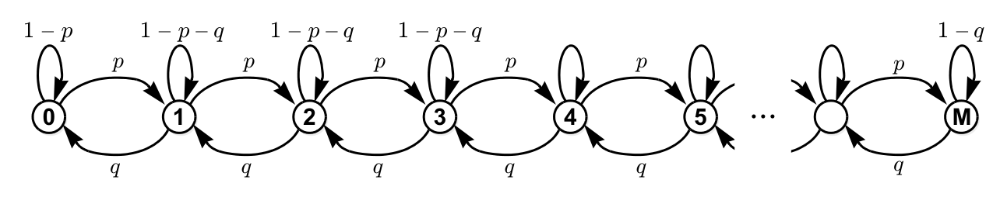

*Figure: the discretized checkout line, with up-moves of probability \\(p=\lambda\tau\\), down-moves \\(q=\beta\tau\\) and self-loops that make each row sum to 1. At equilibrium, the flows across every cut between neighbouring states balance.*

The chain is irreducible and aperiodic, because of the self-loops. The cut equation \\(\lambda\tau\\,\pi\_i = \beta\tau\\,\pi\_{i+1}\\) gives \\(\pi\_{i+1} = \rho\\,\pi\_i\\), and \\(\tau\\) drops out. Hence
\\[
\pi\_k = \rho^k\pi\_0 = \frac{1-\rho}{1-\rho^{M+1}}\\,\rho^k, \qquad k = 0,\dots,M .
\\]
This is a geometric pmf shifted to start at 0 and truncated at \\(M\\). The probability that the line is full, which is also the probability that an arriving customer is turned away, is
\\[
P\_{\text{FULL}} = \pi\_M = \frac{\rho^M}{\sum\_{i=0}^M\rho^i} = \frac{1-\rho}{\rho^{-M}-\rho} .
\\]
For \\(\rho = 0.9\\) and \\(M = 15\\), \\(\pi\_0\approx 0.123\\) and \\(P\_{\text{FULL}}\approx 2.5\\%\\). The mean line length is about 5.4, against \\(\rho/(1-\rho) = 9\\) without the cap. Capacity requirements grow sharply as the load approaches 1. At \\(\rho = 0.99\\), a line of \\(M = 68\\) spots is needed to keep \\(P\_{\text{FULL}}\\) near 1%.

For an unlimited line (\\(M\to\infty\\), which requires \\(\rho<1\\)), \\(\pi\_k = (1-\rho)\rho^k\\). This is \\(\mathrm{Geo}(1-\rho)-1\\), and the mean line length is
\\[
E(X\_k) = \frac{\rho}{1-\rho} = \frac{\lambda}{\beta-\lambda}.
\\]
It blows up as \\(\rho\to1\\). At \\(\rho = 0.99\\), the average line is 99 customers long, even though the cashier is idle 1% of the time. In the limit \\(\tau\to0\\) this is the M/M/1 queue.

**Example 15 (How many voice channels? Erlang-B).** A cell tower at a stadium has \\(N\\) channels. Calls start as a Poisson\\((\lambda)\\) process and last i.i.d. Exp\\((\beta)\\) durations. A call that arrives while all \\(N\\) channels are busy is blocked. How large must \\(N\\) be to keep the blocking probability below 1%? Let \\(\rho = \lambda/\beta\\), the mean number of calls that would be active if capacity were unlimited. Discretizing as before, the number of active calls is a birth–death chain on \\(\\{0,\dots,N\\}\\). The difference from the checkout line is that with \\(i\\) calls active, *any* of them can end, so the down-probability is \\(i\beta\tau\\). The cut equation \\(\lambda\tau\\,\pi\_{i-1} = i\beta\tau\\,\pi\_i\\) gives \\(\pi\_i = (\rho/i)\pi\_{i-1}\\), and therefore
\\[
\pi\_k = \frac{\rho^k/k!}{\sum\_{i=0}^N\rho^i/i!}, \qquad k = 0,\dots,N .
\\]
This is a Poisson\\((\rho)\\) pmf truncated at \\(N\\). The blocking probability is the **Erlang-B formula**
\\[
P\_B = \pi\_N = \frac{\rho^N/N!}{\sum\_{i=0}^N\rho^i/i!} .
\\]
For \\(\rho = 10\\) and \\(N = 15\\), \\(P\_B\approx 3.6\\%\\), and the mean number of active calls is \\(\rho(1-P\_B)\\). For \\(\rho = 100\\), keeping \\(P\_B\le1\\%\\) requires \\(N = 117\\) channels. With \\(N = 100\\) channels, the largest load that keeps \\(P\_B\le 1\\%\\) is \\(\rho\approx 84\\). Large systems can run at high utilization, but they still need some margin above the mean load.

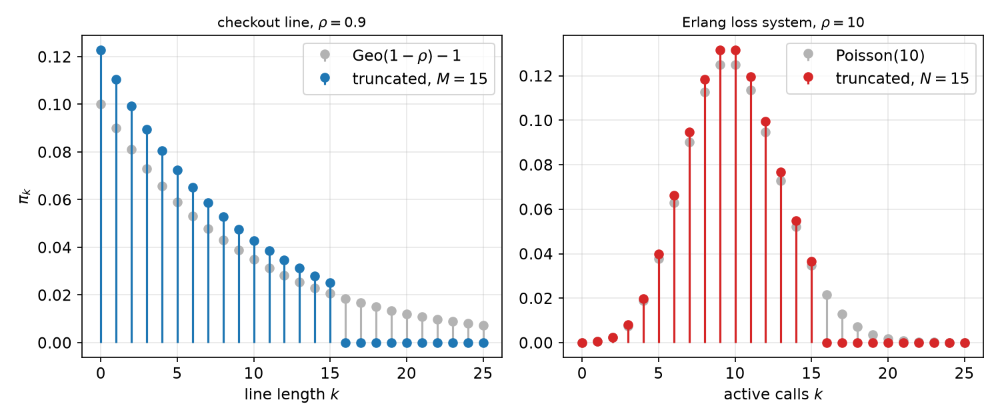

*Figure: stationary pmfs of two birth–death chains (coloured), compared with their untruncated versions (gray). Left, the checkout line with \\(\rho = 0.9\\), \\(M = 15\\): a truncated geometric, where the full-line probability \\(\pi\_{15}\\) is about 2.5%. Right, the voice channels with \\(\rho = 10\\), \\(N = 15\\): a truncated Poisson, where \\(\pi\_{15}\approx3.6\\%\\) is the blocking probability.*

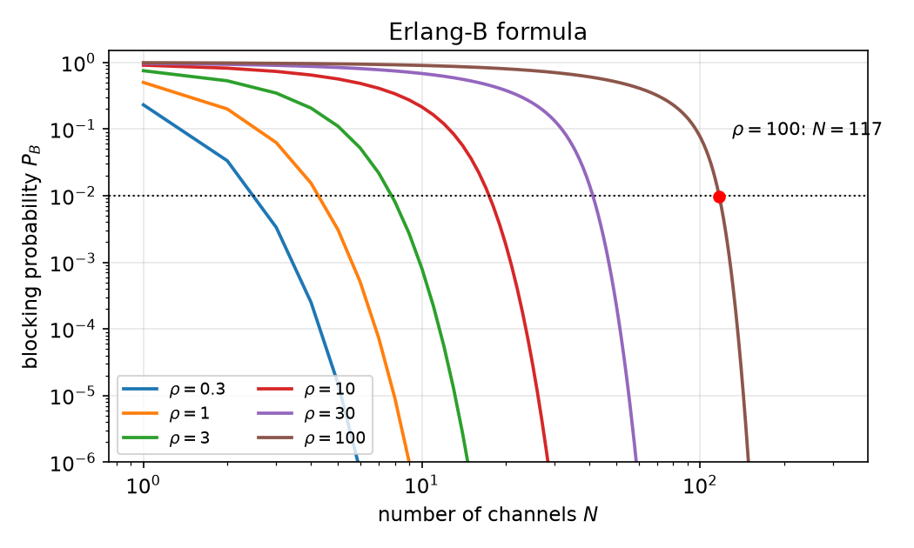

*Figure: Erlang-B blocking probability against the number of channels \\(N\\) for loads \\(\rho = 0.3\\) to 100 (log–log axes). Blocking falls rapidly once \\(N\\) exceeds \\(\rho\\). The red dot marks the design point \\(\rho = 100\\), \\(N = 117\\), \\(P\_B = 1\\%\\). Computed with the stable recursion \\(B\_n = \rho B\_{n-1}/(n+\rho B\_{n-1})\\), \\(B\_0 = 1\\).*

**Example 16 (The Ehrenfest chain).** Two chambers are joined by a narrow tube and hold \\(N\\) balls between them. At each step a ball is chosen uniformly at random and moved to the other chamber. Let \\(X\_k\\) be the number of balls on the right. The model was introduced to reconcile reversible microscopic dynamics with the second law of thermodynamics. Starting with most balls on one side, the system drifts toward an even split and then stays near it, which looks irreversible even though each move is reversible.

The transition probabilities depend on the state: \\(P\_{i,i+1} = (N-i)/N\\) and \\(P\_{i,i-1} = i/N\\). The farther the state is from \\(N/2\\), the stronger the pull back toward the middle. The chain is irreducible. It is *periodic with period 2*, because \\(X\_k\\) changes parity at every step. The cut equation between \\(i-1\\) and \\(i\\) gives
\\[
\pi\_i\frac iN = \pi\_{i-1}\frac{N-i+1}{N} \quad\Rightarrow\quad \pi\_i = \frac{N-i+1}{i}\pi\_{i-1} = \frac{N-i+1}{i}\cdot\frac{N-i+2}{i-1}\cdots\frac N1\\,\pi\_0 = \binom Ni\pi\_0 .
\\]
Normalization gives \\(\sum\_i\binom Ni\pi\_0 = 2^N\pi\_0 = 1\\), so
\\[
\pi\_i = \binom Ni 2^{-N}, \qquad \boldsymbol\pi\sim\mathrm{Bin}(N,\tfrac12).
\\]
This is the distribution we would get by placing each ball independently on a random side. Because the chain is periodic, \\(\mathbf p(k)\\) does not converge. It alternates between even and odd states, but time averages converge to the binomial.

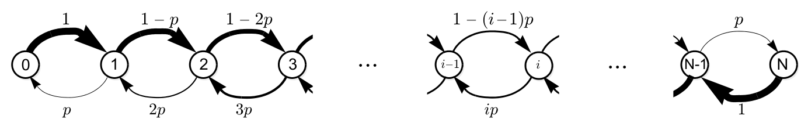

*Figure: the Ehrenfest chain with \\(p = 1/N\\). Arrow thickness is proportional to probability. Up-moves get weaker and down-moves stronger as \\(i\\) grows, which produces the pull toward the middle.*

## Case Study: Computer-Generated Text

Markov chains give a simple and instructive model of language. Take an alphabet of \\(M = 44\\) symbols: A–Z, space, period, comma, hyphen, 0–9, question mark, parentheses and apostrophe.

1. *i.i.d. uniform.* A "monkey" typing uniformly random symbols produces gibberish such as `Aj0e9(2bcfixy3s ?J3yoy(fzw5)qz)…`.
2. *i.i.d. with English letter frequencies.* Estimate the marginal pmf by counting symbols in a novel of about half a million characters (Don DeLillo's *White Noise* was the corpus). Space is the most common symbol at about 18%, followed by E (about 10%), T (about 7.5%), then A, O, I, S, N, R, H, …, with Q, Z and the digits near zero. Text drawn i.i.d. from this pmf (`S TE PA,MFS RNEPOHAM TI CRCLERAFBETEKSW…`) has the right letter frequencies but no word structure.
3. *First-order Markov chain.* Let \\(X\_k\\) be the \\(k\\)-th character and estimate \\(P\_{ij}\\) by counting how often \\(i\\) is followed by \\(j\\). After A, the next letter is N 17% of the time, T 14%, R 10%, S 9%, L 8%, and so on. After Q it is U 99.6% of the time. The \\(44\times44\\) matrix has a strong column at "space". Text generated by a random walk on this graph (`Tck pstruede n tuiofor ckeha wale. As uell s aliviv…`) has English-like letter pairs and word lengths, but no real words.
4. *Higher order.* Take the state to be the last \\(\mu\\) characters. After "TH", for example, the next letter is E 65% of the time, I 12% and A 8%. Order 2 produces some real words (`Therint ang, the adoctichn ar? Slinerke thal peares what salte…`). Order 3 produces more (`Ther telepareful swings, league tal the badly disclose…`). Order 4 gives `There take a bit me. Whetheat, smile had forced house?…`. Order 5 gives nearly grammatical fragments (`There, mobs of these the optimism, his favor fruit chemistry, some kind head…`).

The vectorized state space could have up to \\(44^{\mu}\\) states, about \\(1.6\times10^8\\) for \\(\mu = 5\\). But only the contexts that actually occur in the corpus matter: 44, 800, 6770, 28,741 and 79,371 for orders 1 to 5. This growth is far slower than exponential. The idea was sketched by Shannon in his theory of communication, and it is the ancestor of \\(n\\)-gram language models.

## PageRank

Before Google, web search relied on hand-curated directories. PageRank ranks pages by the principle that *a page is important if important pages link to it*. This definition is circular, and the circularity is resolved by a stationary pmf. Imagine a "random surfer" who repeatedly follows a uniformly chosen outgoing link. A page's rank is the long-run fraction of time the surfer spends on it, which is \\(\pi\_j\\) for the link-following chain. Two modifications make the chain well behaved:

1. **Dangling pages.** A page with no outgoing links is treated as linking to every page. Its row becomes \\(\tfrac1N\mathbf 1^T\\), and the modified matrix is \\(P'\\).
2. **Teleportation.** At each step, with probability \\(\alpha\\), the surfer ignores the links and jumps to a uniformly random page. The resulting "Google matrix" is
\\[
G = \frac{\alpha}{N}\mathbf 1\mathbf 1^T + (1-\alpha)P' .
\\]
Every entry of \\(G\\) is positive, so the chain is irreducible and aperiodic, and by the convergence theorem it has a unique stationary pmf. The usual choice is a damping factor \\(1-\alpha = 0.85\\).

**Example 17 (An eleven-page web).** Pages A–K link as follows: B ↔ C; D → A, B; E → B, D, F; F → B, E; G, H, I → B, E; J, K → E. A has no outgoing links. Solving \\(\boldsymbol\pi = \boldsymbol\pi G\\) with \\(\alpha = 0.15\\) gives
\\[
\text{B } 38.4\\%,\quad \text{C } 34.3\\%,\quad \text{E } 8.1\\%,\quad \text{D } 3.9\\%,\quad \text{F } 3.9\\%,\quad \text{A } 3.3\\%,\quad \text{G–K } 1.6\\% \text{ each}.
\\]
C has only one incoming link, but it ranks second because that link comes from B, the most important page, and B links nowhere else. Pages G–K have no incoming links, so they receive only teleportation traffic, \\(\alpha/N + (1-\alpha)\pi\_A/N\approx 1.6\\%\\). The exact values depend on \\(\alpha\\). Larger \\(\alpha\\) flattens the ranking toward uniform.

```python
import numpy as np
L = 'ABCDEFGHIJK'
links = {'A': '', 'B': 'C', 'C': 'B', 'D': 'AB', 'E': 'BDF', 'F': 'BE',
         'G': 'BE', 'H': 'BE', 'I': 'BE', 'J': 'E', 'K': 'E'}
N, a = len(L), 0.15
P = np.zeros((N, N))
for s, t in links.items():
    i = L.index(s)
    if t: P[i, [L.index(c) for c in t]] = 1 / len(t)
    else: P[i, :] = 1 / N                  # dangling page links everywhere
G = a / N + (1 - a) * P
pi = np.ones(N) / N
for _ in range(200): pi = pi @ G           # power iteration
print(dict(zip(L, np.round(100 * pi, 1))))
```

At web scale, \\(\boldsymbol\pi\\) is computed by power iteration exactly as in the last loop. The error shrinks by a factor of at most \\(1-\alpha\\) per step, because every eigenvalue of \\(G\\) other than 1 has modulus at most \\(1-\alpha\\).

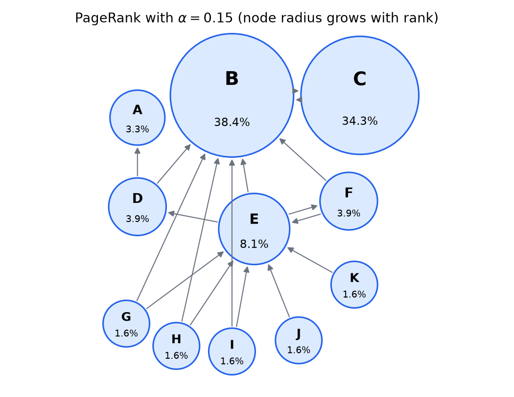

*Figure: PageRank of the eleven-page example with \\(\alpha = 0.15\\), with node radius growing with rank. B and C hold almost three quarters of the stationary probability between them. Pages with no incoming links share the teleportation floor of about 1.6%.*

## Reducible Chains and Absorption

When a chain has several closed classes, the long-run behaviour depends on which class the chain eventually enters. The analysis splits into two parts:

1. analyse each recurrent class on its own, as an irreducible chain with its own \\(\boldsymbol\pi\\);
2. collapse each recurrent class to a single **absorbing** state (\\(P\_{jj} = 1\\)) and compute the probability of ending in each one.

**Example 18 (Two recurrent classes).** Transient states 2 and 3 move between each other (\\(2\to3\\) with probability 0.5 and \\(3\to2\\) with probability 0.75), and they leak out through \\(2\to4\\) (0.5) and \\(3\to5\\) (0.25). The class \\(\\{1,4\\}\\) has \\(P\_{\\{1,4\\}} = \begin{bmatrix}0.5 & 0.5\\\\ 1/3 & 2/3\end{bmatrix}\\), with \\(\boldsymbol\pi = [0.4,\\,0.6]\\). The class \\(\\{5,6\\}\\) has \\(P\_{\\{5,6\\}} = \begin{bmatrix}2/3 & 1/3\\\\ 1 & 0\end{bmatrix}\\), with \\(\boldsymbol\pi = [0.75,\\,0.25]\\). Collapse \\(\\{1,4\\}\\) to an absorbing state \\(1'\\) (entered from 2 with probability 0.5) and \\(\\{5,6\\}\\) to an absorbing state \\(4'\\) (entered from 3 with probability 0.25).

### Absorption probabilities by first-step analysis

**Definition.** For an absorbing state \\(j^{\star}\\), the **absorption probability** from state \\(i\\) is \\(a\_i \triangleq P(X\_\infty = j^{\star}\mid X\_0 = i)\\), the probability that the chain is eventually absorbed in \\(j^{\star}\\).

The key technique is **first-step (recursive) analysis**: condition on the first transition. After one step the chain is in state \\(j\\), and by the Markov property it starts afresh from there. So
\\[
a\_i = \sum\_j P\_{ij}\\,a\_j, \qquad a\_{j^{\star}} = 1, \qquad a\_\ell = 0 \text{ for every other absorbing state } \ell .
\\]
In Example 18, absorption into \\(1'\\) satisfies \\(a\_2 = 0.5 + 0.5a\_3\\) and \\(a\_3 = 0.75a\_2\\). Substituting, \\(a\_2 = 0.5+0.375a\_2\\), so \\(a\_2 = 0.8\\) and \\(a\_3 = 0.6\\). Absorption into \\(4'\\) has the complementary probabilities 0.2 and 0.4. Combining the two parts, a chain started in state 2 is eventually in state 1 a fraction \\(0.8\times0.4 = 0.32\\) of the time, in state 4 a fraction \\(0.8\times0.6\\), in state 5 a fraction \\(0.2\times0.75\\), and in state 6 a fraction \\(0.2\times0.25\\).

**Example 19 (An eleven-state reducible chain).** Consider the chain with a green recurrent class \\(\\{1,4,5,6,7,8,9\\}\\), a blue recurrent class \\(\\{10,11\\}\\) and transient states 2 and 3. From 2: stay with probability 0.3, go to 3 with 0.4, to 1 with 0.2 and to 10 with 0.1. From 3: go to 2 with probability 0.2, to 10 with 0.3 and to 11 with 0.5. Collapsing the classes to \\(1'\\) and \\(4'\\), state 3 enters \\(4'\\) with probability \\(0.3+0.5 = 0.8\\).

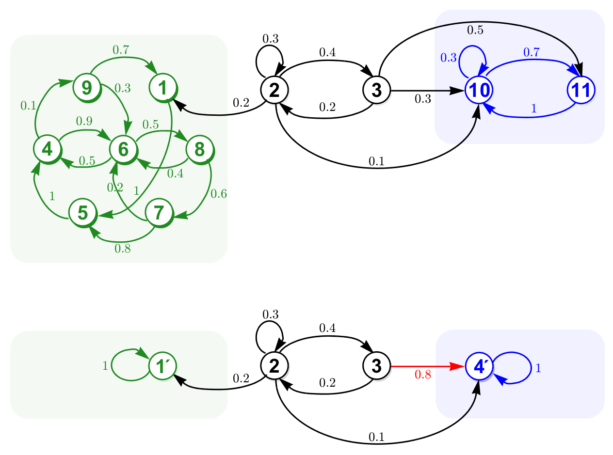

*Figure: top, the eleven-state chain with two recurrent classes (green and blue boxes) and transient states 2 and 3. Bottom, each recurrent class collapsed into one absorbing state. The arcs from 3 into the blue class merge into a single arc of probability 0.8.*

For absorption into \\(4'\\), with \\(a\_{1'} = 0\\) and \\(a\_{4'} = 1\\):
\\[
a\_2 = 0.3a\_2+0.4a\_3+0.1, \qquad a\_3 = 0.2a\_2+0.8 .
\\]
Substituting the second equation into the first gives \\(a\_2 = 0.38a\_2+0.42\\), so
\\[
a\_2 = \tfrac{21}{31}, \qquad a\_3 = \tfrac{29}{31}.
\\]
A numerical check raises the collapsed matrix to a high power:

```matlab
P = [1   0   0   0;
     0.2 0.3 0.4 0.1;
     0   0.2 0   0.8;
     0   0   0   1  ];
31 * P^999        % rows: [31 0 0 0; 10 0 0 21; 2 0 0 29; 0 0 0 31]
```

### Absorption probabilities are a right eigenvector

The equations \\(a\_i = \sum\_jP\_{ij}a\_j\\) hold for every state, including the absorbing ones, because \\(a\_{j^{\star}} = P\_{j^{\star}j^{\star}}a\_{j^{\star}}\\). In vector form,
\\[
\mathbf a = P\mathbf a ,
\\]
so \\(\mathbf a\\) is a **right** eigenvector of \\(P\\) for eigenvalue 1. The stationary pmf, in contrast, is a **left** eigenvector, \\(\boldsymbol\pi = \boldsymbol\pi P\\). The two together describe \\(P^\infty = \lim\_kP^k\\) for aperiodic chains:

- *Irreducible and aperiodic:* \\(P^\infty = \mathbf 1\boldsymbol\pi\\). All rows are identical and equal to the unique stationary pmf.
- *Aperiodic with absorbing states:* the rows differ, because the limit depends on the start, but each row is still a stationary pmf. The columns belonging to absorbing states are right eigenvectors \\(\mathbf a\\). The column of \\(j^{\star}\\) lists the absorption probabilities into \\(j^{\star}\\), normalized so that \\(a\_{j^{\star}} = 1\\). The columns of transient states are zero.
- *Periodic:* \\(P^\infty\\) does not exist.

**Example 20.** Let state 2 have a self-loop of 0.4 and move to 1 with probability 0.4 and to 3 with probability 0.2, with 1 and 3 absorbing:
\\[
P = \begin{bmatrix}1 & 0 & 0\\\\ 0.4 & 0.4 & 0.2\\\\ 0 & 0 & 1\end{bmatrix}.
\\]
For \\(j^{\star} = 1\\), \\(a\_2 = 0.4+0.4a\_2\\), so \\(a\_2 = \tfrac23\\) and \\(\mathbf a = (1,\tfrac23,0)^T\\). Direct multiplication confirms \\(P\mathbf a = \mathbf a\\).

### Mean absorption times

**Example 21 (Waiting for two heads in a row).** A coin shows heads with probability \\(p = 0.1\\). Waiting for a single head takes \\(1/p = 10\\) flips on average. How long, on average, does it take to see two heads in a row? The minimum is 2 flips and there is no maximum, but absorption is certain.

Track progress with a chain. State 0 means no progress (start, or last flip tails), state 1 means one head, and state 2 (HH) is absorbing. From 0 or 1, tails returns to 0. Heads moves from 0 to 1, or from 1 to 2. Let \\(\mu\_i \triangleq E(N\mid X\_0 = i)\\) be the mean number of flips until absorption starting from \\(i\\). Conditioning on the first flip, and noting that it costs one flip,
\\[
\mu\_0 = E(N\mid X\_0=0) = (1+\mu\_0)q + (1+\mu\_1)p = 1+q\mu\_0+p\mu\_1, \qquad \mu\_1 = 1+q\mu\_0, \qquad \mu\_2 = 0 .
\\]
Substituting \\(\mu\_1\\) into the first equation gives \\(\mu\_0 = 1+q\mu\_0+p(1+q\mu\_0)\\). Then \\(\mu\_0(1-q-pq) = 1+p\\), and since \\(1-q-pq = p-pq = p^2\\),
\\[
\mu\_0 = \frac{1+p}{p^2} = 110 \quad (p = 0.1).
\\]
Two sanity checks: \\(p = 1\\) gives 2, and \\(p\to0\\) gives \\(\infty\\).

The same recursion for **three in a row** (states 0, 1, 2, 3, with \\(\mu\_i = 1+q\mu\_0+p\mu\_{i+1}\\)) gives \\(\mu\_0 = (1+p+p^2)/p^3 = 1110\\). For **five in a row**, back-substitution gives \\(\mu\_0 = 1+p+p^2+p^3+p^4+(1-p^5)\mu\_0\\), so
\\[
\mu\_0 = \frac{1+p+p^2+p^3+p^4}{p^5} = \frac{1-p^5}{p^5(1-p)} ,
\\]
which is 62 flips for a fair coin and 111,110 flips for \\(p = 0.1\\).

### Summary of the recursions

Every first-step recursion has the same structure: condition on the first step, then use the Markov property to restart.

| quantity | definition | recursion |
|---|---|---|
| absorption probability into \\(j^{\star}\\) | \\(a\_i = P(X\_\infty = j^{\star}\mid X\_0 = i)\\) | \\(a\_i = \sum\_jP\_{ij}a\_j\\) |
| mean absorption time | \\(\mu\_i = E(\text{steps to absorption}\mid X\_0 = i)\\) | \\(\mu\_i = 1+\sum\_jP\_{ij}\mu\_j\\) (non-absorbing \\(i\\)), \\(\mu = 0\\) at absorbing states |
| mean first-passage time to \\(j^{\star}\\) | \\(T\_i = E(\min\\{k\ge0: X\_k = j^{\star}\\}\mid X\_0 = i)\\) | \\(T\_i = 1+\sum\_jP\_{ij}T\_j\\) (\\(i\ne j^{\star}\\)), \\(T\_{j^{\star}} = 0\\) |
| mean recurrence time of \\(i\\) | \\(T\_i^{\star} = E(\min\\{k>0: X\_k = i\\}\mid X\_0 = i)\\) | \\(T\_i^{\star} = 1+\sum\_jP\_{ij}T\_j\\), with \\(T\\) the first-passage times to \\(i\\) |

The first-passage time to \\(j^{\star}\\) is the absorption time of a modified chain in which \\(j^{\star}\\) is made absorbing. The recurrence time uses the strict inequality \\(k>0\\): the chain must leave and come back. For an ergodic chain, \\(T\_i^{\star} = 1/\pi\_i\\).

**Example 22 (The Hi-Lo game).** Two tokens, A and B, start on the same square. Each round a die is rolled. On a 1 or 2, A moves forward one square. Otherwise B does. A player wins by getting two squares ahead. Model the difference with five states: 1 = A wins, 2 = A leading, 3 = tied, 4 = B leading, 5 = B wins. The interior states move toward B with probability \\(p = \tfrac23\\) and toward A with probability \\(q = \tfrac13\\).

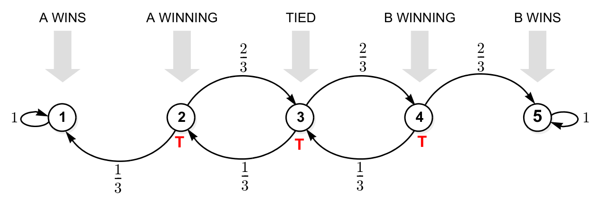

*Figure: the Hi-Lo game as a five-state chain. The two outer states are absorbing, and the three middle states (marked T) are transient.*

*Probability that A wins* (absorption into state 1). From the tie, \\(a\_3 = qa\_2+pa\_4\\), with \\(a\_2 = q+pa\_3\\) and \\(a\_4 = qa\_3\\). Substituting, \\(a\_3 = q^2+2pq\\,a\_3\\), so
\\[
a\_3 = \frac{q^2}{1-2pq} = \frac{1/9}{5/9} = 0.2, \qquad a\_2 = q+pa\_3 = \tfrac13+\tfrac23(0.2)\approx0.47 .
\\]
*Expected length of the game.* \\(\mu\_3 = 1+q\mu\_2+p\mu\_4\\), with \\(\mu\_2 = 1+p\mu\_3\\) and \\(\mu\_4 = 1+q\mu\_3\\). Then \\(\mu\_3 = 2+2pq\\,\mu\_3\\), and
\\[
\mu\_3 = \frac{2}{1-2pq} = 3.6 \text{ rounds}.
\\]
*Probability of a tie after 15 rounds.* It is 0, because a tie can occur only after an even number of rounds. From a tie, two rounds bring the game back to a tie with probability \\(2pq\\), so \\(P(\text{tied after } 2n \text{ rounds}) = (2pq)^n = (4/9)^n\\). A one-square head start for A (starting in state 2) gives A a winning probability of about 0.47, which makes the game nearly fair.

**Example 23 (A Roomba in a dangerous house).** Each morning a robot vacuum cleans its room and then leaves through a uniformly chosen doorway. Entering the kitchen (1) or the office (5) destroys it, so these are absorbing states. The doorways are: living room (2) to kitchen, to bedroom (two doors) and to foyer; bedroom (3) to living room (two doors) and to office; foyer (4) to kitchen, living room and office. Thus
\\[
P = \begin{bmatrix}1 & 0 & 0 & 0 & 0\\\\ 0.25 & 0 & 0.5 & 0.25 & 0\\\\ 0 & 2/3 & 0 & 0 & 1/3\\\\ 1/3 & 1/3 & 0 & 0 & 1/3\\\\ 0 & 0 & 0 & 0 & 1\end{bmatrix}.
\\]
(a) Starting in the living room, the path bedroom → living room → foyer → kitchen has probability \\(P\_{23}P\_{32}P\_{24}P\_{41} = \tfrac12\cdot\tfrac23\cdot\tfrac14\cdot\tfrac13 = \tfrac1{36}\\).

(b) For absorption in the kitchen, \\(a\_2 = \tfrac14+\tfrac12a\_3+\tfrac14a\_4\\), \\(a\_3 = \tfrac23a\_2\\) and \\(a\_4 = \tfrac13+\tfrac13a\_2\\). Clearing fractions gives
\\[
\begin{bmatrix}4 & -2 & -1\\\\ -2 & 3 & 0\\\\ -1 & 0 & 3\end{bmatrix}\begin{bmatrix}a\_2\\\\ a\_3\\\\ a\_4\end{bmatrix} = \begin{bmatrix}1\\\\ 0\\\\ 1\end{bmatrix} \quad\Rightarrow\quad [a\_2,a\_3,a\_4] = \big[\tfrac47,\\ \tfrac8{21},\\ \tfrac{11}{21}\big].
\\]
Starting in the bedroom, the robot dies in the kitchen with probability \\(8/21\approx0.38\\). As a check, the first column of `21*P^999` is \\([21,12,8,11,0]^T\\).

(c) Starting from the living room, it dies eventually with probability \\(\tfrac{12}{21}+\tfrac{9}{21} = 1\\).

(d) For the expected lifetime, the same coefficient matrix with right-hand side \\([4,3,3]^T\\) gives \\([\mu\_2,\mu\_3,\mu\_4] = [3,3,2]\\). Starting in the living room, the robot lasts 3 days on average. A Monte Carlo simulation of \\(10^6\\) robots gives 3.001.

**Example 24 (Package tracking).** Each day, an ordered package ships with probability 0.2. A shipped package goes out for delivery with probability 0.1. A package out for delivery is delivered with probability 0.4 or returned to "shipped" with probability 0.3. Otherwise the status is unchanged. The mean times to delivery satisfy \\(\mu\_0 = 1+0.8\mu\_0+0.2\mu\_1\\), \\(\mu\_1 = 1+0.9\mu\_1+0.1\mu\_2\\) and \\(\mu\_2 = 1+0.3\mu\_1+0.3\mu\_2\\). The second equation gives \\(\mu\_1 = 10+\mu\_2\\). Substituting into the third gives \\(0.4\mu\_2 = 4\\), so \\(\mu\_2 = 10\\), \\(\mu\_1 = 20\\) and \\(\mu\_0 = 25\\) days.

## The Viterbi Algorithm and Hidden Markov Models

### Most likely path of a Markov chain

**Example 25 (Morse code).** Let \\(X\_k\in\\{0,1\\}\\) (dot, dash) be the \\(k\\)-th symbol of a Morse transmission, modelled as a Markov chain with
\\[
P = \frac19\begin{bmatrix}5 & 4\\\\ 8 & 1\end{bmatrix}.
\\]
Given \\(X\_0 = 0\\), what is the *most likely* length-7 sequence \\(\mathbf x = (x\_0,\dots,x\_6)\\)? By the factorization of joint pmfs,
\\[
P(\mathbf x) = P(x\_0)\prod\_{k=0}^{L-1}P\_{x\_kx\_{k+1}} ,
\\]
a product of **branch metrics** \\(\mathrm{BM}\_{i\to j} = P\_{ij}\\). Draw a **trellis**: one column of nodes (one per state) for each time and an arc for every possible transition. Every path through the trellis is a candidate sequence, and its probability is the product of the metrics along it. The problem is to find the path with the largest product.

Exhaustive search must examine \\(2^{L}\\) paths. A greedy search, which always takes the locally best branch, picks \\(0\to0\\) (metric 5/9) at every step. It ends with \\(\mathbf x = 0000000\\), whose metric is \\(5^6/9^6\\). That is not optimal.

**The Viterbi algorithm** is dynamic programming on the trellis. Its key observation is that if the best path to the end passes through node \\((k,j)\\), its first part must be the best path to \\((k,j)\\). So each node needs to remember only its single best incoming path, the **survivor**, and that path's metric. Moving left to right, at each node:

- **multiply**: extend every survivor at time \\(k\\) along each outgoing branch, multiplying by the branch metric;
- **compare** the candidates arriving at each node at time \\(k+1\\);
- **select** the best as the new survivor and discard the rest.

At the end, pick the best final node and **trace back** through the stored decisions. The cost is linear in \\(L\\) (about \\(M^2\\) operations per stage) instead of exponential. This is the same principle of optimality that underlies [Dynamic Programming](../../eng/control/optimal-learning/dynamic-programming.md).

With branch metrics scaled to \\(9P\_{ij}\\) (5, 4, 8, 1), the survivor metrics for state 0 / state 1 are:

| stage | 0 | 1 | 2 | 3 | 4 | 5 | 6 |
|---|---|---|---|---|---|---|---|
| state 0 | 1 | 5 | \\(2^5\\) | \\(5\cdot2^5\\) | \\(2^{10}\\) | \\(5\cdot2^{10}\\) | \\(2^{15}\\) |
| state 1 | — | \\(2^2\\) | \\(5\cdot2^2\\) | \\(2^7\\) | \\(5\cdot2^7\\) | \\(2^{12}\\) | \\(5\cdot2^{12}\\) |

For example, at stage 2 the node for state 0 compares \\(5\cdot5 = 25\\) (staying at 0) with \\(2^2\cdot8 = 32\\) (coming from 1) and keeps the second. The best final metric is \\(2^{15}\\), and tracing back gives
\\[
\mathbf x = [0\\,1\\,0\\,1\\,0\\,1\\,0], \qquad P(\mathbf x) = \frac{2^{15}}{9^6}\approx 0.062,
\\]
about twice the greedy answer's \\(5^6/9^6\approx0.029\\). The strong \\(1\to0\\) transition (8/9) makes alternation pay. (At stages 3 and 5 the state-0 node has a tie, but neither tie lies on the optimal path.)

### Hidden Markov models

Now suppose the symbols are not seen directly. Each received symbol \\(Y\_k\\) is a sloppy reading of \\(X\_k\\) and is wrong with probability \\(\tfrac13\\). Recovering \\(\mathbf x\\) from \\(\mathbf y\\) is an **HMM decoding** problem.

**Definition (hidden Markov model).** An HMM is specified by three things:

- an initial pmf \\(\mathbf p(0)\\);
- a transition matrix \\(P\_{ij} = P(X\_k = j\mid X\_{k-1} = i)\\) for the hidden chain \\(X\_k\\);
- an **emission matrix** \\(B\_{ij} = P(Y\_k = j\mid X\_k = i)\\).

Emissions are memoryless: given \\(X\_k\\), the observation \\(Y\_k\\) is independent of all other states and observations. In the Morse example,
\\[
B = \frac13\begin{bmatrix}2 & 1\\\\ 1 & 2\end{bmatrix}.
\\]

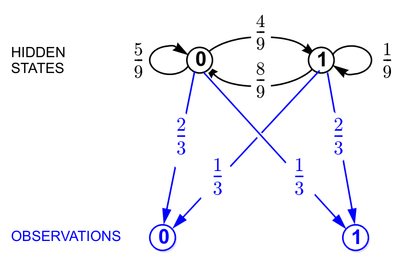

*Figure: the Morse HMM. Hidden states 0 and 1 evolve as a Markov chain (black arcs). Each emits an observation (blue arcs) that is correct with probability 2/3 and flipped with probability 1/3.*

HMMs are used wherever a hidden sequence is seen through noisy measurements:

| application | hidden state | observations |
|---|---|---|
| speech recognition | words | audio |
| music analysis | chord progression | audio |
| gesture recognition | gesture | sensor readings |
| finance | market regime | stock prices |
| autocorrect | intended word | typed word |

The continuous-state, linear-Gaussian counterpart is the state-space model behind the [Kalman filter](../../eng/control/linear/kalman-filter.md).

### Decoding with Viterbi

The maximum a posteriori (MAP) sequence maximizes \\(P(\mathbf x\mid\mathbf y) = P(\mathbf y\mid\mathbf x)P(\mathbf x)/P(\mathbf y)\\). Since \\(P(\mathbf y)\\) does not depend on \\(\mathbf x\\), this is the same as maximizing \\(P(\mathbf y\mid\mathbf x)P(\mathbf x)\\). Memoryless emissions give \\(P(\mathbf y\mid\mathbf x) = \prod\_kB\_{x\_ky\_k}\\), and the Markov property gives \\(P(\mathbf x) = P(x\_0)\prod\_kP\_{x\_kx\_{k+1}}\\). The emission factor for time \\(k+1\\) can be attached to the branch that enters time \\(k+1\\):
\\[
P(\mathbf y\mid\mathbf x)P(\mathbf x) \propto \prod\_k \underbrace{P\_{x\_kx\_{k+1}}\\,B\_{x\_{k+1}y\_{k+1}}}\_{\text{branch metric}} , \qquad \mathrm{BM}\_{i\to j}(y) = P\_{ij}B\_{jy} .
\\]
So decoding is the same Viterbi search with **observation-dependent branch metrics**. In the Morse example, scaling by 27 gives two sets of metrics:

| branch | \\(y = 0\\) | \\(y = 1\\) |
|---|---|---|
| \\(0\to0\\) | \\(5\cdot2 = 10\\) | \\(5\cdot1 = 5\\) |
| \\(0\to1\\) | \\(4\cdot1 = 4\\) | \\(4\cdot2 = 8\\) |
| \\(1\to0\\) | \\(8\cdot2 = 16\\) | \\(8\cdot1 = 8\\) |
| \\(1\to1\\) | \\(1\cdot1 = 1\\) | \\(1\cdot2 = 2\\) |

**Example 26 (Decoding \\(\mathbf y = 0111010\\)).** With \\(X\_0 = 0\\) known, label stage \\(k\\) of the trellis with the metric set for \\(y\_k\\), the observation at the destination column. The survivor metrics (state 0 / state 1) are \\(1\\); \\(5\\,/\\,2^3\\); \\(2^6\\,/\\,5\cdot2^3\\); \\(5\cdot2^6\\,/\\,2^9\\); \\(2^{13}\\,/\\,5\cdot2^8\\); \\(5\cdot2^{13}\\,/\\,2^{16}\\); \\(2^{20}\\,/\\,5\cdot2^{15}\\). At stage 3 the state-0 node has a tie, \\(5\cdot2^6 = 5\cdot2^3\cdot8 = 320\\). The final state-0 metric is \\(\max(5\cdot2^{13}\cdot10,\\ 2^{16}\cdot16) = 2^{20}\\). Tracing back from it gives
\\[
\hat{\mathbf x} = [0\\,1\\,0\\,1\\,0\\,1\\,0] .
\\]
The decoder agrees with the observations everywhere except \\(y\_2\\), which it reads as a 0 rather than a 1. A single flip costs a factor of 2 in the emission metric. Two consecutive dashes would cost much more under the prior, since \\(P\_{11} = 1/9\\) while \\(P\_{10} = 8/9\\).

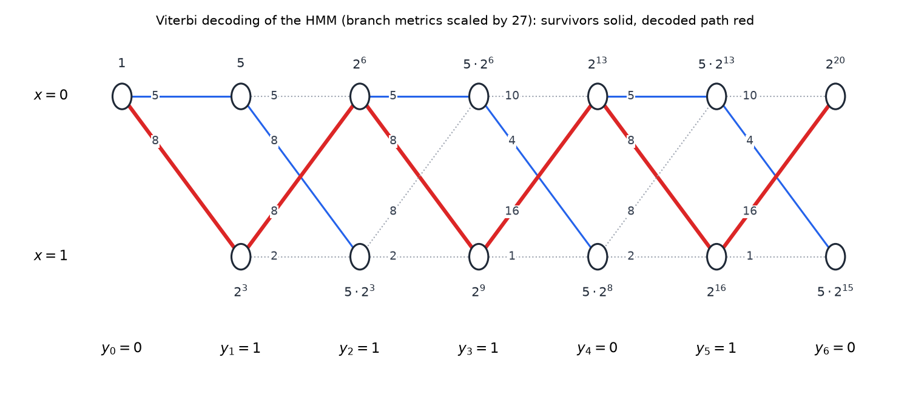

*Figure: the Viterbi trellis for \\(\mathbf y = 0111010\\), with branch metrics \\(27P\_{ij}B\_{jy}\\) printed on the branches and survivor metrics at the nodes. Blue solid branches are survivors and dotted branches are discarded. The red path is the traced-back MAP sequence \\(0101010\\).*

**Example 27 (Weather and umbrellas).** The weather \\(x\in\\{0 = \text{sunny},1 = \text{rainy}\\}\\) is a Markov chain in which sunny follows sunny with probability 0.5 and rainy follows rainy with probability 0.1:
\\[
P = \begin{bmatrix}0.5 & 0.5\\\\ 0.9 & 0.1\end{bmatrix}, \qquad B = \begin{bmatrix}0.6 & 0.4\\\\ 0.4 & 0.6\end{bmatrix},
\\]
where \\(y = 1\\) means Alice carries an umbrella. She carries one with probability 0.4 on sunny days and 0.6 on rainy days. The cut equation \\(0.5\pi\_0 = 0.9\pi\_1\\) gives \\(\boldsymbol\pi = [\tfrac9{14},\tfrac5{14}]\\).

*(a) Most likely three-day weather with no observations, starting in equilibrium.* Use initial metrics \\(14\boldsymbol\pi = [9,5]\\) and branch metrics \\(10P\_{ij}\\) (5, 5, 9, 1). At day 2, state 0 has a tie (45 from either state) and state 1 has 45 (from 0). At day 3, state 0 has \\(\max(45\cdot5,\\ 45\cdot9) = 405\\) (from 1) and state 1 has \\(\max(45\cdot5,\\ 45\cdot1) = 225\\). Tracing back gives \\(\mathbf x = 010\\), with
\\[
P(010) = \tfrac9{14}\cdot0.5\cdot0.9 = \tfrac{81}{280}\approx0.29 .
\\]
Enumeration confirms this: 000, 001, 100 and 101 each have probability \\(45/280\\), 011 and 110 have \\(9/280\\), and 111 has \\(1/280\\).

*(b) Most likely weather on days 0–3 given umbrellas on days 1–3 (\\(\mathbf y = 111\\)).* The posterior is proportional to \\(\pi\_{x\_0}\prod\_k P\_{x\_kx\_{k+1}}B\_{x\_{k+1}1}\\). Use initial metrics \\([9,5]\\) and branch metrics \\(100P\_{ij}B\_{j1}\\): \\(0\to0\\) gives 20, \\(0\to1\\) gives 30, \\(1\to0\\) gives \\(100(0.9)(0.4) = 36\\), and \\(1\to1\\) gives 6. The survivor metrics are \\(180/270\\), then \\(9720/5400\\), then \\(194{,}400/291{,}600\\). Tracing back from the best final node (rainy) gives
\\[
\hat{\mathbf x} = 0101 \quad(\text{sunny, rainy, sunny, rainy}).
\\]
Even though Alice carried an umbrella every day, the decoder chooses alternating weather, because two rainy days in a row are very unlikely (\\(P\_{11} = 0.1\\)). (A published solution of this exercise labels the \\(1\to0\\) branch 20 instead of 36. That changes the intermediate metrics but not the decoded sequence.)

## Summary

- **Markov property**: \\(P(X\_{k+1}=j\mid X\_k=i,\text{past}) = P\_{ij}\\). A chain is specified by \\(\mathbf p(0)\\) and the stochastic matrix \\(P\\) (rows sum to 1), and joint pmfs factor as \\(P(x\_0)\prod P\_{x\_kx\_{k+1}}\\). Finite memory can always be removed by vectorizing the state.
- **pmf evolution**: \\(\mathbf p(k+1) = \mathbf p(k)P\\), \\(\mathbf p(k) = \mathbf p(0)P^k\\) and \\((P^k)\_{ij} = P(X\_k=j\mid X\_0=i)\\). All eigenvalues satisfy \\(\lvert\lambda\rvert\le1\\), and 1 is always one of them.
- **Stationary pmf**: \\(\boldsymbol\pi = \boldsymbol\pi P\\) (a left eigenvector, normalized) always exists. Its balance equations mean flow in equals flow out at every node and across every cut.
- **Classification**: communicating classes partition the states. In a finite chain, closed classes are recurrent and the others are transient. The period is the gcd of return times. Recurrence and period are class properties. Ergodic means irreducible plus aperiodic, equivalently \\(P^k>0\\) entrywise for some \\(k\\).
- **Convergence theorem**: an ergodic chain has \\(\mathbf p(k)\to\boldsymbol\pi\\) (unique) from any start and \\(P^k\to\mathbf 1\boldsymbol\pi\\), at a rate set by \\(\lvert\lambda\_2\rvert\\). \\(\pi\_j\\) is the long-run fraction of time in \\(j\\), and the mean recurrence time is \\(1/\pi\_j\\). For periodic irreducible chains \\(\boldsymbol\pi\\) is still unique and gives time averages, but \\(\mathbf p(k)\\) oscillates.
- **Birth–death chains**: the cut equations \\(\pi\_iP\_{i,i+1} = \pi\_{i+1}P\_{i+1,i}\\) give a truncated geometric for the checkout line (\\(E X = \rho/(1-\rho)\\) when unbounded), Erlang-B \\(P\_B = (\rho^N/N!)/\sum\_{i\le N}\rho^i/i!\\) for blocked calls, and \\(\mathrm{Bin}(N,\tfrac12)\\) for the Ehrenfest chain.
- **PageRank**: the stationary pmf of \\(G = \frac\alpha N\mathbf 1\mathbf 1^T+(1-\alpha)P'\\), computed by power iteration.
- **Absorption** (first-step analysis): \\(a\_i = \sum\_jP\_{ij}a\_j\\), i.e. \\(\mathbf a = P\mathbf a\\) (a right eigenvector). Mean absorption times satisfy \\(\mu\_i = 1+\sum\_jP\_{ij}\mu\_j\\). The expected wait for \\(r\\) heads in a row is \\((1-p^r)/(p^r(1-p))\\).
- **Viterbi**: the MAP path in a trellis is found by multiply–compare–select with traceback, at cost linear in the length. For an HMM \\((\mathbf p(0),P,B)\\), the branch metrics become \\(P\_{ij}B\_{jy}\\).

## See Also

- [Bernoulli and Poisson Processes](bernoulli-poisson.md): the i.i.d. processes that Markov chains generalize, and the Poisson arrivals and exponential services behind the queueing chains.
- [Random Sequences, Stationarity and Power Spectra](random-sequences.md): stationarity and autocorrelation of processes such as Markov chains started in equilibrium.
- [Reinforcement Learning](../../cs/ml/rl.md): Markov decision processes add actions and rewards to Markov chains.
- [Dynamic Programming](../../eng/control/optimal-learning/dynamic-programming.md): the principle of optimality behind the Viterbi algorithm and first-step analysis.
- [Optimal Estimation and the Kalman Filter](../../eng/control/linear/kalman-filter.md): state estimation for the linear-Gaussian analogue of a hidden Markov model.
- [Probability and Statistics](../probability/README.md): introductory probability background.
