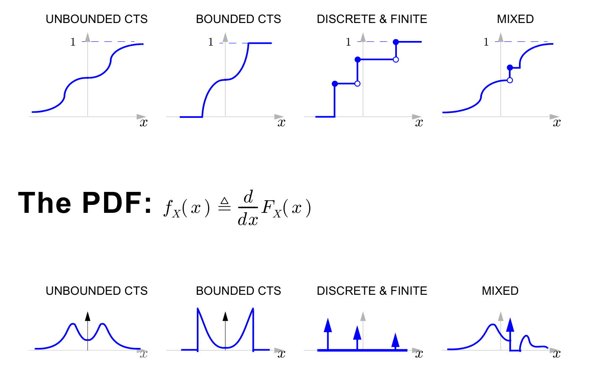
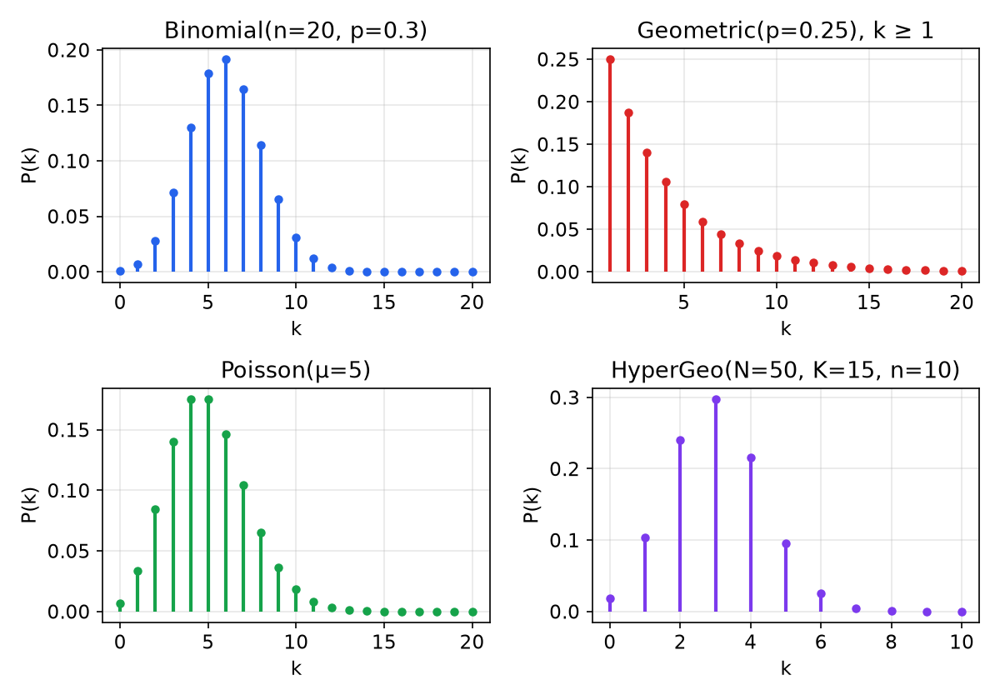
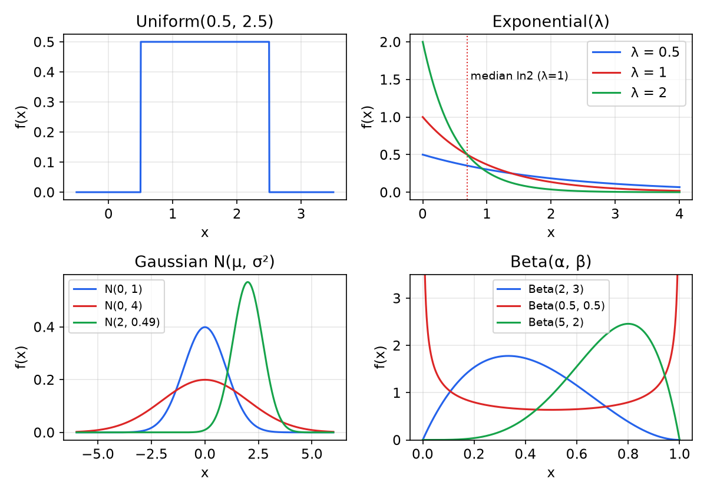
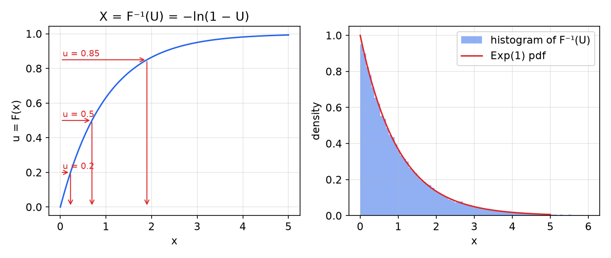
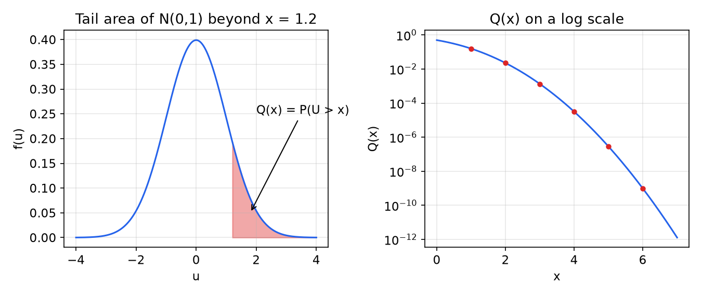

# Random Variables and Their Distributions

Most experiments of interest produce numbers: a voltage, a count of arrivals, a waiting time. A random variable attaches a number to every outcome, and its distribution (pmf, pdf or cdf) replaces the abstract sample space with a function on the real line that can be integrated, differentiated and transformed. This chapter develops the three descriptions of a distribution, its moments and transforms (the moment-generating and characteristic functions), the catalogue of named distributions used throughout the study of random processes, and the rules for finding the distribution of a function of a random variable, including the inverse-CDF method for simulation. It closes with the Gaussian distribution and its tail, the Q function. The overview pages [Random Variables](../probability/random-variables.md), [Distributions](../probability/distributions.md) and [Expectation and Variance](../probability/expectation.md) give a shorter account.

## Random Variables

**Definition (Random variable).** A random variable (RV) \\(X\\) is a function \\(X : \mathcal{S} \to \mathbb{R}\\) that maps every outcome of the experiment to a real number. (Technically the sets \\(\\{s : X(s) \le x\\}\\) must be events for every \\(x\\), so that their probabilities are defined.)

For a coin, \\(\mathcal{S} = \\{T, H\\}\\) and one may set \\(X(T) = 0\\), \\(X(H) = 1\\). Upper case \\(X\\) denotes the random variable; lower case \\(x\\) denotes a value it might take, so "\\(X = x\\)" is shorthand for the event \\(\\{s \in \mathcal{S} : X(s) = x\\}\\).

There are two main types:

- A **discrete** RV takes values in a countable (often finite) set \\(X(\mathcal{S})\\): the face of a die, the number of times a dropped coin bounces, the number of tosses until 20 heads in a row.
- A **continuous** RV takes values in an uncountable set, usually an interval: the settling time of a tossed coin, a thermal-noise voltage.

**Mixed** RVs, part discrete and part continuous, also occur (the output of a clipping amplifier driven by noise, for example).

## Three Descriptions of a Distribution

### The probability mass function

**Definition (pmf).** For a discrete RV, \\(P\_X(x) \triangleq P(X = x)\\).

Properties: \\(P\_X(x) \ge 0\\); \\(\sum\_x P\_X(x) = 1\\); \\(P(X \in A) = \sum\_{x \in A} P\_X(x)\\).

**Example 2.1 (Sum of two dice).** Let \\(X\\) be the sum of two fair dice. Counting the outcomes \\((i, j)\\) with \\(i + j = x\\),
\\[
P\_X(x) = \frac{6 - \lvert x - 7 \rvert}{36}, \qquad x = 2, 3, \dots, 12,
\\]
i.e. \\(\frac{1}{36}, \frac{2}{36}, \dots, \frac{6}{36}, \dots, \frac{2}{36}, \frac{1}{36}\\): a triangle peaking at \\(x = 7\\).

### The cumulative distribution function

**Definition (cdf).** For any RV, \\(F\_X(x) \triangleq P(X \le x)\\).

The cdf exists for every random variable, discrete, continuous or mixed, which makes it the universal description. Its properties:

1. \\(F\_X(-\infty) = 0\\) and \\(F\_X(+\infty) = 1\\).
2. For \\(a \le b\\), \\(F\_X(b) - F\_X(a) = P(a < X \le b)\\).
3. \\(F\_X\\) is nondecreasing. If it decreased between \\(a\\) and \\(b\\), property 2 would make \\(P(a < X \le b)\\) negative.
4. \\(0 \le F\_X(x) \le 1\\), since it is a probability.
5. \\(F\_X\\) is right-continuous: at a jump, the value is the upper one (the closed dot sits on top of the step), because \\(\\{X \le x\\}\\) includes the point \\(x\\) itself.

A discrete RV has a staircase cdf; a continuous RV has a continuous cdf, which may rise over the whole real line (unbounded support) or only over an interval (bounded support); a mixed RV combines continuous rises with jumps.

### The probability density function

**Definition (pdf).** \\(f\_X(x) \triangleq \dfrac{d}{dx}F\_X(x)\\).

By the fundamental theorem of calculus,
\\[
F\_X(x) = \int\_{-\infty}^{x} f\_X(t)\\,dt, \qquad \int\_{-\infty}^{\infty} f\_X(x)\\,dx = 1, \qquad \int\_a^b f\_X(t)\\,dt = F\_X(b) - F\_X(a) = P(a < X \le b).
\\]
The last identity is the **working definition** of the pdf: the area under \\(f\_X\\) between \\(a\\) and \\(b\\) is the probability that \\(X\\) falls in \\((a, b]\\). Equivalently, for small \\(dx\\), \\(P(x < X \le x + dx) \approx f\_X(x)\\,dx\\).

Can \\(f\_X(x)\\) be negative? No: a negative stretch between \\(a\\) and \\(b\\) would give a negative probability. Can it exceed 1? Certainly, because it is a density, not a probability. Uniform\\((0, 0.1)\\) has density 10 on its support.

A discrete RV can also be given a pdf if we allow Dirac impulses at the jump points of the staircase cdf:
\\[
f\_X(x) = \sum\_i P\_X(x\_i)\\,\delta(x - x\_i).
\\]
For a fair die this is six impulses of area \\(1/6\\) at \\(1, \dots, 6\\), while the pmf is six stems of height \\(1/6\\). The pmf is usually preferred for discrete RVs; the impulse form is useful for mixed RVs and for treating all cases with one integral.



*Figure: top row, cdfs of an unbounded continuous, a bounded continuous, a discrete and a mixed random variable; bottom row, their pdfs. Jumps in the cdf become impulses in the pdf, and flat stretches of the cdf become intervals where the pdf is zero.*

In summary: the cdf \\(F\_X(x) = P(X \le x)\\) always exists; the pdf \\(f\_X = dF\_X/dx\\) integrates to 1; the pmf \\(P\_X(x) = P(X = x)\\) sums to 1.

## Expectation and Moments

### The mean

A random variable is described *fully* by its cdf (or pdf, or pmf). A single number gives a partial description, and the most common one is the **mean** or **expected value**
\\[
\mu = E(X) = \sum\_x x\\,P\_X(x) \quad \text{(discrete)}, \qquad \mu = E(X) = \int\_{-\infty}^{\infty} x\\,f\_X(x)\\,dx \quad \text{(continuous)}.
\\]
The mean is a probability-weighted average. Physically it is the **balance point** (centre of gravity): if the pmf stems were weights on a beam, or the pdf a mass density along a rod, the rod would balance on a fulcrum placed at \\(\mu\\).

**Example 2.2 (Fair die).** For \\(X\\) uniform on \\(\\{1, \dots, 6\\}\\), \\(E(X) = (1 + 2 + \dots + 6)/6 = 3.5\\), a value the die never shows: the mean need not be a possible value.

**Example 2.3 (Broken vending machine).** A machine dispenses one can 90% of the time and two cans 10% of the time. The expected number of cans is \\(1(0.9) + 2(0.1) = 1.1\\).

The **median** \\(m\\) is the solution of \\(F\_X(m) = 1/2\\): the RV is equally likely to fall above and below it. For skewed distributions the mean and median differ; see the exponential below.

### The fundamental theorem of expectation

To find the mean of \\(Y = g(X)\\), the hard way first finds \\(P\_Y\\) (or \\(f\_Y\\)) and then averages. The easy way avoids that step.

**Theorem (Fundamental theorem of expectation, LOTUS).** For \\(Y = g(X)\\),
\\[
E(Y) = \sum\_x g(x)\\,P\_X(x) \quad \text{or} \quad E(Y) = \int g(x)\\,f\_X(x)\\,dx,
\\]
whenever the sum or integral converges absolutely.

*Proof sketch (discrete).* Group the values of \\(x\\) according to the value \\(y = g(x)\\) they produce: \\(\sum\_x g(x)P\_X(x) = \sum\_y y \sum\_{x : g(x) = y} P\_X(x) = \sum\_y y\\,P\_Y(y) = E(Y)\\). ∎

Examples: \\(E(X^2) = \sum\_x x^2 P\_X(x)\\), \\(E(\tanh X) = \sum\_x \tanh(x)P\_X(x)\\).

**Linearity.** For constants \\(a, b\\),
\\[
E(aX + b) = \sum\_x (ax + b)P\_X(x) = a\sum\_x x P\_X(x) + b\sum\_x P\_X(x) = aE(X) + b.
\\]
The special case \\(a = 0\\) gives \\(E(b) = b\\). More generally, expectation is linear for sums of random variables, \\(E(X + Y) = E(X) + E(Y)\\), whether or not they are independent (proved in [the chapter on pairs](random-vectors.md)).

**Example 2.4 (High minus low).** A casino charges \$2 to roll two fair dice and pays (high − low) dollars. On the 6 × 6 grid of outcomes, the difference \\(d\\) occurs on two diagonals of length \\(6 - d\\) for \\(d \ge 1\\), i.e. \\(2(6 - d)\\) outcomes, and \\(d = 0\\) on the main diagonal. Hence
\\[
E(\text{high} - \text{low}) = \frac{1 \cdot 10 + 2 \cdot 8 + 3 \cdot 6 + 4 \cdot 4 + 5 \cdot 2}{36} = \frac{70}{36} \approx 1.94 \text{ dollars}.
\\]
The casino wins about 6 cents per game *in the long run*, a phrase made precise by the law of large numbers in [the limit-theorems chapter](limit-theorems.md).

### Moments and variance

The \\(k\\)-th **moment** is \\(E(X^k)\\); the \\(k\\)-th **central moment** is \\(E((X - \mu)^k)\\). The first central moment is identically zero. The second central moment is the **variance**
\\[
\sigma^2 = \text{var}(X) = E\left((X - \mu)^2\right) = E(X^2) - \mu^2,
\\]
where the second form, obtained by expanding \\((X - \mu)^2 = X^2 - 2\mu X + \mu^2\\) and using linearity, is the one used for computation. The **standard deviation** \\(\sigma = \sqrt{\text{var}(X)}\\) has the units of \\(X\\). Both measure spread about the mean.

For an affine function \\(Y = aX + b\\), \\(E(Y) = a\mu + b\\) and \\(Y - E(Y) = a(X - \mu)\\), so
\\[
\text{var}(aX + b) = a^2\\,\text{var}(X).
\\]
Adding a constant shifts without spreading; scaling by \\(a\\) scales the standard deviation by \\(\lvert a \rvert\\). If \\(X\\) has mean 2 and variance 5, then \\(Y = 3X + 17\\) has mean \\(3(2) + 17 = 23\\) and variance \\(9 \cdot 5 = 45\\).

**Example 2.5 (A geometric-type pmf).** Let \\(P\_X(k) = 1/m^k\\) for \\(k = 1, 2, \dots\\), zero otherwise.

(a) *Find \\(m\\).* \\(1 = \sum\_{k \ge 1} (1/m)^k = \frac{1/m}{1 - 1/m} = \frac{1}{m - 1}\\), so \\(m = 2\\).

(b) *Variance.* Using the moment-generating function (introduced below), \\(\phi(s) = \sum\_{k \ge 1} e^{sk}2^{-k} = \sum\_{k \ge 1}(e^s/2)^k = \frac{e^s}{2 - e^s}\\) for \\(e^s < 2\\). Differentiating, \\(\phi'(s) = \frac{2e^s}{(2 - e^s)^2}\\), so \\(\mu = \phi'(0) = 2\\); and \\(\phi''(s) = \frac{2e^s(2 + e^s)}{(2 - e^s)^3}\\), so \\(E(X^2) = \phi''(0) = 6\\). Hence \\(\sigma^2 = 6 - 4 = 2\\).

(c) *Complementary cdf.* \\(P(X > k) = \sum\_{n \ge k+1} 2^{-n} = 2^{-(k+1)}\sum\_{i \ge 0} 2^{-i} = 2^{-k}\\).

(d) *Expectation of a function.* For \\(Y = 3^{-X}(4^X + 5)\\), LOTUS gives
\\[
E(Y) = \sum\_{k \ge 1} 3^{-k}(4^k + 5)\\,2^{-k} = \sum\_{k \ge 1}\left(\tfrac{2}{3}\right)^k + 5\sum\_{k \ge 1}\left(\tfrac{1}{6}\right)^k = \frac{2/3}{1/3} + 5\cdot\frac{1/6}{5/6} = 2 + 1 = 3.
\\]
(This pmf is Geometric(1/2), introduced below; its mean \\(1/p = 2\\) and variance \\(q/p^2 = 2\\) agree.)

**Example 2.6 (A polynomial pdf).** Let \\(f(x) = a x^2 - a x^3\\) for \\(0 < x < 1\\), zero elsewhere.

(a) *Normalization.* \\(1 = a\left(\frac{1}{3} - \frac{1}{4}\right) = \frac{a}{12}\\), so \\(a = 12\\) and \\(f(x) = 12x^2(1 - x)\\).

(b) *Variance.* \\(E(X) = 12\left(\frac{1}{4} - \frac{1}{5}\right) = 0.6\\) and \\(E(X^2) = 12\left(\frac{1}{5} - \frac{1}{6}\right) = 0.4\\), so \\(\sigma^2 = 0.4 - 0.36 = 0.04\\).

(c) *Most likely tiny interval.* Which \\(b\\) maximizes \\(P(b < X < b + \varepsilon)\\) for a minuscule \\(\varepsilon\\)? Since this probability is \\(\approx f(b)\varepsilon\\), maximize the pdf: \\(f'(x) = 24x - 36x^2 = 0\\) gives \\(b = 2/3\\), the **mode**.

(d) *LOTUS.* For \\(Y = 1/(X - X^2)\\), \\(E(Y) = 12\int\_0^1 \frac{x^2(1 - x)}{x(1 - x)}dx = 12\int\_0^1 x\\,dx = 6\\).

(This is the Beta(3, 2) distribution.)

## Transforms: the MGF and the Characteristic Function

### Definitions

**Definition (Moment-generating function).** \\(\phi\_X(s) \triangleq E(e^{sX}) = \int f\_X(x)\\,e^{sx}\\,dx\\) (or \\(\sum\_x P\_X(x)e^{sx}\\)), for real \\(s\\) in the range where the expectation is finite.

**Definition (Characteristic function).** \\(\psi\_X(j\omega) \triangleq E(e^{j\omega X}) = \int f\_X(x)\\,e^{j\omega x}\\,dx\\).

The characteristic function is the Fourier transform of the pdf with the sign of the exponent reversed (\\(+j\omega x\\) instead of \\(-j\omega x\\)); it exists for every RV because \\(\lvert e^{j\omega X} \rvert = 1\\). The mgf is the two-sided Laplace transform evaluated at \\(-s\\); it may exist only on an interval of \\(s\\) (or only at \\(s = 0\\), as for the Cauchy distribution). Like the Laplace and Fourier transforms (see [the Fourier transform](../../signals/fourier-transform.md) and [the Laplace transform](../../signals/laplace-transform.md)), each **uniquely determines the distribution** when it exists in a neighbourhood of the origin (mgf) or everywhere (characteristic function).

**Example 2.7 (Bernoulli).** For \\(P(X = 1) = p\\), \\(P(X = 0) = q = 1 - p\\): \\(\phi(s) = q e^{s \cdot 0} + p e^{s \cdot 1} = q + p e^s\\).

### Moments from the mgf

Expanding \\(e^{sX} = \sum\_k (sX)^k/k!\\) and taking expectations term by term gives \\(\phi(s) = \sum\_k E(X^k)s^k/k!\\), so the moments are the Taylor coefficients:
\\[
E(X^k) = \underbrace{\int x^k f(x)\\,dx}\_{\text{hard}} = \underbrace{\left.\frac{d^k}{ds^k}\phi(s)\right\rvert\_{s=0}}\_{\text{easy}}.
\\]

**Example 2.8 (Moments of the exponential).** For \\(X \sim \text{Exp}(\lambda)\\) with pdf \\(\lambda e^{-\lambda x}u(x)\\),
\\[
\phi(s) = \int\_0^\infty \lambda e^{-\lambda x}e^{sx}\\,dx = \frac{\lambda}{\lambda - s}, \qquad s < \lambda.
\\]
Then \\(\phi'(s) = \frac{\lambda}{(\lambda - s)^2}\\) gives \\(E(X) = 1/\lambda\\); \\(\phi''(s) = \frac{2\lambda}{(\lambda - s)^3}\\) gives \\(E(X^2) = 2/\lambda^2\\); \\(\phi'''(s) = \frac{6\lambda}{(\lambda - s)^4}\\) gives \\(E(X^3) = 6/\lambda^3\\); and in general \\(E(X^k) = k!/\lambda^k\\). Hence \\(\text{var}(X) = 2/\lambda^2 - 1/\lambda^2 = 1/\lambda^2\\).

### Why transforms matter

1. They generate moments by differentiation.
2. **Sums of independent RVs.** If \\(X\\) and \\(Y\\) are independent, \\(\phi\_{X+Y}(s) = E(e^{sX}e^{sY}) = \phi\_X(s)\phi\_Y(s)\\): adding independent RVs multiplies their transforms, which is the same as *convolving* their pdfs.
3. They give insight into RVs defined as i.i.d. sums: the binomial is a sum of Bernoullis, the Erlang a sum of exponentials, the chi-square a sum of squared Gaussians.
4. They are the main tool in proofs, notably of the central limit theorem ([Iterated Expectation and Limit Theorems](limit-theorems.md)).

## The Named Distributions

### Discrete distributions

| Name | pmf | Range | Mean | Variance | mgf \\(\phi(s)\\) |
|---|---|---|---|---|---|
| Uniform\\((\mathcal{S})\\) | \\(1/\lvert\mathcal{S}\rvert\\) | finite \\(\mathcal{S}\\) | average of \\(\mathcal{S}\\) | | |
| Bernoulli\\((p)\\) | \\(P(1) = p\\), \\(P(0) = q\\) | \\(\\{0, 1\\}\\) | \\(p\\) | \\(pq\\) | \\(q + pe^s\\) |
| Binomial\\((n, p)\\) | \\(\binom{n}{k}p^k q^{n-k}\\) | \\(0, \dots, n\\) | \\(np\\) | \\(npq\\) | \\((q + pe^s)^n\\) |
| Geometric\\((p)\\) | \\(q^{k-1}p\\) | \\(1, 2, \dots\\) | \\(1/p\\) | \\(q/p^2\\) | \\(\frac{pe^s}{1 - qe^s}\\) |
| NegBin\\((p, r)\\) | \\(\binom{k-1}{r-1}p^r q^{k-r}\\) | \\(r, r+1, \dots\\) | \\(r/p\\) | \\(rq/p^2\\) | \\(\left(\frac{pe^s}{1 - qe^s}\right)^r\\) |
| Poisson\\((\mu)\\) | \\(e^{-\mu}\mu^k/k!\\) | \\(0, 1, \dots\\) | \\(\mu\\) | \\(\mu\\) | \\(e^{\mu(e^s - 1)}\\) |
| HyperGeo\\((N, K, n)\\) | \\(\binom{K}{k}\binom{N-K}{n-k}/\binom{N}{n}\\) | \\(\max(0, n+K-N), \dots, \min(n, K)\\) | \\(nK/N\\) | \\(n\frac{K}{N}\frac{N-K}{N}\frac{N-n}{N-1}\\) | |

Here \\(q = 1 - p\\). The geometric and negative binomial mgfs require \\(s < \ln(1/q)\\).

- **Uniform\\((\mathcal{S})\\).** Every element equally likely; a fair die is Uniform\\(\\{1, \dots, 6\\}\\).
- **Bernoulli\\((p)\\).** A single trial with success probability \\(p\\). "Snake eyes on a roll of two dice" is Bernoulli(1/36). Its variance follows from \\(E(X^2) = E(X) = p\\): \\(\sigma^2 = p - p^2 = pq\\).
- **Binomial\\((n, p)\\).** The number of successes in \\(n\\) independent Bernoulli\\((p)\\) trials. *Derivation:* \\(P(X = 0) = P(00\cdots0) = q^n\\) and \\(P(X = n) = p^n\\). \\(P(X = 1) = P(10\cdots0) + P(010\cdots0) + \dots = npq^{n-1}\\). In general, every particular string with \\(k\\) ones and \\(n - k\\) zeros has probability \\(p^k q^{n-k}\\) by independence, and there are \\(\binom{n}{k}\\) such strings, so
\\[
\boxed{P\_X(k) = \binom{n}{k}p^k(1 - p)^{n-k}}, \qquad k = 0, \dots, n.
\\]
- **Geometric\\((p)\\).** The number of trials up to and including the first success: \\(k - 1\\) failures and then a success. It is the only memoryless discrete distribution.
- **Negative binomial NegBin\\((p, r)\\).** The trial on which the \\(r\\)-th success occurs: \\(r - 1\\) successes in the first \\(k - 1\\) trials and a success on trial \\(k\\).
- **Poisson\\((\mu)\\).** Counts of rare events: the limit of Binomial\\((n, \mu/n)\\) as \\(n \to \infty\\). The [Poisson process chapter](bernoulli-poisson.md) derives it from the arrival model.
- **Hypergeometric\\((N, K, n)\\).** The number of marked items in a sample of \\(n\\) drawn *without* replacement from \\(N\\) items, \\(K\\) of them marked. With replacement the count would be Binomial\\((n, K/N)\\).



*Figure: pmfs of Binomial(20, 0.3), Geometric(0.25), Poisson(5) and Hypergeometric(50, 15, 10). The geometric decays monotonically from k = 1; the others are unimodal humps around their means.*

The Bernoulli-process family (binomial, geometric, negative binomial) and the Poisson family (Poisson, exponential, Erlang) are developed as random processes in [The Bernoulli and Poisson Processes](bernoulli-poisson.md).

### Continuous distributions

| Name | pdf | Mean | Variance | mgf \\(\phi(s)\\) |
|---|---|---|---|---|
| Uniform\\((a, b)\\) | \\(\frac{1}{b - a}\\) on \\([a, b]\\) | \\(\frac{a + b}{2}\\) | \\(\frac{(b - a)^2}{12}\\) | \\(\frac{e^{sb} - e^{sa}}{s(b - a)}\\) |
| Exp\\((\lambda)\\) | \\(\lambda e^{-\lambda x}u(x)\\) | \\(1/\lambda\\) | \\(1/\lambda^2\\) | \\(\frac{\lambda}{\lambda - s}\\) |
| Erlang\\((\lambda, k)\\) | \\(\frac{\lambda^k x^{k-1}}{(k-1)!}e^{-\lambda x}u(x)\\) | \\(k/\lambda\\) | \\(k/\lambda^2\\) | \\(\left(\frac{\lambda}{\lambda - s}\right)^k\\) |
| Gamma\\((\lambda, k)\\) | \\(\frac{\lambda^k x^{k-1}}{\Gamma(k)}e^{-\lambda x}u(x)\\) | \\(k/\lambda\\) | \\(k/\lambda^2\\) | \\(\left(\frac{\lambda}{\lambda - s}\right)^k\\) |
| \\(\mathcal{N}(\mu, \sigma^2)\\) | \\(\frac{1}{\sqrt{2\pi\sigma^2}}e^{-(x - \mu)^2/2\sigma^2}\\) | \\(\mu\\) | \\(\sigma^2\\) | \\(e^{\mu s + \sigma^2 s^2/2}\\) |
| \\(\chi^2(n)\\) | \\(\frac{x^{n/2 - 1}e^{-x/2}}{2^{n/2}\Gamma(n/2)}u(x)\\) | \\(n\\) | \\(2n\\) | \\((1 - 2s)^{-n/2}\\) |
| Rayleigh\\((\sigma^2)\\) | \\(\frac{r}{\sigma^2}e^{-r^2/2\sigma^2}u(r)\\) | \\(\sqrt{\pi/2}\\,\sigma\\) | \\((2 - \frac{\pi}{2})\sigma^2\\) | |
| Beta\\((\alpha, \beta)\\) | \\(\frac{x^{\alpha - 1}(1 - x)^{\beta - 1}}{B(\alpha, \beta)}\\) on \\((0, 1)\\) | \\(\frac{\alpha}{\alpha + \beta}\\) | \\(\frac{\alpha\beta}{(\alpha + \beta)^2(\alpha + \beta + 1)}\\) | |
| Cauchy | \\(\frac{1/\pi}{1 + x^2}\\) | undefined | infinite | (char. fn. \\(e^{-\lvert\omega\rvert}\\)) |

Here \\(u(x)\\) is the unit step, \\(\Gamma\\) the gamma function and \\(B(\alpha, \beta) = \Gamma(\alpha)\Gamma(\beta)/\Gamma(\alpha + \beta)\\). The Erlang, Gamma and chi-square are treated in [the limit-theorems chapter](limit-theorems.md); the Rayleigh, Rice and Cauchy distributions arise from Gaussian pairs in [the random-vectors chapter](random-vectors.md).

**Uniform\\((a, b)\\).** Mean: \\(\int\_a^b \frac{x}{b - a}dx = \frac{b^2 - a^2}{2(b - a)} = \frac{a + b}{2}\\). Variance: shifting to the centre, \\(\frac{1}{b - a}\int\_{-(b-a)/2}^{(b-a)/2} t^2\\,dt = \frac{(b - a)^2}{12}\\).

**Example 2.9 (Exponential: mean and median).** For \\(X \sim \text{Exp}(\lambda)\\):

(a) Integration by parts gives \\(E(X) = \int\_0^\infty x\lambda e^{-\lambda x}dx = \left[-xe^{-\lambda x}\right]\_0^\infty + \int\_0^\infty e^{-\lambda x}dx = 1/\lambda\\).

(b) The median \\(m\\) satisfies \\(\frac{1}{2} = P(X > m) = \int\_m^\infty \lambda e^{-\lambda x}dx = e^{-\lambda m}\\), so
\\[
m = \frac{\ln 2}{\lambda} \approx \frac{0.693}{\lambda} < \frac{1}{\lambda} = \mu.
\\]
The long right tail pulls the balance point to the right of the median. The exponential is the continuous counterpart of the geometric and the only memoryless continuous distribution; it models waiting times in [the Poisson process](bernoulli-poisson.md).



*Figure: pdfs of a uniform, three exponentials (the dotted line marks the median ln 2 for λ = 1), three Gaussians and three Beta distributions. Beta(0.5, 0.5) shows that a density can be unbounded and still integrate to one.*

## Functions of a Random Variable

If \\(Y = g(X)\\), what is the distribution of \\(Y\\)? The reliable method is to **start with the cdf**: express the event \\(\\{Y \le y\\}\\) as an event about \\(X\\), compute its probability with \\(F\_X\\) or \\(f\_X\\), and differentiate.

### Affine maps

**Theorem.** If \\(Y = aX + b\\) with \\(a \ne 0\\), then
\\[
\boxed{f\_Y(y) = \frac{1}{\lvert a \rvert}f\_X\left(\frac{y - b}{a}\right)}
\\]

*Proof.* If \\(a > 0\\), \\(F\_Y(y) = P(aX + b \le y) = P\left(X \le \frac{y - b}{a}\right) = F\_X\left(\frac{y - b}{a}\right)\\). If \\(a < 0\\), dividing by \\(a\\) reverses the inequality: \\(F\_Y(y) = P\left(X \ge \frac{y - b}{a}\right) = 1 - F\_X\left(\frac{y - b}{a}\right)\\). Differentiating with the chain rule gives \\(\frac{1}{a}f\_X(\cdot)\\) in the first case and \\(\frac{1}{-a}f\_X(\cdot)\\) in the second; both equal \\(\frac{1}{\lvert a \rvert}f\_X(\cdot)\\). ∎

Special cases: a shift \\(Y = X + b\\) gives \\(f\_Y(y) = f\_X(y - b)\\); a scaling \\(Y = aX\\) gives \\(f\_Y(y) = \frac{1}{\lvert a \rvert}f\_X(y/a)\\). The factor \\(1/\lvert a \rvert\\) keeps the area equal to one when the density is stretched.

### Monotone and general maps

If \\(g\\) is differentiable and strictly monotone with inverse \\(g^{-1}\\), the same argument gives
\\[
f\_Y(y) = f\_X\left(g^{-1}(y)\right)\left\lvert \frac{d g^{-1}(y)}{dy} \right\rvert.
\\]
If \\(g\\) is not one-to-one, sum over all roots \\(x\_i\\) of \\(g(x\_i) = y\\): \\(f\_Y(y) = \sum\_i f\_X(x\_i)/\lvert g'(x\_i) \rvert\\). For example, \\(Y = X^2\\) has roots \\(\pm\sqrt{y}\\) and \\(\lvert g'(\pm\sqrt{y}) \rvert = 2\sqrt{y}\\), so
\\[
f\_Y(y) = \frac{f\_X(\sqrt{y}) + f\_X(-\sqrt{y})}{2\sqrt{y}}, \qquad y > 0.
\\]
When in doubt, the cdf method always works.

**Example 2.10 (A logarithm of a uniform).** Let \\(U \sim \text{Uniform}(0, 1)\\) and \\(X = -\log(1 - U)\\). Starting with the cdf, for \\(x \ge 0\\),
\\[
F\_X(x) = P(-\log(1 - U) \le x) = P(\log(1 - U) \ge -x) = P(1 - U \ge e^{-x}) = P(U \le 1 - e^{-x}) = F\_U(1 - e^{-x}) = 1 - e^{-x}.
\\]
So \\(F\_X(x) = (1 - e^{-x})u(x)\\) and \\(f\_X(x) = e^{-x}u(x)\\): \\(X\\) is Exp(1).

### The inverse-CDF method

The example is an instance of a general principle used to simulate any distribution from uniform random numbers.

**Theorem (Inverse-CDF method).** Let \\(F\\) be a continuous, strictly increasing cdf and \\(U \sim \text{Uniform}(0, 1)\\). Then \\(X = F^{-1}(U)\\) has cdf \\(F\\).

*Proof.* Because \\(F\\) is increasing, \\(F^{-1}(U) \le x\\) exactly when \\(U \le F(x)\\). Hence \\(P(X \le x) = P(U \le F(x)) = F(x)\\), using \\(F\_U(u) = u\\) on \\([0, 1]\\). ∎

(For a general cdf with jumps or flat parts, define \\(F^{-1}(u) = \inf\\{x : F(x) \ge u\\}\\); the theorem still holds. This is how discrete RVs are sampled: split \\([0, 1]\\) into intervals of lengths \\(P\_X(x\_i)\\) and report which one contains \\(U\\).)

For Exp(\\(\lambda\\)), \\(F(x) = 1 - e^{-\lambda x}\\) and \\(F^{-1}(u) = -\ln(1 - u)/\lambda\\), recovering the example. Since \\(1 - U\\) is also uniform, \\(-\ln(U)/\lambda\\) works equally well. The converse statement, the **probability integral transform**, says that \\(F\_X(X) \sim \text{Uniform}(0, 1)\\) for any continuous \\(X\\).



*Figure: left, a uniform value u on the vertical axis is mapped through the inverse of F(x) = 1 − e^(−x) to x on the horizontal axis; the flat top of the cdf stretches uniform values near 1 into a long tail. Right, a histogram of 100,000 samples of −ln(1 − U) matches the Exp(1) pdf.*

The Gaussian cdf has no closed-form inverse, so a different route, the Box–Muller transform in [the random-vectors chapter](random-vectors.md), is the classic way to generate Gaussians from uniforms.

## The Gaussian Distribution

### The standard normal

**Definition.** \\(U \sim \mathcal{N}(0, 1)\\) has pdf
\\[
f\_U(u) = \frac{1}{\sqrt{2\pi}}e^{-u^2/2},
\\]
a bell curve with peak \\(1/\sqrt{2\pi} \approx 0.399\\) at \\(u = 0\\).

*Normalization.* Let \\(I = \int e^{-u^2/2}du\\). Then, switching to polar coordinates,
\\[
I^2 = \iint e^{-(u^2 + v^2)/2}\\,du\\,dv = \int\_0^{2\pi}\\!\\!\int\_0^\infty e^{-r^2/2}\\,r\\,dr\\,d\theta = 2\pi\left[-e^{-r^2/2}\right]\_0^\infty = 2\pi,
\\]
so \\(I = \sqrt{2\pi}\\).

**MGF of the standard normal (complete the square).** Since \\(-\frac{x^2}{2} + sx = -\frac{(x - s)^2}{2} + \frac{s^2}{2}\\),
\\[
\phi\_U(s) = \frac{1}{\sqrt{2\pi}}\int e^{-x^2/2}e^{sx}\\,dx = e^{s^2/2}\cdot\underbrace{\frac{1}{\sqrt{2\pi}}\int e^{-(x - s)^2/2}\\,dx}\_{= 1} = e^{s^2/2}.
\\]
The transform of a Gaussian is a Gaussian; in characteristic-function form, \\(\psi\_U(j\omega) = e^{-\omega^2/2}\\).

### The general Gaussian

**Definition.** \\(X \sim \mathcal{N}(\mu, \sigma^2)\\) if \\(X = \mu + \sigma U\\) with \\(U \sim \mathcal{N}(0, 1)\\). By the affine rule,
\\[
f\_X(x) = \frac{1}{\sqrt{2\pi\sigma^2}}\exp\left(-\frac{(x - \mu)^2}{2\sigma^2}\right),
\\]
with peak \\(1/\sqrt{2\pi\sigma^2}\\) at \\(x = \mu\\) and inflection points at \\(\mu \pm \sigma\\) (so the "width" between inflection points is \\(2\sigma\\)). A Gaussian is fully specified by its mean and variance.

Its mgf follows from the representation:
\\[
\phi\_X(s) = E\left(e^{s(\mu + \sigma U)}\right) = e^{\mu s}E\left(e^{(\sigma s)U}\right) = e^{\mu s}\phi\_U(\sigma s) = e^{\mu s + \sigma^2 s^2/2}.
\\]

**Moments.** For \\(X \sim \mathcal{N}(0, \sigma^2)\\), \\(\phi\_X(s) = e^{\sigma^2 s^2/2} = \sum\_{m \ge 0}\frac{\sigma^{2m}s^{2m}}{2^m m!}\\). Matching with \\(\sum\_k E(X^k)s^k/k!\\): odd moments vanish (the pdf is even), and for \\(k = 2m\\)
\\[
E(X^{2m}) = \frac{(2m)!}{2^m m!}\sigma^{2m} = (2m - 1)!!\\,\sigma^{2m} = 1 \cdot 3 \cdot 5 \cdots (2m - 1)\\,\sigma^{2m}.
\\]
So \\(E(X^2) = \sigma^2\\), \\(E(X^4) = 3\sigma^4\\), \\(E(X^6) = 15\sigma^6\\), \\(E(X^7) = 0\\), \\(E(X^8) = 105\sigma^8\\).

**Sums.** If \\(X\_i \sim \mathcal{N}(\mu\_i, \sigma\_i^2)\\) are independent, the mgf of their sum is \\(\prod\_i e^{\mu\_i s + \sigma\_i^2 s^2/2} = e^{\mu s + \sigma^2 s^2/2}\\) with \\(\mu = \sum \mu\_i\\), \\(\sigma^2 = \sum \sigma\_i^2\\): the sum is again Gaussian. Gaussians are closed under independent addition and, more generally, under linear combination of jointly Gaussian variables ([random vectors](random-vectors.md)).

### The Q function

The Gaussian cdf has no elementary closed form, so its tail is tabulated as a special function.

**Definition (Q function).** The complementary cdf of the standard normal,
\\[
Q(x) \triangleq P(U > x) = \frac{1}{\sqrt{2\pi}}\int\_x^\infty e^{-u^2/2}\\,du.
\\]

Properties: \\(Q(0) = 1/2\\); \\(Q(-x) = 1 - Q(x)\\) by symmetry; \\(Q\\) is decreasing; and for \\(x > 0\\) the bounds
\\[
\frac{x}{1 + x^2}\frac{e^{-x^2/2}}{\sqrt{2\pi}} < Q(x) < \frac{1}{x}\frac{e^{-x^2/2}}{\sqrt{2\pi}}, \qquad Q(x) \le \tfrac{1}{2}e^{-x^2/2}
\\]
show that the tail decays like \\(e^{-x^2/2}\\). On a log scale \\(Q(x)\\) falls from 0.5 at \\(x = 0\\) to about \\(10^{-10}\\) near \\(x = 6.4\\). Reference values: \\(Q(1) = 0.159\\), \\(Q(2) = 0.0228\\), \\(Q(3) = 1.35 \times 10^{-3}\\), \\(Q(1.645) = 0.05\\), \\(Q(0.8416) = 0.2\\).

For any Gaussian \\(X \sim \mathcal{N}(\mu, \sigma^2)\\), standardize:
\\[
P(X > x) = P\left(\frac{X - \mu}{\sigma} > \frac{x - \mu}{\sigma}\right) = Q\left(\frac{x - \mu}{\sigma}\right), \qquad F\_X(x) = 1 - Q\left(\frac{x - \mu}{\sigma}\right).
\\]
The Q function is related to the complementary error function by \\(Q(x) = \frac{1}{2}\operatorname{erfc}(x/\sqrt{2})\\). It is the standard currency of detection and communication theory: bit-error rates of digital modems are Q functions of a signal-to-noise ratio.

```matlab
function ret = Q(x)
  ret = 1 - normcdf(x);   % or 0.5*erfc(x/sqrt(2)), accurate far into the tail
end
```

```python
from scipy.stats import norm
Q = norm.sf          # Q(x) = P(U > x)
Qinv = norm.isf      # Q^{-1}(p), e.g. Qinv(0.2) = 0.8416
```

Computing `1 - normcdf(x)` loses all precision once \\(Q(x)\\) falls below about \\(10^{-16}\\); the `erfc` or survival-function forms do not.



*Figure: left, Q(x) is the area under the standard normal pdf to the right of x. Right, Q(x) on a logarithmic axis for 0 ≤ x ≤ 7, nearly a parabola because log Q(x) ≈ −x²/2.*

## Summary

- An RV maps outcomes to numbers. Its distribution is given by the cdf \\(F\_X(x) = P(X \le x)\\) (always exists, nondecreasing, right-continuous), the pdf \\(f\_X = F\_X'\\) (area = probability; may exceed 1; impulses for discrete parts) or the pmf \\(P\_X(x) = P(X = x)\\).
- Mean \\(E(X)\\) = balance point; LOTUS \\(E(g(X)) = \int g(x)f\_X(x)dx\\); linearity \\(E(aX + b) = aE(X) + b\\); \\(\text{var}(X) = E(X^2) - \mu^2\\), \\(\text{var}(aX + b) = a^2\text{var}(X)\\). Median solves \\(F(m) = 1/2\\).
- MGF \\(\phi(s) = E(e^{sX})\\), characteristic function \\(\psi(j\omega) = E(e^{j\omega X})\\): unique, \\(E(X^k) = \phi^{(k)}(0)\\), and independent sums multiply transforms.
- Named distributions: Bernoulli, binomial \\(\binom{n}{k}p^kq^{n-k}\\), geometric \\(q^{k-1}p\\), negative binomial, Poisson \\(e^{-\mu}\mu^k/k!\\), hypergeometric; uniform, exponential (\\(\mu = 1/\lambda\\), median \\(\ln 2/\lambda\\), \\(E(X^k) = k!/\lambda^k\\)), Erlang, Gamma, Gaussian, chi-square, Rayleigh, Beta, Cauchy.
- Functions of an RV: start with the cdf. \\(f\_{aX+b}(y) = f\_X((y - b)/a)/\lvert a \rvert\\). Inverse-CDF method: \\(F^{-1}(U)\\) has cdf \\(F\\).
- Gaussian: \\(X = \mu + \sigma U\\), \\(\phi(s) = e^{\mu s + \sigma^2 s^2/2}\\), \\(E(X^{2m}) = (2m - 1)!!\sigma^{2m}\\) for zero mean; \\(P(X > x) = Q((x - \mu)/\sigma)\\).

## See Also

- [Random Variables](../probability/random-variables.md), [Distributions](../probability/distributions.md) and [Expectation and Variance](../probability/expectation.md): overview pages.
- [Probability Foundations](probability.md): the event-level rules used here.
- [Pairs and Vectors of Random Variables](random-vectors.md): joint distributions, jointly Gaussian vectors, Box–Muller.
- [Iterated Expectation and Limit Theorems](limit-theorems.md): sums of RVs, the CLT, Gamma and chi-square.
- [The Fourier Transform](../../signals/fourier-transform.md) and [Convolution](../../signals/convolution.md): the transform and convolution tools behind characteristic functions.
